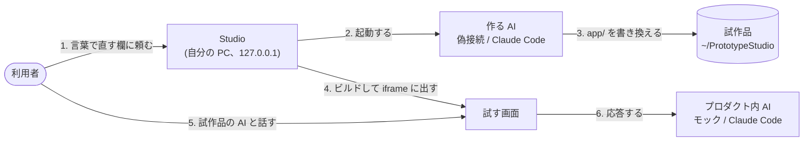

# agent-prototype-studio

**AI プロダクトの試作品を言葉で作り、ブラウザで触って、モックと実モデルの両方で試す。**

社内の企画担当など、エンジニアでない人のためのローカルのツールです。
試作品の画面も、試作品の中の AI の振る舞いも、「言葉で直す」欄に頼んで直せます。
良い状態になったら版として保存し、本番開発の担当者に引き継ぐフォルダーを書き出せます。

## しくみ



- AI は 2 つあります。作る AI は試作品のファイルを変えます。プロダクト内 AI は、試作品の中で利用者と話します
- 作る AI の既定は自動です。Claude Code が入っていてログインしていれば、Claude Code(実モデル)を使います。なければ言葉で直す欄は使えず、理由が出ます
- プロダクト内 AI の既定はモックで、料金はかかりません。偽接続(決まった依頼だけに反応する作る AI)は `STUDIO_AGENT=fake` で起動したときだけです
- 試作品は別ポートの `sandbox` つき iframe で動きます。作る AI が書けるのは、試作品の `app/` だけです([ADR 0001](docs/adr/0001-local-runtime-and-isolation.md))

## 特長

- **言葉で直す**: 画面も AI の振る舞い(`app/ai.json`)も、「言葉で直す」欄の依頼で変えられます
- **同じ発言で試し直す**: AI の設定を変えたら、前の会話を新しい設定で送り直し、前と今の応答を比べられます
- **モックと実モデル**: 同じ試作品のまま、モックと Claude Code を切り替えられます。モックはいつも同じ応答を返します
- **実行の記録**: AI に渡したもの、受け取ったもの、状態の変化、失敗の理由を、画面で読めます
- **版**: `app/` のファイルと会話と状態を保存し、いつでも戻せます。Studio を止めても残ります
- **引き継ぎ**: ソース、AI の設定、試した会話、何がモックで何が未接続か、目録、シナリオ、最新の証拠の要約を、1 つのフォルダーに書き出します
- **架空のデータで安全に**: サンプルは 3 つとも架空のデータです。秘密らしい文字列は記録と書き出しから伏せます

## はじめる

要るもの: Node.js 22 以上(`node --version` で確かめる)。言葉で直すには、Claude Code 2.1.248 以上とログインが要ります([docs/claude-code.md](docs/claude-code.md))。なくても、試す、版、引き継ぎは使えます。

```sh
npm install                # 初回だけ
npm run install:chromium   # 初回だけ。観察器が使う Playwright の Chromium(約 200 MB)を入れる
npm start                  # 既定のブラウザで Studio が開く
```

観察器は、試作品をヘッドレスのブラウザで動かして確かめる部品です。使うのは Playwright の Chromium だけで、利用者の Chrome や Edge は使いません。入れていないと、観察の結果は「未確認」になります([docs/troubleshooting.md](docs/troubleshooting.md))。

ブラウザが開かないときは、ターミナルに出た `http://127.0.0.1:4317/#token=…` を開きます。止めるときは Ctrl+C です。

実モデル(Claude Code)を使うときは、先に [docs/claude-code.md](docs/claude-code.md) の「先に確かめること」を読んでください。発言や設定が Anthropic に送られ、費用がかかります。

## 使い方

最初の 1 分の流れです。この流れは偽接続で試します。4 の試験用の依頼は、偽接続のときだけ出るためです。起動は `STUDIO_AGENT=fake npm start` です(Windows の書き方は [docs/usage.md の「手順」](docs/usage.md#手順))。偽接続はモデルを呼ばず、料金はかかりません。上の帯に「開発用: 偽の直す AI」と出ます。

1. 開くと、上の帯の「試作品: … ▾」で「求人相談(架空・AI と話せる)」が選ばれている。左が「試す」、右が「言葉で直す」
2. 「試す」の枠の中の欄に `カフェで働きたいです` と書いて送る。試作品の右の「希望条件」に、AI が理解した条件が出る
3. 違う条件は「希望条件」で直す。続けて話すと、AI は直した条件を踏まえて応答する
4. 上の帯の「その他」→「開発者向けの詳細」の「試験用の依頼」で `読み取れなかったときは例を出して聞き返すようにして` を押し、「言葉で直す」欄で送る。AI の設定が変わる
5. 「前の発言で試し直す」を押す。上の帯の「その他」→「開発者向けの詳細」の「試し直しの結果」で、前と今の応答を比べる
6. 良い状態になったら、上の帯の「保存」を押す

サンプルは 4 つあります。一覧の順に並べました。

| サンプル(一覧の名前) | 試せること |
|---|---|
| 求人相談(架空・AI と話せる) | 試作品の中の AI と話し、AI が理解した希望条件を確かめて直す。最初に開く |
| 学習相談(架空・AI と話せる) | 求人ではない題材で、同じ仕組みを使う |
| バイト探し(架空・AI と話せる) | 相手の会社のエージェント(模擬)がトークを回し、こちらのツールを呼ぶ形を、トーク風の画面で試す |
| 図書室(架空・AI なし) | 本を探す、借りる、登録する画面。作る AI で画面を変える |

版の戻し方、本番開発への引き継ぎ、実行の記録、画面の見方は [docs/usage.md](docs/usage.md) にあります。

画面から試作品を自動で確かめるときは、上の帯の「その他」の「試作品を自動で確かめる」を押します([docs/usage.md の「試作品を自動で確かめる」](docs/usage.md#試作品を自動で確かめる画面の確かめる))。ターミナルからは `npm run observe -- <プロジェクト>` を使います([docs/usage.md の「ターミナルで観察する」](docs/usage.md#ターミナルで観察するnpm-run-observe))。試作品の場面(`app/evals/`)を構成と前提を変えて回すときは `npm run evals -- <プロジェクト>` を使います([docs/usage.md の「場面を回す」](docs/usage.md#場面を回すnpm-run-evals))。

## ドキュメント

| はじめる・使う | 設定と困ったとき | 仕組みと決定 | 開発する |
|---|---|---|---|
| [usage.md](docs/usage.md) 使い方の全部 | [configuration.md](docs/configuration.md) 環境変数、`app/prototype.json`、`app/ai.json`、`app/composition.json`、データの置き場 | [architecture/hld.md](docs/architecture/hld.md) 部品とデータの流れ | [AGENTS.md](AGENTS.md) エージェント向けの入口 |
| [claude-code.md](docs/claude-code.md) 実モデル(Claude Code)を使う | [troubleshooting.md](docs/troubleshooting.md) うまくいかないとき | [prd.md](docs/prd.md) 何を作るか | [CONTRIBUTING.md](CONTRIBUTING.md) 書き方、置き場所、テスト |
| [handoff.md](docs/handoff.md) 引き継ぎの形(形式 2、仮) | | [ADR 0001](docs/adr/0001-local-runtime-and-isolation.md) ローカル実行と隔離の方式(仮採用) | |
| | | [design/ux-redesign.md](docs/design/ux-redesign.md) 初見で分かる画面の設計(設計。実装は別のカード) | |

## 開発

```sh
npm test            # 単体と結合のテスト(1 分ほど)
npm run test:e2e    # ブラウザの E2E(Playwright、全体でおよそ 3 分半)
```

どのテストも実モデルと外部の API を呼びません。テストの中身とコードの構成は [CONTRIBUTING.md](CONTRIBUTING.md) にあります。エージェントで作業するときは [AGENTS.md](AGENTS.md) を読んでください。
