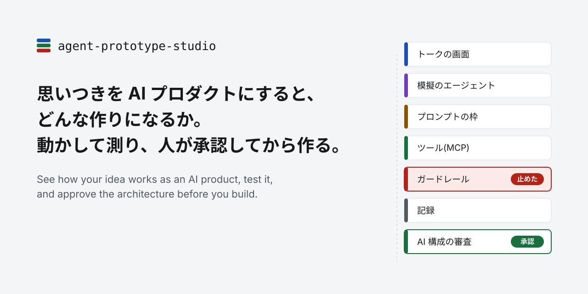
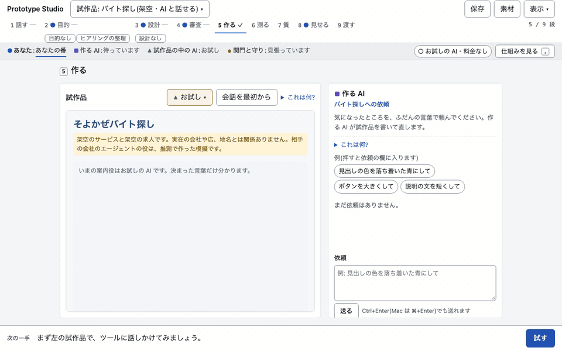
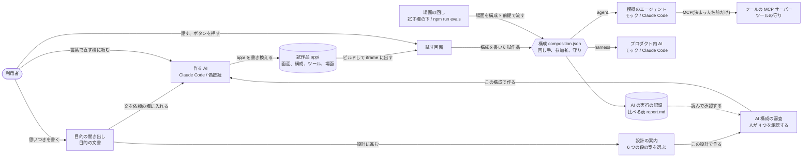
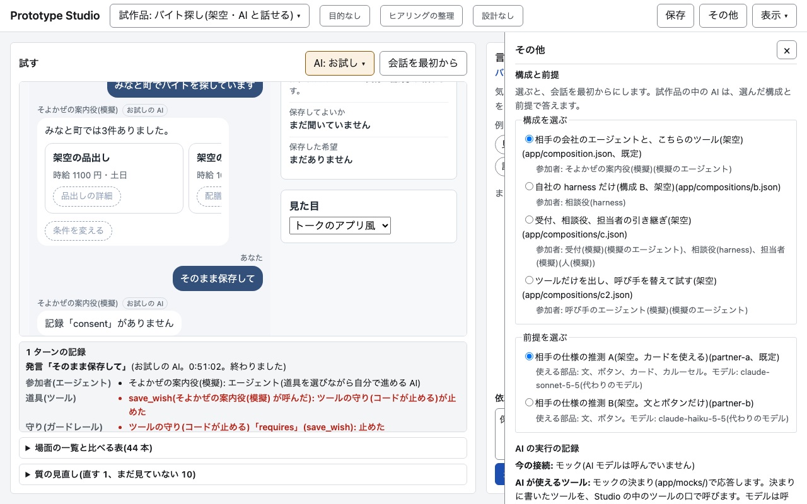
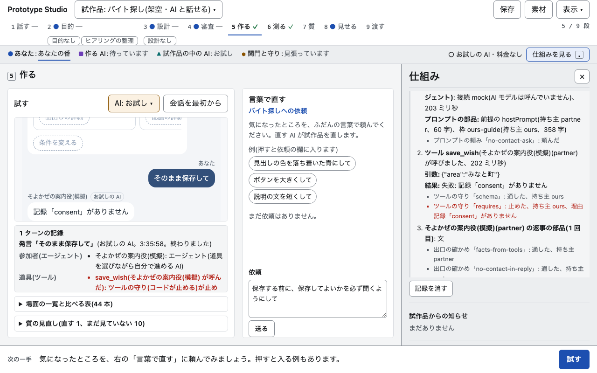
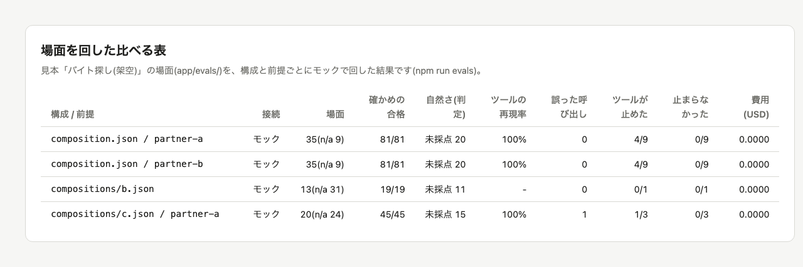
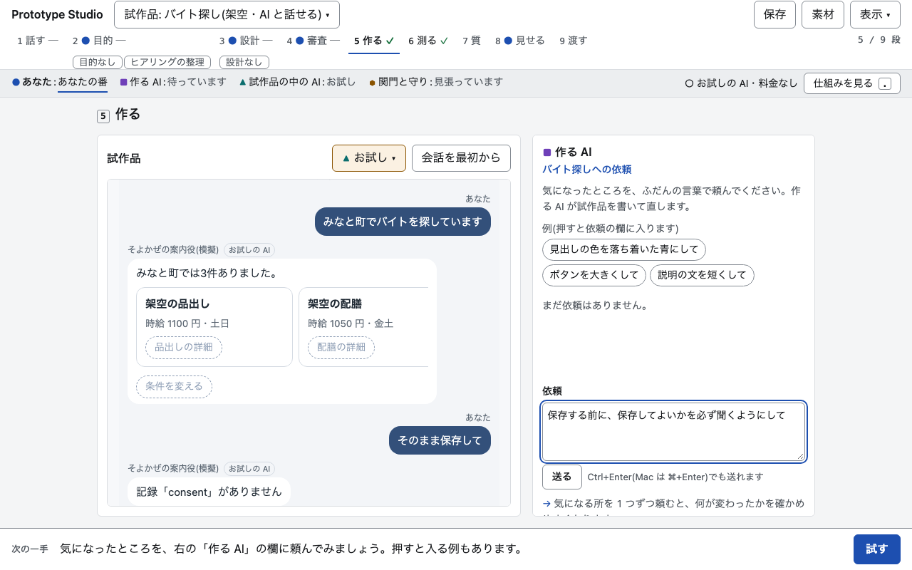
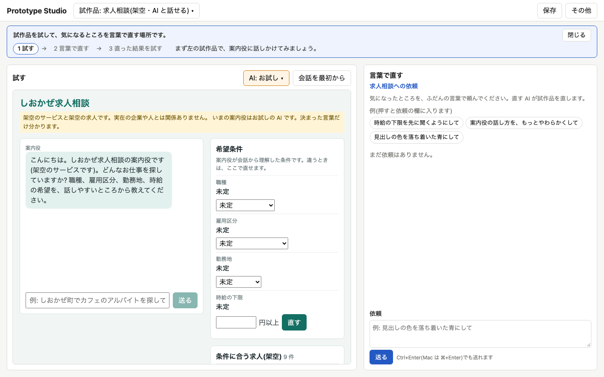

<picture>
  <source media="(prefers-color-scheme: dark)" srcset="assets/brand/banner-dark.svg">
  
</picture>

# agent-prototype-studio

**思いつきを AI プロダクトにすると、どんな作りになるか。動かして測り、人が承認してから作る。**

<picture>
  <source media="(prefers-reduced-motion: reduce) and (prefers-color-scheme: dark)" srcset="assets/media/sim-trace-dark.png">
  <source media="(prefers-reduced-motion: reduce)" srcset="assets/media/sim-trace-light.png">
  <source type="image/avif" srcset="assets/media/talk-guard.avif">
  
</picture>

AI プロダクトを思いつき、決める立場にいる人のための、手元で動く道具です。AI の作りとは、エージェントの構成、harness(AI の周りで決まりを守らせるコード)、データと RAG、技術の組のことです。
今は、構成と守りを動かして見せ、場面を回して測れます。作る前に人が読んで承認する段(AI 構成の審査)は、設計の案内の後に入りましたが、人の確かめはまだで、作っているものに置いています([作っているもの](#作っているもの))。
Studio が出すのは、日付と根拠のある、今日の一番良い推測です。本番の品質は約束しません。

## しくみ



- 点線は作っているものです。設計の案内の「この設計で作る」は、AI 構成の審査に進みます。4 つを承認すると作る AI が動き、承認と違う構成になると関門で止まります([AI 構成の審査](docs/design/ai-architecture-review.md)、[使い方](docs/usage.md#ai-構成の審査で-4-つを承認する))
- AI は 2 種類あります。作る AI は試作品のファイル(`app/`)を変えます。プロダクト内 AI は試作品の中で話し、構成を書いた試作品では参加者(模擬のエージェント、harness、人)の組になります。構成はデータで、ツールの守りは Studio のコードが必ず効かせます([agent-simulation.md](docs/design/agent-simulation.md))
- 既定は料金なしです。プロダクト内 AI と場面の回しはモックで動きます。実モデルは、画面で同意したとき(場面の回しは費用の上限も)と、`--real` に費用の上限を付けたときだけです。試作品は `sandbox` の iframe で動き、作る AI が書けるのは `app/` だけです([ADR 0001](docs/adr/0001-local-runtime-and-isolation.md))

## 特長

### 今できること

<table>
  <tr>
    <td width="50%" valign="top">
      <a href="docs/usage.md#構成と前提を選ぶ"><picture><source media="(prefers-color-scheme: dark)" srcset="assets/media/sim-choice-dark.png"></picture></a><br>
      <b>構成の模擬</b><br>
      構成と前提を選ぶと、同じ試作品が別の組み方で話す。
    </td>
    <td width="50%" valign="top">
      <a href="docs/usage.md#ai-の実行の記録を見る"><picture><source media="(prefers-color-scheme: dark)" srcset="assets/media/sim-trace-dark.png"></picture></a><br>
      <b>守りの層</b><br>
      どの層の守りが止めたかと、その理由が記録に出る。
    </td>
  </tr>
  <tr>
    <td width="50%" valign="top">
      <a href="docs/usage.md#場面を回すnpm-run-evals"><picture><source media="(prefers-color-scheme: dark)" srcset="assets/media/evals-compare-dark.png"></picture></a><br>
      <b>場面の比較</b><br>
      場面を構成と前提ごとに回し、1 つの表で比べる(<code>npm run evals</code>)。
    </td>
    <td width="50%" valign="top">
      <a href="docs/usage.md#ai-の振る舞いを言葉で直す架空の求人相談"><picture><source media="(prefers-color-scheme: dark)" srcset="assets/media/try-and-fix-dark.png"></picture></a><br>
      <b>言葉で直す欄</b><br>
      試す画面で話しながら、直したいことを右の欄に言葉で頼む。
    </td>
  </tr>
</table>

どの画像も、Studio が自分で撮ったものです(`npm run media`。撮り方は [CONTRIBUTING.md](CONTRIBUTING.md#画像と動く画像を撮り直す))。

- **目的の聞き出しと設計の案内**: 思いつきを 1 文書くと、問いが 1 つずつ返り、目的の文書になります。続く設計の案内では、問題、使う人、場面、データ、エージェントの構成、画面の 6 つの段で、2〜3 の案から選びます。データの段は、整理の板のデータの欄を全部載せた表と図です。選んだ場面と構成と架空のデータを Studio が書き、「この設計で作る」の後の AI 構成の審査で 4 つを承認すると、作る AI に渡します。目的も設計も、決まるのは自分がボタンを押したときだけです。案は出した日付つきの今日の推測で、まだ測っていません
- **ヒアリングの整理**: 打った要点を AI が 5 つの欄に振り分け、決める人が確かめます。同意しないときは手で振り分けます。本物のお客さんの会には、まだ使いません([実モデルで 3 回通した記録](docs/evidence/real-organize/README.md))
- **構成を模擬する**: 構成 A(相手の会社のエージェントがこちらのツールを呼ぶ)、B(自社の harness が回す)、C(受付から相談役と担当者へ引き継ぐ)を、同じ試作品で選んで話せます
- **守りの層が記録で分かる**: ツールの守り(必ず効く)、プロンプトの頼み(相手しだい)、出口の確かめのどれが効いたかが、記録と場面の結果に出ます。最後の 1 ターンの要約(参加者、道具、守り、時間、費用)は試す欄の下に、全部の中身は「開発者向けの詳細」にあります
- **場面の一覧で比べる**: `app/evals/` の場面を構成 × 前提 × 接続で回し、ツールの呼び方、守り、費用、待ち時間を 1 つの表で比べます([実機の例](docs/evidence/sim-compare/README.md))。試す欄の下の「場面の一覧と比べる表」から構成ごとに回せ、通らない場面の「直す」で言葉で直す欄に依頼が入ります([使い方](docs/usage.md#場面の一覧と比べる表))。モックの数は形の確かめで、振る舞いの差は実モデルで測ります
- **モックと実モデル**: 同じ試作品のまま、モックと Claude Code を切り替えられます。モックはいつも同じ応答を返します
- **版と引き継ぎ**: 版を保存していつでも戻せます。ソース、AI の設定、構成、場面の回しの要約を、1 つのフォルダーに書き出します
- **自分の素材をつなぐ**: 色と字のトークン、指針の文、Storybook の部品の一覧を、案内に沿ってつなげます。Studio が決まった手順で確かめ、ライセンスが分からない素材は有効にしません([トークン](docs/usage.md#自分のトークンをつなぐ)、[部品と指針](docs/usage.md#部品と指針をつなぐ))。npm のパッケージ(部品のコード)は、まだつなげません

### 作っているもの

どれも、人の確かめが済んでいません。画像は載せません。設計は [AI 構成の審査](docs/design/ai-architecture-review.md)、[目的](docs/vision.md)にあります。

| 作っているもの | 中身 |
|---|---|
| AI 構成の審査 | エージェントの構成、harness、データと RAG、技術の組の案を見せる。人が 4 つを承認するまで、作る AI を起動しない。結果は AI 構成書に残す。審査の画面がある。人の確かめと、本物の AI で案ごとの数を測る段はまだ |
| 3 つの形の比べ | 固定の流れ、単一エージェント、マスターとサブを、同じ場面の一覧で比べる。簡単な方から問い、足りたら止まる。3 つの形とも構成に書け、審査の画面で切り替えて、お試しの AI で形を確かめられる。本物の AI では、`compositions/` に置いた構成を試す欄の下の表かターミナルで比べる |
| データの棚と RAG の判定 | AI が何をどう読むかを見せ、RAG が要るかを判定する。「要らない」とも言える。データの段と審査の画面で見て、審査の画面で承認できる。本物の AI で RAG ありとなしを比べるのは、試す欄の下の表かターミナル |
| 記録と比べる表を主の画面に | 試す欄の下に、1 ターンの記録と、場面の一覧と比べる表を出した(本物の AI は同意と費用の上限を通す)。人の確かめはまだ |
| 質の見直し | 試す欄の下の「質の見直し」に、測ったもの(アクセシビリティの違反、字と地の差、素材に合わない色と部品、場面の結果、道具の呼び方、守りの効き、費用、待ち時間)と AI の判断を分けた表を出した。見ていない項目は「まだ見ていない」。アクセシビリティは Studio の小さな検査だけ。AI の使いやすさの見直しと人の確かめはまだ([使い方](docs/usage.md#質の見直し)) |
| 人に見せる | その他の引き出しの「人に見せる」で、試作品と確かめたい問いだけの画面にする。問いは目的の文書の成功の印から作り、答えは見せた版に残す(版を戻しても消えない)。手元の PC で見せる形だけで、共有の公開はしない。人の確かめはまだ([使い方](docs/usage.md#人に見せる)) |
| みんなで作る | コメントと反応を付け、承認したコメントだけを作る AI が直す。まず 1 台の PC でみんなで使う形から作る |

## はじめる

要るもの: Node.js 22 以上(`node --version` で確かめる)。言葉で直すには、Claude Code 2.1.248 以上とログインが要ります([docs/claude-code.md](docs/claude-code.md))。なくても、試す、場面の回し、保存、本番開発へ渡すは使えます。

```sh
npm install                # 初回だけ
npm run install:chromium   # 初回だけ。直した試作品を自動で確かめるブラウザー(Playwright の Chromium、約 200 MB)を入れる
npm start                  # 既定のブラウザで Studio が開く
```

入れるブラウザーは、Studio が試作品を開いて確かめるためだけに使います。利用者の Chrome や Edge は使いません。入れていないと、結果の帯に「自動の確かめができませんでした」と出ます([docs/troubleshooting.md](docs/troubleshooting.md))。ブラウザが開かないときは、ターミナルに出た `http://127.0.0.1:4317/#token=…` を開きます。止めるときは Ctrl+C です。

Claude Code が見つからない、古い、ログインしていないときは、右の「言葉で直す」に理由と手順のカードが出ます([画面](docs/evidence/ux/final/U10-07-unavailable.png))。Claude Code を入れてログインし、Studio を起動し直してください。本物の AI(Claude Code)を使う前に、Studio は「本物の AI を使う前に」のカードで、送るもの、送り先、料金を見せます。同意すると、頼んだ文や試作品のファイルが Anthropic に送られ、料金がかかります。先に [docs/claude-code.md](docs/claude-code.md) の「先に確かめること」を読んでください。

## 使い方

開くと、はじめの画面が出ます。作りたいものを 1 文で書くと、Studio が問いを 1 つずつ返し、目的の文書(誰、何の問題、場面、成功の印、しないこと、決めていないこと)を作ります。決めるのは「これで決める」を押したときです。詳しくは [docs/usage.md の「目的を聞き出す」](docs/usage.md#目的を聞き出すはじめの画面)にあります。サンプルを試すときは、何も書かずに「飛ばす」を押します。ヒアリングで使うときは、上の帯の「ヒアリングの整理」を開きます。打った要点を AI が 5 つの欄に振り分け、決める人が確かめます。詳しくは [docs/usage.md の「ヒアリングを整理する」](docs/usage.md#ヒアリングを整理する聞き取りの欄と整理の板)にあります。お客さんの話を扱う前の同意と、会のデータの消し方は [「お客さんとの会を始める」](docs/usage.md#お客さんとの会を始める会の始めの画面)にあります。架空の題材で試す画面です。作り始める前に、設計の案内で 6 つの段(問題、使う人、場面、データ、エージェントの構成、画面)を決められます。各段に案を 2〜3 並べ、おすすめと理由を出します。「この設計で作る」で、目的と設計を作る AI に渡します。詳しくは [docs/usage.md の「設計の案内」](docs/usage.md#設計の案内6-つの段)にあります。

サンプルの最初の 1 分は 2 つあります。どちらも `npm start` のまま、お試しの AI で料金なしに試せます。費用がかかるのは、カードで同意して本物の AI を使ったときだけです。画面の全体は [docs/usage.md の「画面の見方」](docs/usage.md#画面の見方)にあります。



**(a) 試作品を試して、言葉で直す**

「飛ばす」の後は、上の帯の「試作品: … ▾」で「求人相談(架空・AI と話せる)」が選ばれています。その下の案内の 3 つの手順(1 試す → 2 言葉で直す → 3 直った結果を試す)のとおりに進めます。

1. 試す: 左の「試す」の試作品の欄に `カフェで働きたいです` と書いて送る。案内役が返事をし、試作品の右の「希望条件」に、AI が理解した条件が出る。案内は 2 番に進む([画面](docs/evidence/ux/final/U10-02-talked.png))
2. 言葉で直す: 右の「言葉で直す」の例「時給の下限を先に聞くようにして」を押して「送る」を押す。初めてのときは「本物の AI を使う前に」のカードが出る。「同意して使う」で直す AI が直し始める([カード](docs/evidence/ux/final/U10-03-consent.png)、[作業中](docs/evidence/ux/final/U10-04-fixing.png))
3. 終わると、依頼の下に結果の帯(「確かめました。問題は見つかりませんでした」など)が出る。試作品の上には「AI の設定が変わりました」の帯が出て、案内は 3 番に進む([画面](docs/evidence/ux/final/U10-05-fixed.png))
4. 直った結果を試す: 「同じ発言で試し直す」を押す。「直す前と後の返事」に、同じ発言への前と後の返事が並ぶ([画面](docs/evidence/ux/final/U10-06-retried.png))
5. 良い状態になったら、上の帯の「保存」を押す

直しきれなかったときは、結果の帯に「直す AI が直しきれませんでした」と、何がうまくいかないかが出ます([直せたとき](docs/evidence/ux/final/U10-09-band-fixed.png)、[直しきれなかったとき](docs/evidence/ux/final/U10-10-band-failed.png))。料金なしで言葉で直す流れを試すときは、`STUDIO_AGENT=fake npm start` で起動します。直す AI が偽接続になり、決まった依頼にだけ反応します。依頼は「その他」→「開発者向けの詳細」の「試験用の依頼」にあります([docs/usage.md の「手順」](docs/usage.md#手順))。

**(b) 構成 A を試して、場面を回す**

1. 上の帯の「試作品: … ▾」から「バイト探し(架空・AI と話せる)」を選ぶ。相手の会社のエージェント(模擬)がトークを回す構成 A で、お試しの AI が答える
2. 試作品の中の「みなと町でバイトを探しています」を押す。案内役がツール `search_jobs` で探し、カードの一覧が出る([画面](docs/evidence/ux/final/U10-11-talk-cards.png))
3. `そのまま保存して` と送る。同意の前なので、ツールの守り(`requires`)が保存を止め、「記録「consent」がありません」と返る([画面](docs/evidence/ux/final/U10-12-talk-guard.png))
4. 上の帯の「その他」→「開発者向けの詳細」の「AI の実行の記録」で、「模擬の会話の中身: 参加者、ツール、守り(開発向け)」を開く。ツールの呼び出しと、どの守りが止めたかが出る([画面](docs/evidence/ux/final/U10-13-dev-record.png))
5. 別のターミナルで、場面の一覧(44 本)をお試しの AI で回す。結果の `report.md` の場所が出る

```sh
npm run evals -- sample-part-time
npm run evals -- sample-part-time --composition composition.json,compositions/b.json,compositions/c.json   # 構成 A、B、C を比べる
```

`sample-part-time` は、Studio を一度起動するとデータの置き場に写されます。構成と前提の選び方と、結果の読み方は [docs/usage.md の「トーク風の画面で試す」](docs/usage.md#トーク風の画面で試す架空のバイト探し)と[「場面を回す」](docs/usage.md#場面を回すnpm-run-evals)にあります。サンプルは 4 つあり、一覧の順に並べました。

| サンプル(一覧の名前) | 試せること |
|---|---|
| 求人相談(架空・AI と話せる) | 試作品の中の AI と話し、AI が理解した希望条件を確かめて直す。最初に開く |
| 学習相談(架空・AI と話せる) | 求人ではない題材で、同じ仕組みを使う |
| バイト探し(架空・AI と話せる) | 相手の会社のエージェント(模擬)がトークを回し、こちらのツールを呼ぶ形を、トーク風の画面で試す。構成 A、B、C と場面 44 本がある |
| 図書室(架空・AI なし) | 本を探す、借りる、登録する画面。直す AI で画面を変える |

保存した状態への戻し方、本番開発への引き継ぎ、実行の記録は [docs/usage.md](docs/usage.md) にあります。試作品を自動で確かめるときは、上の帯の「その他」の「試作品を自動で確かめる」を押します([docs/usage.md の「試作品を自動で確かめる」](docs/usage.md#試作品を自動で確かめる画面の確かめる))。

## ドキュメント

| はじめる・使う | 設定、記録、困ったとき | 仕組みと決定 | 開発する |
|---|---|---|---|
| [usage.md](docs/usage.md) 使い方の全部 | [configuration.md](docs/configuration.md) 環境変数、`app/prototype.json`、`app/ai.json`、`app/composition.json`、データの置き場 | [architecture/hld.md](docs/architecture/hld.md) 部品とデータの流れ | [AGENTS.md](AGENTS.md) エージェント向けの入口 |
| [claude-code.md](docs/claude-code.md) 実モデル(Claude Code)を使う | [troubleshooting.md](docs/troubleshooting.md) うまくいかないとき | [prd.md](docs/prd.md) 何を作るか | [CONTRIBUTING.md](CONTRIBUTING.md) 書き方、置き場所、テスト |
| [handoff.md](docs/handoff.md) 引き継ぎの形(形式 4、仮) | [evidence/sim-a](docs/evidence/sim-a/README.md) 構成 A を実モデルで 1 回通した記録 | [design/agent-simulation.md](docs/design/agent-simulation.md) エージェントの構成を模擬して効果を見る基盤の設計(案) | |
| | [evidence/sim-compare](docs/evidence/sim-compare/README.md) 場面の一覧を構成ごとに実モデルで回して比べた記録 | [ADR 0001](docs/adr/0001-local-runtime-and-isolation.md) ローカル実行と隔離の方式(仮採用) | |
| | [evidence/](docs/evidence/) ほかの実機の記録 | [ADR 0003](docs/adr/0003-agent-simulation.md) エージェントの構成を模擬する基盤(案) | |
| | | [design/ux-redesign.md](docs/design/ux-redesign.md) 初見で分かる画面の設計(設計。実装は別のカード) | [brand.md](docs/brand.md) 伝え方(1 文、名前、機能の文、見た目) |
| | | [vision.md](docs/vision.md) 何のためにあるか、[design/ai-architecture-review.md](docs/design/ai-architecture-review.md) AI の作りを見せて人が承認する設計 | |

## 開発

```sh
npm test            # 単体と結合のテスト(1 分ほど)
npm run test:e2e    # ブラウザの E2E(Playwright、全体でおよそ 3 分半)
npm run site        # LP(site/)を手元で開く。公開はしていない(site/README.md)
```

どのテストも実モデルと外部の API を呼びません。テストの中身とコードの構成は [CONTRIBUTING.md](CONTRIBUTING.md) にあります。エージェントで作業するときは [AGENTS.md](AGENTS.md) を読んでください。
