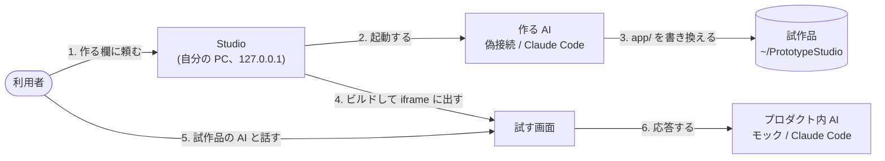

# agent-prototype-studio

**AI プロダクトの試作品を言葉で作り、ブラウザで触って、モックと実モデルの両方で試す。**

社内の企画担当など、エンジニアでない人のためのローカルのツールです。
試作品の画面も、試作品の中の AI の振る舞いも、「作る」欄に言葉で頼んで直せます。
良い状態になったら版として保存し、本番開発の担当者に引き継ぐフォルダーを書き出せます。

## しくみ



- AI は 2 つあります。作る AI は試作品のファイルを変えます。プロダクト内 AI は、試作品の中で利用者と話します
- 既定では、どちらもモデルを呼びません。作る AI は偽接続、プロダクト内 AI はモックで、料金はかかりません
- 試作品は別ポートの `sandbox` つき iframe で動きます。作る AI が書けるのは、試作品の `app/` だけです([ADR 0001](docs/adr/0001-local-runtime-and-isolation.md))

## 特長

- **言葉で直す**: 画面も AI の振る舞い(`app/ai.json`)も、「作る」欄の依頼で変えられます
- **同じ発言で試し直す**: AI の設定を変えたら、前の会話を新しい設定で送り直し、前と今の応答を比べられます
- **モックと実モデル**: 同じ試作品のまま、モックと Claude Code を切り替えられます。モックはいつも同じ応答を返します
- **実行の記録**: AI に渡したもの、受け取ったもの、状態の変化、失敗の理由を、画面で読めます
- **版**: `app/` のファイルと会話と状態を保存し、いつでも戻せます。Studio を止めても残ります
- **引き継ぎ**: ソース、AI の設定、試した会話、何がモックで何が未接続かを、1 つのフォルダーに書き出します
- **架空のデータで安全に**: サンプルは 3 つとも架空のデータです。秘密らしい文字列は記録と書き出しから伏せます

## はじめる

要るもの: Node.js 22 以上(`node --version` で確かめる)。偽接続とモックで試すだけなら、Claude Code は要りません。

```sh
npm install   # 初回だけ
npm start     # 既定のブラウザで Studio が開く
```

ブラウザが開かないときは、ターミナルに出た `http://127.0.0.1:4317/#token=…` を開きます。止めるときは Ctrl+C です。

実モデル(Claude Code)を使うときは、先に [docs/claude-code.md](docs/claude-code.md) の「先に確かめること」を読んでください。発言や設定が Anthropic に送られ、費用がかかります。

## 使い方

最初の 1 分の流れです。

1. 左の「試作品」から「サンプル: 架空の求人相談(プロダクト内 AI)」を選ぶ
2. 「試す」の枠の中の欄に `カフェで働きたいです` と書いて送る。試作品の右の「希望条件」に、AI が理解した条件が出る
3. 違う条件は「希望条件」で直す。続けて話すと、AI は直した条件を踏まえて応答する
4. 「作る」欄の下の例 `読み取れなかったときは例を出して聞き返すようにして` を押して送る。AI の設定が変わる
5. 「前の発言で試し直す」を押す。右の「詳細」の「試し直しの結果」で、前と今の応答を比べる
6. 良い状態になったら、右の「詳細」の「版」で「今の作業中を保存」を押す

サンプルは 3 つあります。

| サンプル | 試せること |
|---|---|
| 架空の図書室 | 本を探す、借りる、登録する画面。作る AI で画面を変える |
| 架空の求人相談 | 試作品の中の AI と話し、AI が理解した希望条件を確かめて直す |
| 架空の学習相談 | 求人ではない題材で、同じ仕組みを使う |

版の戻し方、本番開発への引き継ぎ、実行の記録、画面の見方は [docs/usage.md](docs/usage.md) にあります。

## ドキュメント

| はじめる・使う | 設定と困ったとき | 仕組みと決定 | 開発する |
|---|---|---|---|
| [usage.md](docs/usage.md) 使い方の全部 | [configuration.md](docs/configuration.md) 環境変数、`app/ai.json`、データの置き場 | [architecture/hld.md](docs/architecture/hld.md) 部品とデータの流れ | [AGENTS.md](AGENTS.md) エージェント向けの入口 |
| [claude-code.md](docs/claude-code.md) 実モデル(Claude Code)を使う | [troubleshooting.md](docs/troubleshooting.md) うまくいかないとき | [prd.md](docs/prd.md) 何を作るか | [CONTRIBUTING.md](CONTRIBUTING.md) 書き方、置き場所、テスト |
| [handoff.md](docs/handoff.md) 引き継ぎの形(形式 1、仮) | | [ADR 0001](docs/adr/0001-local-runtime-and-isolation.md) ローカル実行と隔離の方式(仮採用) | |
| | | [design/ux-redesign.md](docs/design/ux-redesign.md) 初見で分かる画面の設計(設計。実装は別のカード) | |

## 開発

```sh
npm test            # 単体と結合のテスト(数秒)
npm run test:e2e    # ブラウザの E2E(Playwright、1 分以内)
```

どのテストも実モデルと外部の API を呼びません。テストの中身とコードの構成は [CONTRIBUTING.md](CONTRIBUTING.md) にあります。エージェントで作業するときは [AGENTS.md](AGENTS.md) を読んでください。
