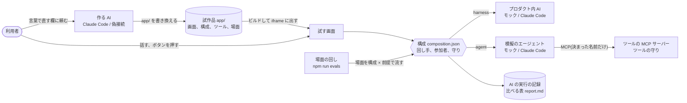

# agent-prototype-studio

**AI エージェントの試作品を、作る前に、構成ごと手元で試して測る。**

社内の企画担当など、エンジニアでない人のためのローカルのツールです。
構成とは、誰が会話を回し、誰がどのツールを持ち、守りをどこに置くかです。その構成で、会話、ツールの呼び方、守りがどう効くかが分かります。
言葉で画面の試作品を作る道具(GitHub の Replica など)とは、試作品の中の AI とエージェントの構成を模擬して測れる点が違います。

## しくみ



- AI は 2 種類あります。作る AI は試作品のファイル(`app/`)を変えます。プロダクト内 AI は試作品の中で話し、構成を書いた試作品では参加者(模擬のエージェント、harness、人)の組になります
- 構成はデータです。`app/composition.json` に回し手と参加者と守りを、`app/tools.json` にツールを書きます。Studio のコード(ツールの口)が、ツールの守りを必ず効かせます([agent-simulation.md](docs/design/agent-simulation.md))
- 既定は料金なしです。プロダクト内 AI と場面の回しはモックで動きます。実モデルは、画面で同意したときと、`--real` に費用の上限を付けたときだけです。試作品は `sandbox` の iframe で動き、作る AI が書けるのは `app/` だけです([ADR 0001](docs/adr/0001-local-runtime-and-isolation.md))

## 特長

- **言葉で直す**: 画面も AI の振る舞いも「言葉で直す」欄で変え、同じ発言で試し直して前と後を比べられます
- **構成を模擬する**: 構成 A(相手の会社のエージェントがこちらのツールを呼ぶ)、B(自社の harness が回す)、C(受付から相談役と担当者へ引き継ぐ)を、同じ試作品で選んで話せます
- **場面の一覧で比べる**: `app/evals/` の場面を構成 × 前提 × 接続で回し、ツールの呼び方、守り、費用、待ち時間を 1 つの表で比べます([実機の例](docs/evidence/sim-compare/README.md))
- **守りの層が記録で分かる**: ツールの守り(必ず効く)、プロンプトの頼み(相手しだい)、出口の確かめのどれが効いたかが、記録と場面の結果に出ます
- **データだけで流用できる**: 新しい構成とツールは `app/` のデータで足します。構成 C と C2 は、Studio のコードを変えずに足しました
- **モックと実モデル**: 同じ試作品のまま、モックと Claude Code を切り替えられます。モックはいつも同じ応答を返します
- **版と引き継ぎ**: 版を保存していつでも戻せます。ソース、AI の設定、構成、場面の回しの要約を、1 つのフォルダーに書き出します

## はじめる

要るもの: Node.js 22 以上(`node --version` で確かめる)。言葉で直すには、Claude Code 2.1.248 以上とログインが要ります([docs/claude-code.md](docs/claude-code.md))。なくても、試す、場面の回し、版、引き継ぎは使えます。

```sh
npm install                # 初回だけ
npm run install:chromium   # 初回だけ。観察器が使う Playwright の Chromium(約 200 MB)を入れる
npm start                  # 既定のブラウザで Studio が開く
```

観察器は、試作品をヘッドレスのブラウザで動かして確かめる部品です。使うのは Playwright の Chromium だけで、利用者の Chrome や Edge は使いません。入れていないと、観察の結果は「未確認」になります([docs/troubleshooting.md](docs/troubleshooting.md))。

ブラウザが開かないときは、ターミナルに出た `http://127.0.0.1:4317/#token=…` を開きます。止めるときは Ctrl+C です。

実モデル(Claude Code)を使うときは、先に [docs/claude-code.md](docs/claude-code.md) の「先に確かめること」を読んでください。発言や設定が Anthropic に送られ、費用がかかります。

## 使い方

最初の 1 分は 2 つあります。どちらも `npm start` のまま、モックで料金なしに試せます。費用がかかるのは、画面で本物の AI に同意して使ったときだけです。

**(a) 試作品を触って直す**

1. 開くと、上の帯の「試作品: … ▾」で「求人相談(架空・AI と話せる)」が選ばれている。左が「試す」、右が「言葉で直す」
2. 「試す」の枠の中の欄に `カフェで働きたいです` と書いて送る。試作品の右の「希望条件」に、AI が理解した条件が出る
3. 違う条件は「希望条件」で直す。続けて話すと、AI は直した条件を踏まえて応答する
4. 画面や AI の振る舞いを変えるときは、「言葉で直す」欄に頼む。初めて送るときに「本物の AI を使う前に」のカードが出る。同意すると Claude Code で直し、費用がかかる
5. 良い状態になったら、上の帯の「保存」を押す

料金なしで言葉で直す流れを試すときは、`STUDIO_AGENT=fake npm start` で起動します。作る AI が偽接続になり、決まった依頼にだけ反応します。依頼は「その他」→「開発者向けの詳細」の「試験用の依頼」にあります([docs/usage.md の「手順」](docs/usage.md#手順))。

**(b) 構成 A を試して、場面を回す**

1. 上の帯の「試作品: … ▾」から「バイト探し(架空・AI と話せる)」を選ぶ。相手の会社のエージェント(模擬)がトークを回す構成 A で、既定はお試しの AI(モック)が答える
2. 「みなと町でバイトを探しています」を押す。案内役がツール `search_jobs` で探し、カードの一覧が出る
3. `そのまま保存して` と送る。同意の前なので、ツールの守り(`requires`)が保存を止め、「記録「consent」がありません」と返る
4. 「その他」→「開発者向けの詳細」の「AI の実行の記録」で、「模擬の会話の中身: 参加者、ツール、守り(開発向け)」を開く。ツールの呼び出しと、どの守りが止めたかが出る
5. 別のターミナルで、場面の一覧(37 本)をモックで回す。結果の `report.md` の場所が出る

```sh
npm run evals -- sample-part-time
npm run evals -- sample-part-time --composition composition.json,compositions/b.json,compositions/c.json   # 構成 A、B、C を比べる
```

`sample-part-time` は、Studio を一度起動するとデータの置き場に写されます。構成と前提の選び方と、結果の読み方は [docs/usage.md の「トーク風の画面で試す」](docs/usage.md#トーク風の画面で試す架空のバイト探し)と[「場面を回す」](docs/usage.md#場面を回すnpm-run-evals)にあります。

サンプルは 4 つあります。一覧の順に並べました。

| サンプル(一覧の名前) | 試せること |
|---|---|
| 求人相談(架空・AI と話せる) | 試作品の中の AI と話し、AI が理解した希望条件を確かめて直す。最初に開く |
| 学習相談(架空・AI と話せる) | 求人ではない題材で、同じ仕組みを使う |
| バイト探し(架空・AI と話せる) | 相手の会社のエージェント(模擬)がトークを回し、こちらのツールを呼ぶ形を、トーク風の画面で試す。構成 A、B、C と場面 37 本がある |
| 図書室(架空・AI なし) | 本を探す、借りる、登録する画面。作る AI で画面を変える |

版の戻し方、本番開発への引き継ぎ、実行の記録、画面の見方は [docs/usage.md](docs/usage.md) にあります。試作品を自動で確かめるときは、上の帯の「その他」の「試作品を自動で確かめる」を押します([docs/usage.md の「試作品を自動で確かめる」](docs/usage.md#試作品を自動で確かめる画面の確かめる))。

## ドキュメント

| はじめる・使う | 設定、記録、困ったとき | 仕組みと決定 | 開発する |
|---|---|---|---|
| [usage.md](docs/usage.md) 使い方の全部 | [configuration.md](docs/configuration.md) 環境変数、`app/prototype.json`、`app/ai.json`、`app/composition.json`、データの置き場 | [architecture/hld.md](docs/architecture/hld.md) 部品とデータの流れ | [AGENTS.md](AGENTS.md) エージェント向けの入口 |
| [claude-code.md](docs/claude-code.md) 実モデル(Claude Code)を使う | [troubleshooting.md](docs/troubleshooting.md) うまくいかないとき | [prd.md](docs/prd.md) 何を作るか | [CONTRIBUTING.md](CONTRIBUTING.md) 書き方、置き場所、テスト |
| [handoff.md](docs/handoff.md) 引き継ぎの形(形式 3、仮) | [evidence/sim-a](docs/evidence/sim-a/README.md) 構成 A を実モデルで 1 回通した記録 | [design/agent-simulation.md](docs/design/agent-simulation.md) エージェントの構成を模擬して効果を見る基盤の設計(案) | |
| | [evidence/sim-compare](docs/evidence/sim-compare/README.md) 場面の一覧を構成ごとに実モデルで回して比べた記録 | [ADR 0001](docs/adr/0001-local-runtime-and-isolation.md) ローカル実行と隔離の方式(仮採用) | |
| | [evidence/](docs/evidence/) ほかの実機の記録 | [ADR 0003](docs/adr/0003-agent-simulation.md) エージェントの構成を模擬する基盤(案) | |
| | | [design/ux-redesign.md](docs/design/ux-redesign.md) 初見で分かる画面の設計(設計。実装は別のカード) | [brand.md](docs/brand.md) 伝え方(1 文、名前、機能の文、見た目) |

## 開発

```sh
npm test            # 単体と結合のテスト(1 分ほど)
npm run test:e2e    # ブラウザの E2E(Playwright、全体でおよそ 3 分半)
npm run site        # LP(site/)を手元で開く。公開はしていない(site/README.md)
```

どのテストも実モデルと外部の API を呼びません。テストの中身とコードの構成は [CONTRIBUTING.md](CONTRIBUTING.md) にあります。エージェントで作業するときは [AGENTS.md](AGENTS.md) を読んでください。
