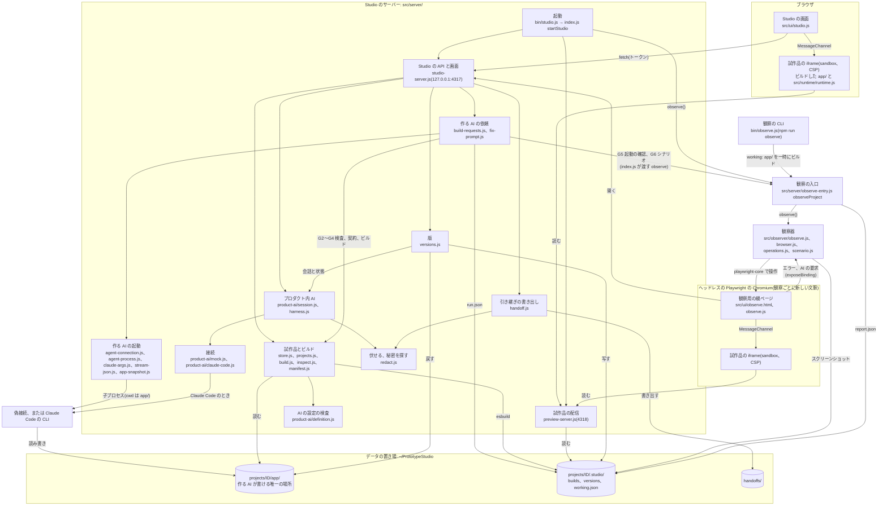

# HLD: Prototype Studio の全体設計

Prototype Studio が何でできていて、データがどこを流れるかの全体図です。今のコード(`src/`、`bin/`)から書きました。新しい機能を考えるときは、まずこの図のどこに手を入れるかを決めます。

- なぜこの作りなのか(隔離の 3 つの層、作る AI の起動のしかた)は [ADR 0001](../adr/0001-local-runtime-and-isolation.md) に書きます。ここでは繰り返しません
- 画面の設計し直しは [docs/design/ux-redesign.md](../design/ux-redesign.md) にあります。この HLD は、今の画面のまま書いています
- 目的と範囲の元は [PRD](../prd.md) です
- 関数、ファイルの形式、守る約束を書く LLD は、まだありません。harness の作り直し(#293)の後で作ります

## 1. 目的と範囲

非エンジニアが、AI プロダクトの試作品を言葉で作り、ブラウザで触り、モックと実モデルの両方で試し、本番開発に引き継げるようにします。Studio は利用者の PC で動くローカルのサーバーです。

範囲外: サーバーの公開、複数人での共有、本番の AI の接続、本物のデータ。

## 2. システムの文脈

- Studio が持つ AI は 2 つです。作る AI は試作品のファイルを変えます。プロダクト内 AI は、試作品の中で利用者と話します
- 作る AI の既定は偽接続です。プロダクト内 AI の既定はモックです。どちらも、既定ではモデルを呼びません
- Studio は資格情報を読みません。Claude Code は、利用者が入れてログインした CLI を、改変せずに子プロセスとして起動します

## 3. 部品

| 部品 | ファイル | すること |
|---|---|---|
| 起動 | `bin/studio.js`、`src/server/index.js`、`src/server/config.js` | 環境変数を読み、サンプルを写し、途中で止まった復元を戻し、2 つのサーバーを loopback で待ち受ける。起動ごとのトークンを作る |
| Studio の API と画面 | `src/server/studio-server.js`、`src/server/security.js` | `/api/projects/...` の API と `src/ui/` の画面を出す。Host、Origin、トークンを確かめる |
| 試作品の配信 | `src/server/preview-server.js` | ビルドしたものを別ポートから CSP つきで出す。API はない |
| 試作品とビルド | `src/server/store.js`、`src/server/projects.js`、`src/server/build.js`、`src/server/inspect.js`、`src/server/manifest.js` | 試作品の一覧と置き場、`app/` と目録の検査、esbuild で 1 つの classic script に束ねる |
| 作る AI | `src/server/build-requests.js` ほか | 作る run を節の並び(blueprint)で回す。依頼を受け、CLI を起動し、出力を画面に流す。終わったら、関門 G1〜G6 を安い順に回す。失敗したら直す依頼(`fix-prompt.js`)を作って作る AI に返し、2 回まで直させる。`run.json` に残す |
| プロダクト内 AI | `src/server/product-ai/` | 試作品ごとの会話、状態、実行の記録を持つ。1 ターンは harness(`harness.js`)が抽出 → 決定 → 言い方で回し、何を聞くか、段の遷移、終わるかはコードが決める。接続はモックか Claude Code。`app/ai.json` を検査する |
| 版 | `src/server/versions.js` | `app/` と会話と状態を `.studio/versions/` に写す。復元する |
| 引き継ぎ | `src/server/handoff.js` | 作業中の試作品を `handoffs/` に書き出す。形は [handoff.md](../handoff.md) |
| 伏せる | `src/server/redact.js` | 記録と表示の前に、秘密らしい文字列と個人のデータを伏せる。書き出す前に秘密を探す |
| 偽接続 | `src/agent/fake-claude.js` | `claude -p` と同じ形の出力を出す偽の CLI。モデルを呼ばない |
| runtime | `src/runtime/runtime.js` | 試作品に配る。試作品のエラーを画面に知らせ、`window.studio.ai` を配る |
| 観察器 | `src/observer/observe.js`、`src/observer/browser.js` | 表示中のビルドをヘッドレスの Playwright の Chromium で開き、読み込み、エラー、スクリーンショット、シナリオの結果、最後の画面、合否を report で返す。ブラウザは Studio の中で 1 つ。観察は 1 つずつ、毎回新しい文脈で回す。文脈は観察用の親ページと観察するビルドにだけ要求を出せ、名前の解決は loopback だけ([ADR 0002](../adr/0002-observer-and-harness.md))。作る AI、画面、版、会話の実装は import しない。設計は [harness.md の 3](../design/harness.md#3-観察) |
| 観察の入口 | `src/server/observe-entry.js` | 観察を呼ぶ所が、どれも通る `observeProject`。同じ形の report を返す。モードは 2 つ。`shown` は Studio の表示中のビルドを見る。`working` は作業中の `app/` を一時フォルダーにビルドし、loopback の空いているポートに自分の試作品の配信と観察用の親ページを立てて見る。`working` の AI は、その観察だけのモックの会話。観察器は会話の実装を import しないので、入口は `src/server/` に置く |
| 観察の CLI | `bin/observe.js` | `npm run observe -- <プロジェクト>`。入口を `working` で呼び、結果をターミナルに出す。終了コードは `passed` で 0 |
| 観察器の操作とシナリオ | `src/observer/operations.js`、`src/observer/scenario.js` | 7 つの操作(読む、要素の一覧と検査、クリック、入力、スクロール、画面幅、スクリーンショット)と 4 つの確かめ。シナリオの手順と、1 つずつの呼び出し(`observe()` の `operate`)が同じ関数を使う。シナリオの形の検査、`app/scenarios/` の読み込み、Studio の基本のシナリオ([形](../configuration.md#シナリオappscenariosjson)) |
| 観察用の親ページ | `src/ui/observe.html`、`src/ui/observe.js` | Studio の `/observe.html` に置く静的なページ。試作品を同じ sandbox の iframe に入れ、エラーと AI の要求を `exposeBinding` で観察器に渡す。Studio の API は呼ばない(CSP の `connect-src 'none'`) |

## 4. データの流れ

### 作る(試作品を変える)

作る run は、コードで定義した節の並び(blueprint、`BLUEPRINT`)です。節には、モデルが判断する節(作る AI)と、決まった手順の節があります。決まった節は、作る AI の接続に触れません。設計は [harness.md の 2](../design/harness.md#2-作るループ)。

| 節 | 判断 | すること |
|---|---|---|
| 受け付け(`accept`) | コード | `BuildRequests.start` が依頼の形と上限、接続の問題を確かめる。1 つの試作品で動く依頼は 1 つだけ(`ProjectStore.claimRun`) |
| 前の指紋(`fingerprint`) | コード | `app/` の指紋(`snapshotApp`)と、表示中のプロダクト内 AI の設定を取る |
| 作る AI(`agent`) | モデル | `startAgentProcess` が偽接続か Claude Code を `app/` で起動する。引数は `buildClaudeArgs`、依頼は標準入力。stream-json を `readMessage` で項目に直して画面に流す。直すラウンドでも、引数、cwd、時間の上限、止め方は同じで、標準入力が直す依頼になるだけ |
| G1 変更の確認(`changes`) | コード | 指紋を取り直し、変わったファイルを出す。変わっていなければ、ここで終わる(`unchanged`)。直すラウンドで変わっていなければ、直せなかったとして `failed` で終わる |
| G2 検査、G3 契約、G4 ビルド(`inspect`、`contract`、`compile`) | コード | `ProjectStore.build` の 1 回の呼び出し。`buildApp` が誤りに段の名前を付けるので、どの関門で止まったかが分かる。G3 は目録、`ai.json`、目録が指すシナリオ(`readScenarios`)の形を検査し、シナリオの誤りはファイル、シナリオ、手順で返す。失敗したら、試す画面は前のビルドのまま |
| G5 起動の確認(`launch`) | コード | 新しいビルドを観察器で開く。基本のシナリオなしで、3 つの画面幅を撮る。読み込みが 15 秒以内に終わり、エラーと `console.error` がなく、画面が空でなければ通る。ビルドが失敗したら行わない |
| G6 シナリオ(`scenarios`) | コード | G5 が通ったら入る。`app/scenarios/` の各シナリオと、Studio の基本のシナリオを観察器で回す。プロダクト内 AI は、利用者が選んだ接続によらず、いつもモックの観察用の会話(`createObservationAi`)。時間の上限は 1 本 60 秒、関門の全体で 3 分。超えたら G6 の失敗。失敗したシナリオごとに、名前、失敗した手順、期待と実際、そのときの画面の文字を残す |
| 直す依頼(`fix`) | コード | G2〜G6 のどれかが失敗したら入る。直すラウンドが `MAX_FIX_ROUNDS`(2 回)に満たなければ、`buildFixPrompt`(`fix-prompt.js`)で直す依頼を作り、作る AI の節に戻る。満たしたら、失敗と証拠を人に返す |
| 証拠をまとめる(`evidence`) | コード | 結果の状態を決め、関門の結果を作る会話に出し、`.studio/runs/<run-id>/run.json` に残す |

1. 利用者が「作る」欄に依頼を書く。画面が `POST /api/projects/<id>/build-requests` を送る
2. `execute` が節を順に回す。どの節も次の節を返し、通った節を `run.nodes` に残す。関門は失敗した段で止まり、直す依頼の節へ進む
3. 直すラウンド: 直す依頼の節が、失敗を決まった型の文にして作る AI に返す。入れるのは、元の依頼、直前のラウンドで失敗した関門の名前と結果(8,000 文字まで。G6 はシナリオの名前、失敗した手順、期待と実際、そのときの画面の文字)、変わったファイルの名前だけ。前の会話や report の全部は入れない。作る AI が直したら、G1 から回し直す。作る AI の起動は 1 つの依頼で 3 回まで。依頼の前から同じ失敗が出ていたら、印(`preexisting`)を付ける
4. `app/ai.json` が変わってビルドが通ったら、前の設定との違いを会話に出す
5. ビルドが通ったら、画面が iframe を新しいビルドに切り替える。G5 か G6 で失敗しても切り替える(利用者が失敗を見られるように)。会話には「確かめで失敗あり」と出す
6. 観察器が使えない(Playwright の Chromium がない)ときは、G5 と G6 を「未確認」にする。通ったとは扱わない。直すラウンドにも進まない
7. 直すラウンドで `app/scenarios/`(目録のシナリオの置き場所)が変わったら、結果に「確かめ方が変わりました」と出し、`run.json` の `scenariosChanged` に印を残す。作る AI がシナリオを弱めて通すことを、人が見つけられるようにするため。基本のシナリオは `app/` の外にあり、作る AI は変えられない
8. 中断と時間切れは、直すラウンドの作る AI にも同じく効く。止めた run と、作る AI が失敗した run は、直させない。関門を回している間の中断は、今の関門を終えてから止め、次の直すラウンドに進まない

作る会話には、ラウンドの区切り(`round`)、直す依頼の要約(`fix-request`)、G6 の結果(`scenarios-ok`、`scenarios-failed`、`scenarios-unverified`)、確かめ方が変わった印(`scenarios-changed`)、人に返したこと(`gave-up`)、前からの失敗の印(`preexisting`)が項目として出ます。

結果の状態(`run.status`)は次のどれかです。

| 状態 | 意味 |
|---|---|
| `passed` | 最初のラウンドで、関門 G1〜G6 がすべて通った |
| `fixed` | 直すラウンドの後に、関門 G1〜G6 がすべて通った |
| `unverified` | ビルドは通ったが、観察器が使えず、起動かシナリオを確かめていない |
| `unchanged` | `app/` が変わらなかった |
| `failed` | 2 回の直すラウンドの後も、関門 G2〜G6 のどれかで失敗した。直すラウンドで `app/` が変わらなかったときも含む |
| `agent-failed`、`cancelled`、`timed-out` | 作る AI が失敗した、中断した、時間の上限を超えた。変わったファイルがあれば、G1〜G4 は回す |

`run.json` には、通った節の列(`nodes`。どの節にもラウンドの番号が付く)、最後のラウンドの関門の結果(`gates`)、ラウンドごとの節の列と関門の結果と直す依頼で返した失敗(`rounds`)、作る AI の起動の回数と時間(`agentLaunches`)、変わったファイル、直すラウンドで変わったシナリオ(`scenariosChanged`)、ビルドの結果、report の場所(`reports`)を書きます。依頼の文と直す依頼の文は書きません。G5 の report とスクリーンショットは `.studio/runs/<run-id>/rounds/<ラウンド>/` に、G6 のものはその下の `scenarios/` に置きます。

### 試す(試作品の中の AI と話す)

1. 試作品が `window.studio.ai.send(text)` を呼ぶ。runtime が `MessagePort` で親の画面に送る
2. 画面が `POST /api/projects/<id>/ai/messages` を送る
3. `AiSessions.send` が、上限を確かめてから、harness の `turn()`(`product-ai/harness.js`)に、選んでいる接続(モックか Claude Code)、設定、進み具合(段、ターン、終わったか)、状態、会話、発言を渡す。`turn()` は 1 ターンを 3 段で回す
   1. 抽出: 接続の `extract` が、項目の値(`updates`)と発言の種類(`intent`)を返す。選択肢の文字そのものや、今聞いている数の項目への数だけの答えは、抽出を呼ばずに読む。返った値は項目の決まりで検査し、合わない値は状態に入れない
   2. 決定: harness のコードが、状態の更新、段の遷移(`next[].when`)、次に聞く項目、言うこと、終わるか(`flow.maxTurns` を含む)を決める。本人の修正は、モデルを呼ばずに状態に入っていて、ここで `corrected` として渡る
   3. 言い方: 接続の `phrase` が、決定を返事の文にする。モックは `mock` の型に当てはめる
4. 返事と状態の変化と進み具合を会話に足す。実行の記録には、段ごとの中身(抽出の入出力、入れなかった値、決定とその理由、言い方の入出力)を伏せて残す。画面が `MessagePort` で試作品に返す

Claude Code の接続は、今は 1 回の呼び出し(`respond`)で返事と `updates` を返す。`updates` は抽出として同じ検査を通り、決定は harness が行う。返事はその呼び出しのものを使う(抽出と言い方の 2 つの呼び出しに分けるのは jyoka/tasks#308)。

接続の切り替え(`ai/connection`)、応答を止める(`ai/cancel`)、試し直し(`ai/retry`)は、Studio の画面からだけ呼べます。試作品からは呼べません。

観察の中の AI のやり取りは、この会話とは別の会話に入ります。`AiSessions` は会話を「プロジェクトと会話の ID」で分け、観察ごとに新しい会話(接続の既定はモック)を作り、観察が終わると捨てます。記録には「観察から」の印が付きます。

### 観察する(ヘッドレスのブラウザで試作品を動かす)

観察を呼ぶ所は、今は 3 つです。どれも観察の入口 `observeProject`(`src/server/observe-entry.js`)を通り、同じ形の report を返します(harness.md の S5)。

| 呼ぶ所 | 入口のモード | 見るもの | プロダクト内 AI | report とスクリーンショット |
|---|---|---|---|---|
| 作る run の関門 G5、G6(`build-requests.js` → `index.js` の `observeGate`) | `shown` | Studio の表示中のビルド | G5 は断る。G6 はいつもモックの観察用の会話 | `.studio/runs/<run-id>/rounds/<n>/` |
| Studio の `observe(<id>, { scenarios, viewports, ai, aiConnection, operate, limits })`(`index.js`) | `shown` | Studio の表示中のビルド | 渡した `ai` 関数か、`aiConnection` の観察用の会話 | `.studio/observations/<観察の ID>/` |
| CLI `npm run observe -- <プロジェクト>`(`bin/observe.js`) | `working` | 作業中の `app/` を一時フォルダーにビルドしたもの | いつもモック。実モデルは選べない | `.studio/observations/<観察の ID>/` |

後の作る AI の観察の道具(MCP サーバー、jyoka/tasks#311)は `working` で、画面の「確かめる」(P27)は `shown` で、同じ入口を呼ぶ。

1. 呼ぶ所が `observeProject({ projectDir, mode, ... })` を呼ぶ。`scenarios` を渡さなければ、目録の `scenarios` のフォルダー(既定は `app/scenarios/`)から読む。`aiConnection: 'mock'` で観察用の会話の `ai` 関数(`createObservationAi`)を作り、やり取りを report の `ai` に入れる。G5 はシナリオを回さず、基本のシナリオも回さない。G6 は目録のシナリオと基本のシナリオを回す。`outDir` を渡さなければ、`.studio/observations/<観察の ID>/` を新しく作り、`report.json` もそこに書く
   - `shown`: Studio が、表示中のビルドの結果と、Studio のプレビューの配信と `/observe.html` の URL を渡す
   - `working`: 入口が `app/` を `os.tmpdir()` の下にビルドし、loopback の空いているポートに試作品の配信(`preview-server.js`)と観察用の親ページ(`studio-server.js` の `createObserveHostHandler`。API とトークンはない)を立てる。プロジェクトの `.studio/builds/` と表示中のビルドには触れない。終わったら配信を止め、一時フォルダーを消す
2. ビルドに失敗していれば、ブラウザを開かずに `failed` を返す
3. `ObserverBrowser` が Playwright の Chromium を起動するか、起動したものを使い回す(Studio の中では 1 つを使い回す。CLI は観察ごとに起動して閉じる)。見つからなければ `unverified` と入れ方を返す
4. 新しい文脈で `/observe.html` を開き、試作品の URL を iframe で読む。runtime のエラー、`console.error`、処理されない reject は、`MessagePort` から親ページを通って観察器に届く。親ページと観察するビルドの外への要求は断ち、`blocked-request` のエラーにする
5. 15 秒で読み込みが終わらなければ時間切れのエラーにする。終われば、指定した画面幅ごとにスクリーンショットを `.studio/observations/<観察の ID>/` に撮る
6. Studio の基本のシナリオ(起動、AI のある試作品ではあいさつ)、渡されたシナリオの順に、手順どおりに回す。試作品の iframe の中を、役割と名前、ラベル、文字で指して操作する。失敗した手順で止め、そのときの画面を撮る。最後に画面の文字とアクセシビリティの木の要約、空でないかを report の `page` に入れる
7. 読み込みが終わり、エラーがなく、シナリオがすべて通れば `passed`、そうでなければ `failed` の report を返す。観察の全体の上限(`limits.observeTimeoutMs`)を超えたら、文脈ごと閉じて `unverified` を返す。形は [harness.md の 3.1](../design/harness.md#31-観察器の契約studio-の-drydock-に当たる)

### 版と引き継ぎ

- 保存: `ProjectVersions.save` が `app/` と、`AiSessions.snapshot` の会話と状態を写す
- 復元: `ProjectVersions.restore` が、作業中を自動で保存してから `app/` を戻してビルドし、`AiSessions.restore` で会話と状態を戻す
- 引き継ぎ: `ProjectHandoffs.export` が、作業中のソース、AI の設定、会話と状態、メモを `handoffs/<id>-<日時>/` に書き出す。秘密らしい文字列があれば書き出さない

## 5. 手元の状態

| 場所 | 中身 | 書くもの |
|---|---|---|
| `projects/<id>/app/` | 試作品のソースと `ai.json` | 作る AI、版の復元 |
| `projects/<id>/app/prototype.json` | 目録。入口、意図、制約、架空のデータ、AI の設定、シナリオの置き場所。ビルドのたびに検査する。なければ既定の値で読む([形](../configuration.md#試作品の目録appprototypejson)) | 作る AI、版の復元 |
| `projects/<id>/app/scenarios/` | シナリオ(`*.json`)。観察器が手順どおりに回す([形](../configuration.md#シナリオappscenariosjson)) | 作る AI、版の復元 |
| `projects/<id>/.studio/builds/` | ビルドの結果 | Studio |
| `projects/<id>/.studio/observations/<観察の ID>/` | 観察の report(`report.json`)とスクリーンショット(画面幅ごと、シナリオの手順、失敗したとき)。観察ごとに新しいフォルダー | 観察の入口、観察器 |
| `projects/<id>/.studio/runs/<run-id>/` | 作る run の記録(`run.json`)と、G5 と G6 の report とスクリーンショット。新しい 20 個だけ残す | Studio、観察器 |
| `projects/<id>/.studio/versions/`、`working.json` | 保存した版と、どの版から作業しているか | Studio |
| `projects/<id>/.studio/handoff-notes.json` | 引き継ぎのメモ | Studio |
| `handoffs/` | 引き継ぎの書き出し | Studio |
| Studio のメモリー | 作業中の会話と状態、実行の記録、作る欄の会話 | Studio(止めると消える) |

置き場の場所と変え方は [configuration.md](../configuration.md#データの置き場) にあります。

## 6. 外部の呼び出しと費用

| 呼び出し先 | いつ | 費用 |
|---|---|---|
| 偽接続(`src/agent/fake-claude.js`) | 作る AI の既定(`STUDIO_AGENT=fake`) | なし。モデルを呼ばない |
| モック(`product-ai/mock.js`) | プロダクト内 AI の既定 | なし。モデルを呼ばない |
| Claude Code の CLI(作る AI) | `STUDIO_AGENT=claude` で起動したとき | 本人のアカウントの枠か API の従量課金。1 回の起動は 10 分、30 回まで。直すラウンドを合わせて 1 つの依頼で 3 回まで起動する |
| Playwright の Chromium(観察器) | 観察するとき。`npm run install:chromium` で入れたもの | なし。モデルを呼ばない。AI の要求は、呼ぶ側が渡す関数に渡す |
| Claude Code の CLI(プロダクト内 AI) | `STUDIO_ALLOW_CLAUDE_CODE=1` で起動し、画面で切り替えたとき | 同上。1 回の応答は 90 秒、$0.1 まで。1 つの会話で 30 回まで |

詳しい決まりは [claude-code.md](../claude-code.md) にあります。テストは偽の CLI(`test/fixtures/fake-claude.js`)を使い、実モデルを呼びません。

## 7. 決定の記録

- [ADR 0001: ローカル実行と隔離の方式](../adr/0001-local-runtime-and-isolation.md)
- [ADR 0002: 観察器と harness](../adr/0002-observer-and-harness.md)(観察器のブラウザ、観察器の隔離、直すラウンドの回数)
- [初見で分かる画面の設計](../design/ux-redesign.md)
- [引き継ぎの形](../handoff.md)
