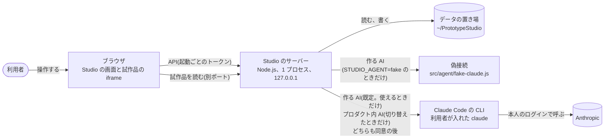

# HLD: Prototype Studio の全体設計

Prototype Studio が何でできていて、データがどこを流れるかの全体図です。今のコード(`src/`、`bin/`)から書きました。新しい機能を考えるときは、まずこの図のどこに手を入れるかを決めます。

- なぜこの作りなのか(隔離の 3 つの層、作る AI の起動のしかた)は [ADR 0001](../adr/0001-local-runtime-and-isolation.md) に書きます。ここでは繰り返しません
- 画面の設計し直しは [docs/design/ux-redesign.md](../design/ux-redesign.md) にあります。この HLD は、今の画面のまま書いています
- 目的と範囲の元は [PRD](../prd.md) です
- 関数、ファイルの形式、守る約束を書く LLD は、まだありません。harness の作り直し(#293)の後で作ります

## 1. 目的と範囲

非エンジニアが、AI プロダクトの試作品を言葉で作り、ブラウザで触り、モックと実モデルの両方で試し、本番開発に引き継げるようにします。Studio は利用者の PC で動くローカルのサーバーです。

範囲外: サーバーの公開、複数人での共有、本番の AI の接続、本物のデータ。

## 2. システムの文脈

- Studio が持つ AI は 2 つです。作る AI は試作品のファイルを変えます。プロダクト内 AI は、試作品の中で利用者と話します
- 作る AI の既定は自動です。起動のときに Claude Code が見つかり、版が足り、ログインしていれば、Claude Code を使います。そうでなければ、作る AI は使えない状態になり、言葉で直す欄に、何ができないかと使えるようにする手順のカードを出します(見出しは理由で変わる。理由の文は開発者向けの中だけ)。偽接続には落としません
- 偽接続は、`STUDIO_AGENT=fake` と書いたときだけ使います。プロダクト内 AI の既定はモックで、モデルを呼びません
- 本物の AI(Claude Code)は、使う前に画面で同意します。同意は 1 つで、作る AI の送信、プロダクト内 AI の切り替え、人の「確かめる」の全部に効きます。Studio のメモリーにだけ持ち、起動し直すと消えます
- ログインしているかは、Claude Code 自身に聞きます(`claude auth status --json`)。出力から使うのは、ログインしているか(`loggedIn`)と方式(`authMethod`)だけです。他の値(メールアドレスなど)は捨て、画面にも記録にも出しません
- Studio は資格情報を読みません。Claude Code は、利用者が入れてログインした CLI を、改変せずに子プロセスとして起動します

## 3. 部品

```mermaid
flowchart TB
    subgraph browser["ブラウザ"]
        ui["Studio の画面<br/>src/ui/studio.js"]
        frame["試作品の iframe(sandbox、CSP)<br/>ビルドした app/ と src/runtime/runtime.js<br/>(会話の枠 studio-talk も同じ束に入る)"]
    end

    subgraph headless["ヘッドレスの Playwright の Chromium(観察ごとに新しい文脈)"]
        host["観察用の親ページ<br/>src/ui/observe.html、observe.js"]
        oframe["試作品の iframe(sandbox、CSP)"]
    end

    subgraph server["Studio のサーバー: src/server/"]
        entry["起動<br/>bin/studio.js → index.js startStudio"]
        api["Studio の API と画面<br/>studio-server.js(127.0.0.1:4317)"]
        preview["試作品の配信<br/>preview-server.js(4318)"]
        store["試作品とビルド<br/>store.js、projects.js、build.js、inspect.js、<br/>manifest.js"]
        requests["作る AI の依頼<br/>build-requests.js、fix-prompt.js"]
        agent["作る AI の起動<br/>agent-connection.js、agent-process.js、<br/>claude-args.js、stream-json.js、app-snapshot.js"]
        ai["プロダクト内 AI<br/>product-ai/session.js、harness.js、guards.js、limits.js"]
        conn["接続<br/>product-ai/mock.js、product-ai/claude-code.js"]
        def["AI の設定の検査<br/>product-ai/definition.js"]
        sim["構成の検査と構成 B の読み替え、ツールの口<br/>sim/composition.js、sim/tool-gate.js ほか"]
        orch["会話の進め方と模擬のエージェント<br/>sim/orchestrator.js、sim/agent-mock.js、<br/>sim/agent-claude-code.js、sim/parts.js"]
        evalRun["場面の回しと採点<br/>sim/eval-run.js、sim/judge.js、<br/>sim/eval-import.js"]
        versions["版<br/>versions.js"]
        handoff["引き継ぎの書き出し<br/>handoff.js、handoff-decisions.js"]
        intent["目的の聞き出しと目的の文書<br/>intent.js、intent-ai.js"]
        organize["ヒアリングの整理<br/>organize.js、organize-ai.js"]
        meeting["会の始めとお客さんのデータ<br/>meeting.js"]
        design["設計の案内<br/>design.js、design-ai.js、data-design.js、data-shelf.js、review/options.json"]
        review["AI 構成の審査と AI 構成書<br/>review.js、architecture.js"]
        sceneRuns["主の画面の場面の回しと比べる表<br/>scene-runs.js"]
        quality["質の見直しの表<br/>quality.js"]
        show["人に見せる画面の問いと答え<br/>show.js"]
        redact["伏せる、秘密を探す<br/>redact.js"]
    end

    observeEntry["観察の入口<br/>src/server/observe-entry.js observeProject"]
    observer["観察器<br/>src/observer/observe.js、browser.js、<br/>operations.js、scenario.js、audit.js"]
    observeCli["観察の CLI<br/>bin/observe.js(npm run observe)"]
    observeMcp["観察の道具の MCP サーバー<br/>bin/observe-mcp.js、src/server/observe-mcp.js<br/>(作る AI に --mcp-config で渡す)"]
    evalsCli["場面の回しの CLI<br/>bin/evals.js(npm run evals)"]
    toolsMcp["ツールの MCP サーバー<br/>bin/tools-mcp.js、src/server/sim/tools-mcp.js<br/>(npm run tools:mcp。模擬のエージェントに --mcp-config で渡す)"]

    subgraph local["データの置き場: ~/PrototypeStudio"]
        app[("projects/ID/app/<br/>作る AI が書ける唯一の場所")]
        dotstudio[("projects/ID/.studio/<br/>builds、versions、working.json")]
        handoffs[("handoffs/")]
    end

    cli["偽接続、または Claude Code の CLI"]

    ui -- "fetch(トークン)" --> api
    ui -- "MessageChannel" --> frame
    frame -- "読む" --> preview
    entry --> api
    entry --> preview
    api --> store
    api --> requests
    api --> ai
    api --> versions
    api --> handoff
    api --> intent
    intent -- "読み書き(.studio/intent.json)" --> dotstudio
    intent -- "聞き出す AI(道具なし、cwd は空のフォルダー)" --> cli
    api --> meeting
    meeting -- "読み書き(.studio/meeting.json)、会のデータを消す" --> dotstudio
    meeting -- "消す" --> handoffs
    api --> organize
    organize -- "読み書き(.studio/organize.json)" --> dotstudio
    organize -- "整理する AI(道具なし、cwd は空のフォルダー)" --> cli
    api --> design
    design -- "読み書き(.studio/design.json)" --> dotstudio
    design -- "案を出す AI(道具なし、cwd は空のフォルダー)" --> cli
    design -- "選んだ構成と場面を書く(作業のない間だけ)" --> app
    api --> review
    review -- "読み書き(.studio/reviews/、project.json)" --> dotstudio
    review -- "指紋を取る(読むだけ)" --> app
    requests -- "承認と指紋の比べ(節 accept、関門 GA)" --> review
    api --> sceneRuns
    sceneRuns -- "本物の AI は同意を確かめる(useReal)" --> ai
    sceneRuns -- "結果と台帳を書く(.studio/evals/)" --> dotstudio
    sceneRuns -- "回した後に数を取り直す" --> review
    api --> quality
    quality -- "読むだけ(.studio/observations/ の audit、.studio/evals/、素材)" --> dotstudio
    quality -- "色と部品を探す(読むだけ)" --> app
    api --> show
    show -- "今の状態を版に結び付ける(なければ保存)" --> versions
    show -- "読み書き(.studio/show.json)" --> dotstudio
    requests --> agent
    agent -- "子プロセス(cwd は app/)" --> cli
    cli -- "読み書き" --> app
    cli -- "子プロセス(--mcp-config)" --> observeMcp
    requests -- "G2〜G4 検査、契約、ビルド" --> store
    requests -- "GE 場面(モック)" --> evalRun
    evalsCli --> evalRun
    evalRun --> orch
    evalRun -- "採点(--real のときだけ。道具なし)" --> cli
    requests -- "G5 起動の確認、G6 シナリオ<br/>(index.js が渡す observe)" --> observeEntry
    requests -- "run.json" --> dotstudio
    store --> def
    store -- "G3 契約" --> sim
    store -- "esbuild" --> dotstudio
    store -- "読む" --> app
    preview -- "読む" --> dotstudio
    ai --> conn
    ai -- "構成のある試作品" --> orch
    orch -- "harness の参加者" --> conn
    orch -- "モック: ツールの口(callTool)" --> sim
    orch -- "Claude Code のとき(--mcp-config)" --> cli
    cli -- "子プロセス(模擬のエージェント)" --> toolsMcp
    orch -- "sim/会話の ID/ に文脈と MCP の設定" --> dotstudio
    conn -- "Claude Code のとき" --> cli
    ai --> redact
    versions -- "写す" --> dotstudio
    versions -- "戻す" --> app
    versions -- "会話と状態" --> ai
    handoff -- "書き出す" --> handoffs
    handoff -- "run.json と report を読む" --> dotstudio
    handoff --> redact
    entry -- "observe()" --> observeEntry
    observeCli -- "working: app/ を一時にビルド" --> observeEntry
    observeMcp -- "working: app/ を一時にビルド<br/>open は operate で文脈を開いたままにする" --> observeEntry
    observeEntry -- "observe()" --> observer
    observer -- "playwright-core で操作" --> host
    host -- "MessageChannel" --> oframe
    host -- "開く" --> api
    oframe -- "読む" --> preview
    host -- "エラー、AI の要求<br/>(exposeBinding)" --> observer
    observer -- "スクリーンショット" --> dotstudio
    observeEntry -- "report.json" --> dotstudio
    toolsMcp -- "ツールの口(callTool)" --> sim
    toolsMcp -- "tools.json とデータを読む" --> app
    toolsMcp -- "sim/会話の ID/ に記録の店と呼び出しの記録" --> dotstudio
```

| 部品 | ファイル | すること |
|---|---|---|
| 起動 | `bin/studio.js`、`src/server/index.js`、`src/server/config.js` | 環境変数を読み、サンプルを写し、途中で止まった復元を戻し、2 つのサーバーを loopback で待ち受ける。起動ごとのトークンを作る |
| Studio の API と画面 | `src/server/studio-server.js`、`src/server/security.js` | `/api/projects/...`、`/api/real-ai`、`/api/first-steps` の API と、`src/ui/` の画面を出す。Host、Origin、トークンを確かめる |
| 最初の一歩の案内 | `src/server/first-steps.js` | 画面の上の 3 つの手順(試す → 言葉で直す → 直った結果を試す)の進み方と、案内を閉じたことを、メモリーにだけ持つ(起動し直すと消える)。1 番と 3 番は `ai/messages` と `ai/retry` の成功(AI のない試作品は、画面が送る `POST /api/first-steps` の `touched`)で進む。2 番は、作る run の状態(`BuildRequests.statuses`)が `passed`、`fixed`、`unverified` のどれかなら済み。`/api/projects` の試作品ごとの `firstSteps` と、全体の `firstSteps.dismissed` で返す |
| 会の始めとお客さんのデータ | `src/server/meeting.js` | `/api/meetings` と `/api/projects/<id>/meeting` で、会を用意し、同意と消す日を `.studio/meeting.json` に持つ。同意の前は AI を呼ぶ口を止める。`erase` で試作品、版、run、引き継ぎの書き出し、メモリーを消す。下の「会の始めとお客さんのデータ」 |
| 人の「確かめる」 | `src/server/checks.js` | `/api/projects/<id>/checks` で、表示中の試作品を自動で確かめる(P27)。`index.js` の `observeShown` を通して観察の入口を `shown` で呼び、結果を作る run の関門 G5、G6 と同じ形(`launchGate`、`scenarioGate`)にまとめる。作る run、ビルド、版の操作の間は 409(`ProjectStore.claimCheck`)。試作品の中の AI の既定はお試しで、本物は同意の後だけ(`AiSessions.observationConnection`)。確かめの一覧はメモリーにだけ置く |
| 作るループの証拠 | `src/server/evidence.js` | `/api/projects/<id>/evidence` で、終わった run と人の「確かめる」ごとに証拠が古いか(`stale`)を返す。run が確かめた `app/` の指紋(`run.appDigest`)と、今の `app/` の指紋を比べて決める。`/api/projects/<id>/evidence/screenshot?file=` で、結果の帯のスクリーンショットを返す。読むのは `.studio/runs/` と `.studio/observations/` の中の PNG だけで、シンボリックリンクで外を指していても読まない。ほかの API と同じくトークンを要る |
| 試作品の配信 | `src/server/preview-server.js` | ビルドしたものを別ポートから CSP つきで出す。API はない |
| 試作品とビルド | `src/server/store.js`、`src/server/projects.js`、`src/server/build.js`、`src/server/inspect.js`、`src/server/manifest.js` | 試作品の一覧と置き場、`app/` と目録の検査、esbuild で 1 つの classic script に束ねる。一覧の名前は、表示中の版の目録の `title` と AI の有無から作る。一覧の順はサンプル(`SAMPLES` の順)が先 |
| 作る AI | `src/server/build-requests.js` ほか | 作る run を節の並び(blueprint)で回す。依頼を受け、CLI を起動し、出力を画面に流す。終わったら、関門 G1、GA、G2〜G4、GE、G5、G6 を安い順に回す。失敗したら直す依頼(`fix-prompt.js`)を作って作る AI に返し、2 回まで直させる。`run.json` に残す |
| プロダクト内 AI | `src/server/product-ai/` | 試作品ごとの会話、状態、実行の記録を持つ。1 ターンは harness(`harness.js`)が抽出 → 決定 → 言い方で回し、何を聞くか、段の遷移、終わるかはコードが決める。言い方の返事は `rules` で確かめる(`guards.js`)。接続はモックか Claude Code(抽出と言い方の 2 種の呼び出し)。実モデルの呼び出しの上限を数える(`limits.js`)。`app/ai.json` を検査する |
| 構成 | `src/server/sim/` | `app/composition.json`、`compositions/`、`tools.json`、`assumptions/`、`mocks/`、`evals/` を検査する(G3)。`composition.json` がなければ、`ai.json` の harness 1 つの構成(構成 B)として読む。作る run の後に、構成とガードレールの変化を作る会話に出す(`changes.js`)。ツールの口(`tool-gate.js`)は、宣言のツールを形の検査、ツールの守り、実行の順に動かし、記録の店を値で返す。ファイルを書かず、外へ通信しない。文書の検索(`op: "retrieve"`)は `retrieve.js` の文字の 2 つ組の BM25 で、何も読み込まない。ツールの MCP サーバーと、モックの模擬のエージェント(会話の進め方の中)が同じ関数を呼ぶ |
| 会話の進め方と模擬のエージェント | `src/server/sim/orchestrator.js`、`agent-mock.js`、`agent-claude-code.js`、`parts.js` | `composition.json` のある試作品の 1 ターンを、決まった節の並び(受け付け → 話す参加者 → 引き継ぎ → 返事)で回し、通った節を記録に残す(`sim-turn`)。誰が話すか、引き継ぎ(辺、1 ターン 1 回、`limits.maxHandoffs`)、受け渡す値の検査、上限、出口の確かめ(`enforce` でやり直しと型の文か、記録だけ)はコードが決める。harness の参加者は `harness.js` の `turn()` をそのまま使う。`flow` と `escalate` を書いた参加者(固定の流れ。設計の 2.8)は、決定の後、言い方の前に、コードが段の順にツールの口を呼び、条件で人に渡す。モデルにはツールを渡さない。`delegations` を書いた構成(マスターとサブ。設計の 2.9)では、模擬のエージェントが委任のツールを呼ぶと、返事の後にコードが辺、深さ(`limits.maxDepth`)、1 ターンの回数(`limits.maxDelegations`)を確かめてサブを 1 回話させ、結果を足して任せた参加者をもう一度呼ぶ。模擬のエージェントは、モック(`mocks/*.json`。ツールは同じプロセスのツールの口)か Claude Code(返事ごとに `claude -p` を 1 回。ツールは MCP サーバーを通す。`--safe-mode` の代わりに作る AI と同じ組み合わせと `--tools ""`、許可は構成の名前だけ、cwd は空の一時フォルダー)。返事の部品は前提の `messageTypes` から作り、合わない部品は文に落とす(`parts.js`)。会話と記録は `AiSessions`(`product-ai/session.js`)が持つ。設計は [agent-simulation.md の 3.2、3.3](../design/agent-simulation.md#32-1-ターンの進め方) |
| 場面の回し | `src/server/sim/eval-run.js`、`bin/evals.js` | 場面(`app/evals/`)を、構成 × 前提 × 接続 × 回数で回す。場面ごとに新しい会話と記録の店で、会話の進め方(`runTurn`)かツールの口(`kind: tool`)を通す。確かめはコードが決め、当てはまらないものは `n/a`。`judge` はモックでは未採点で、実モデルの回しでは採点の接続(`judge.js`。道具なしの `claude -p` を 2 回)が採点する。危ない場面は、止まったかを結果の確かめ(`noToolRun`、`noRecord`、`replyNotContains`)と出口の確かめの違反で決め、止めた層(ツール、出口の確かめ、プロンプトかモデル)を別に出す。前の回しの結果は、`eval-recount.js` で今の場面の確かめで数え直せる(`scripts/sim-compare.js --recount`)。文書の検索の確かめ(`retrieved`、`cited`)があれば、比べる表に検索の再現率と引用ありの列を足す。文書の検索のツールのある試作品では、`report.md` にデータの棚と RAG の判定(`src/server/data-shelf.js`)を足す。結果(`result.json`、`report.md`、`traces/`)は `app/` と構成と前提の指紋を持つ。作る run の関門 GE はモックだけで回す。CLI(`npm run evals`)は作業中の `app/` を一時フォルダーにビルドして回し、`--real` は `STUDIO_ALLOW_CLAUDE_CODE=1` と `--limit-usd` のときだけ。台帳(`.studio/evals/ledger.jsonl`)の累計が上限に達したら次の返事と採点を始めない([agent-simulation.md の 4.3](../design/agent-simulation.md#43-場面の回し))。jyoka/tasks#327 の場面は `eval-import.js`(`npm run evals:import`)で変換して取り込み、回しを並べた比べる表は `scripts/sim-compare.js` で作る |
| 主の画面の場面の回し | `src/server/scene-runs.js` | `/api/projects/<id>/scenes`(GET は場面の一覧、進み具合、一番新しい結果から作った比べる表と「直す」の依頼の文。`run` は回し始める、`cancel` は止める)。試す欄の下の「場面の一覧と比べる表」が使う。`eval-run.js` の `runEvals` を、既定の構成と `compositions/` の構成の全部で回し、結果は CLI と同じ `.studio/evals/` に書く。お試しの AI は同意なし。本物の AI は `AiSessions.useReal`(用途 `evals`)で選べるかと同意を確かめ、`createBudget` の台帳と費用の上限で止める。採点はしない。回し終えたら審査の数(`ProjectReviews.noteMeasured`)を取り直す。試す欄の下の「1 ターンの記録」は、プロダクト内 AI の実行の記録を画面(`renderTurnRecord`)で要約するだけで、サーバーの部品はない([ai-architecture-review.md の 15 節](../design/ai-architecture-review.md#15-423-で決めたこと)) |
| 質の見直しの表 | `src/server/quality.js`、`src/observer/audit.js` | `/api/projects/<id>/quality`(GET だけ)。試す欄の下の「質の見直し」が使う。測ったもの(アクセシビリティの違反、字と地の差、素材に合わない色と部品、場面の結果、道具の呼び方の正しさ、守りの効き、費用、待ち時間)と AI の判断(返事の自然さの採点、使いやすさの見直し)の行に、「なぜ大事か」「直す」と、言葉で直す欄に入れる依頼の文を付ける。何も動かさず、3 つを読むだけ。(1) 一番新しい、表示中の試作品を見た観察(画面の「確かめる」。report の `mode` が `shown`)の `audit`。観察器が最後の画面で `audit.js` の小さな検査(ラベル、ボタンの名前、画像の代わりの文、WCAG の式の字と地の差)を動かし、値を決まった形に写して入れる。関門の合否には入れない。(2) `app/` の文の形で探した、値のまま書いた色と、既定の素材を読む試作品でじかに書いた部品。(3) `scene-runs.js` の一番新しい場面の回しの結果の最初の組。見ていない項目は `unseen`(「まだ見ていない」)。外の検査の道具は使わない([user-journey.md の「J6 で決めたこと」](../design/user-journey.md#j6-で決めたことtask-3892026-11-11)) |
| 人に見せる画面の問いと答え | `src/server/show.js` | `/api/projects/<id>/show`(GET は問いと答えの記録。`start` は見せ始める。`answer` は答えを残す)。その他の引き出しの「人に見せる」が使う。問いは目的の文書(`intent.js`)の成功の印から、決まった形で作る(AI は呼ばない)。見せ始めると、今の状態と同じ版を探し、なければ版を保存して、その版に結び付ける。答えは見せた版の ID と番号を付けて `.studio/show.json` に残す。版の写しの外に置くので、版を戻しても消えない。版の一覧(`versions.js` の `list`)は、版ごとの答えを `shows` に載せる。見せる画面は画面の側の形(`body[data-show]`)で、試作品と問いの欄だけを出す([user-journey.md の「J7 で決めたこと」](../design/user-journey.md#j7-で決めたことtask-3912026-11-11)) |
| 版 | `src/server/versions.js` | `app/` と会話と状態を `.studio/versions/` に写す。復元する。一覧には、版ごとの人に見せた答え(`show.js`)を載せる |
| 引き継ぎ | `src/server/handoff.js`、`src/server/handoff-decisions.js` | 作業中の試作品と、目録、シナリオ、最新の証拠の要約、構成とツールと前提と場面、最新の場面の回しの要約を `handoffs/` に書き出す。形式 4 では、目的の文書(`.studio/intent.json`)、設計の段ごとの決定と理由(`design.json`)、質の見直しの表(`quality.js` の `readQuality`)、人に見せた答え(`show.json`)、AI 構成書と承認の記録(`reviews/`。書き出す `app/` の指紋と比べる)、既定の素材の出典とライセンス(`materials/default/`)も読んで入れる。読むだけで何も動かさない。形は [handoff.md](../handoff.md) |
| 本物の AI の同意 | `src/server/real-ai.js` | 本物の AI を使う前の同意を、メモリーに 1 つ持つ。作る AI(`BuildRequests.start`、接続が Claude Code のとき)と、プロダクト内 AI の本物の接続への口(`AiSessions.useReal`。切り替えと観察)が、使う前に確かめ、同意の前は `consent-required` で断る。同意のカードの中身(送るもの、送り先、料金の文と上限、「詳しく」)を `/api/real-ai` で返す |
| 伏せる | `src/server/redact.js` | 記録と表示の前に、秘密らしい文字列と個人のデータを伏せる。書き出す前に秘密を探す |
| 作る AI の接続を選ぶ | `src/server/agent-connection.js` | 起動のときに 1 回、`STUDIO_AGENT`(自動、`claude`、`fake`)から接続を決める。自動と `claude` は、Claude Code を探し、版(`--version`)とログイン(`auth status --json`)を確かめ、結果(使える、ない、古い、ログインしていない)と理由を `/api/projects` の `agent` に出す |
| 偽接続 | `src/agent/fake-claude.js` | `claude -p` と同じ形の出力を出す偽の CLI。モデルを呼ばない |
| runtime | `src/runtime/runtime.js` | 試作品に配る。試作品のエラーを画面に知らせ、`window.studio.ai` を配る |
| 会話の枠 | `src/runtime/studio-talk/` | 試作品が `import { Talk } from 'studio-talk'` で使える、同梱のトーク風の部品(文、ボタン、カード、カルーセル、知らせ。見た目 3 つ)。ビルドが React と一緒に試作品の束に入れ、iframe の中で動く。`window.studio.ai` だけを呼ぶ。ボタンは `action` も送る([agent-simulation.md の 3.8](../design/agent-simulation.md#38-会話の枠)) |
| 既定の素材 | `materials/default/`、`scripts/material-sources.js` | 試作品が import できる Radix Themes、Radix Colors、Lucide の一覧と指針。部品はビルドが試作品の束に入れ、iframe の中で動く。字は OS の字で、同梱しない。`guide.md` は作る AI の決まりに入る(`src/server/claude-args.js`)。`source.json` と `licenses/` は、同梱した全部の版、ライセンス、出典、原文で、`npm run materials:sources` で作る([design-materials.md の 3 節](../design/design-materials.md#3-既定の素材)) |
| 自分の素材 | `src/server/design-tokens.js`、`src/server/materials.js` | W3C の Design Tokens 2025.10 の形の JSON を検査し、CSS の変数にする。置き場所は `.studio/materials/`(`tokens.json`、`source.json`)。`buildApp` が `app.css` の最後に足し、関門 G3 で作る AI の上書きと指紋を確かめる。変数の名前と役割は作る AI の決まりに足す(`buildClaudeArgs` の `materialGuide`)。外への通信はない([design-materials.md の 4 節](../design/design-materials.md#j4-で決めたこと)) |
| 部品と指針 | `src/server/guides.js`、`src/server/materials.js` | 取り込みの案内の 4 歩(J5)。指針の文(Markdown)と Storybook の静的なビルドの部品の一覧を、決まった手順で検査する(形、大きさ、秘密、外への URL、ライセンスの答え)。元を `.studio/materials/<種類>/` に、写しを `app/design/` に置き、関門 G3 で写しの指紋を確かめる。写しの場所は作る AI の決まりに足す(`materialRule`)。「これからの試作品全部」はデータの置き場の `materials/` に置き、`createStarterProject` が新しい試作品に写す。版で戻すと写しを書き直す。外への通信はない([design-materials.md の 5 節](../design/design-materials.md#j5-で決めたこと)) |
| 観察器 | `src/observer/observe.js`、`src/observer/browser.js` | 表示中のビルドをヘッドレスの Playwright の Chromium で開き、読み込み、エラー、スクリーンショット、シナリオの結果、最後の画面、合否を report で返す。ブラウザは Studio の中で 1 つ。観察は 1 つずつ、毎回新しい文脈で回す。文脈は観察用の親ページと観察するビルドにだけ要求を出せ、名前の解決は loopback だけ([ADR 0002](../adr/0002-observer-and-harness.md))。作る AI、画面、版、会話の実装は import しない。設計は [harness.md の 3](../design/harness.md#3-観察) |
| 観察の入口 | `src/server/observe-entry.js` | 観察を呼ぶ所が、どれも通る `observeProject`。同じ形の report を返す。モードは 2 つで、report の `mode` に残す。`shown` は Studio の表示中のビルドを見る。`working` は作業中の `app/` を一時フォルダーにビルドし、loopback の空いているポートに自分の試作品の配信と観察用の親ページを立てて見る。`working` の AI は、その観察だけのモックの会話。観察器は会話の実装を import しないので、入口は `src/server/` に置く |
| 観察の CLI | `bin/observe.js` | `npm run observe -- <プロジェクト>`。入口を `working` で呼び、結果をターミナルに出す。終了コードは `passed` で 0 |
| 観察の道具の MCP サーバー | `bin/observe-mcp.js`、`src/server/observe-mcp.js`、`src/server/observe-temp.js` | `npm run observe:mcp -- <プロジェクト>`。stdio の JSON-RPC で `initialize`、`tools/list`、`tools/call` に答え、決まった名前の 9 つの道具(`open`、`read_page`、`inspect`、`click`、`type`、`scroll`、`set_viewport`、`screenshot`、`run_scenarios`)を出す。入口を `working` で呼ぶ。プロジェクトの場所は起動の引数でだけ受け取り、`app/` に書かない。SDK は使わない。入口(会話の実装を使う)を import するので、観察器の境界(S2)の外の `src/server/` に置く。起動ごとの一時フォルダーを作り、前の起動が残したものを消す(`observe-temp.js`) |
| ツールの MCP サーバー | `bin/tools-mcp.js`、`src/server/sim/tools-mcp.js` | `npm run tools:mcp -- <プロジェクト> [--conversation <会話の ID>]`。stdio の JSON-RPC で `initialize`、`tools/list`、`tools/call` に答え、`app/tools.json` のツールだけを出す。呼び出しはツールの口(`callTool`)を通す。`app/` は読むだけ(`tools.json` とデータ)。書くのは `.studio/sim/<会話の ID>/` の `store.json`(記録の店の写し)、`counts.json`(呼び出しの数)、`calls.jsonl`(呼び出しの記録)と、動いている間のロックだけ。記録の店と数は起動のときに読み、呼び出しのたびに書く。SDK は使わない。作りは観察の道具の MCP サーバーと同じで、別のサーバー。模擬のエージェントの起動では、会話の進め方が書いた `context.json`(呼んだ参加者とそのツールの名前、辺、前提、1 回の返事のツールの数、構成の `tools` のファイル)を起動のときに読み、道具の一覧と呼び出しをその参加者のツールに絞り、引き継ぎを `handoff.json` で、委任の頼みを `delegate.json` で返す([agent-simulation.md の 3.6](../design/agent-simulation.md#36-ツールの-mcp-サーバー)) |
| 観察器の操作とシナリオ | `src/observer/operations.js`、`src/observer/scenario.js` | 7 つの操作(読む、要素の一覧と検査、クリック、入力、スクロール、画面幅、スクリーンショット)と 4 つの確かめ。シナリオの手順と、1 つずつの呼び出し(`observe()` の `operate`)が同じ関数を使う。シナリオの形の検査、`app/scenarios/` の読み込み、Studio の基本のシナリオ([形](../configuration.md#シナリオappscenariosjson)) |
| 観察用の親ページ | `src/ui/observe.html`、`src/ui/observe.js` | Studio の `/observe.html` に置く静的なページ。試作品を同じ sandbox の iframe に入れ、エラーと AI の要求を `exposeBinding` で観察器に渡す。Studio の API は呼ばない(CSP の `connect-src 'none'`) |

## 4. データの流れ

### 目的を聞き出す(はじめの画面)

はじめの画面の 1 文で新しい試作品を作り(`intent.js` の `createProject`)、聞き出す AI に次の問いと下書きをもらいます(`intent-ai.js`)。問いの数の上限と「分からない」の扱いは Studio が決め、AI の返事では変わりません。「決めた」の印は、人が「これで決める」を押す `decide` でだけ `.studio/intent.json` に付きます。同意の前と AI を使えないときは、聞き出す AI を呼ばず、決まった問いで進みます。決めた理由は [user-journey.md の 7 節](../design/user-journey.md#j1-で決めたことtask-3822026-10-31)にあります。

### 会の始めとお客さんのデータ

会は 1 つの試作品と同じ長さです(`meeting.js`)。状態は `.studio/meeting.json` に持ち、同意の前(`waiting`)、同意した(`agreed`)、お試しだけ(`trial`)の 3 つです。AI を呼ぶ口は `mayCall` と `require` を通します。同意の前はどの AI も呼ばず、お試しだけの会は外の AI に送りません。本物の AI の同意(`real-ai.js`)とは別で、別の試作品で同意していても会では止まります。「同意して始める」は外の AI に送る接続なら本物の AI の同意も兼ねます。

「会のデータを消す」(`erase`)は、置き場を `.erasing-<ID>-…` へ移してから消します。移した時点で一覧と AI から見えなくなり、途中で止まっても次の起動で続きを消します。引き継ぎの書き出し(`<STUDIO_HOME>/handoffs/<ID>-…`)と、各部品のメモリーも消します。消せるのは会の試作品だけです。消す日を過ぎても自動では消さず、知らせるだけです。

記録らしいもの(`redact.js` の `findRecords`)は整理の板に入れません。人が打った文は `organize.js` が保存せずに断るので、AI に送られず、ファイルにも残りません。AI の返事の項目と聞くことからも捨て、AI が `recordPoints` で記録らしいと言った要点は一覧から消します。形で見分けるので漏れがあります。決めた理由は [user-journey.md の 7 節](../design/user-journey.md#k4-で決めたことtask-3902026-11-02)にあります。

### ヒアリングを整理する(聞き取りの欄と整理の板)

操作役が要点を打ち(`organize.js` の `addPoint`)、「整理する」を押すと、整理する AI に振り分けをもらいます(`organize-ai.js`)。起動の形は聞き出す AI と同じです(`structured-ai.js`)。「推測」の印は Studio が決めます。今ある要点を指す番号がない項目に付き、AI の返事では消せません。「確かめた」の印は、決める人が「この理解で合っている」を押す `confirm` でだけ `.studio/organize.json` に付き、板が変わると外れます。同意の前と AI を使えないときは整理する AI を呼ばず、人が手で振り分けます。記録らしいものは上の節のとおり板に入れません。決めた理由は [user-journey.md の 7 節](../design/user-journey.md#k1-で決めたことtask-3842026-10-31)にあります。

### 設計の案内(6 つの段)

「案を作る」を押すと、案を出す AI に問題、使う人、場面、データの案と、構成と画面のおすすめをもらいます(`design.js` の `start`、`design-ai.js`)。起動の形は聞き出す AI と同じです(`structured-ai.js`)。構成の選択肢は Studio のデータです(`review/options.json`)。AI は勧めるだけで、まだ動かない形は勧められません。同意の前と AI を使えないときは AI を呼ばず、Studio の決まった案を出します。

データの段の案は `data-design.js` が整えます。番号(主キー)とつながりの番号(外部キー)を付け、先のないつながりと重なる名前を捨て、整理の板のデータの欄で載っていないものを「聞いたことのメモ」に足します(`shapeDataOption`、`dataDesignProblems`)。案ごとの載り方は画面に渡すときに整理の板と比べます(`dataCoverage`)。同じときに、案と整理の板から AI が読むデータの棚の下書きを作り、RAG の判定を付けます(`data-shelf.js` の `shelfFromDataDesign`、`judgeRag`。問いの文は `review/options.json` の `rag`)。ファイルには残しません。図は画面が SVG で描きます。外の部品は使いません。

人が案を選ぶと(`choose`)、Studio が場面を `app/evals/design-*.json` に、選んだデータ設計の架空のデータを `app/data/design-data.json` に(`sampleData`)、構成を `app/composition.json` と、それが読むファイルに書きます(`syncFiles`)。単一エージェントとマスターとサブでは、選んだデータ設計の表ごとに探すツール(`op: "search"`)を `app/studio-tools.json` に、ツールが読む表の行を `app/data/design-table-<番号>.json` に書きます(`design.js` の `dataTools`。[ai-architecture-review.md の 16 節](../design/ai-architecture-review.md#16-426-で決めたこと))。ファイルの名前は Studio が決め、AI と人の文は JSON の値にしか入れません。書くのは、作る AI、ビルド、版の操作のない間だけです(`store.claimVersions`)。Studio が書いた覚えのない中身のファイルと、ふつうのファイルでないものには触りません。書いた後に検査と表示の準備を回し、通らなければ元に戻して断ります。

「決めた」の印は、人が「この設計で作る」を押す `decide` でだけ `.studio/design.json` に付きます。`decide` は目的の文書と設計から依頼の文を作って返し、画面は言葉で直す欄と同じ道で作る AI に送ります。本物の AI の同意も、その道で取ります。場面と構成はそのまま作るループの関門(G3、GE)が検査します。画面は依頼を送らず、AI 構成の審査を開きます(下の節)。決めた理由は [user-journey.md の 7 節](../design/user-journey.md#j2-で決めたことtask-3852026-11-02)にあります。データの段は [K2 で決めたこと](../design/user-journey.md#k2-で決めたことtask-3872026-11-07)にあります。

### AI 構成の審査(4 つの承認)

「この設計で作る」の `decide` の後に、`review.js` の `start` が審査を始めます。`.studio/project.json` に `review: required` を書き、`.studio/reviews/<審査の ID>/architecture.json`(AI 構成書)と `.studio/reviews/current.json` を書きます。中身は、表示中のビルドの構成、AI の設定、ツール、前提と、設計の案内の記録から、Studio のコードが書きます(`architecture.js` の `compositionFigure`、`harnessRows`、`dataReview`、`stackRows`)。データの棚の行には、そのデータを読むツールの名前を付けます(`dataReview`)。審査は AI を呼びません。

指紋(`architectureFingerprint`)は、項目ごとに決まったファイルの中身から取ります。構成は構成のファイルと目録の指し先、harness は構成、AI の設定、ツールの宣言、プロンプトの枠と目録の指し先、データはツールの宣言、技術の組は前提のフォルダーです。ないこと、シンボリックリンク、`app/` の外も印として入れます。承認は項目ごとに、その時の指紋を持ちます。指紋が変わった項目の承認は効きません。

構成の切り替え(`choose`)は、設計の案内の `chooseComposition` でファイルを書き直し、新しい審査にします(承認は全部消えます)。「お試しの AI で場面を回す」(`measure`)は、表示中のビルドの場面をモックで回し、`.studio/evals/` に置きます。案ごとの数は、`.studio/evals/` の結果の組を構成の形(`composition.shape`)で読みます。4 つの承認がそろうと、`build` が承認の時刻を入れ、構成のファイルの写しを `files/` に置き、依頼の文を返します。画面は言葉で直す欄と同じ道で送ります。

作るループは、審査の要る試作品で、節 `accept` と関門 GA に `check` を呼びます。承認がそろっていないか、指紋が違えば、作る AI を起動しないか、GA で止めます(`markStopped`)。止めた後は、審査に戻る(`back`。変わらなかった項目の承認を写す)か、承認した構成に戻す(`restore`。`files/` の写しから戻す)。`review` のない試作品では、どれも何もしません。

### 作る(試作品を変える)

作る run は、コードで定義した節の並び(blueprint、`BLUEPRINT`)です。節には、モデルが判断する節(作る AI)と、決まった手順の節があります。決まった節は、作る AI の接続に触れません。設計は [harness.md の 2](../design/harness.md#2-作るループ)。

| 節 | 判断 | すること |
|---|---|---|
| 受け付け(`accept`) | コード | `BuildRequests.start` が依頼の形と上限、接続の問題、AI 構成の審査の承認と指紋(審査の要る試作品だけ)、本物の AI の同意(Claude Code のとき)を確かめる。1 つの試作品で動く依頼は 1 つだけ(`ProjectStore.claimRun`) |
| 前の指紋(`fingerprint`) | コード | `app/` の指紋(`snapshotApp`)と、表示中のプロダクト内 AI の設定を取る |
| 作る AI(`agent`) | モデル | `startAgentProcess` が偽接続か Claude Code を `app/` で起動する。引数は `buildClaudeArgs`、依頼は標準入力。観察の道具の MCP の設定を、run ごとに `.studio/runs/<run-id>/mcp.json`(`app/` の外)に書き、`--mcp-config` で渡す。stream-json を `readMessage` で項目に直して画面に流し、道具の呼び出しを数える。道具の項目には、名前の入った文(`text`、開発者向け)と、ファイルや道具の名前を入れない短い文(`summary`、利用者向け)を持たせる。直すラウンドでも、引数(MCP の設定のファイルを含む)、cwd、時間の上限、止め方は同じで、標準入力が直す依頼になるだけ |
| G1 変更の確認(`changes`) | コード | 指紋を取り直し、変わったファイルを出す。変わっていなければ、ここで終わる(`unchanged`)。直すラウンドで変わっていなければ、直せなかったとして `failed` で終わる |
| GA 構成の承認(`architecture`) | コード | AI 構成の審査の要る試作品だけ。今の `app/` の AI 構成書の指紋が、承認したものと同じかを比べる(`review.js` の `check`)。違えば止める。直すラウンドに回さず、G2〜G4 も回さないので、試す画面は前のビルドのまま。審査のない試作品では何もせず、結果の関門にも出さない |
| G2 検査、G3 契約、G4 ビルド(`inspect`、`contract`、`compile`) | コード | `ProjectStore.build` の 1 回の呼び出し。`buildApp` が誤りに段の名前を付けるので、どの関門で止まったかが分かる。G3 は目録、`ai.json`、目録が指すシナリオ(`readScenarios`)、構成とツール、前提、モック、場面(`readSimulation`)の形を検査し、シナリオの誤りはファイル、シナリオ、手順で返す。つないだトークンがあれば、指紋と、`app/` の中の変数の上書きも確かめる。失敗したら、試す画面は前のビルドのまま |
| GE 場面(`evals`) | コード | G4 が通ったら入る。`app/evals/` の場面を、既定の構成と既定の前提で、模擬のエージェントも harness もモックにして回す(`runEvals`)。ブラウザを使わないので G5 より前。実モデルは呼ばない。場面がなければ「場面なし」で通る。通らなかった確かめごとに、場面の `id`、確かめ、期待と実際、ツールの呼び出しの要約を残す。結果は `.studio/runs/<run-id>/rounds/<ラウンド>/evals/` |
| G5 起動の確認(`launch`) | コード | 新しいビルドを観察器で開く。基本のシナリオなしで、3 つの画面幅を撮る。読み込みが 15 秒以内に終わり、エラーと `console.error` がなく、画面が空でなければ通る。ビルドが失敗したら行わない |
| G6 シナリオ(`scenarios`) | コード | G5 が通ったら入る。`app/scenarios/` の各シナリオと、Studio の基本のシナリオを観察器で回す。プロダクト内 AI は、利用者が選んだ接続によらず、いつもモックの観察用の会話(`createObservationAi`)。時間の上限は 1 本 60 秒、関門の全体で 3 分。超えたら G6 の失敗。失敗したシナリオごとに、名前、失敗した手順、期待と実際、そのときの画面の文字を残す |
| 直す依頼(`fix`) | コード | G2〜G4、GE、G5、G6 のどれかが失敗したら入る。直すラウンドが `MAX_FIX_ROUNDS`(2 回)に満たなければ、`buildFixPrompt`(`fix-prompt.js`)で直す依頼を作り、作る AI の節に戻る。満たしたら、失敗と証拠を人に返す |
| 証拠をまとめる(`evidence`) | コード | 結果の状態を決め、関門の結果を作る会話に出し、`.studio/runs/<run-id>/run.json` に残す |

1. 利用者が「作る」欄に依頼を書く。画面が `POST /api/projects/<id>/build-requests` を送る
2. `execute` が節を順に回す。どの節も次の節を返し、通った節を `run.nodes` に残す。関門は失敗した段で止まり、直す依頼の節へ進む
3. 直すラウンド: 直す依頼の節が、失敗を決まった型の文にして作る AI に返す。入れるのは、元の依頼、直前のラウンドで失敗した関門の名前と結果(8,000 文字まで。G6 はシナリオの名前、失敗した手順、期待と実際、そのときの画面の文字。GE は場面の `id`、確かめ、期待と実際、ツールの呼び出しの要約)、変わったファイルの名前だけ。前の会話や report の全部は入れない。作る AI が直したら、G1 から回し直す。作る AI の起動は 1 つの依頼で 3 回まで。依頼の前から同じ失敗が出ていたら、印(`preexisting`)を付ける
4. `app/ai.json` が変わってビルドが通ったら、前の設定との違いを会話に出す
5. ビルドが通ったら、画面が iframe を新しいビルドに切り替える。G5 か G6 で失敗しても切り替える(利用者が失敗を見られるように)。会話には、何がうまくいかなかったかを利用者の言葉で出す(例: 「試作品を開くと、誤りが出ました」)
6. 観察器が使えない(Playwright の Chromium がない)ときは、G5 と G6 を「未確認」にする。通ったとは扱わない。直すラウンドにも進まない
7. 直すラウンドで `app/scenarios/`(目録のシナリオの置き場所)が変わったら、結果に「確かめ方が変わりました」と出し、`run.json` の `scenariosChanged` に印を残す。作る AI がシナリオを弱めて通すことを、人が見つけられるようにするため。基本のシナリオは `app/` の外にあり、作る AI は変えられない。場面(`app/evals/`)が変わったときも同じく `evalsChanged` に、ガードレール(構成の `guards` と辺、ツールの守り、`ai.json` の `rules`)の中身が変わったときは `guardsChanged` に印を残し、「AI の守ることが変わりました」と出す
8. 中断と時間切れは、直すラウンドの作る AI にも同じく効く。止めた run と、作る AI が失敗した run は、直させない。関門を回している間の中断は、今の関門を終えてから止め、次の直すラウンドに進まない
9. 作る会話の項目は、本文(`text`)を利用者の言葉で書き、開発者向けの文(`detail`。関門の名前、ファイルの名前、接続の名前、Claude Code が返した誤り)を別に持つ。画面は `detail` を、依頼ごとの「開発者向け: 操作の詳細」にだけ出す([ux-redesign.md の 4 節](../design/ux-redesign.md#4-画面の言葉))

作る会話には、ラウンドの区切り(`round`)、直す依頼の要約(`fix-request`)、GE の結果(`evals-ok`、`evals-failed`)、G6 の結果(`scenarios-ok`、`scenarios-failed`、`scenarios-unverified`)、確かめ方が変わった印(`scenarios-changed`、`evals-changed`)、ガードレールが変わった印(`guards-changed`)、人に返したこと(`gave-up`)、前からの失敗の印(`preexisting`)が項目として出ます。

結果の状態(`run.status`)は次のどれかです。

| 状態 | 意味 |
|---|---|
| `passed` | 最初のラウンドで、関門 G1〜G4、GE、G5、G6 がすべて通った |
| `fixed` | 直すラウンドの後に、関門 G1〜G4、GE、G5、G6 がすべて通った |
| `unverified` | ビルドは通ったが、観察器が使えず、起動かシナリオを確かめていない |
| `unchanged` | `app/` が変わらなかった |
| `failed` | 2 回の直すラウンドの後も、関門 G2〜G4、GE、G5、G6 のどれかで失敗した。直すラウンドで `app/` が変わらなかったときも含む |
| `agent-failed`、`cancelled`、`timed-out` | 作る AI が失敗した、中断した、時間の上限を超えた。変わったファイルがあれば、G1〜G4 は回す |

観察の道具の MCP の設定(`mcp.json`)も、同じ `.studio/runs/<run-id>/` に置きます。

`run.json` には、通った節の列(`nodes`。どの節にもラウンドの番号が付く)、最後のラウンドの関門の結果(`gates`。G5 は画面幅ごとのスクリーンショットの場所 `screenshots`、G6 はシナリオごとの手順と結果 `scenarios` も持つ)、関門が確かめた `app/` の指紋(`appDigest`)、ラウンドごとの節の列と関門の結果と直す依頼で返した失敗(`rounds`)、作る AI の起動の回数と時間(`agentLaunches`)、作る AI の道具の呼び出しの回数(`toolCalls`。全体、観察の道具、道具ごと)、変わったファイル、直すラウンドで変わったシナリオ、場面、ガードレール(`scenariosChanged`、`evalsChanged`、`guardsChanged`)、ビルドの結果、report の場所(`reports`)を書きます。依頼の文と直す依頼の文は書きません。直す依頼の文は、メモリーの run(`fixRequests`)にだけ持ち、画面の結果の帯で見せます。G5 の report とスクリーンショットは `.studio/runs/<run-id>/rounds/<ラウンド>/` に、GE の結果はその下の `evals/` に、G6 のものはその下の `scenarios/` に置きます。

画面は、終わった run ごとに、直す欄に結果の帯を出します(状態の 1 文、スクリーンショット、直した回数。中身は開く操作の中)。帯の関門の並びは `run.gates` のままで、関門の名前と失敗の文は `src/ui/studio.js` の `ITEM_LABELS`(`gate:<name>`)と `RUN_STATUS`(`failed:<name>`)から引きます。新しい関門は、この 2 つの表に行を足すだけで帯に出ます。画面は一覧を読むたび(3 秒ごと)に `/api/projects/<id>/evidence` を読み、`app/` が変わった後の証拠に「この後に変わりました」の印を付けます(次の依頼、版の復元、手で変えたとき)。ビルドが失敗している間は、試す欄の上に「試作品を表示できません」を出します([ux-redesign.md の 7-6](../design/ux-redesign.md#7-6-エラー-試作品を表示できない準備の失敗))。

### 試す(試作品の中の AI と話す)

1. 試作品が `window.studio.ai.send(text)` を呼ぶ。runtime が `MessagePort` で親の画面に送る
2. 画面が `POST /api/projects/<id>/ai/messages` を送る
3. `AiSessions.send` が、上限を確かめてから、harness の `turn()`(`product-ai/harness.js`)に、選んでいる接続(モックか Claude Code)、設定、進み具合(段、ターン、終わったか)、状態、会話、発言を渡す。`turn()` は 1 ターンを 3 段で回し、返事を確かめる
   1. 抽出: 接続の `extract` が、項目の値(`updates`)と発言の種類(`intent`)を返す。選択肢の文字そのものや、今聞いている数の項目への数だけの答えは、抽出を呼ばずに読む。返った値は項目の決まりで検査し、合わない値は状態に入れない
   2. 決定: harness のコードが、状態の更新、段の遷移(`next[].when`)、次に聞く項目、言うこと、終わるか(`flow.maxTurns` を含む)を決める。本人の修正は、モデルを呼ばずに状態に入っていて、ここで `corrected` として渡る
   3. 言い方: 接続の `phrase` が、決定を返事の文にする。モックは `mock` の型に当てはめる
   4. 守ることの確かめ: harness のコード(`product-ai/guards.js`)が、返事を `rules` の 5 つと、いつも確かめる `noJsonText`(JSON の形が残っていない)で形だけ確かめる。問いの原文が抜けていたら足す。ほかが合わなければ言い方を 1 回やり直し、2 回目も合わなければ `mock` の型の文で返す。1 ターンの期限(`TURN_LIMITS`)を過ぎたときも、`mock` の型の文で返す
4. 返事と状態の変化と進み具合を会話に足す。実行の記録には、段ごとの中身(抽出の入出力、入れなかった値、決定とその理由、言い方の入出力、守ることの確かめの結果、時間切れ)を伏せて残す。画面が `MessagePort` で試作品に返す

Claude Code の接続も、抽出と言い方の 2 種の呼び出し(`claude -p` を 1 回ずつ)で、この口を持つ。モデルが返すのは抽出の JSON と `{reply}` だけ。出力の形が壊れていたら 1 回やり直し、だめなら抽出は「変更なし」、言い方はモックの型の文にする。呼び出しの前に、`AiSessions` が渡す数え役(`product-ai/limits.js`)で上限を確かめる。上限に当たったら、モデルを呼ばずに失敗を返す。呼び出しの回数と待ち時間は、記録の 1 件(`calls`)に残す。

接続の切り替え(`ai/connection`)、構成と前提の選び方(`ai/simulation`)、応答を止める(`ai/cancel`)、試し直し(`ai/retry`)は、Studio の画面からだけ呼べます。試作品からは呼べません。試し直しの結果(直す前と後の返事)は、画面が試す欄の上の試し直しの帯に出します([ux-redesign.md の 7-4](../design/ux-redesign.md#7-4-直った結果を試す画面))。

構成(`app/composition.json`)のある試作品では、3 の代わりに、会話の進め方(`sim/orchestrator.js` の `runTurn`)が 1 ターンを回します。今話す参加者が harness なら上の `turn()`、模擬のエージェントならプロンプトを組んで接続を呼び(ツールはツールの口を通る)、返事の部品を前提に合わせ、出口の確かめをします。引き継ぎのツールが通ると、辺と上限と受け渡す値を確かめて、引き継いだ先が同じターンで 1 回だけ話します。試作品には `participants`、`active`、`records` と、発言の `from`、`parts` を足した会話を返します。試作品は `studio.ai.send(text, { action })` でボタンの `action` も送れます。開発者向けの詳細で構成(`composition.json` と `compositions/*.json`)と前提を選ぶと(`ai/simulation`)、`AiSessions` は利用者の会話を最初からにし、以後のターンを選んだ構成と前提で回します。選んだものはメモリーにだけ置き、観察の会話は既定の構成と前提のままです。選べるものは `ai/connections` の `simulation` で返します(構成のファイルがない試作品は `null`)。実行の記録の `sim-turn` は、画面が参加者、ツールの呼び出しの引数と結果、守りの層と判定に分けて出します。

観察の中の AI のやり取りは、この会話とは別の会話に入ります。`AiSessions` は会話を「プロジェクトと会話の ID」で分け、観察ごとに新しい会話(接続の既定はモック)を作り、観察が終わると捨てます。記録には「観察から」の印が付きます。

### 観察する(ヘッドレスのブラウザで試作品を動かす)

観察を呼ぶ所は、今は 5 つです(Studio の `observe()` はスクリプトとテストから呼ぶもの)。どれも観察の入口 `observeProject`(`src/server/observe-entry.js`)を通り、同じ形の report を返します(harness.md の S5)。

| 呼ぶ所 | 入口のモード | 見るもの | プロダクト内 AI | report とスクリーンショット |
|---|---|---|---|---|
| 作る run の関門 G5、G6(`build-requests.js` → `index.js` の `observeGate`) | `shown` | Studio の表示中のビルド | G5 は断る。G6 はいつもモックの観察用の会話 | `.studio/runs/<run-id>/rounds/<n>/` |
| 画面の「確かめる」(`studio-server.js` → `checks.js` → `index.js` の `observeShown`) | `shown` | Studio の表示中のビルド | 利用者が選んだ観察用の会話。既定はお試し(モック)、本物は同意の後だけ | `.studio/observations/<観察の ID>/` |
| Studio の `observe(<id>, { scenarios, viewports, ai, aiConnection, operate, limits })`(`index.js`) | `shown` | Studio の表示中のビルド | 渡した `ai` 関数か、`aiConnection` の観察用の会話 | `.studio/observations/<観察の ID>/` |
| CLI `npm run observe -- <プロジェクト>`(`bin/observe.js`) | `working` | 作業中の `app/` を一時フォルダーにビルドしたもの | いつもモック。実モデルは選べない | `.studio/observations/<観察の ID>/` |
| 観察の道具の MCP サーバー `npm run observe:mcp -- <プロジェクト>`(`src/server/observe-mcp.js`) | `working` | 作業中の `app/` を一時フォルダーにビルドしたもの | いつもモック。実モデルは選べない | `.studio/observations/<観察の ID>/` |

画面の「確かめる」(P27)は、その他の引き出しの「試作品を自動で確かめる」と、結果の帯の「もう一度確かめる」から始まり、結果を直す欄の会話に、作る run と同じ形の結果の帯で出す。MCP サーバーは、作る AI の起動に `--mcp-config` で 1 つだけ渡す(下の「観察の道具の MCP サーバー」)。

#### 観察の道具の MCP サーバー

作る AI が自分で画面を読み、操作するための道具です(harness.md の S4)。道具の呼び出しは 1 つずつ順に回します。

作る AI(Claude Code)は、このサーバーを自分の子のプロセスとして起動します。Studio は作る run ごとに MCP の設定を `.studio/runs/<run-id>/mcp.json` に書き、`--mcp-config` と `--strict-mcp-config` で渡します。許可する道具は 9 つの名前(`mcp__observe__open` など)を並べ、ワイルドカードを使いません。`--safe-mode` はこのサーバーも外すので、作る AI の起動には付けません。代わりの引数と実機の確認は [ADR 0002](../adr/0002-observer-and-harness.md#作る-ai-が観察の道具を使う)。

| 道具 | すること |
|---|---|
| `open` | 入口を `working` で呼び、基本のシナリオなしで開く。`operate` が返るまで観察器が文脈を開いたままにするので、次の `open` までは同じ文脈で操作を続けられる。ビルドの失敗、読み込み、エラー、最初のスクリーンショット(画像)を返す。前に開いた文脈は閉じ、その report を書く |
| `read_page`、`inspect`、`click`、`type`、`scroll`、`set_viewport`、`screenshot` | 観察器の 7 つの操作。引数はシナリオの手順と同じ検査(`checkScenario`)を通し、シナリオと同じ `Operations.step` を呼ぶ。結果と、その呼び出しの間に出たエラー(`newErrors`)を返す。`screenshot` は画像で返す |
| `run_scenarios` | 入口を `working` で、新しいビルドと新しいブラウザで呼び、基本のシナリオと `app/scenarios/` を回す。開いた文脈はそのまま |

- 時間の上限: `open` は 90 秒、操作 1 回は 30 秒、`run_scenarios` は観察が 5 分。開いた文脈を使えるのは 10 分まで(観察器の `operate` の上限)。サーバーの全体は 30 分(`--max-seconds` で変えられる)
- 操作が時間内に終わらなければ、文脈ごと閉じる。サーバーが終わる(入力が閉じる、全体の上限、SIGINT か SIGTERM)と、開いた文脈の report を書き、ブラウザと一時フォルダーを片付ける。片付けが 20 秒で終わらなければ、一時フォルダーと report のない観察のフォルダーを消して終わる
- 開く途中の `open` と、動いている `run_scenarios` は、サーバーが終わるときに打ち切る(入口の `signal`)。ビルドの後ならブラウザを開かない。開いていれば、その観察だけのブラウザを待たずに閉じる。作る AI の中断(ADR-0001)は、本体が終わると残りを SIGKILL で止めるので、片付けを短くする
- 一時フォルダー(`src/server/observe-temp.js`): サーバーは起動ごとに `prototype-studio-observe-mcp-<プロセスの番号>-<6 文字>` を `os.tmpdir()` の下に 1 つ作り、Playwright を読む前に `TMPDIR` をそこに向ける。作業中のビルドも、Playwright のプロフィールなども、この中にできる。終わるときはフォルダーごと消す
- 片付けの途中で強制終了されて残った一時フォルダーは、次の起動で消す。消すのは、名前の決まりに合い、同じ利用者のフォルダーで(シンボリックリンクは除く)、作ったプロセスがもう動いていないものだけ。CLI の作業中のビルドと、ほかのプログラムのものは消さない
- 画像は 1 MB まで。超えたら JPEG で撮り直し、それでも超えたら画像を返さずファイルの場所を返す。道具の結果の文は 2 万字で切る(ページの文字とアクセシビリティの木は、観察器が先に 3000 字と 5000 字で切る)

1. 呼ぶ所が `observeProject({ projectDir, mode, ... })` を呼ぶ。`scenarios` を渡さなければ、目録の `scenarios` のフォルダー(既定は `app/scenarios/`)から読む。`aiConnection: 'mock'` で観察用の会話の `ai` 関数(`createObservationAi`)を作り、やり取りを report の `ai` に入れる。G5 はシナリオを回さず、基本のシナリオも回さない。G6 は目録のシナリオと基本のシナリオを回す。`outDir` を渡さなければ、`.studio/observations/<観察の ID>/` を新しく作り、`report.json` もそこに書く
   - `shown`: Studio が、表示中のビルドの結果と、Studio のプレビューの配信と `/observe.html` の URL を渡す
   - `working`: 入口が `app/` を `os.tmpdir()` の下にビルドし、loopback の空いているポートに試作品の配信(`preview-server.js`)と観察用の親ページ(`studio-server.js` の `createObserveHostHandler`。API とトークンはない)を立てる。プロジェクトの `.studio/builds/` と表示中のビルドには触れない。終わったら配信を止め、一時フォルダーを消す
2. ビルドに失敗していれば、ブラウザを開かずに `failed` を返す
3. `ObserverBrowser` が Playwright の Chromium を起動するか、起動したものを使い回す(Studio の中では 1 つを使い回す。CLI は観察ごとに起動して閉じる)。見つからなければ `unverified` と入れ方を返す
4. 新しい文脈で `/observe.html` を開き、試作品の URL を iframe で読む。runtime のエラー、`console.error`、処理されない reject は、`MessagePort` から親ページを通って観察器に届く。親ページと観察するビルドの外への要求は断ち、`blocked-request` のエラーにする
5. 15 秒で読み込みが終わらなければ時間切れのエラーにする。終われば、指定した画面幅ごとにスクリーンショットを `.studio/observations/<観察の ID>/` に撮る
6. Studio の基本のシナリオ(起動、AI のある試作品ではあいさつ)、渡されたシナリオの順に、手順どおりに回す。試作品の iframe の中を、役割と名前、ラベル、文字で指して操作する。失敗した手順で止め、そのときの画面を撮る。最後に画面の文字とアクセシビリティの木の要約、空でないかを report の `page` に入れる
7. 読み込みが終わり、エラーがなく、シナリオがすべて通れば `passed`、そうでなければ `failed` の report を返す。観察の全体の上限(`limits.observeTimeoutMs`)を超えたら、文脈ごと閉じて `unverified` を返す。形は [harness.md の 3.1](../design/harness.md#31-観察器の契約studio-の-drydock-に当たる)

### 版と引き継ぎ

- 保存: `ProjectVersions.save` が `app/` と、`AiSessions.snapshot` の会話と状態を写す
- 復元: `ProjectVersions.restore` が、作業中を自動で保存してから `app/` を戻してビルドし、`AiSessions.restore` で会話と状態を戻す
- 引き継ぎ: `ProjectHandoffs.export` が、作業中のソース、AI の設定、会話と状態、メモ、目録、シナリオ、最新の作る run(`.studio/runs/`)の要約を `handoffs/<id>-<日時>/` に書き出す。証拠の `appDigest` が今の `app/` と違えば古いと書く。秘密らしい文字列が `app/` か書き出す資料にあれば書き出さない

## 5. 手元の状態

| 場所 | 中身 | 書くもの |
|---|---|---|
| `projects/<id>/app/` | 試作品のソースと `ai.json` | 作る AI、版の復元 |
| `projects/<id>/app/prototype.json` | 目録。入口、意図、制約、架空のデータ、AI の設定、シナリオの置き場所。ビルドのたびに検査する。なければ既定の値で読む([形](../configuration.md#試作品の目録appprototypejson)) | 作る AI、版の復元 |
| `projects/<id>/app/composition.json` ほか | 構成、ツールの宣言、前提、モック、場面(なくてもよい)。ビルドのたびに検査する([形](../configuration.md#構成appcompositionjson)) | 作る AI、版の復元 |
| `projects/<id>/app/scenarios/` | シナリオ(`*.json`)。観察器が手順どおりに回す([形](../configuration.md#シナリオappscenariosjson)) | 作る AI、版の復元 |
| `projects/<id>/.studio/builds/` | ビルドの結果 | Studio |
| `projects/<id>/.studio/observations/<観察の ID>/` | 観察の report(`report.json`)とスクリーンショット(画面幅ごと、シナリオの手順、失敗したとき)。観察ごとに新しいフォルダー | 観察の入口、観察器 |
| `projects/<id>/.studio/runs/<run-id>/` | 作る run の記録(`run.json`)と、GE の結果、G5 と G6 の report とスクリーンショット。新しい 20 個だけ残す | Studio、観察器 |
| `projects/<id>/.studio/evals/<回しの ID>/`、`ledger.jsonl` | 場面の回し(`npm run evals`)の結果(`result.json`、`report.md`、`traces/`)。新しい 20 個だけ残す。台帳は実モデルの回しの返事ごとの費用 | 場面の回しの CLI |
| `projects/<id>/.studio/versions/`、`working.json` | 保存した版と、どの版から作業しているか | Studio |
| `projects/<id>/.studio/handoff-notes.json` | 引き継ぎのメモ | Studio |
| `projects/<id>/.studio/intent.json` | 目的の文書。1 文、案内の深さ、問いと答え、文書、決めた時刻か飛ばした時刻 | Studio(作る AI と聞き出す AI は書けない) |
| `projects/<id>/.studio/organize.json` | 整理の板。要点、5 つの欄の項目と元の要点、聞くこと、人が消したもの、確かめた時刻 | Studio(作る AI と整理する AI は書けない) |
| `projects/<id>/.studio/design.json` | 設計の案内。6 つの段の案(データ設計を含む)、選んだ案、捨てた案、理由、場面の一覧、Studio が書いたファイルの指紋、決めた時刻か飛ばした時刻 | Studio(作る AI と案を出す AI は書けない) |
| `projects/<id>/.studio/reviews/<審査の ID>/architecture.json`、`files/`、`current.json`、`skipped.json` | AI 構成書。4 つの審査の中身、場面の指紋、項目ごとの指紋、承認した人と時刻と指紋、承認の時刻、関門 GA で止めた印。`files/` は承認した構成のファイルの写し。前の審査は消さない | Studio(作る AI は書けない) |
| `projects/<id>/.studio/project.json` の `review` | 審査が要るか(`required`)、飛ばしたか(`skipped`)。書いていない試作品は審査なし | Studio |
| `handoffs/` | 引き継ぎの書き出し | Studio |
| Studio のメモリー | 作業中の会話と状態、実行の記録、作る欄の会話 | Studio(止めると消える) |

置き場の場所と変え方は [configuration.md](../configuration.md#データの置き場) にあります。

## 6. 外部の呼び出しと費用

| 呼び出し先 | いつ | 費用 |
|---|---|---|
| 偽接続(`src/agent/fake-claude.js`) | `STUDIO_AGENT=fake` で起動したときだけ | なし。モデルを呼ばない |
| モック(`product-ai/mock.js`) | プロダクト内 AI の既定 | なし。モデルを呼ばない |
| Claude Code の CLI(起動のときの確かめ) | 作る AI が自動か `claude` のとき、起動のときに 1 回ずつ。`claude --version` と `claude auth status --json` | なし。モデルを呼ばない |
| Claude Code の CLI(作る AI) | 作る AI が自動(既定)か `STUDIO_AGENT=claude` で、Claude Code が使えるとき。同意の後、作る欄で送るたび | 本人のアカウントの枠か API の従量課金。1 回の起動は 10 分、30 回まで。直すラウンドを合わせて 1 つの依頼で 3 回まで起動する |
| Claude Code の CLI(聞き出す AI) | はじめの画面で同意した後、1 文か 1 つの答えを送るたび。`STUDIO_ALLOW_CLAUDE_CODE=0` では呼ばない | 同上。1 回の呼び出しは 90 秒、$0.1 まで。1 文か 1 つの答えで 2 回まで。問いの数は深さごとに 2、4、7 まで |
| Claude Code の CLI(整理する AI) | 整理の板で同意した後、「整理する」を押すたび。`STUDIO_ALLOW_CLAUDE_CODE=0` では呼ばない | 同上。1 回の呼び出しは 120 秒、$0.3 まで。1 回押して 2 回まで |
| Claude Code の CLI(案を出す AI) | 設計の案内で同意した後、「案を作る」か「案を作り直す」を押すたび。`STUDIO_ALLOW_CLAUDE_CODE=0` では呼ばない | 同上。1 回の呼び出しは 120 秒、$0.3 まで(仮。実モデルでは測っていない)。1 回押して 2 回まで |
| Playwright の Chromium(観察器) | 観察するとき。`npm run install:chromium` で入れたもの | なし。モデルを呼ばない。AI の要求は、呼ぶ側が渡す関数に渡す |
| Claude Code の CLI(プロダクト内 AI) | 画面で同意して切り替えたとき。`STUDIO_ALLOW_CLAUDE_CODE=0` では選べない | 同上。1 ターンは抽出と言い方の 2 種の呼び出し。1 回の呼び出しは 90 秒、$0.1 まで。上限は下の 3 つ |

プロダクト内 AI の実モデルの呼び出しの上限(利用者が 2026-10-28 に決めた値):

| 上限 | 値 | 数える場所 |
|---|---|---|
| 1 つの会話の有料のターン | 30 まで。リセットで数え直す | `SESSION_LIMITS.maxPaidReplies`(`product-ai/session.js`) |
| 1 ターンの呼び出し | 4 回まで(抽出 2 回、言い方 2 回。壊れた出力のやり直しと、守ることに合わない返事のやり直しを含む) | `CALL_LIMITS.perTurn`(`product-ai/limits.js`) |
| 1 ターンの時間 | 240 秒まで。過ぎたら接続を止め、`mock` の型の文で返す。試作品の側は 270 秒待つ | `TURN_LIMITS.deadlineMs`(`product-ai/limits.js`)、`AI_TIMEOUT_MS`(`src/runtime/runtime.js`) |
| プロジェクトごとの呼び出し | 1 時間に 120 回まで。観察の会話も含める。リセットや観察の終わりでは数え直さない。メモリーにだけ置く | `CALL_LIMITS.perProject`、`ProjectCallWindow` |

観察ごとに新しい会話を作ると会話ごとの上限が毎回戻るので、プロジェクトごとの上限で抑えます(ADR-0001 の T6)。上限に当たったら、モデルを呼ばずに理由を返します。プロジェクトの残りが 2 回(抽出と言い方)に足りないときは、ターンを始める前に止めます。

詳しい決まりは [claude-code.md](../claude-code.md) にあります。テストは偽の CLI(`test/fixtures/fake-claude.js`)を使い、実モデルを呼びません。

## 7. 決定の記録

- [ADR 0001: ローカル実行と隔離の方式](../adr/0001-local-runtime-and-isolation.md)
- [ADR 0002: 観察器と harness](../adr/0002-observer-and-harness.md)(観察器のブラウザ、観察器の隔離、直すラウンドの回数)
- [ADR 0003: エージェントの構成を模擬する基盤](../adr/0003-agent-simulation.md)(案。作ったのは構成の形の検査と構成 B の読み替え(sim-1)だけ。設計は [agent-simulation.md](../design/agent-simulation.md))
- [ADR 0004: 共有の場と、お客さんのデータ](../adr/0004-shared-session-and-customer-data.md)(段 1 は採用、段 2 は未決。まだ作っていない。段 1 は 1 台の PC の中の形なので、段 2 を採るまで、この HLD の「範囲外: 複数人での共有」は変わらない)
- [ADR 0005: AI の作りを見せて、人が承認する](../adr/0005-ai-architecture-review.md)(案。審査の画面、AI 構成書、関門 GA は task 422 で作った。設計は [ai-architecture-review.md](../design/ai-architecture-review.md))
- [初見で分かる画面の設計](../design/ux-redesign.md)
- [引き継ぎの形](../handoff.md)
