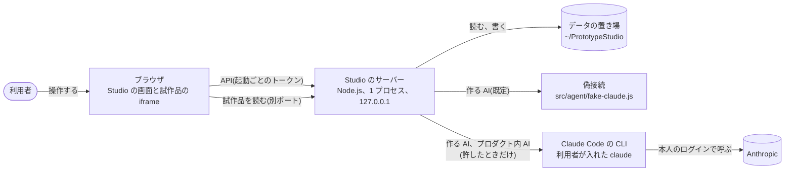
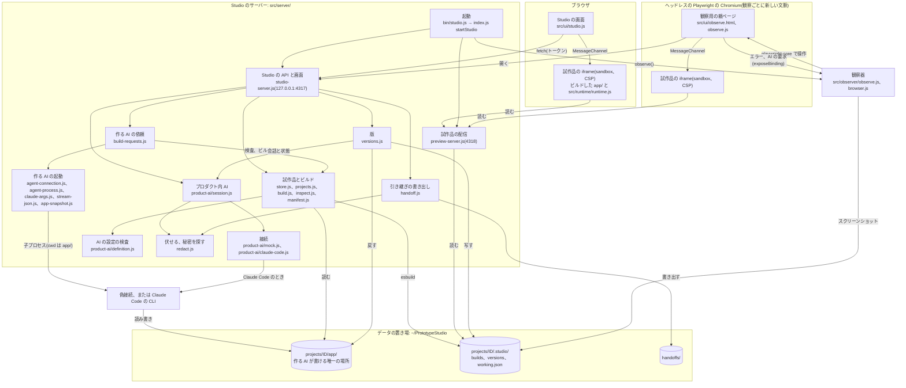

# HLD: Prototype Studio の全体設計

Prototype Studio が何でできていて、データがどこを流れるかの全体図です。今のコード(`src/`、`bin/`)から書きました。新しい機能を考えるときは、まずこの図のどこに手を入れるかを決めます。

- なぜこの作りなのか(隔離の 3 つの層、作る AI の起動のしかた)は [ADR 0001](../adr/0001-local-runtime-and-isolation.md) に書きます。ここでは繰り返しません
- 画面の設計し直しは [docs/design/ux-redesign.md](../design/ux-redesign.md) にあります。この HLD は、今の画面のまま書いています
- 目的と範囲の元は [PRD](../prd.md) です
- 関数、ファイルの形式、守る約束を書く LLD は、まだありません。harness の作り直し(#293)の後で作ります

## 1. 目的と範囲

非エンジニアが、AI プロダクトの試作品を言葉で作り、ブラウザで触り、モックと実モデルの両方で試し、本番開発に引き継げるようにします。Studio は利用者の PC で動くローカルのサーバーです。

範囲外: サーバーの公開、複数人での共有、本番の AI の接続、本物のデータ。

## 2. システムの文脈

- Studio が持つ AI は 2 つです。作る AI は試作品のファイルを変えます。プロダクト内 AI は、試作品の中で利用者と話します
- 作る AI の既定は偽接続です。プロダクト内 AI の既定はモックです。どちらも、既定ではモデルを呼びません
- Studio は資格情報を読みません。Claude Code は、利用者が入れてログインした CLI を、改変せずに子プロセスとして起動します

## 3. 部品

| 部品 | ファイル | すること |
|---|---|---|
| 起動 | `bin/studio.js`、`src/server/index.js`、`src/server/config.js` | 環境変数を読み、サンプルを写し、途中で止まった復元を戻し、2 つのサーバーを loopback で待ち受ける。起動ごとのトークンを作る |
| Studio の API と画面 | `src/server/studio-server.js`、`src/server/security.js` | `/api/projects/...` の API と `src/ui/` の画面を出す。Host、Origin、トークンを確かめる |
| 試作品の配信 | `src/server/preview-server.js` | ビルドしたものを別ポートから CSP つきで出す。API はない |
| 試作品とビルド | `src/server/store.js`、`src/server/projects.js`、`src/server/build.js`、`src/server/inspect.js`、`src/server/manifest.js` | 試作品の一覧と置き場、`app/` と目録の検査、esbuild で 1 つの classic script に束ねる |
| 作る AI | `src/server/build-requests.js` ほか | 依頼を受け、CLI を起動し、出力を画面に流す。終わったら、変わったファイルを自分で確かめ、検査してビルドする |
| プロダクト内 AI | `src/server/product-ai/` | 試作品ごとの会話、状態、実行の記録を持つ。接続はモックか Claude Code。`app/ai.json` を検査する |
| 版 | `src/server/versions.js` | `app/` と会話と状態を `.studio/versions/` に写す。復元する |
| 引き継ぎ | `src/server/handoff.js` | 作業中の試作品を `handoffs/` に書き出す。形は [handoff.md](../handoff.md) |
| 伏せる | `src/server/redact.js` | 記録と表示の前に、秘密らしい文字列と個人のデータを伏せる。書き出す前に秘密を探す |
| 偽接続 | `src/agent/fake-claude.js` | `claude -p` と同じ形の出力を出す偽の CLI。モデルを呼ばない |
| runtime | `src/runtime/runtime.js` | 試作品に配る。試作品のエラーを画面に知らせ、`window.studio.ai` を配る |
| 観察器 | `src/observer/observe.js`、`src/observer/browser.js` | 表示中のビルドをヘッドレスの Playwright の Chromium で開き、読み込み、エラー、スクリーンショット、合否を report で返す。ブラウザは Studio の中で 1 つ。観察は 1 つずつ、毎回新しい文脈で回す。作る AI、画面、版、会話の実装は import しない。設計は [harness.md の 3](../design/harness.md#3-観察) |
| 観察用の親ページ | `src/ui/observe.html`、`src/ui/observe.js` | Studio の `/observe.html` に置く静的なページ。試作品を同じ sandbox の iframe に入れ、エラーと AI の要求を `exposeBinding` で観察器に渡す。Studio の API は呼ばない(CSP の `connect-src 'none'`) |

## 4. データの流れ

### 作る(試作品を変える)

1. 利用者が「作る」欄に依頼を書く。画面が `POST /api/projects/<id>/build-requests` を送る
2. `BuildRequests.start` が依頼を受ける。1 つの試作品で動く依頼は 1 つだけ(`ProjectStore.claimRun`)。`execute` が `app/` の指紋を取る(`snapshotApp`)
3. `startAgentProcess` が、偽接続か Claude Code を `app/` で起動する。引数は `buildClaudeArgs`、依頼は標準入力で渡す
4. CLI の stream-json を `readMessage` で項目に直し、画面に流す
5. 終わったら、`app/` の指紋を取り直して変わったファイルを出す。`ProjectStore.build` が検査とビルドをする。`app/ai.json` が変わったら、前の設定との違いを会話に出す
6. 画面が iframe を新しいビルドに切り替える

### 試す(試作品の中の AI と話す)

1. 試作品が `window.studio.ai.send(text)` を呼ぶ。runtime が `MessagePort` で親の画面に送る
2. 画面が `POST /api/projects/<id>/ai/messages` を送る
3. `AiSessions.send` が、選んでいる接続(モックか Claude Code)に、設定、状態、会話、発言を渡す
4. 返事と状態の変化を会話に足し、実行の記録に伏せて残す。画面が `MessagePort` で試作品に返す

接続の切り替え(`ai/connection`)、応答を止める(`ai/cancel`)、試し直し(`ai/retry`)は、Studio の画面からだけ呼べます。試作品からは呼べません。

### 観察する(ヘッドレスのブラウザで試作品を動かす)

1. 呼ぶ側が `startStudio` の `observe(<id>, { viewports, ai, limits })` を呼ぶ。今は呼ぶ所はまだない(作るループへの組み込みは jyoka/tasks#303)
2. ビルドに失敗していれば、ブラウザを開かずに `failed` を返す
3. `ObserverBrowser` が Playwright の Chromium を起動するか、起動したものを使い回す。見つからなければ `unverified` と入れ方を返す
4. 新しい文脈で `/observe.html` を開き、試作品の URL を iframe で読む。runtime のエラー、`console.error`、処理されない reject は、`MessagePort` から親ページを通って観察器に届く
5. 15 秒で読み込みが終わらなければ時間切れのエラーにする。終われば、指定した画面幅ごとにスクリーンショットを `.studio/observations/<観察の ID>/` に撮る
6. エラーがなければ `passed`、あれば `failed` の report を返す。形は [harness.md の 3.1](../design/harness.md#31-観察器の契約studio-の-drydock-に当たる)

### 版と引き継ぎ

- 保存: `ProjectVersions.save` が `app/` と、`AiSessions.snapshot` の会話と状態を写す
- 復元: `ProjectVersions.restore` が、作業中を自動で保存してから `app/` を戻してビルドし、`AiSessions.restore` で会話と状態を戻す
- 引き継ぎ: `ProjectHandoffs.export` が、作業中のソース、AI の設定、会話と状態、メモを `handoffs/<id>-<日時>/` に書き出す。秘密らしい文字列があれば書き出さない

## 5. 手元の状態

| 場所 | 中身 | 書くもの |
|---|---|---|
| `projects/<id>/app/` | 試作品のソースと `ai.json` | 作る AI、版の復元 |
| `projects/<id>/app/prototype.json` | 目録。入口、意図、制約、架空のデータ、AI の設定、シナリオの置き場所。ビルドのたびに検査する。なければ既定の値で読む([形](../configuration.md#試作品の目録appprototypejson)) | 作る AI、版の復元 |
| `projects/<id>/.studio/builds/` | ビルドの結果 | Studio |
| `projects/<id>/.studio/observations/` | 観察のスクリーンショット | 観察器 |
| `projects/<id>/.studio/versions/`、`working.json` | 保存した版と、どの版から作業しているか | Studio |
| `projects/<id>/.studio/handoff-notes.json` | 引き継ぎのメモ | Studio |
| `handoffs/` | 引き継ぎの書き出し | Studio |
| Studio のメモリー | 作業中の会話と状態、実行の記録、作る欄の会話 | Studio(止めると消える) |

置き場の場所と変え方は [configuration.md](../configuration.md#データの置き場) にあります。

## 6. 外部の呼び出しと費用

| 呼び出し先 | いつ | 費用 |
|---|---|---|
| 偽接続(`src/agent/fake-claude.js`) | 作る AI の既定(`STUDIO_AGENT=fake`) | なし。モデルを呼ばない |
| モック(`product-ai/mock.js`) | プロダクト内 AI の既定 | なし。モデルを呼ばない |
| Claude Code の CLI(作る AI) | `STUDIO_AGENT=claude` で起動したとき | 本人のアカウントの枠か API の従量課金。1 回の依頼は 10 分、30 回まで |
| Playwright の Chromium(観察器) | 観察するとき。`npm run install:chromium` で入れたもの | なし。モデルを呼ばない。AI の要求は、呼ぶ側が渡す関数に渡す |
| Claude Code の CLI(プロダクト内 AI) | `STUDIO_ALLOW_CLAUDE_CODE=1` で起動し、画面で切り替えたとき | 同上。1 回の応答は 90 秒、$0.1 まで。1 つの会話で 30 回まで |

詳しい決まりは [claude-code.md](../claude-code.md) にあります。テストは偽の CLI(`test/fixtures/fake-claude.js`)を使い、実モデルを呼びません。

## 7. 決定の記録

- [ADR 0001: ローカル実行と隔離の方式](../adr/0001-local-runtime-and-isolation.md)
- [初見で分かる画面の設計](../design/ux-redesign.md)
- [引き継ぎの形](../handoff.md)
