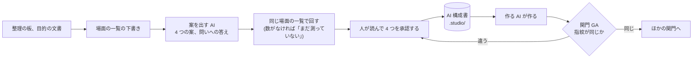
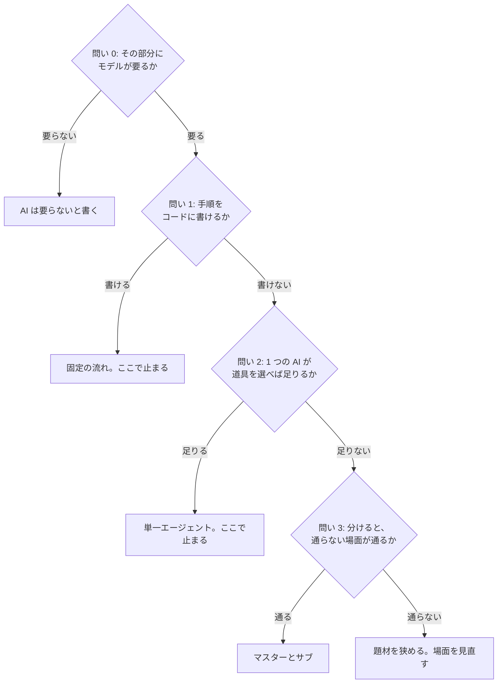

# AI 構成の審査: AI の作りを見せて、人が承認する

Studio の中心を「AI の作りを見せて、人が理解して承認する」に変える設計です。今の設計は、構成の模擬を「主役にしない」とし、構成を日常の言葉で選ばせて、Studio が裏で書く形でした。これでは、普通のプロダクトの試作の道具と差がありません(運営者が 2026-10-31 に指摘した)。

- 状態: 決めた(task 416)。書いた日: 2026-10-31。運営者が 2026-10-31 に、おすすめを全部採った。決めたことは [12 節](#12-決めたこと)。実装は 11 節のカードで進めている
- J2(task 385、2026-11-02)で、選択肢のデータ(`src/server/review/options.json`)、場面の下書き、選んだ案の構成のファイルを書く所までを作った。審査の画面、AI 構成書、指紋、関門 GA は #422 のまま。[user-journey.md の 7 節](user-journey.md#j2-で決めたことtask-3852026-11-02)
- 決定の記録: [ADR 0005](../adr/0005-ai-architecture-review.md)
- 前提: [vision.md](../vision.md)、[agent-simulation.md](agent-simulation.md)、[ADR 0001](../adr/0001-local-runtime-and-isolation.md)、[ADR 0003](../adr/0003-agent-simulation.md)
- 範囲: 設計だけ。実装は [11 節](#11-カードと確かめ方)のカードで行う。実モデルは呼んでいない
- 人物、会社、題材は、どれも架空。例の案はまだ測っていない

## 結論

- 作り始める前に「AI 構成の審査」を置く。審査するのは 4 つ。エージェントの構成、harness、データと RAG、技術の組(1 節)
- 構成の選択肢は 3 つ。固定の流れ、単一エージェント、マスターとサブ。簡単な方から順に問い、足りたらそこで止まる(2 節)
- AI 同士の引き継ぎは選択肢にしない。人に渡すのは harness の条件にする。今の `handoffs` はデータとして残す(3 節)
- 「理想の構成」と言わない。出すのは今日の一番良い推測で、日付と根拠の場面を付ける。一番長く残る資産は場面の一覧(4 節)
- 承認の結果は AI 構成書にして `.studio/` に置く。作る AI は `.studio/` に書けない。承認後に構成が変わったら、新しい関門 GA で止めて審査に戻す(6 節)
- 技術の言葉は隠さず、平たい言葉と並べる。お客さんに見せる画面(#391)だけは今の決まりのまま(8 節)
- `composition.json` のない試作品と今の構成は、変えずに動く。審査を必須にするのは、これから新しく作る試作品だけ。今の試作品で関門 GA は何もしない(6 節)
- お試しの AI(モック)の数は、形が動くかを示すだけで、案の良し悪しの根拠にならない。この区別を画面に出す(4 節)

## 1. 審査の 4 つ



| 審査すること | 人が読んで答える問い | 見せるもの | 今あるもの |
|---|---|---|---|
| エージェントの構成 | 誰が会話を回すか。どの形なら足りるか | 構成の図、選んだ案と捨てた案、問いへの答え、比べる表 | 構成(`app/composition.json`)と比べる表(`npm run evals`) |
| harness | 何をモデルに任せ、何をコードで縛るか | モデルの判断の一覧、コードで縛る一覧、人に渡す条件、プロンプトの全文、ツールの権限、守りの層、上限 | `ai.json`、`tools.json` の守り、構成の `guards`、3 つの層(agent-simulation.md の 3.7) |
| データと RAG | AI が何をどう読むか。RAG が要るか | データの棚、RAG の判定、足す条件 | 無い(#421)。ツールの処理の 5 種類に文書の検索はない |
| 技術の組 | 試作品で何を使ったか。本番の候補は何か | 試作品で使うものと、本番の候補の表 | 前提(`app/assumptions/*.json`)のモデル名。本番の候補は無い |

### harness: モデルに任せること、コードで縛ること

案は、下の 2 列を項目ごとに埋めて出します。ここが普通の試作の道具にない審査の中心です。

| 例(しおかぜ便、架空) | モデルに任せる | コードで縛る |
|---|---|---|
| 言葉の読み取り | 発言から荷物の番号と希望の時間帯を読む | 読んだ値の形の確かめ |
| 順番 | 任せない(固定の流れのとき) | 番号を聞く、荷物を引く、時間帯を選ぶ、確かめて書く |
| 書く | 任せない | 本人の確認の前は書くツールを動かさない |
| 言い方 | 文を作る | 数字を作らない、禁止の言葉、長さ |
| 人に渡す | 苦情らしさを読む(読むだけ) | 条件を満たしたら渡す。17 時を過ぎた再配達は翌日にする |

コードで縛れず、モデルに頼るしかない項目には、「モデル頼み」の印を付けます。単一エージェントとマスターとサブでは、順番と人に渡す判断の一部がこの印になります。隠さず見せることで、承認する人が危険を読めます。

### データと RAG

データの棚は、データごとに次の項目を持ちます(形は #421 で決める。データ設計の表が下書きになる)。

| 項目 | 中身 | 例(架空) |
|---|---|---|
| 形 | 表、短い決まり、長い文書 | 荷物の表 |
| AI の読み方 | ツールで引く、プロンプトに入れる、RAG、使わない | ツールで引く |
| 変わる速さ | 毎分、毎日、年に数回 | 毎分 |
| 個人情報 | 有無と種類 | あり(お届け先の名前) |
| 試作品での扱い | 架空のデータで作る、使わない | 架空の荷物 10 件 |

RAG の判定は、棚の読み方を簡単な方から順に問います。足りたら止まり、「要らない」と書きます。

| 順 | 問い | はいなら |
|---|---|---|
| 1 | AI がこのデータを読まなくても、場面は通るか | 使わない |
| 2 | 表やキーで、1 件を引けるか | ツールで引く |
| 3 | 短くて、毎回プロンプトに入れられるか | プロンプトに入れる |
| 4 | ここまでで通らない場面があるか | RAG を足す案を出す。通らない場面の id を根拠に書く |

- RAG が要ると判定したら、決めることを並べる。分割、埋め込み、置き場、引用、再現率の測り方(#421)
- 要らないと判定したら、理由と「足す条件」を書く。例: 約款が長くなり、プロンプトに入れた案で通らない場面が出たら
- 数の上限(何文字なら入れてよいか)は決めない。場面が通るかで決める
- 検索は手元で動かし、外へ通信しない。方法は #421 で決めて、この節に理由を書く
- 試作品のデータは架空のまま。棚の「個人情報」は、本番のデータの話として書く

### 技術の組

| 区分 | 中身 | 書き方の決まり |
|---|---|---|
| 試作品で使うもの | 実際に回したモデル、ツールの口、データの形、検索 | 前提と実行の記録から Studio が書く。作り話にならないよう、案を出す AI に書かせない |
| 本番の候補 | モデル、動かす基盤、データの置き場、記録の取り方 | 「候補。試作品では確かめていない」と必ず出す。試作品のモデルは「代わりのモデル」と書く |

試作品の組は、本番の品質を約束しません(vision.md の 5 節)。

## 2. 構成の選択肢と判断の順

### 選択肢

| 選択肢 | 平たい言葉 | 順番を決めるもの | 今の作りでの書き方 | 動くようにするカード |
|---|---|---|---|---|
| 固定の流れ | 手順はコードが決める。モデルは読み取りと言い方だけ | コード | `harness` の参加者の `flow` と `escalate`([agent-simulation.md の 2.8](agent-simulation.md#28-固定の流れharness-の参加者からツールを呼ぶ)) | #419 |
| 単一エージェント | 1 つの AI が、渡された道具から選んで進む | モデル | `agent` の参加者 1 人とツール(今の構成で書ける) | 今あるもの |
| マスターとサブ | 親の AI が、子の AI に仕事を任せて結果を受け取る | モデル。深さと回数はコード | `agent` の参加者どうしの `delegations` と、委任のツール(`op: "delegate"`)([agent-simulation.md の 2.9](agent-simulation.md#29-マスターとサブ親の-ai-が子の-ai-に仕事を任せる)) | #420 |

### 判断の順

簡単な方から順に問い、足りたらそこで止まります。難しい形を先に見せません。



- 「足りる」は、必須の場面が通ることで決める。数がないときは推測と書き、「まだ測っていない」を出す
- 上の形に進むには、下の形で通らない場面の id が要る。その id を AI 構成書に残す
- 問いの結果として「要らない」と言える。サブは要らない、RAG は要らない、この部分に AI は要らない
- 問い 0 の「AI は要らない」は、4 つ目の選択肢ではない。ある処理をコードで済ませる、という判定の結果
- 人は、問いの順を飛ばして難しい形を選んでよい(原則「人が決める」)。そのときは AI 構成書に「測らずに選んだ」と残す

例(しおかぜ便の再配達、架空。まだ測っていない):

| 問い | 答え | 理由 |
|---|---|---|
| 0 | 要る | 自由な文から番号と時間帯を読む |
| 1 | 書ける。固定の流れで止まる | 番号を聞く、荷物を引く、時間帯を選ぶ、確かめて書く、の順が決まっている |
| 2、3 | 問わない | 上で足りた。単一エージェントとマスターとサブは「要らない(今日の推測)」と書く |

## 3. AI 同士の引き継ぎは選択肢にしない

AI 同士の引き継ぎ(受付の AI から相談の AI へ会話を渡す形)は、審査の選択肢に出しません。理由は次のとおりです。測った結果ではなく、運営者の判断と設計の判断です。

- 仕事を分けたいなら、マスターとサブで足りる。親が全体の文脈と責任を持ち続ける
- 引き継ぐと、会話の責任が移る。どの AI が約束したのかを、承認する人が読みにくい
- 選択肢が増えるほど、「簡単な方から問う」の順が崩れる

人に渡すのは、harness の条件にします。AI が「渡すかどうか」を自由に決めるのではなく、コードが条件を確かめます。モデルは読み取りまでです(1 節の表)。

| 形 | 人に渡す条件の守り方 | 審査での見え方 |
|---|---|---|
| 固定の流れ | 流れの条件。コードが決める | コードで縛る |
| 単一エージェント、マスターとサブ | 決まった条件(番号が 2 回読めない、ツールの失敗、17 時を過ぎた)はコード。意味で判断するもの(苦情らしさ)はモデルの判断 | 条件ごとに「コードで縛る」か「モデル頼み」 |

細かい形は #419 で決めて、[agent-simulation.md の 2.8](agent-simulation.md#28-固定の流れharness-の参加者からツールを呼ぶ) に書きました。`when` の語は `ai.json` と同じく決まった語だけにし、式や関数は書かせません。

```json
{ "id": "desk", "kind": "harness", "ai": "ai.json",
  "escalate": [
    { "id": "no-parcel-number", "when": { "unreadAfter": { "field": "parcel_no", "times": 2 } }, "to": "staff", "tell": "番号を読み取れないので、担当の者におつなぎします。" }
  ] }
```

この節の案から 2 つ変えました。

- 渡す値は `escalate` の `carry` に書かず、`handoffs` の辺の `carry` に書く。今の引き継ぎと同じ 1 か所にするため。辺も要る(今の `returnTo` と同じ「人に渡すのも引き継ぎ」)
- 渡すときに伝える文(`tell`)を足した。harness が黙って人に替わらないようにするため

### 今の `handoffs` の扱い

| 所 | 扱い | 理由 |
|---|---|---|
| 構成の `handoffs`、ツールの `handoff`、確かめの `handoffTo`、`human` の参加者 | 残す。検査も動きも変えない | 今の試作品を壊さない(agent-simulation.md の R2、R3) |
| 見本の構成 C(`compositions/c.json`) | 残す | 今のテストと比べる表の元 |
| 案を出す AI の案 | AI から AI への辺を出さない。辺の先は `human` だけ | 選択肢にしないため。Studio が案の検査で落とす |
| 審査の画面 | 今の試作品に AI から AI への辺があれば、「今の構成。選択肢にはない」と事実を見せ、承認はできる(6 節の「今の構成を審査する」) | 持ち主の構成を勝手に変えないため |

`agent-simulation.md` の構成 C は、流用できることを試した結果として残します。お勧めの形ではありません。

## 4. 「理想の構成」と言わない

新しいモデルや作り方は、次々に出ます。「理想」は日付が変わると嘘になります。出すのは、今日の一番良い推測です。

### 案に必ず付けるもの

| 項目 | 中身 | 例(架空) |
|---|---|---|
| 日付 | この推測を出した日と、数を測った日 | 2026-11-02 |
| 根拠の場面 | 場面の id と結果。通らなかった場面も書く | `redeliver-after-17`: 通った |
| 測った組 | 接続、モデル、前提の id と指紋 | 本物の AI、`claude-sonnet-5-5` |
| 言い方 | 「今日の一番良い推測」。測っていなければ「まだ測っていない」 | |

- 画面と文書で使わない言葉: 理想の構成、最適、ベストプラクティス、最新の正解
- 調子は [vision.md の 7 節](../vision.md#7-調子と声)の「数は出典か測った値だけ」のまま

### 数の読み方

モックの回しは、決まった返事を返します。前提を替えても同じ結果になることを、sim-8 で確かめました(agent-simulation.md の 2.6)。だから、数を出すときは接続を分けます。

| 接続 | 分かること | 画面の出し方 |
|---|---|---|
| モック | 構成とツールの形が動くか。関門 GE に使う | 「お試しの AI で回した。形の確かめだけ」。案の順位に使わない |
| 実モデル | 振る舞いの差。費用と待ち時間 | 「本物の AI で回した」と日付、モデル、回数 |
| 回していない | 何も分からない | 「まだ測っていない」 |

実モデルで回すときは、今の同意と費用の上限を通します。回していない案も、数がないと出したまま承認できます。そのときは、AI 構成書に「測らずに承認した」と残します。

### 測り直す

新しいモデルや作り方が出たら、同じ場面の一覧で測り直します。比べ方は今の `npm run evals` のとおり、構成 × 前提 × 接続 × 回数です。

- 測り直すのは人が決める。Studio は自動で実モデルを呼ばない
- 結果が変われば、新しい審査にする。前の AI 構成書は消さない
- 前の推測が外れたことも、記録として残す

### 一番長く残る資産は場面の一覧

モデル、構成、プロンプトは入れ替わります。残るのは「この題材で何ができれば良いか」を書いた場面の一覧です。

- 場面の一覧は、案より先に作る(審査の前に下書きを作る)
- 引き継ぎに入れて、本番開発に渡す
- 場面を変えると、前の数と比べられなくなる。場面の指紋を AI 構成書に残し、変わったら数を「古い」と出す(6 節)
- 作る AI が場面を弱めて通すことは、`evalsDigest` の違いで見える。今の `evalsChanged` の印は直すラウンドの分だけで、最初のラウンドの変更には付かない(`src/server/build-requests.js`)

## 5. 選択肢はデータにする

新しい作り方を足すたびにコードを書くと、測り直しが止まります。agent-simulation.md の R3 と同じ考えで、足せる所をデータにします。

選択肢の一覧は Studio が持つデータにします。R3 は「新しい構成を足す変更で `src/` と `bin/` が変わらない」です。#419、#420、#421 は、新しい種類の処理を足すカードなので、R3 の例外です。下の表の「要る」に当たり、足した後は、また R3 のとおりデータだけで足せます。置き場は `src/server/review/options.json` です。`app/` に置かないのは、作る AI が選択肢を書き換えられないようにするためです。

| 足すもの | コードが要るか | 足す所 |
|---|---|---|
| 構成の選択肢(今の参加者の種類の組み合わせ) | 要らない | `options.json` |
| 問いの文、判断の順 | 要らない | `options.json` |
| 本番の候補の一覧 | 要らない | `options.json` |
| RAG の判定の問い、足す条件の文 | 要らない | `options.json` |
| 新しいモデル(`agent` の参加者) | 要らない | 前提(`app/assumptions/*.json`) |
| harness のモデルの指定(固定の流れ) | 足した(#419)。別のモデルは前提を足すだけで要らない | 参加者の `model`(`{ "from": "assumptions" }`)。書いた参加者だけ前提の `model.name` を `src/server/product-ai/claude-code.js` の `--model=` に渡す |
| 場面、プロンプト、ツールの宣言、守りの値 | 要らない | `app/` |
| 参加者の種類(`kind`) | **要る** | `src/server/sim/composition.js`、`orchestrator.js` |
| 流れからツールを呼ぶ書き方(固定の流れ) | 足した(#419)。次の流れは書き方を足さずに書ける | `composition.js`、`src/server/product-ai/harness.js`、`tool-gate.js` |
| 親子の委任(マスターとサブ) | 足した(#420)。次のサブは書き方を足さずに書ける | `composition.js`、`orchestrator.js`、`tools.js`、`tool-gate.js`、`tools-mcp.js`、実行の記録 |
| 流れの条件の語(`when`。人に渡す条件など) | **要る** | `composition.js`、`src/server/product-ai/` |
| ツールの処理(`op`。文書の検索など) | **要る** | `src/server/sim/tools.js`、`tool-gate.js` |
| 確かめの種類(`check`)、守りの層(`layer`) | **要る** | `src/server/sim/evals.js`、`eval-run.js`、`eval-recount.js`、`composition.js` |
| 審査の 4 つの項目そのもの | **要る** | 画面と AI 構成書の版 |

- コードが要る所を分けるのは、守りのため。種類を増やせるのは Studio のコードだけ(agent-simulation.md の 2.2)。式、関数、正規表現は、データに書かせない
- 新しい選択肢にコードが要ったら、足す前に理由をこの節に書く(R3 と同じ決まり)
- `options.json` の形の例:

```json
{
  "formatVersion": 1,
  "compositions": [
    { "id": "fixed-flow", "label": "固定の流れ", "plain": "手順はコードが決める", "order": 1,
      "question": "手順をコードに書けるか", "participantKinds": ["harness"], "addedOn": "2026-11-02" }
  ]
}
```

## 6. AI 構成書

AI 構成書は、4 つの審査の結果です。何を、誰が、いつ、何を根拠に承認したかを、1 つのファイルに残します。

### 置き場

`.studio/reviews/<審査の ID>/architecture.json` に置きます。

- `.studio/` は Studio だけが書く。作る AI の作業の場所(`app/`)の外にある(ADR 0001)
- 今の AI 構成書は `.studio/reviews/current.json` で指す
- 承認した構成のファイルの写しを `.studio/reviews/<審査の ID>/files/` に置く。比べる元と、戻す元にする
- 審査を要るかは `.studio/project.json` に書く(下の「審査が要る試作品」)
- 古い審査は消さない。「会のデータを消す」では全部消す(K4)
- 引き継ぎの `handoff.json` と、会の終わりの書き出しに、写しを入れる(#392、#395)

### 形

```json
{
  "formatVersion": 1,
  "id": "review-20261102-a1b2c3",
  "createdAt": "2026-11-02T10:25:00+09:00",
  "basis": { "purposeDigest": "sha256:…", "boardDigest": "sha256:…" },
  "composition": {
    "chosen": "fixed-flow",
    "answers": [{ "question": 1, "answer": "書ける", "evalIds": ["redeliver-after-17"] }],
    "rejected": [{ "option": "single-agent", "reason": "固定の流れで足りた(今日の推測)" }]
  },
  "harness": {
    "modelDecides": ["発言から番号と時間帯を読む", "文を作る"],
    "codeBinds": ["順番", "確認の前は書かない"],
    "modelOnly": [],
    "escalate": ["no-parcel-number"]
  },
  "data": {
    "shelf": [{ "id": "parcels", "shape": "table", "read": "tool", "change": "minutes", "personal": true, "prototype": "架空の 10 件" }],
    "rag": { "needed": false, "reason": "表と短い決まりだけ", "addWhen": "約款を読む場面が通らなくなったら" }
  },
  "stack": {
    "prototype": [{ "kind": "model", "name": "claude-sonnet-5-5", "standIn": true }],
    "productionCandidates": [{ "kind": "model", "name": "未定", "verified": false }]
  },
  "evidence": {
    "status": "unmeasured",
    "measuredAt": null,
    "runIds": [],
    "evalsDigest": "sha256:…"
  },
  "fingerprint": {
    "algorithm": "sha256",
    "value": "…",
    "items": {
      "composition": { "digest": "…", "files": ["composition.json"] },
      "harness": { "digest": "…", "files": ["composition.json", "ai.json", "tools.json"] },
      "data": { "digest": "…", "files": ["tools.json"] },
      "stack": { "digest": "…", "files": ["assumptions/default.json"] }
    }
  },
  "approvals": {
    "composition": { "needs": ["facilitator"], "by": [{ "role": "facilitator", "pressedBy": "早瀬", "spokenBy": null, "at": "2026-11-02T10:33:00+09:00", "digest": "…" }] },
    "harness": { "needs": ["facilitator", "decider"], "by": [] },
    "data": { "needs": ["facilitator", "decider"], "by": [] },
    "stack": { "needs": ["facilitator"], "by": [] }
  },
  "approvedAt": null
}
```

- 指紋の作り方は今の `snapshotApp` と `digestSnapshot`(`src/server/app-snapshot.js`)に合わせる。ファイルがないことも指紋に入れる
- 指紋に入れるのは、目録(`prototype.json`)の指し先(`composition`、`ai`)の値、たどった先の既定の構成、参加者が指す harness の設定、ツールの宣言、プロンプトの枠、使う前提
- 指し先の値を入れるのは、`compositions/c.json` へ向け直すだけで関門を通れないようにするため。目録の全体は入れない。作る AI が依頼のたびに直すので
- 指紋に入れないのは、画面のソース、架空のデータの中身、モックの決まり、場面。作る AI が普通に直すもので、止めると作れなくなるため
- 場面は `evidence.evalsDigest` に別に残す。変わっても止めず、数を「古い」と出す
- ツールが読むデータのファイルの場所は、ツールの宣言に入るので指紋で分かる
- 承認ごとに、その項目の指紋を持つ。指紋が変わった項目の承認は効かない
- 役は `owner`(1 人で使うときの本人)、`facilitator`(進行役)、`decider`(決める人)。1 人で使うときの `needs` は `["owner"]`
- 1 台の PC の形では、押した人と声に出した人を残す(collaboration.md の 3 節と同じ)。名前は申告で、Studio は本人を確かめない

### 承認までの流れ

1. Studio が場面の一覧の下書きを作る(J2 の場面の段)
2. 案を出す AI が案を出す。Studio が案の形を検査する
3. Studio が、案ごとの構成を `app/compositions/<案の id>.json` に書き、G3 の検査を通す。要るときは、目録、ツールの宣言、架空のデータの枠も書く
4. 人が頼んだら、同じ場面の一覧を案ごとに回す(4 節)。回さなければ「まだ測っていない」
5. 人が案を選ぶ。Studio が選んだ案を `app/composition.json` に写し、指紋を取り、`files/` に写しを置く。選び直すと、4 つの承認は全部消える
6. 人が 4 つを読んで承認する
7. 4 つがそろうと `approvedAt` が入る。ここで初めて作る AI を起動できる

- 場面の回しは今 `buildApp` を通るので、入口のファイルが要る。画面のソースがない段では、Studio が決まった入口の枠を置く(12 節)
- 書くファイルの名前は Studio が決める。案にパスの欄を持たせない。Studio は作る AI の閉じ込めの外で書くので、モデルが決めたパスを使わないため
- 構成のファイルを Studio が書くのは、承認する中身と作る前のファイルを同じにするため。作る AI が書くのは、画面のソースと架空のデータ
- 原則 8 の「試作品のソースを書くのは作る AI だけ」の「ソース」は画面のコードと読む。構成はデータで、人が選んだ案を Studio が写す

### 今の構成を審査する

すでに構成のある試作品(作る AI が書いた構成、構成 C など)を審査するときは、上の 2〜5 を通りません。今のファイルをそのまま読んで見せ、指紋を取ります。書き換えません。AI から AI への辺があれば、「今の構成。選択肢にはない」と出します。

### 審査が要る試作品

| 試作品 | `.studio/project.json` | 作る前の審査 | 関門 GA |
|---|---|---|---|
| 今ある試作品、見本 | `review` がない | 要らない。人が頼めば受けられる | AI 構成書がなければ何もしない |
| これから新しく作る試作品 | `"review": "required"` | 要る。承認まで作る AI を起動しない | 比べる |
| 審査を飛ばした試作品 | `"review": "skipped"` | 飛ばした人、時刻、理由を `.studio/reviews/skipped.json` に残す。画面と引き継ぎに「審査なし」と出す | 何もしない |

`"review": "required"` で `current.json` が読めないときは、止めます。審査なしとして通しません。

### 関門 GA

作るループに、新しい関門 GA を足します。

| 項目 | 中身 |
|---|---|
| 置く所 | 節 `changes`(G1)の直後、節 `inspect`(G2〜G4)の前 |
| 理由 | G2〜G4 は `store.build` の 1 回の呼び出しで、通ると試す欄の試作品が替わる。承認と違う構成を動かす前に止める。コードだけで決まり、安い |
| 確かめること | 今の `app/` の指紋が、AI 構成書の指紋と同じか |
| 目録が読めないとき | GA では決めず、次の G3 に任せる。G3 が落とすので、試す欄は替わらない |
| AI 構成書がないとき | 上の表のとおり。今の試作品では何もしない(agent-simulation.md の R2) |
| 同じとき | 通す |
| 違うとき | 止める。直すラウンドに回さず、作る AI に直させない。試す欄は前の試作品のまま |
| 止めた後 | 違いを画面に出し、審査に戻す |
| 次の依頼 | 節 `accept` でも同じ比べをする。審査に戻るまで作る AI を起動しない |

作る AI に直させないのは、承認された値に合わせて書き戻すと、人が望んだ変更まで消えるからです。「言葉で直す」の依頼で構成を変えたいときも同じ扱いで、例外を作りません。

R2 との関係です。今の試作品の振る舞いは変わりません。GA の行も結果に出しません。ただし、節と関門の一覧を確かめる `test/unit/blueprint.test.js` は、節を足すので #422 で直します。「今のテストが変えずに通る」の例外はこの 1 つです。

作る AI への決まりも直します。`src/server/claude-args.js` の決まりと `src/server/fix-prompt.js` の終わりの文に、「承認された構成のファイルを変えない。変えたいときは言葉で知らせる」を足します(#422)。足さないと、場面の失敗を直そうとして構成を変え、run が止まります。

| 止めた後の道 | どうなるか |
|---|---|
| 審査に戻る | 新しい審査の ID を作る。指紋が同じ項目の承認は写し、変わった項目は承認し直す。前の AI 構成書は残す |
| 承認した構成に戻す | 構成のファイルを `files/` の写しに戻す。画面のソースはそのまま |

- 違いの中身は、`files/` の写しと今のファイルを、`src/server/sim/changes.js` の `describeSimulationChanges` と `describeDefinitionChanges` で比べる。守りが減ったときの印も今のまま
- この文には `app/` やモックの語が入るので、主の画面の文は審査の画面用に作り、今の文は開発者向けの詳細に出す
- 版を戻して指紋が変わったら、前に承認した AI 構成書を指紋で探す。あればそれを今のものにし、なければ審査に戻す
- 引き継ぎの書き出しでも指紋を比べ、違えば「承認と違う」と出す(今の `stale` と同じ考え)。人が手で `app/` を直した場合もここで分かる
- コメントの種類に「構成」を足す(#393)。承認しても作る AI に送らず、審査に戻す

## 7. 案を出す AI

**聞き出しの AI(#382)と同じ決め方でよい。** #382 が決めた起動の形(別の役。[user-journey.md の 7 節](user-journey.md#j1-で決めたことtask-3822026-10-31))をそのまま使います。整理する AI(K1)も同じ決め方なので、役を増やさずに済みます。

ただし、役目が違うので、次の 4 つは足します。

| 足すこと | 中身 | 理由 |
|---|---|---|
| 決まった形で返す | 問いへの答えと 4 つの案を JSON で返し、Studio が検査する。ファイルは書かせない | 案がそのまま AI 構成書の元になるため |
| 数を書かせない | 通った数、費用、待ち時間は、場面の回しの結果から Studio が入れる | 作り話の数を防ぐ。「質を測る」の原則 |
| 簡単な方から問わせる | 問いの順は `options.json` から渡す。AI から AI への辺は案の検査で落とす | 難しい形に寄るのを防ぐ。どの程度寄るかは測っていない |
| 測って確かめる | 形の違う架空の題材 3 つで案を出す。いつも同じ構成を勧めるなら作り直す | #422 の受け入れ条件 |

- 入れるのは、整理の板、目的の文書、データ設計、場面の一覧
- 守りは ADR 0001 のまま。`app/` の外に書かない。外への通信を足さない
- お客さんの話を送るので、会の中では、会の始めの同意の後だけ呼ぶ(K4)。1 人で使うときと、K4 より先に #422 ができたときは、今の本物の AI の同意を通す(`POST /api/real-ai/consent`)
- テストは偽接続と偽の `claude` で、決まった案を返す。実モデルで呼ぶのは #422 の 3 題材だけ(上限 3 USD)

## 8. 言葉

技術の言葉を隠さず、平たい言葉と並べます。覚えなくても読めて、本番開発の人にもそのまま通じるようにするためです。

| 技術の言葉 | 平たい言葉(並べる文) |
|---|---|
| エージェント | 道具を選びながら自分で進める AI |
| 固定の流れ | 手順はコードが決める形 |
| 単一エージェント | 1 つの AI が道具を選んで進む形 |
| マスターとサブ | 親の AI が子の AI に仕事を任せる形 |
| harness | AI の周りで決まりを守らせるコード |
| ツール | AI が呼べる決まった処理 |
| プロンプト | AI に渡す指示の文 |
| ガードレール(守り) | AI にさせないことを決めた仕組み |
| RAG | 文書から探した部分を AI に読ませて答えさせる仕組み |
| 再現率 | 探すべき文書のうち、見つけた割合 |

### 2 種類の言葉を分ける

| 種類 | 例 | 画面での扱い |
|---|---|---|
| AI の作りの言葉 | 上の表 | 主の画面に出す。平たい言葉と並べる。これが今回変える所 |
| 開発の作業の言葉 | `DEV_WORDS` の語(`test/e2e/studio.js`。モック、ビルド、関門、シナリオ、`app/` など) | 今のまま。開発者向けの詳細にだけ出す |

今の `DEV_WORDS` に AI の作りの言葉は入っていません。だから、`DEV_WORDS` を変えず、`expectNoDevWordsOnScreen` で審査の画面も確かめられます。審査の画面で関門 GA が止めたときも、「承認した構成と違います」と書きます。モックの数は「お試しの AI」と書きます(ux-redesign.md の 4 節)。

プロンプトの全文は、利用者が書いた文なので `--` や `app/` が入りえます。全文は閉じた `details` の中に置きます。`expectNoDevWords` は閉じた `details` の中を見ません。開いた後の全文は、この確かめの対象にしません。

### 画面ごとの決まり

| 画面 | 決まり |
|---|---|
| 審査の画面、試す画面の記録、比べる表 | 技術の言葉と平たい言葉を並べる |
| 決める人が承認する審査(会の中) | 同じ。ただし承認の前に、進行役が平たい言葉で話す |
| お客さんに見せる画面(#391) | 今の決まりのまま。開発の言葉も技術の言葉も出さない。この画面に実行の記録は出さない(#423) |

## 9. 承認する人

| 審査すること | 1 人で使うとき | 会の中(進行役と決める人) | 理由 |
|---|---|---|---|
| エージェントの構成 | 本人 | 進行役 | 形の判断は技術の責任。決める人は図を見て質問できる |
| harness | 本人 | 進行役と決める人の 2 人 | 人に渡す条件と守りは、お客さんとの約束を変える |
| データと RAG | 本人 | 進行役と決める人の 2 人 | お客さんのデータを AI にどう読ませるかの話 |
| 技術の組 | 本人 | 進行役 | 試作品の事実と本番の候補。契約の判断はここでしない |

- 考え方は [collaboration.md の 3 節](collaboration.md#3-役とできること)と同じ。お客さんとの約束を変えるものは 2 人にする
- 1 台の PC の形では、決める人が声に出し、進行役が押す。押した人と声に出した人の両方を残す
- 参加者は承認しない。質問とコメントはできる

## 10. 何の製品か

[vision.md の「何の製品か」](../vision.md#何の製品か)に書きました。1 文は次のとおりで、運営者が 2026-10-31 に決めました。

- 日本語: 思いつきを AI プロダクトにすると、どんな作りになるか。動かして測り、人が承認してから作る。
- 英語: See how your idea works as an AI product, test it, and approve the architecture before you build.

#417 で、`docs/brand.md`、README、LP、バナー、`package.json` を全部この文に変えました(`test/unit/brand.test.js` が同じかを確かめます)。審査の段はまだないので、README と LP は「今できること」と「作っているもの」を分けて書きます。

## 11. カードと確かめ方

作る順は [user-journey.md の 6 節](user-journey.md#作る順jyokatasks-の-blocked-by)にあります。

| カード | この文書の節 | 確かめること |
|---|---|---|
| #417 README と LP | 10 節 | 新しい 1 文で `brand.test.js` と `site.spec.js` が通る |
| #419 固定の流れからツールを呼ぶ | 2 節、3 節 | モデルの返事で順番が変わらない。今の構成とテストが変えずに通る |
| #420 マスターとサブ | 2 節、5 節 | 上限を超えた委任が止まる。3 つの形を同じ場面の一覧で比べる |
| #421 データの棚と RAG の判定 | 1 節 | 短い決まりと表だけの題材で「要らない」になる。隔離の E2E が今のまま通る |
| #422 審査の画面と AI 構成書 | 1、4、6、7、8、9 節 | 4 つの承認まで作る AI が起動しない。選び直すと承認が消える。承認後に変えると GA で止まる |
| #423 記録と比べる表を主の画面に | 4 節、8 節 | 同意の前に本物の AI を呼ばない。見せる画面に記録が出ない |
| #393 K3 | 6 節 | 構成のコメントを承認しても作る AI に送らず、審査に戻る |
| #392 J8、#395 K5 | 6 節 | 書き出しに AI 構成書と承認の記録が入る |
| #396 K6 | 全部 | 台本に審査を入れて最後まで通る |

## 12. 決めたこと

運営者が 2026-10-31 に、task 416 のおすすめを全部採りました。

| 事項 | 決めたこと | 理由 | 作るカード |
|---|---|---|---|
| 1 文 | 10 節の 1 文 | 中心(作りを見せる、測る、承認する)が全部入る。英語は訳の確かめをしていない | #417 |
| AI プロダクトに絞るか | 絞る | 審査の 4 つは AI にしか意味がない。1 文とも合う | #417 |
| 指紋に入れる範囲 | 6 節のとおり。プロンプトの枠を含める | 「全文を読める」と言うなら、変われば承認し直す。止まりすぎたら、K6 で見て減らす | #422 |
| 関門 GA を直すラウンドに回さないこと | 回さない | 作る AI が承認された値に合わせて書き戻すと、変更の意図が消える | #422 |
| 会の中で実モデルで案を比べるか | 比べる。代表の場面を 5 本まで、選んだ案と 1 つ簡単な案の 2 つだけ。時間の上限を超えたら「まだ測っていない」で進める | 全部を回す時間はない見込み。sim-9 の値で 5 本 2 ターンなら 1 案 1〜2 分、0.2 USD 前後(推測)。お客さんの前で実モデルを使うなら同意が要る | #422、K6 |
| 測らずに承認してよいか | よい。印を残す | 測れないときに止まると、会が止まる。「人が決める」に合う | #422 |
| 1 人で使う人(企画担当)にも審査を必須にするか | 新しく作る試作品だけ必須にする。ただし「審査を飛ばす」を残し、「審査なし」の印を残す(6 節の「審査が要る試作品」) | 飛ばす道を残す決まり(vision.md の 7 節)。今の試作品は変えない(R2) | #422 |
| 画面のソースがない段で、案をどう回すか | 決まった入口の枠を Studio が置く | 今の `npm run evals` は `buildApp` を通る。検査だけの口を足すより変更が小さい。確かめていない | #422 |
| 選択肢の置き場 | `src/server/review/options.json`(J2 で置いた。構成の選択肢だけ。本番の候補と RAG の問いは #421、#422 で足す) | 作る AI に書かせず、コードと分ける | #422 |
| 人に渡す条件の形 | 3 節の形(#419 で作った)。`ai.json` の版は上げず、構成の参加者に書く | ADR 0003 の「`ai.json` の版を上げない」に合う | #419 |
| 会の成果物の数え方 | AI 構成書を足して 7 つにする | #395 の「成果物に足す」に合わせた。#396 の本文は「6 つ」のままなので、読み替えが要る | #395、#396 |

## 13. 確かめていないこと

- 想像図(jyoka/tasks#416 のリンク)は、このカードの実行では読めなかった(閲覧の権限がなかった)。画面の中身はカードの本文から書いた。#422 で想像図と突き合わせる
- 案を出す AI がどの程度正しく案を出せるか。測っていない(#422)
- 人が 4 つの審査を読んで理解できるか。人の確かめをしていない。#396 の人の確かめで見る
- AI 同士の引き継ぎを外すことで失うものがあるか。比べて測っていない
- 案ごとのファイルを `app/compositions/` に置いたとき、作る AI がそれを読んで振る舞いを変えないか
- 分の割り当て([field-session.md](field-session.md))。どれも推測
