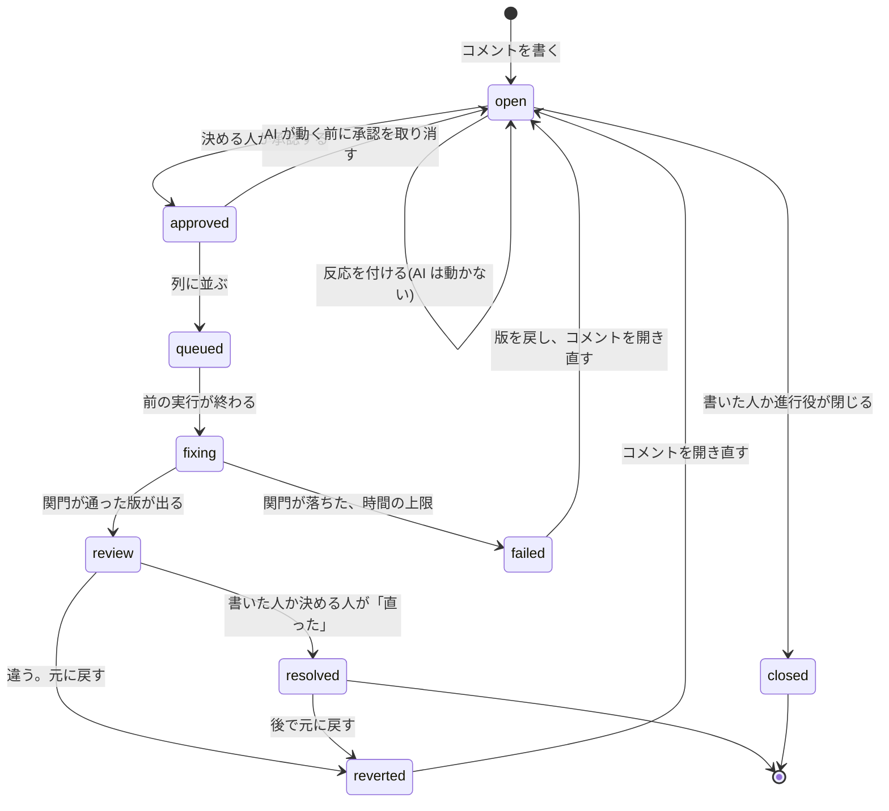
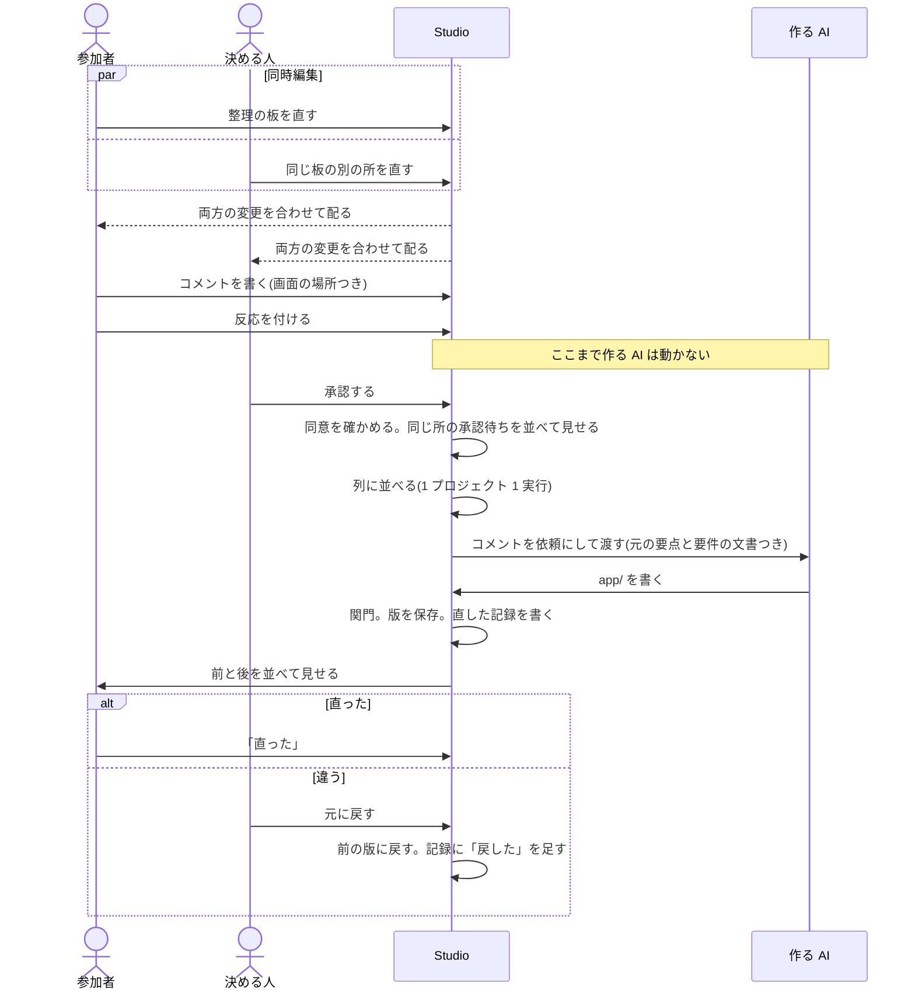
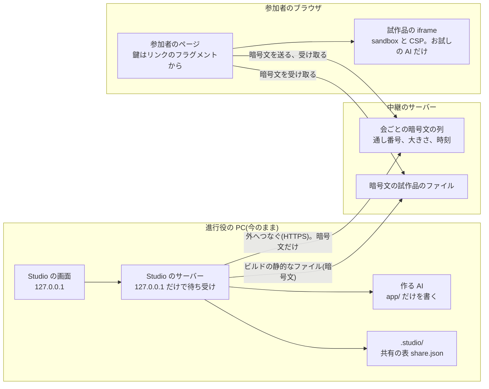
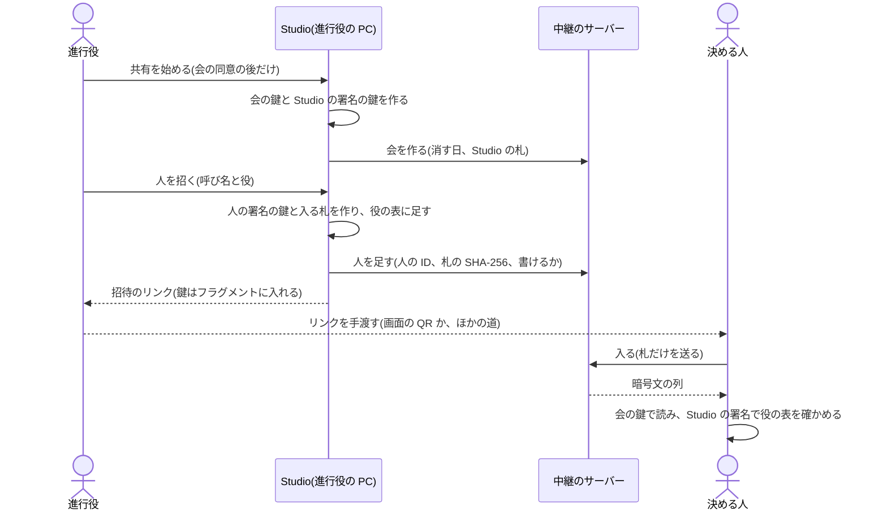
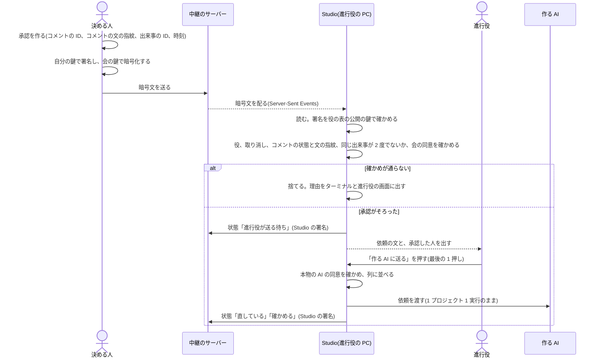

# 同時に作ることとコメントの流れ

[目的の文書](../vision.md)の 2 つ目の柱「みんなで、その場で作る」の設計です。同時編集、コメント、反応、承認、AI への送り、直した結果の確かめ、元に戻す、の流れと決まりを書きます。今の「手元で動く」形との食い違いと、両立の案も書きます。

- 状態: 案(task 380)。書いた日: 2026-10-29。2 節(同時に書くもの)、3 節(承認する人)、6 節(手元か共有か)、7 節(お客さんのデータ)は、運営者が 2026-10-29 に決めた(task 381)。決めたことは 8 節。段 2 の設計は 9 節(task 428、2026-11-18)。段 2 は採った。2 枚目(task 429)で作ったことと、設計と違う所は 9.7
- 前提: [vision.md の 10 節](../vision.md#10-野望-みんなでその場で作る)、[field-session.md](field-session.md)、[ADR 0001](../adr/0001-local-runtime-and-isolation.md)。決定は [ADR 0004](../adr/0004-shared-session-and-customer-data.md)(段 1 と段 2 を採用)
- 出典は 2026-10-29 に読んだ。確かめられなかったことは「不明」、自分の見立ては「推測」と書いた
- 人物と会社は架空([field-session.md の 1 節](field-session.md#1-人物と場面))

## 結論

- 人が同時に書くのは、文書(整理の板、要件の文書、データ設計、場面の一覧)とコメントだけにする。試作品のソース(`app/`)を書くのは、今と同じく作る AI だけ(2 節。決めた)
- コメントは誰でも書け、反応も誰でも付けられる。作る AI に送るのは、承認されたコメントだけ。反応の数では動かない(3 節、4 節)
- 見た目と動きのコメントは、進行役か決める人の 1 人の承認で作る AI に送る。要件を変えるコメントは、進行役とお客さん側の決める人の 2 人の承認がそろってから送る(3 節。決めた)
- 直すたびに「直した記録」を `.studio/` に残す。どのコメントから、誰が承認し、何が変わり、関門がどうだったか。元に戻しても記録は消さない(5 節)
- 今の Studio は 1 台の PC の 127.0.0.1 で動く。両立の案は 3 つ。まず案 A(1 台の PC でみんなで。ADR 0001 を変えない)で 1 時間を通す。案 C(手元で作り、中継のサーバーで文書とコメントだけを同期する)は、K6 で操作役が詰まりになると分かってから、運営者が ADR 0004 の段 2 を採るかを決める。案 B は採らない(6 節。決めた)
- お客さんの話は同意の後に扱い、お客さんの記録(個人情報、取引の実データ)は入れない。消す日の既定は 30 日(仮)。本物のお客さんの会で使う前に、会社のデータの取り決め(Commercial Terms など)を決める(7 節。決めた)
- 段 2 の設計: 承認は決める人が自分の端末で出し、作る AI に送る最後の 1 押しは進行役が自分の PC でする。中継のサーバーは暗号文を預かって配るだけ(9 節)。段 2 は採った。2 枚目で、中継のサーバーと整理の板の同時編集を作った。同期は Yjs を使わず、文書の正を進行役の Studio に置き、参加者の書き込みを Studio が板に当てる形にした(9.7)

## 1. 似た道具と仕組み(調べたこと)

| 道具、仕組み | 調べたこと | 出典 | Studio に持ってくるもの |
|---|---|---|---|
| Figma の同時編集 | 本物の CRDT ではなく、CRDT に習った形。サーバーが正で、物の属性ごとに、最後にサーバーに届いた値が残る。切れている間も編集でき、つながると最新を受け取り、手元の変更を上に当て直す | [How Figma's multiplayer technology works](https://www.figma.com/blog/how-figmas-multiplayer-technology-works/)(2019-10-16) | 中心の場を正にする考え方。属性ごとの「最後が勝つ」で足りる所は、それで済ませる |
| Yjs | 同時の変更を、衝突なしに合わせる CRDT。通信の方式を決めず、WebSocket、WebRTC などの部品でつなぐ。保存の部品(IndexedDB など)もある。MIT | [Yjs の文書](https://docs.yjs.dev/)、[GitHub](https://github.com/yjs/yjs) | 文書の同時編集の候補。中継のサーバーを差し替えられる |
| Automerge | ローカルファーストの同期の仕組み。切れていても使え、つながると同期する。P2P、サーバー、ファイルのどれでも同期できる。MIT | [automerge.org](https://automerge.org/)、[GitHub](https://github.com/automerge/automerge) | Yjs と並ぶ候補。履歴を手元に全部持つ |
| ローカルファーストの 7 つの理想 | 待たせない、1 台に閉じ込めない、ネットワークなしでも使える、同僚と自然に一緒に作る、長く残る、守りと秘密が既定、持ち主が自分で持つ | [Local-first software](https://www.inkandswitch.com/essay/local-first/)(Kleppmann ほか、2019) | 案 C の考え方。データの持ち主は進行役の PC |
| Liveblocks のコメント | コメントのスレッドに、AI のエージェントを参加させる例がある(@ で呼ばれると答える)。AI を人と並ぶ参加者として扱う | [Next.js comments AI](https://liveblocks.io/docs/get-started/nextjs-comments-ai)、[1.9 の記事](https://liveblocks.io/blog/liveblocks-1-9-comments-improvements-that-enable-ai-agents-chat-moderation-thread-filtering-and-more) | コメントを AI への入口にする形。ただし Studio は @ ではなく承認で動かす |
| Lovable のチーム | 招待した人どうしで、カーソルと変更が見える、と公式の文書にある | [Lovable の Teams](https://docs.lovable.dev/user-guides/teams) | 作る AI の道具でも同時の参加が求められている、という傍証。コメントと承認の形があるかは不明 |

承認してから AI が直す形を持つ道具は、見つけられませんでした。見つけられなかっただけで、無いとは言えません。

## 2. 何を同時に書くか

| 対象 | 書く人 | 同時の書き方 | 理由 |
|---|---|---|---|
| 整理の板、要件の文書、データ設計、場面の一覧、未決事項 | 参加者の全員(見るだけの人を除く) | 同時編集。字の単位で合わせる(CRDT。Yjs か Automerge) | 会の間に、何人もが同じ所を直す |
| コメントと反応 | 参加者の全員 | 足すだけ。消すのは書いた本人と進行役 | 上書きが起きない形にする |
| 承認、差し戻し、元に戻す | 決める人(3 節) | 1 件ずつ。Studio が順に並べる | 作る AI を動かす操作なので、順を決める |
| 試作品のソース(`app/`) | 作る AI だけ。人は書かない | 1 プロジェクト 1 実行(今のまま)。承認したコメントは列に並ぶ | 人と AI が同時に書くと、関門が何を確かめたかが分からなくなる |
| 版、直した記録、ビルド | Studio だけ(`.studio/`) | 書くのは Studio の決まった手順だけ | 作る AI に書き換えさせない(ADR 0001) |

人が同時に書くのは文書とコメントだけで、試作品のソースは作る AI が書く(運営者が 2026-10-29 に決めた)。

試作品の文言や色を、人がその場で直接直す道(画面の上で書き換える)は、この案に入れていません。要るかは、通し(K6)で使ってから決めます。

## 3. 役と、できること

| できること | 進行役(持ち主) | 決める人(お客さん側) | 参加者 | 見るだけ |
|---|---|---|---|---|
| 文書を直す | できる | できる | できる | できない |
| コメントを書く | できる | できる | できる | できない |
| 反応を付ける | できる | できる | できる | できない |
| 見た目と動きのコメントを承認する | できる(1 人の承認で送る) | できる(1 人の承認で送る) | できない | できない |
| 要件を変えるコメントを承認する | できる(2 人の承認がそろってから送る) | できる(2 人の承認がそろってから送る) | できない | できない |
| 直った版を「直った」にする | できる | できる | 書いた本人はできる | できない |
| 元に戻す | できる | できる | できない | できない |
| 招待する、役を変える | できる | できない | できない | できない |
| 会のデータを消す | できる | 消すように頼める(進行役が消す) | できない | できない |

- コメントの種類は 3 つ。「見た目と動き」(画面、文言、流れ)と「要件」(要求、決まりごと、データを変える)と「構成」(AI の作りを変える。2026-10-31 に足した。承認しても作る AI に送らず、AI 構成の審査に戻す)。書く人が選ぶ。承認する人が直す口は、K3 では作っていない
- 見た目と動きのコメントは、進行役か決める人の 1 人が承認すれば作る AI に送る。要件を変えるコメントは、進行役とお客さん側の決める人の 2 人の承認がそろってから送る(運営者が 2026-10-29 に決めた)
- 要件のコメントは、お客さんとの約束を変える。だから、お客さん側の決める人の承認を要る形にした
- 決める人は、会の始めに進行役が決める。既定は進行役 1 人と、お客さん側 1 人
- 1 台の PC で通す形(6 節の案 A)では、全員が同じ画面を使う。承認は、決める人がその場で声に出し、進行役が押す。押した人と、声に出した人の両方を記録に残す

## 4. 流れ

### コメントの状態

状態の名前は英語にしています(図の書き方の決まりのため)。画面では、開いている、承認した、待っている、直している、確かめる、直った、戻した、閉じた、落ちた、と出します。

### 同時編集から、直した結果の確かめまで

図の Studio は、案 A では進行役の PC の Studio です。案 C では、同時編集の配りを中継のサーバーが受け持ち、承認を確かめて作る AI に渡すのは進行役の PC の Studio のままです(6 節)。

## 5. 決まり

### 承認の前に AI が動かない

- 作る AI を動かせるのは、承認されたコメントと、作る欄の依頼(今のまま)だけ。反応、コメントの書き込み、文書の編集では動かない
- 承認されたコメントの文は、そのまま依頼にしない。Studio が決まった形(画面の場所、どうなってほしいか、元の要点、要件の文書の関係する項目)に包んで渡す
- 本物の AI の同意(今の P24)は、承認とは別に要る。同意がなければ、承認しても列で止まり、理由を出す
- 承認は、AI が動き出す前なら取り消せる。動き出した後は、元に戻すで扱う
- 確かめるテスト(案): 反応を 10 個付けても、偽の `claude` が起動しない。承認すると 1 回だけ起動する。承認を取り消すと起動しない

### 同じ所に向いたコメント

- 承認の前に、同じ画面の場所に向いた開いたコメントを並べて見せる。逆の向きのコメントがあれば、承認の画面に出す
- 承認は 1 件ずつ列に並び、前の実行が終わってから次を渡す。まとめて渡すかは、使ってから決める

### 直した記録

直すたびに 1 件、`.studio/` に残します。作る AI は `app/` の外を書けないので、記録を書き換えられません。

| 項目 | 中身 |
|---|---|
| コメント | ID、文、画面の場所、種類(見た目と動き、要件)、書いた人、反応の数 |
| 承認 | 承認した人(2 人のときは 2 人とも)、時刻。1 台の形では、押した人と声に出した人 |
| 依頼 | 作る AI に渡した文の全部 |
| 版 | 直す前の版と、直した後の版の ID |
| 変わったもの | 変わったファイルの一覧と差分の要約。要件の文書を変えたなら、変えた項目 |
| 関門 | 関門ごとの結果。今の run の記録(`.studio/runs/`)への参照 |
| 確かめ | 「直った」を押した人と時刻、または元に戻した人と時刻 |

引き継ぎ(J8 と K5)には、直した記録の一覧を入れます。要件の文書の各項目から、それを変えたコメントへたどれるようにします。

### 元に戻す

- 元に戻すは、今の版の復元を使う(作業中を保存してから戻す)。直した記録は消さず、「戻した」を足す
- 要件の文書を変えたコメントを戻すときは、要件の文書の項目も前に戻す
- 後のコメントで直した版がすでにあるときは、どこまで戻るかを画面に出し、確かめてから戻す

## 6. 今の作りとの食い違いと、両立の案

### 食い違い

| 今の決まり | 出典 | 同時に作ることとの食い違い |
|---|---|---|
| 127.0.0.1 だけで待ち受ける。Host と Origin を確かめる | ADR 0001 の層 3 | ほかの人の端末からつなげない |
| 起動ごとのトークンを、起動時の URL のフラグメントで 1 つの画面に渡す。Cookie は使わない | ADR 0001 の層 3 | 人ごとの認証と役(3 節)がない |
| 作業中の会話、実行の記録、本物の AI の同意は、Studio のメモリーにだけ持つ | hld.md の 5 節、ADR 0001 の T6 | 何人もが見る状態を、同じ形で配れない。同意が 1 人分 |
| 作る AI は、利用者本人のログインの Claude Code を子プロセスで動かす | ADR 0001、hld.md の 2 節 | ほかの人の承認で、進行役のログインの AI が動く。第三者の製品で claude.ai のログインを提供することは、事前の承認なしには認められていない([Agent SDK の文書](https://code.claude.com/docs/en/agent-sdk/overview))。Studio を共有の場にしたとき、これに当たるかは不明 |
| 実データを使わない。例は架空だけ | vision.md の 5 節、PRD | お客さんの話(要求)は、実在のお客さんの社内の情報 |
| 試作品は外へ通信しない。プロダクト内 AI の既定はモック | ADR 0001 の層 2 | ほかの人の端末で試作品を動かすとき、プロダクト内 AI をどこで動かすかが決まっていない |

### 案

| 案 | 中身 | 良い所 | 気になる所 |
|---|---|---|---|
| A. 1 台の PC でみんなで(ADR 0001 のまま) | 進行役の PC だけで Studio を動かし、大きな画面に映す。コメント、反応、承認は、その PC の画面で入れる。お客さんは声で言い、操作役が打つ。同時編集の仕組みは入れない | ADR 0001 を変えない。お客さんのデータは 1 台に閉じる。会議室のネットワークに頼らない。すぐ作れる | 本当の同時編集ではない。操作役が打つのが詰まりになる。離れた所の人は入れない |
| B. 手元の Studio を、同じ部屋の人に開く | 進行役の PC の Studio に、参加者用の口を 1 つ足し、同じネットワークの端末から招待リンクで入れる。参加者用の口は、文書、コメント、反応、試作品のビルドを見ることだけ。作る AI とビルドの API は出さない | データは進行役の PC に置いたまま。クラウドが要らない。本当の同時編集になる | ADR 0001 の「loopback だけ」を変える。お客さんの会議室のネットワークは、端末どうしの通信を止めていることが多い(推測)。LAN の中の暗号化(証明書)が要る。進行役の PC が止まると全員が止まる |
| C. 手元で作り、中継のサーバーで同期する(ローカルファースト) | 作る AI、ビルド、`app/` は進行役の PC のまま。文書、コメント、反応、ビルドした試作品の静的なファイルだけを、中継のサーバーで同期する(Yjs か Automerge)。参加者はブラウザで中継のサーバーに入る。中継のサーバーは、運営者かコンサル会社が持つ | 作る AI と隔離の 3 つの層は今のまま。離れた所の人も入れる。切れても進行役の PC で続けられる。中継のサーバーを差し替えられる | 中継のサーバーの運用、認証、保存、消し方が要る。お客さんの話が中継のサーバーを通る。中継のサーバーで中身を読めない形(端から端の暗号化)にできるかは不明 |

採らない案: すべてをクラウドで動かす形(作る AI もサーバーで動かす)。ADR 0001 の候補 E で範囲外にしたもので、作る AI を API の鍵で動かすことになり、費用と規約の前提が変わります。

### 決めたこと

運営者が 2026-10-29 に、おすすめのとおりに決めた(task 381)。

1. まず案 A で、理想の場面の 1 時間を通す(K3、K6)。同時編集なしでも、整理、設計、作る、見せる、承認して直すの速さは試せる。ADR 0001 を変えない
2. 案 A の通しで、操作役が詰まりになるかを測る。K6 で詰まりになると分かってから、運営者が ADR 0004 の段 2(案 C)を採るかを決める。採ったら K7 に進む
3. 案 B は採らない。お客さんの会議室のネットワークに頼るため、現場で動くかが読めない(推測)

案 C に進むときは、ADR 0001 の層 3 の外に「共有の場」を足すことになります。[ADR 0004](../adr/0004-shared-session-and-customer-data.md) の状態は「段 1 は採用、段 2 は未決」です。

## 7. お客さんのデータの扱い

運営者が 2026-10-29 に決めた(task 381): お客さんの話は同意の後に扱い、記録(個人情報、取引の実データ)は入れない。消す日の既定は 30 日(仮)。本物のお客さんの会で使う前に、会社のデータの取り決め(Commercial Terms など)を決める。

### 分け方

| 区分 | 例(架空) | 扱い |
|---|---|---|
| お客さんの話 | 「電話の半分は再配達」「17 時を過ぎたら翌日」 | 扱う。整理の板と要件の文書に入る。作る AI と整理する AI に送る(同意の後) |
| お客さんの記録 | 実在の人の名前、住所、電話番号、荷物の番号、取引の数字 | 入れない。試作品のデータは架空だけ(今のまま) |
| お客さんの素材 | お客さんのロゴ、社内の画面の写し | 入れない(この案では)。入れるなら、素材の作戦([design-materials.md](design-materials.md))の取り込みで、ライセンスと同意を確かめる |

お客さんの記録が話に出たら、項目にせず、「記録らしいものを省いた」と出します。今の引き継ぎの、秘密らしい文字列の検査と同じ考え方です。

「記録らしい」とみる形は K4 で決めました(task 390)。電話番号(全角、空白、かっこの打ち方も)、メールアドレス、番地のある住所、名乗りと「氏名:」の後の名前、敬称の付いたフルネーム、9 桁以上の番号です。人が打った文は Studio が保存せずに断るので、AI に送られません。形に当たらない記録は整理する AI に頼ります。指示で項目にしないよう伝え、記録らしいと言った要点は一覧から消します。その場合は、一度 AI に届きます。形で見分けるので漏れがあり、名字だけの呼び名と短い番号は止まりません。詳しくは [user-journey.md の K4 で決めたこと](user-journey.md#k4-で決めたことtask-3902026-11-02)です。

### 置き場、見られる人、消し方

| 項目 | 案 A | 案 C |
|---|---|---|
| どこに置くか | 進行役の PC の `~/PrototypeStudio/projects/<id>/` だけ | 進行役の PC と、中継のサーバー(文書、コメント、反応、試作品の静的なファイル) |
| 誰が見られるか | 進行役の PC を使える人 | 招待された人。役(3 節)で書けるものが変わる。中継のサーバーの運用者が中身を読めるかは、暗号化の方式しだい(不明) |
| どこへ送るか | 作る AI と整理する AI の送り先(Anthropic)。Claude Code の会話の保存はしない(`--no-session-persistence`、ADR 0001 の #274)。API の入出力は、既定で 30 日以内に消す、と Anthropic は書いている。データを残さない取り決めもある([出典](https://privacy.claude.com/en/articles/7996866-how-long-do-you-store-my-organization-s-data))。サブスクのログインのときの扱いは確かめていない | 案 A と同じ。加えて中継のサーバー |
| 消し方 | 「会のデータを消す」で、プロジェクト、版、直した記録、run、引き継ぎの書き出しを消す。消した一覧を出す | 案 A に加えて、中継のサーバーの写しを消す。参加者のブラウザに残った写しは、次に開いたときに消す(消えたことを確かめる方法は不明) |
| 消す日 | 会の始めに決める。既定は 30 日(仮。2026-10-29 に決めた)。過ぎたら知らせる。Studio は勝手には消さない(K4) | 同じ |

### 会の始めに見せること

- 何を送るか(お客さんの話、整理の板、試作品のソース)と、送り先
- どこに置くか、誰が見られるか、いつ消すか
- お客さんの記録を入れないこと
- 同意しない道(お試しの AI だけで通す)

## 8. 決めたこと、決めていないこと、確かめていないこと

### 決めたこと

運営者が 2026-10-29 に、おすすめのとおりに決めた(task 381)。

| 決めたこと | 中身 | 書いた所 |
|---|---|---|
| 何を同時に書くか | 人が同時に書くのは文書とコメントだけ。試作品のソースは作る AI が書く | 2 節 |
| 承認する人 | 見た目と動きのコメントは、進行役か決める人の 1 人の承認で AI に送る。要件を変えるコメントは、進行役とお客さん側の決める人の 2 人の承認がそろってから | 3 節 |
| 手元か共有か | まず案 A で 1 時間を通す。案 C は、K6 で操作役が詰まりになると分かってから、運営者が ADR 0004 の段 2 を採るかを決める。案 B は採らない | 6 節、[ADR 0004](../adr/0004-shared-session-and-customer-data.md) |
| お客さんのデータ | 話は同意の後に扱い、記録は入れない。消す日の既定は 30 日(仮) | 7 節、[vision.md の 5 節](../vision.md#5-しないこと) |

### K3 で作ったこと

案 A の形(1 台の PC、役は進行役と決める人)を、見せる画面の上に作った(task 393、2026-11-11)。コメント、反応、承認、列、直した記録(5 節の項目)、前と後の比べ、元に戻す、構成のコメントを審査に戻す、がある。状態の名前は 4 節のとおりで、「承認した」は列に入る前の一瞬なので残さず、構成のコメントには「審査に戻した」を足した。作って決めたことと残りは [user-journey.md の「K3 で決めたこと」](user-journey.md#k3-で決めたことtask-3932026-11-11)。

### 決めていないこと、確かめていないこと

- ADR 0004 の段 2(案 C)を採るか: K6 で操作役が詰まりになると分かってから、運営者が決める
- 会社のデータの取り決め(Commercial Terms など): 本物のお客さんの会で使う前に、運営者と会社が決める
- 進行役のログインの作る AI を、ほかの人の承認で動かしてよいか(Claude の利用の決まり): 2026-11-18 に確かめた(9.2)。サブスクのログインで自動で動かすのは、だめに近い不明。設計は、最後の 1 押しを進行役にする形にした。その形でよいかと、Anthropic に書面で確かめるかは運営者が決める
- 中継のサーバーで、中身を読めない形にできるか: 会の鍵を招待のリンクのフラグメントだけで渡し、暗号文だけを預ける形にした(9.4)。人の ID と時刻の形は隠せない。暗号化の作りの安全の検査はしていない
- 同時編集の仕組みを Yjs と Automerge のどちらにするか: 9.3 で比べ、Yjs を選んだ(案。運営者の確かめは PR で受ける)
- 試作品を人がその場で直接直す道: 入れていない。通しで要るかを見る
- 参加者の端末で動く試作品のプロダクト内 AI: 案 C では、モックだけにするのがおすすめ(費用と同意が 1 人分のため)。本物は進行役の画面だけ

## 9. 段 2 の設計(K7 の 1 枚目)

[ADR 0004](../adr/0004-shared-session-and-customer-data.md) の段 2(案 C。手元で作り、中継のサーバーで同期する)を、作れる細かさまで書きます。K7 の残りの 2 枚は、この節に従って進みます。

- 状態: 案(task 428)。書いた日: 2026-11-18。段 2 は採った(運営者が 2026-11-17 に K7 の全部のカードを放した。記録は task 429)。2 枚目で作ったことと、この節と違う作りにした所は 9.7
- 出典は 2026-11-18 に読んだ。見た日は表の中にも書いた。確かめられなかったことは「不明」、自分の見立ては「推測」と書いた
- コードは書いていない。実モデルは呼んでいない

### 9.1 この節の結論

- 利用の決まり: 進行役のサブスクのログインの作る AI を、ほかの人の承認で自動で動かす形は、規約の文と合わない所が多い。はっきり禁じた文は見つからなかったが、「だめに近い不明」として扱う。段 2 では、承認は決める人が自分の端末で出し、作る AI に送る最後の 1 押しは進行役が自分の PC でする(9.2)
- 同期の仕組み: Yjs を選ぶ。更新を暗号文のまま中継のサーバーで預かれ、消した字を手元で捨てられ、依存が小さい(9.3)
- 中継のサーバー: 暗号文を預かって配るだけにする。中身を読めず、作る AI を動かせない。Node の標準の部品だけで書く(9.4)
- 承認: 人ごとの署名の鍵で署名し、Studio が手元の役の表で確かめる。中継のサーバーの返事だけでは、何も列に並ばない(9.4)
- 残りのカード: 2 枚目は中継のサーバーと文書の同時編集と消し方、3 枚目は招待と役と承認と参加者の画面の試作品(9.5)

### 9.2 Claude の利用の決まり

ADR 0004 の「残る危険」の 1 つ目です。共有の場で、進行役のログインの作る AI が、ほかの人の承認で動いてよいかを確かめました。

#### 読めた文

| 出典(見た日) | 書いてあること | この場面への読み |
|---|---|---|
| [Agent SDK の概要](https://code.claude.com/docs/en/agent-sdk/overview)(2026-11-18) | 事前の承認なしに、第三者の開発者が自分の製品で claude.ai のログインや利用の上限を提供することを認めない("Unless previously approved, Anthropic does not allow third party developers to offer claude.ai login or rate limits for their products")。Agent SDK の利用は Commercial Terms に従う | 段 2 でほかの人の承認が進行役の利用の上限を使うと、「利用の上限を提供する」に近い |
| [Claude Code の法と準拠](https://code.claude.com/docs/en/legal-and-compliance)(2026-11-18) | Free、Pro、Max、Ultra は Consumer Terms、Team、Enterprise、API は Commercial Terms に従う | 進行役のログインの種類で、効く規約が変わる |
| 同上 | Pro、Max、Ultra の利用の上限は、ふつうの個人の使い方を前提にする("assume ordinary, individual usage of Claude Code and the Agent SDK") | 何人もの承認で動く使い方が「個人の使い方」に入るかは書いていない |
| 同上 | 製品を作る開発者は API の鍵を使う。第三者の開発者が、利用者に代わって Free、Pro、Max、Ultra の資格で要求を送ることを認めない("route requests through Free, Pro, Max, or Ultra plan credentials on behalf of their users") | 段 2 の自動の形は「利用者に代わって」に近い |
| 同上 | 利用者が、手を加えていない Claude Code に、自分のサブスクでログインすることは妨げない | 段 1 の今の使い方(進行役が自分の PC で自分のログインの Claude Code を動かす)は、これに近い(推測) |
| 同上 | 自社の製品で Claude Code を動かすときは、利用者ごとに自分の資格でログインする。利用者に代わって払う、転売する、仲立ちすることはできない("Each end user must authenticate with their own ...") | Studio を会社の製品として配るとき、API の鍵でも当たるかは不明 |
| 同上 | 自社の鍵を、自社の認められた人に使わせることは妨げない。費用は鍵の持ち主に付き、転売や仲立ちをしないこと | API の鍵(Commercial Terms)なら、会社の鍵で動かす道がある |
| [Consumer Terms](https://www.anthropic.com/legal/consumer-terms)(2025-10-08 から有効。見た日 2026-11-18) | 2 節: アカウントを誰かに使わせない("You also may not make your Account available to anyone else")。3 節: API の鍵か明示の許可のときを除き、自動の手段でサービスを使わない | ほかの人の承認で動く形は「使わせる」に当たりうる |
| [利用の決まり(Usage Policy)](https://www.anthropic.com/legal/aup)(2026-11-12 から有効。見た日 2026-11-18) | 消費者のサブスクを通して要求を送るサービスで、Claude を使わせることを禁じる("services that route requests through consumer subscriptions") | 段 2 の自動の形は、文に近い |
| [Team の席の管理](https://support.claude.com/en/articles/12004354-purchasing-and-managing-seats)(2026-11-18) | 席は名前のある 1 人のもの。ほかの人にアカウントを使わせない。ほかの人のアカウントを通して、その人の残りの利用を使わない | Team の席(Commercial Terms)でも、席は個人のもの。サブスクの席なら種類によらず同じ |
| [Commercial Terms](https://www.anthropic.com/legal/commercial-terms)(2025-06-17 から有効。見た日 2026-11-18) | A.1: 自社のお客さんと利用者に出す製品やサービスを動かすために使ってよい。D.4: 承認なしに転売しない | 会社の API の鍵で、会の参加者を「利用者」として扱う道がある |

#### 不明なこと

- この場面(資格を渡さない。参加者は Claude に触れない。承認を決まった形の依頼に包み、進行役の PC で動かす)を直接書いた文は、見つからなかった
- 進行役が自分の画面で確かめてから送る形を、「ふつうの個人の使い方」とみるかは書いていない
- Studio を会社の道具として配るとき、「製品で Claude Code を動かす」に当たるかは書いていない。当たるなら、API の鍵でも「利用者ごとに自分の資格で」が効くかもしれない
- Anthropic は、この決まりを知らせなしに守らせることがある、と書いている。危険を負うのは進行役のアカウント

#### 答え

| ログイン | 答え | 理由 |
|---|---|---|
| サブスク(Pro、Max、Ultra、Team と Enterprise の席) | ほかの人の承認で自動で動かすのは、だめに近い不明。はっきり禁じた文はない | 「利用者に代わって」「アカウントを使わせない」「消費者のサブスクを通す」「席は 1 人のもの」の文と合わない |
| API の鍵(会社の Commercial Terms) | 認められる見込み。不明が 1 つ残る | A.1 と、自社の鍵を自社の人に使わせる文がある。「利用者ごとに自分の資格で」が効くかは不明 |

#### 作りの案

| 案 | 中身 | 良い所 | 気になる所 |
|---|---|---|---|
| A. 最後の 1 押しは進行役(おすすめ) | 承認は決める人が自分の端末で出す。承認がそろうと「進行役が送る待ち」になる。進行役が自分の PC の画面で依頼の文を見て「作る AI に送る」を押すと、列に並ぶ。進行役が自分の画面で承認してそろったときは、その承認が最後の 1 押しになる | 作る AI を動かすのは、いつも進行役の手。段 1(決める人が声に出し、進行役が押す)と同じ位置に立つ。ログインの種類によらない | 進行役の 1 押しが残る。段 1 でも同じ形なので、詰まりは増えない(推測) |
| B. API の鍵なら自動 | 会社の API の鍵で動いているときだけ、承認がそろうと自動で列に並ぶ。サブスクのときは案 A | 進行役が離れていても進む | 上の不明が残る。Anthropic に書面で確かめてから。鍵の見分け方も要る |
| C. 段 2 では作る AI を動かさない | 同期するのは文書とコメントだけ。直すのは段 1 の形で、進行役がその場で押す | 規約の不明に触れない | 承認を同期する意味が薄い |

おすすめは案 A です。案 B は、運営者が Anthropic の窓口([営業への問い合わせ](https://www.anthropic.com/contact-sales))に書面で確かめてから、後で足せます。

同じ決まりを、作る AI のほかの AI にも当てます。整理する AI、聞き出す AI、案を出す AI、模擬のエージェントの本物、プロダクト内 AI の本物は、どれも進行役の PC の画面の操作でだけ動かします。参加者の操作で本物の AI は動きません。

### 9.3 同期の仕組み: Yjs と Automerge

| 比べる点 | Yjs | Automerge |
|---|---|---|
| 形の合わせやすさ | 共有の型は Map、Array、Text など。入れ子にできる([shared types](https://docs.yjs.dev/api/shared-types))。数を数える型はない。文書の字の同時編集に向く | JSON に近い文書と、数を数える型(Counter)がある([counters](https://automerge.org/docs/reference/documents/counters/))。反応の数には少し合う |
| 中継のサーバーの作りやすさ | 更新は順も重なりも気にせず当てられる("commutative, associative, and idempotent"、[document updates](https://docs.yjs.dev/api/document-updates))。中継のサーバーは更新を預かって配るだけでよい(推測)。用意のサーバー(y-websocket-server)は「開発用か、出発点」と書かれ、中身を読む作り([GitHub](https://github.com/yjs/y-websocket-server)) | 用意のサーバー(automerge-repo-sync-server)は「とても簡単な同期のサーバー」で、文書を保存する([GitHub](https://github.com/automerge/automerge-repo-sync-server))。同期の手順に、サーバーが文書を持つ形が要る(推測) |
| 端から端の暗号化 | 部品はない。暗号化した CRDT を中継する作り(secsync)は Yjs の例を持つ。beta で、鍵の受け渡しは含まない。Apache-2.0([GitHub](https://github.com/serenity-kit/secsync)) | secsync に例がある(同上)。公式の暗号化の層(Keyhive、automerge-repo-keyhive)は、alpha と書かれた段([2026 年 8 月の記事](https://automerge.org/blog/2026-august/)) |
| 消し方 | 消した字は、ガベージコレクションで中身を捨て、長さだけ残す([INTERNALS.md](https://github.com/yjs/yjs/blob/main/INTERNALS.md))。更新を足し合わせる関数(mergeUpdates)は捨てない。捨てるには文書を読み込む([document updates](https://docs.yjs.dev/api/document-updates)) | 文書はいつも変更の全部の履歴を持つ("A document always contains a complete history of changes"、[binary format spec](https://automerge.org/automerge-binary-format-spec/))。履歴を捨てる口は見つからなかった |
| ライセンス | MIT([GitHub](https://github.com/yjs/yjs)、npm の登録) | MIT([GitHub](https://github.com/automerge/automerge)、npm の登録) |
| 依存の大きさ(npm の登録。2026-11-18) | yjs 13.6.33 は展開して 2.3 MB、依存は lib0(2.8 MB。その下に isomorphic.js)だけ | @automerge/automerge 3.5.0 は展開して 47.5 MB(WASM を含む)。@automerge/automerge-repo の latest は 2.6.0-alpha.3 で、依存は 8 つ |

おすすめは **Yjs** です。

- 中継のサーバーが暗号文を預かって配るだけで済む。更新は順を問わずに当てられるので、中身を読む要がない
- 消した字を、進行役の PC で文書を詰め直せば捨てられる(9.4 の「消す」)。Automerge は全部の履歴を持つ作り
- 依存が小さく、WASM が要らない

気になる所:

- 暗号化の層は自分で書く。secsync の作り(暗号文の更新と、詰めた写しと、サーバーが付ける通し番号)に習う
- 中継のサーバーに預けた古い更新には、消した字が残る。詰め直して古い更新を消すまでは消えない
- npm の Yjs には次の版(14)の試しの版がある。13 の系で版を固定する(npm の登録の `next` と `beta` のタグ。2026-11-18 に見た)

### 9.4 中継のサーバーの形

#### 全体の形

- Studio のサーバーは 127.0.0.1 のまま。新しい口を開かない。中継のサーバーへは、Studio のサーバーが外へつなぐ(ADR 0001 の層 3 と ADR 0004 の層 4)
- Studio の画面の CSP は変えない。画面は今までどおり Studio のサーバーとだけ話す。中継のサーバーと話すのは、Studio のサーバー(Node)
- 中継のサーバーの宛先は `STUDIO_RELAY_URL` で決める。HTTPS だけを受ける。テストだけ `http://127.0.0.1:<ポート>` を受ける
- 中継のサーバーは、送る(HTTP の POST)と、受け取る(Server-Sent Events)だけで作る。Node の標準の `node:http` で書け、依存を足さない。Studio のサーバーは `fetch` で読む。ブラウザは `EventSource` で読む(推測。WebSocket の部品を足すより小さい)
- 置き場は、このリポジトリの `src/relay/`(中継のサーバー)、`src/server/share.js`(Studio の側)、`src/share-page/`(参加者のページ)。テストの中で、中継のサーバーを 127.0.0.1 の空いたポートに起こす。外のサービスは契約しない

#### 何を同期するか

ADR 0004 の段 2 の表のとおりです。同期のしかたは 3 つに分けます。

| もの | 同期のしかた | 書ける人 | 理由 |
|---|---|---|---|
| 整理の板、未決事項の持ち主と期日 | Yjs の文書(字の単位で合わせる) | 整理の板は見るだけの人を除く全員。未決事項の持ち主と期日は進行役と決める人(K5 の決まり) | 会の間に何人もが同じ所を直す(2 節) |
| 要件の文書、データ設計、場面の一覧 | Studio が作った写し。人は直さない | Studio だけ | 要件の文書は Studio が記録から作る(K5)。場面の一覧は `app/evals/` にあり、`app/` は作る AI だけが書く(2 節)。直したいことはコメントで出す |
| コメント、反応、承認、承認の取り消し | 足すだけの出来事。人ごとに署名する | 3 節の表のとおり | 他人のコメントや承認を書き換えられない形にする。Yjs の文書に入れると、更新の中身で書き手を分けにくい |
| コメントの状態(待っている、直している、直った、戻した)と、役の表 | Studio が署名した出来事 | Studio だけ | 状態を決めるのは進行役の PC の Studio(4 節) |
| 試作品のビルドの静的なファイル | Studio が暗号化して預けるファイル。Yjs に入れない | Studio だけ | 履歴に古いビルドを全部残さない。ADR 0004 のとおり、ソースは渡さない |
| 同期しないもの | `app/` のソース、版、run の記録、直した記録の依頼の全文、作業中の会話、本物の AI の同意、API の鍵とログインの情報 | なし | 作るのは手元だけ(ADR 0004 の層 4) |

反応は人ごとに 1 つにします(押し直すと外れる)。画面には数だけを出し、誰が付けたかは出しません(K3 の「誰が付けたかは残さない」に近づける)。

#### 鍵

| 鍵 | 作る所 | 持つ所 | 使い道 |
|---|---|---|---|
| 会の鍵(AES-256-GCM) | Studio。会ごとに作る | Studio の `.studio/share.json` と、招待のリンクのフラグメント | すべての中身の暗号化 |
| 人の署名の鍵(ECDSA P-256) | Studio。招待ごとに作る | 秘密の側は招待のリンクのフラグメントだけ。公開の側は Studio の役の表 | コメント、反応、承認の署名 |
| 人の包む鍵(AES-256-GCM) | Studio。招待ごとに作る | Studio と招待のリンクのフラグメント | 招待を取り消した後に、新しい会の鍵を包んで配る |
| Studio の署名の鍵(ECDSA P-256) | Studio。会ごとに作る | Studio。公開の側は招待のリンク | 状態と役の表の署名 |
| 入る札(ランダムな値) | Studio。招待ごとに作る | 招待のリンク。中継のサーバーは札の SHA-256 だけを持つ | 中継のサーバーに入るとき。書けるか、読むだけか |

- 人の署名の鍵は Studio が作るので、署名が示すのは「中継のサーバーが作った承認ではない」ことまで。本人が押したことの証にはならない。本人の端末で鍵を作り、公開の側だけを Studio に届ける形は、3 枚目で比べる
- 署名を ECDSA P-256 にするのは、Web Crypto に昔からあるため。Web Crypto の次の版の案には Ed25519 も載る([W3C の Web Cryptography Level 2](https://www.w3.org/TR/WebCryptoAPI/)、2025-04-22 の草案。見た日 2026-11-18)。ブラウザごとの Ed25519 の対応は確かめていない(不明)
- フラグメント(`#` の後)は、URL を引く前に切り離される([RFC 3986 の 3.5 節](https://www.rfc-editor.org/rfc/rfc3986#section-3.5)、見た日 2026-11-18)。ブラウザは中継のサーバーにフラグメントを送らない(ブラウザのふつうの動き。この節では出典を確かめていない)
- 参加者のページは、開いたらすぐにフラグメントを `sessionStorage` に移し、アドレス欄から消す(`history.replaceState`)。閲覧の履歴に鍵を残さないため(推測。3 枚目で確かめる)

#### 中継のサーバーが見えるもの、見えないもの

| 見える | 見えない |
|---|---|
| 会の ID、人の ID(ランダム)、書けるか読むだけか、暗号文の大きさと時刻、消す日 | 人の呼び名、役、文書、コメント、承認の中身、試作品 |

人の ID と時刻から、誰がいつ書いたかの形は分かります。中身を読めない形でも、この形は隠せません。

#### 招待と役

- 役は 4 つ(進行役、決める人、参加者、見るだけ)。できることは 3 節の表のとおり。進行役は Studio そのもので、招待しない
- 役の表は Studio が持ち、署名して配る。中継のサーバーは役を知らない。知るのは「書けるか、読むだけか」だけ
- 見るだけの人の札では、中継のサーバーが書き込みを断る。断り損ねても、Studio と参加者のページは、役の表にない署名の出来事と更新を捨てる
- 招待を取り消すと、Studio はその人を役の表から外し、中継のサーバーで札を消し、会の鍵を作り直す。新しい会の鍵は、残る人ごとの鍵で包んで配る(人ごとに包む鍵は、招待のリンクに 1 つ足す)
- リンクを人に回すと、回された人が同じ役で入れる。人ごとのリンクにして、取り消せる形にする。防ぎきれない

#### 承認を Studio が手元で確かめる流れ

- 中継のサーバーの返事だけでは、何も列に並ばない。中継のサーバーは鍵を持たないので、承認を作れない。できるのは、遅らせる、落とす、同じものを送り直すこと。同じ出来事の ID は 1 度だけ数える
- 承認はコメントの文の指紋に結ぶ。承認の後に文が変わったら、その承認は数えない
- 4 節の状態に、「進行役が送る待ち」を 1 つ足す(approved と queued の間)。段 1 の形(1 台の PC)では、今のままこの状態を通らない
- 直した記録の承認の欄には、押した人に加えて、署名した人の ID と「共有の場から」を残す
- 承認の取り消しは、今と同じく作る AI が動き出す前まで。共有の場では、取り消しも署名した出来事にする

#### 消す日と「会のデータを消す」

| 場面 | 中継のサーバー | 参加者のブラウザ |
|---|---|---|
| 会のデータを消す | Studio が会を消すように頼む。中継のサーバーは会の暗号文の列とファイルを全部消し、消した数を返す。その後、その会の ID には「消した」と返す | 次の受け取りで「消した」を受けたら、メモリーと `sessionStorage` の写しを消し、「この会のデータは消しました」と出す |
| 消す日を過ぎた | 中継のサーバーが自分で消す(会を作るときに消す日を預かる) | 同上 |
| 中継のサーバーに届かない | Studio は手元を今までどおり消す。消した一覧に「中継のサーバーの写しは消せませんでした。消す日に中継のサーバーが消します」と出す。次の起動で消すのをやり直す(会の ID と札を、プロジェクトの外の小さな表に残す) | 同上 |

- 参加者のページは、写しを長く残る所(IndexedDB など)に置かない。メモリーと `sessionStorage` だけ。HTTP の答えには `Cache-Control: no-store` を付ける
- 残るもの: 参加者が撮った画面、写した文、開いたまま切れたタブのメモリー。消えたことを確かめる方法はない(ADR 0004 の残る危険)。会の始めに見せる文に書く
- 消した字の扱い: Studio は、決まった数の更新ごとと、整理の板の項目を消したときに、Yjs の文書を読み込んで詰め直し、詰めた写しを暗号化して預ける。中継のサーバーは、その写しより前の更新を消す。詰め直すまでは、消した字が古い更新に残る

#### 参加者の画面の試作品の隔離

- 試作品は、参加者のページの中の `sandbox` の iframe(`allow-scripts allow-forms`。`allow-same-origin` は付けない)で出す。ADR 0001 の層 2 と同じ
- 中継のサーバーは中身を読めないので、ビルドのファイルをそのまま配れない。参加者のページが暗号文を読み、1 つの HTML にまとめて iframe の `srcdoc` に入れる。中に CSP(`default-src 'none'`、`connect-src 'none'`、`form-action 'none'`)を入れる(推測。3 枚目で、今のビルドの形で動くかを確かめる)
- プロダクト内 AI は、お試しの AI(モック)だけ。参加者のページの中で、モックの会話を動かす。今のモック(`src/server/product-ai/mock.js`)と会話の進め方(`harness.js`)はブラウザでも動く形に近いが、`definition.js` が Node の部品を読むので、分ける要がある(推測)
- お試しの AI を動かせないときは、試作品の AI の部分に「AI の返事は進行役の画面で見られます」と出す。参加者の操作を進行役の PC に送って動かすことはしない
- 本物の AI の返事は、進行役の画面だけ(8 節のおすすめのとおり)。参加者の操作で費用は増えない

#### 中継のサーバーの口(案)

| 口 | 誰が | 中身 |
|---|---|---|
| `POST /api/sessions` | Studio | 会を作る。消す日を預かる。Studio の札を返す |
| `PUT /api/sessions/:id/members/:member` と `DELETE` | Studio | 人を足す、外す(札の SHA-256、書けるか) |
| `POST /api/sessions/:id/rows` | 書ける人と Studio | 暗号文を 1 つ足す。中継のサーバーが通し番号を付けて返す |
| `GET /api/sessions/:id/rows?since=<番号>` | 入れる人 | 番号より後の暗号文 |
| `GET /api/sessions/:id/stream` | 入れる人 | 新しい暗号文を配る(Server-Sent Events) |
| `POST /api/sessions/:id/compact` | Studio | 詰めた写しを置き、それより前を消す |
| `PUT /api/sessions/:id/files/:name` と `GET` | Studio が置き、入れる人が読む | 試作品のファイルの暗号文 |
| `DELETE /api/sessions/:id` | Studio | 会を全部消す。消した数を返す |
| `GET /s/:id` | 誰でも | 参加者のページ(静的なファイル。鍵は持たない) |

暗号文 1 つと会ごとの数と人ごとの速さに、上限を置きます。値は 2 枚目で決めます。

### 9.5 残りのカードの範囲と受け入れ条件(直す案)

user-journey.md の 6 節の K7 の行は、2 枚以上に分けると書いていました。この設計に合わせて、次の 2 枚にします。

| カード | 範囲 | 受け入れ条件(E2E は偽接続と偽の `claude`) |
|---|---|---|
| K7 (2/3) 文書の同時編集 | 中継のサーバー(`src/relay/`)、Studio の側(`share.js`)、参加者のページの最初の形。会の鍵での暗号化。整理の板と未決事項の同時編集(Yjs)。要件の文書、データ設計、場面の一覧の写し。招待のリンク(役は参加者と見るだけの 2 つ)。消す日と「会のデータを消す」で中継のサーバーの写しを消す。詰め直し。ADR 0004 に段 2 を採った記録を書く | 2 つのブラウザで同じ整理の板の別の所を同時に直し、両方と進行役の画面に出る。中継のサーバーの置き場に、文書の字が平文で出てこない。見るだけの人の書き込みが断られる。会のデータを消すと、中継のサーバーの写しも消え、参加者のページに「消しました」が出る。消す日を過ぎると中継のサーバーが消す。Studio は 127.0.0.1 だけで待ち受ける。ADR 0001 の隔離の E2E が今のまま通る |
| K7 (3/3) 招待と役と承認 | 4 つの役。人ごとの署名の鍵。参加者のコメントと反応。承認を Studio が手元で確かめる流れ。「進行役が送る待ち」と最後の 1 押し。状態の出来事。招待の取り消しと会の鍵の作り直し。参加者の画面の試作品(`srcdoc` の iframe とお試しの AI) | 決める人の承認がそろっても、進行役が「作る AI に送る」を押すまで偽の `claude` が起動しない。押すと 1 回だけ起動する。参加者の役の承認、取り消した人の承認、署名の合わない承認、同じ承認の送り直しでは起動しない。要件のコメントは 2 人の承認がそろうまで「送る待ち」にならない。参加者の画面の試作品が外へ通信できず、AI の返事はお試しの AI。中継のサーバーが作った出来事(鍵を持たない)を Studio が捨てる。ADR 0001 の隔離の E2E が今のまま通る |

2 枚目の前に、運営者が決めること(ADR 0004 の未決事項):

- 段 2 を採るか(2026-11-17 に、採る前提で進めてよいと答えた)
- 中継のサーバーを誰が持つか(テストでは手元に起こすので、2 枚目は決まっていなくても進められる)
- 最後の 1 押しの形でよいか。案 B(API の鍵なら自動)のために Anthropic に確かめるか(3 枚目の前)

### 9.6 確かめていないこと

- 規約の読み方は、公開の文書から読んだだけ。Anthropic に問い合わせていない
- Yjs の暗号化の作りは、secsync の作りに習った推測。安全の検査はしていない
- 参加者のページで、`srcdoc` の iframe とブラウザの中のモックが今のビルドの形で動くか: 確かめていない(3 枚目)
- 中継のサーバーの置き場の大きさ、会ごとの上限、人ごとの速さの上限: 決めていない(2 枚目)
- 会議室のネットワークから中継のサーバーにつながるか: 確かめていない。HTTPS だけで済む形にしたので、案 B より通りやすいと見ている(推測)

### 9.7 2 枚目で作ったこと(task 429、2026-11-18)

中継のサーバーと、文書の同時編集を作りました。実モデルは呼んでいません。テストは偽接続と、テストの中で 127.0.0.1 に起こした中継のサーバーで回しました。

#### 作ったもの

| もの | 置き場 | 中身 |
|---|---|---|
| 中継のサーバー | `src/relay/relay-server.js`、`bin/relay.js`(`npm run relay`) | 暗号文を預かって配るだけ。口は 9.4 の表に近い(下の「口の違い」)。Node の標準の部品だけ。置き場(`RELAY_DATA`)を決めると、止めて起こし直しても続きから配る |
| Studio の側 | `src/server/share.js` | 会を作る、人を招く、外す、やめる。写しを包んで置き、参加者の書き込みを受け取って板に当てる。切れたらつなぎ直す |
| 参加者のページ | `src/share-page/` | 中継のサーバーが `/s/<会の ID>` で配る。整理の板を直し、要件の文書、データ設計、場面の一覧、未決事項を読む |
| 暗号化 | `src/share-page/seal.js` | 会の鍵(AES-256-GCM)で包む。Studio(Node 22 の Web Crypto)と参加者のページが同じファイルを使う。付ける文(AAD)に会の ID と使い道を入れ、別の会や別の口へ移した暗号文は開けない |
| 進行役の画面 | `src/ui/studio.js` の `renderShare` ほか | 整理の板の画面の「その場の共有」。始める、招く(呼び名と役)、リンクを写す、外す、やめる。共有している間は 1.5 秒ごとに板を読み直す |

#### 設計と違う作りにした所

| 9 節の設計 | 作ったもの | 理由 |
|---|---|---|
| 整理の板は Yjs の文書で、字の単位で合わせる(9.3、9.4) | 文書の正は進行役の Studio。参加者の書き込み(項目を足す、直す、消す)を Studio が受け取り、人が押したときと同じ口(`organize.js` の `addItem`、`editItem`、`removeItem`)で板に当て、写しを置き直す。同じ項目を 2 人が直したときは、後から当てたものが残る | (1) 記録らしいものを断る決まり(K4)と「推測」「確かめた」の印は、Studio の口が守っている。Yjs で参加者が文書を直に書くと、断る前の文がほかの参加者の画面と中継のサーバーの写しに広がる。(2) 9.4 の「状態を決めるのは進行役の PC の Studio」と合う。(3) 項目の文は 300 字までで、字の単位で合わせる場面は少ない(推測)。(4) 依存を足さない。Yjs を入れるには、この実行の中で npm から入れることになる |
| 中継のサーバーは字の更新の列を預かり、詰めた写しを `compact` で置く | 文書の写しは 1 つのファイル(`docs`)として置き直す。書き込みの列には、参加者の書き込みだけを置く。Studio が当てて写しに載せたら、`compact` で列から消す | 写しを置き直すたびに古い写しが消えるので、消した字が古い更新に残らない。9.3 の「詰め直すまで残る」を気にしなくてよい |
| 役は 4 つ。人ごとの署名の鍵(ECDSA P-256)と包む鍵 | 役は参加者(直せる)と見るだけの 2 つ。署名はしない。書いた人は、中継のサーバーが札から付ける人の ID で見分け、Studio が役の表で確かめる | 9.5 のとおり、署名と 4 つの役は 3 枚目。2 枚目の書き込みは板の項目だけで、作る AI は動かない |
| 参加者は `EventSource` で受け取る(推測) | `fetch` で Server-Sent Events を読む | `EventSource` は札を Authorization で送れない。札を URL に入れると、記録に残る |
| 試作品のビルドの静的なファイルも同期する(ADR 0004 の段 2 の表) | 同期していない。参加者のページの CSP は `frame-src` を開けていない | 参加者の画面の試作品(`srcdoc` の iframe とお試しの AI)は 9.5 で 3 枚目。ファイルだけを置いても、出す口がない |

#### 口の違い

| 9.4 の口 | 作った口 |
|---|---|
| `POST /api/sessions` は Studio の札を返す | Studio が札を作り、SHA-256 だけを送る。中継のサーバーは札そのものを知らない |
| `POST /api/sessions/:id/compact` は詰めた写しを置く | `{ upTo }` までの書き込みを消すだけ。写しは `PUT /files/docs` で置く |
| なし | `GET /s/share.js`、`/s/seal.js`、`/s/share.css`(参加者のページの部品) |

#### 決めた値

| 値 | 決めた値 | 置き場 |
|---|---|---|
| 暗号文 1 つ(書き込み) | 64 KB まで | `RELAY_LIMITS.maxRowBytes` |
| 写しのファイル | 4 MB まで、会ごとに 20 個まで | `maxFileBytes`、`maxFiles` |
| 会ごとの書き込み | 5000 個まで(当てたら消すので、ふつうはたまらない) | `maxRows` |
| 人ごとの速さ | 10 秒に 60 個まで | `rowsPerWindow`、`windowMs` |
| 会の数、人の数 | 200 会、会ごとに 50 人 | `maxSessions`、`maxMembers` |
| 中継のサーバーの消す日 | 会の消す日の終わり(23:59:59)。会でない試作品は 30 日後。1 年を超える消す日は受けない | `share.js` の `start`、`maxLifetimeMs` |
| 「消した」と返す長さ | 消してから 31 日 | `tombstoneMs` |
| 切れたと見る長さ | 45 秒の間、心拍(15 秒ごと)も何も来ないとき。Studio と参加者のページの両方 | `SILENCE_MS` |
| 同じ書き込みを覚える数 | 書き込みの ID を 500 個まで。送り直された書き込みは 1 度だけ当てる | `share.js` の `MAX_APPLIED` |

#### 確かめたこと

- E2E(`test/e2e/share.spec.js`): 2 つのブラウザで同じ板の別の項目を同時に直すと、両方と進行役の画面に出る。中継のサーバーを止めて進行役の画面で直し、起こし直すと参加者の画面に出る。見るだけの人には直す口がない。共有をやめると、参加者の画面の写しと `sessionStorage` が消え、「この会のデータは消しました」が出る
- 結合(`test/integration/share.test.js`): 中継のサーバーが受け取ったものと置き場に残ったもの(包んだ写しを開いた中身も)に、`app/` のソースと run の記録が出てこない。板の文と人の呼び名は平文で出てこない。見るだけの人の書き込みは中継のサーバーが断る。記録らしいものを含む書き込みは Studio が当てず、理由を写しに載せる。会のデータを消すと中継のサーバーの写しも消え、届かなければ次の起動で消し直す
- 結合(`test/integration/relay.test.js`): 札、見るだけの人、Studio だけの口、消す日、消した会の 410、置き場からの続き

#### 確かめていないこと

- 暗号化の作りの安全の検査
- 本物の HTTPS の中継のサーバー(テストは http://127.0.0.1 だけ)
- 会議室のネットワーク、何十人もの同時の書き込み
- 招待のリンクを外した人の会の鍵の作り直し(3 枚目)。外した人は中継のサーバーに入れなくなるが、前に受け取った写しは手元に残りうる

#### 残る危険

- 中継のサーバーは、だれでも会を作れる(会を作る口に札がない)。外に置くと、会の数の上限(200)まで埋められ、本当の会を始められなくなりうる。写しのファイルの置き直しには速さの上限もない。中継のサーバーを誰が持つかを決めるとき(ADR 0004 の未決事項)に、会を作る口の守り(作る札、置き場の上限)を足す
- 書き込みを板に当てた後、`share.json` に当てた番号を書く前に Studio が止まると、起動し直したときに同じ書き込みをもう一度当てる。項目を足す書き込みなら、同じ項目が 2 つになる。動いている間の送り直しは、書き込みの ID で 1 度だけ当てる
- 書いた人は、中継のサーバーが札から付ける人の ID で見分ける。中継のサーバーが乗っ取られると、ある参加者の書き込みを、別の参加者が書いたことにできる。新しい中身は、会の鍵がないと作れない。人ごとの署名は 3 枚目
