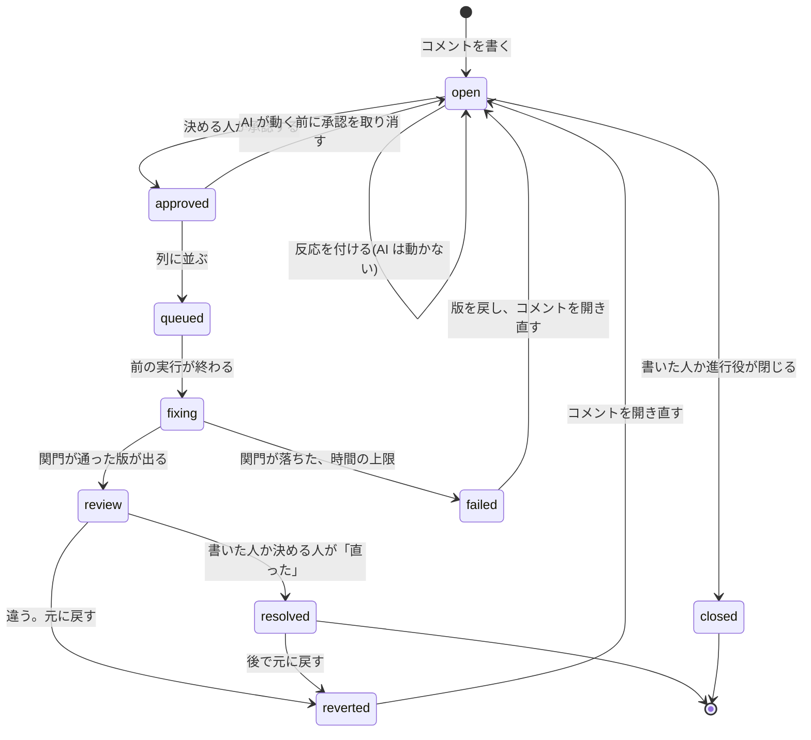
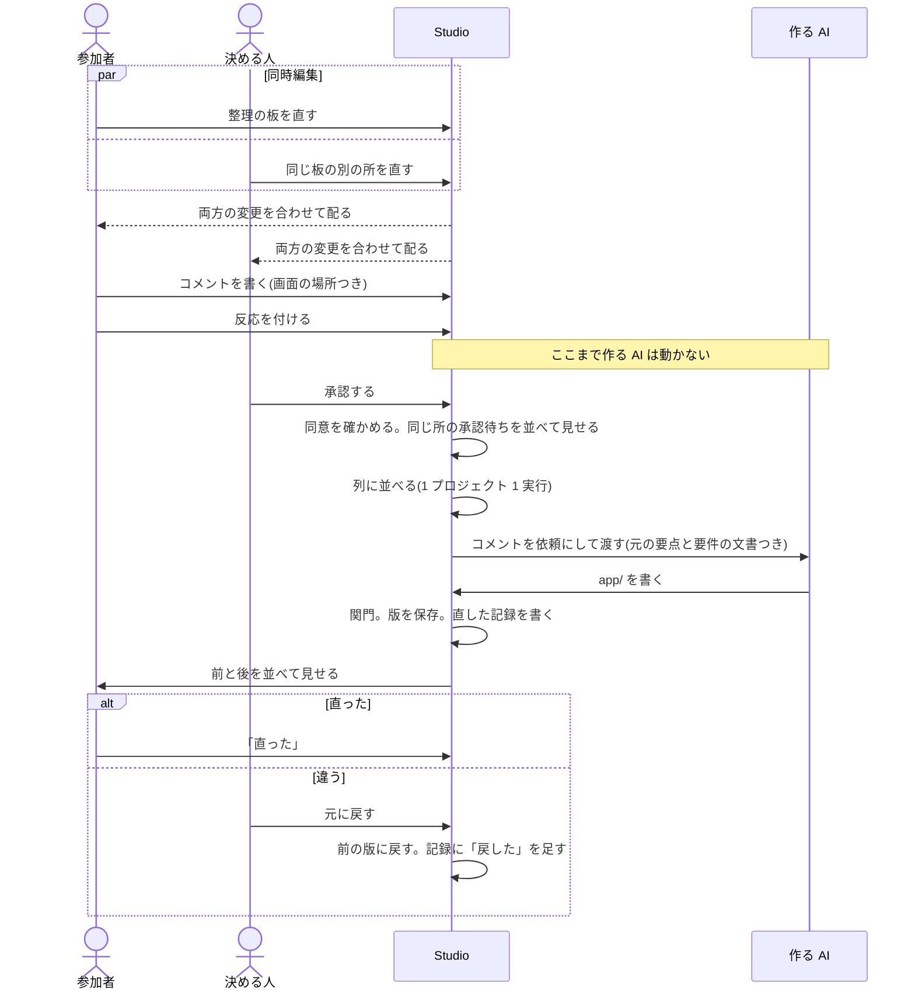

# 同時に作ることとコメントの流れ

[目的の文書](../vision.md)の 2 つ目の柱「みんなで、その場で作る」の設計です。同時編集、コメント、反応、承認、AI への送り、直した結果の確かめ、元に戻す、の流れと決まりを書きます。今の「手元で動く」形との食い違いと、両立の案も書きます。

- 状態: 案(task 380)。書いた日: 2026-10-29。2 節(同時に書くもの)、3 節(承認する人)、6 節(手元か共有か)、7 節(お客さんのデータ)は、運営者が 2026-10-29 に決めた(task 381)。決めたことは 8 節
- 前提: [vision.md の 10 節](../vision.md#10-野望-みんなでその場で作る)、[field-session.md](field-session.md)、[ADR 0001](../adr/0001-local-runtime-and-isolation.md)。決定は [ADR 0004](../adr/0004-shared-session-and-customer-data.md)(段 1 は採用、段 2 は未決)
- 出典は 2026-10-29 に読んだ。確かめられなかったことは「不明」、自分の見立ては「推測」と書いた
- 人物と会社は架空([field-session.md の 1 節](field-session.md#1-人物と場面))

## 結論

- 人が同時に書くのは、文書(整理の板、要件の文書、データ設計、場面の一覧)とコメントだけにする。試作品のソース(`app/`)を書くのは、今と同じく作る AI だけ(2 節。決めた)
- コメントは誰でも書け、反応も誰でも付けられる。作る AI に送るのは、承認されたコメントだけ。反応の数では動かない(3 節、4 節)
- 見た目と動きのコメントは、進行役か決める人の 1 人の承認で作る AI に送る。要件を変えるコメントは、進行役とお客さん側の決める人の 2 人の承認がそろってから送る(3 節。決めた)
- 直すたびに「直した記録」を `.studio/` に残す。どのコメントから、誰が承認し、何が変わり、関門がどうだったか。元に戻しても記録は消さない(5 節)
- 今の Studio は 1 台の PC の 127.0.0.1 で動く。両立の案は 3 つ。まず案 A(1 台の PC でみんなで。ADR 0001 を変えない)で 1 時間を通す。案 C(手元で作り、中継のサーバーで文書とコメントだけを同期する)は、K6 で操作役が詰まりになると分かってから、運営者が ADR 0004 の段 2 を採るかを決める。案 B は採らない(6 節。決めた)
- お客さんの話は同意の後に扱い、お客さんの記録(個人情報、取引の実データ)は入れない。消す日の既定は 30 日(仮)。本物のお客さんの会で使う前に、会社のデータの取り決め(Commercial Terms など)を決める(7 節。決めた)

## 1. 似た道具と仕組み(調べたこと)

| 道具、仕組み | 調べたこと | 出典 | Studio に持ってくるもの |
|---|---|---|---|
| Figma の同時編集 | 本物の CRDT ではなく、CRDT に習った形。サーバーが正で、物の属性ごとに、最後にサーバーに届いた値が残る。切れている間も編集でき、つながると最新を受け取り、手元の変更を上に当て直す | [How Figma's multiplayer technology works](https://www.figma.com/blog/how-figmas-multiplayer-technology-works/)(2019-10-16) | 中心の場を正にする考え方。属性ごとの「最後が勝つ」で足りる所は、それで済ませる |
| Yjs | 同時の変更を、衝突なしに合わせる CRDT。通信の方式を決めず、WebSocket、WebRTC などの部品でつなぐ。保存の部品(IndexedDB など)もある。MIT | [Yjs の文書](https://docs.yjs.dev/)、[GitHub](https://github.com/yjs/yjs) | 文書の同時編集の候補。中継のサーバーを差し替えられる |
| Automerge | ローカルファーストの同期の仕組み。切れていても使え、つながると同期する。P2P、サーバー、ファイルのどれでも同期できる。MIT | [automerge.org](https://automerge.org/)、[GitHub](https://github.com/automerge/automerge) | Yjs と並ぶ候補。履歴を手元に全部持つ |
| ローカルファーストの 7 つの理想 | 待たせない、1 台に閉じ込めない、ネットワークなしでも使える、同僚と自然に一緒に作る、長く残る、守りと秘密が既定、持ち主が自分で持つ | [Local-first software](https://www.inkandswitch.com/essay/local-first/)(Kleppmann ほか、2019) | 案 C の考え方。データの持ち主は進行役の PC |
| Liveblocks のコメント | コメントのスレッドに、AI のエージェントを参加させる例がある(@ で呼ばれると答える)。AI を人と並ぶ参加者として扱う | [Next.js comments AI](https://liveblocks.io/docs/get-started/nextjs-comments-ai)、[1.9 の記事](https://liveblocks.io/blog/liveblocks-1-9-comments-improvements-that-enable-ai-agents-chat-moderation-thread-filtering-and-more) | コメントを AI への入口にする形。ただし Studio は @ ではなく承認で動かす |
| Lovable のチーム | 招待した人どうしで、カーソルと変更が見える、と公式の文書にある | [Lovable の Teams](https://docs.lovable.dev/user-guides/teams) | 作る AI の道具でも同時の参加が求められている、という傍証。コメントと承認の形があるかは不明 |

承認してから AI が直す形を持つ道具は、見つけられませんでした。見つけられなかっただけで、無いとは言えません。

## 2. 何を同時に書くか

| 対象 | 書く人 | 同時の書き方 | 理由 |
|---|---|---|---|
| 整理の板、要件の文書、データ設計、場面の一覧、未決事項 | 参加者の全員(見るだけの人を除く) | 同時編集。字の単位で合わせる(CRDT。Yjs か Automerge) | 会の間に、何人もが同じ所を直す |
| コメントと反応 | 参加者の全員 | 足すだけ。消すのは書いた本人と進行役 | 上書きが起きない形にする |
| 承認、差し戻し、元に戻す | 決める人(3 節) | 1 件ずつ。Studio が順に並べる | 作る AI を動かす操作なので、順を決める |
| 試作品のソース(`app/`) | 作る AI だけ。人は書かない | 1 プロジェクト 1 実行(今のまま)。承認したコメントは列に並ぶ | 人と AI が同時に書くと、関門が何を確かめたかが分からなくなる |
| 版、直した記録、ビルド | Studio だけ(`.studio/`) | 書くのは Studio の決まった手順だけ | 作る AI に書き換えさせない(ADR 0001) |

人が同時に書くのは文書とコメントだけで、試作品のソースは作る AI が書く(運営者が 2026-10-29 に決めた)。

試作品の文言や色を、人がその場で直接直す道(画面の上で書き換える)は、この案に入れていません。要るかは、通し(K6)で使ってから決めます。

## 3. 役と、できること

| できること | 進行役(持ち主) | 決める人(お客さん側) | 参加者 | 見るだけ |
|---|---|---|---|---|
| 文書を直す | できる | できる | できる | できない |
| コメントを書く | できる | できる | できる | できない |
| 反応を付ける | できる | できる | できる | できない |
| 見た目と動きのコメントを承認する | できる(1 人の承認で送る) | できる(1 人の承認で送る) | できない | できない |
| 要件を変えるコメントを承認する | できる(2 人の承認がそろってから送る) | できる(2 人の承認がそろってから送る) | できない | できない |
| 直った版を「直った」にする | できる | できる | 書いた本人はできる | できない |
| 元に戻す | できる | できる | できない | できない |
| 招待する、役を変える | できる | できない | できない | できない |
| 会のデータを消す | できる | 消すように頼める(進行役が消す) | できない | できない |

- コメントの種類は 3 つ。「見た目と動き」(画面、文言、流れ)と「要件」(要求、決まりごと、データを変える)と「構成」(AI の作りを変える。2026-10-31 に足した。承認しても作る AI に送らず、AI 構成の審査に戻す)。書く人が選ぶ。承認する人が直す口は、K3 では作っていない
- 見た目と動きのコメントは、進行役か決める人の 1 人が承認すれば作る AI に送る。要件を変えるコメントは、進行役とお客さん側の決める人の 2 人の承認がそろってから送る(運営者が 2026-10-29 に決めた)
- 要件のコメントは、お客さんとの約束を変える。だから、お客さん側の決める人の承認を要る形にした
- 決める人は、会の始めに進行役が決める。既定は進行役 1 人と、お客さん側 1 人
- 1 台の PC で通す形(6 節の案 A)では、全員が同じ画面を使う。承認は、決める人がその場で声に出し、進行役が押す。押した人と、声に出した人の両方を記録に残す

## 4. 流れ

### コメントの状態

状態の名前は英語にしています(図の書き方の決まりのため)。画面では、開いている、承認した、待っている、直している、確かめる、直った、戻した、閉じた、落ちた、と出します。

### 同時編集から、直した結果の確かめまで

図の Studio は、案 A では進行役の PC の Studio です。案 C では、同時編集の配りを中継のサーバーが受け持ち、承認を確かめて作る AI に渡すのは進行役の PC の Studio のままです(6 節)。

## 5. 決まり

### 承認の前に AI が動かない

- 作る AI を動かせるのは、承認されたコメントと、作る欄の依頼(今のまま)だけ。反応、コメントの書き込み、文書の編集では動かない
- 承認されたコメントの文は、そのまま依頼にしない。Studio が決まった形(画面の場所、どうなってほしいか、元の要点、要件の文書の関係する項目)に包んで渡す
- 本物の AI の同意(今の P24)は、承認とは別に要る。同意がなければ、承認しても列で止まり、理由を出す
- 承認は、AI が動き出す前なら取り消せる。動き出した後は、元に戻すで扱う
- 確かめるテスト(案): 反応を 10 個付けても、偽の `claude` が起動しない。承認すると 1 回だけ起動する。承認を取り消すと起動しない

### 同じ所に向いたコメント

- 承認の前に、同じ画面の場所に向いた開いたコメントを並べて見せる。逆の向きのコメントがあれば、承認の画面に出す
- 承認は 1 件ずつ列に並び、前の実行が終わってから次を渡す。まとめて渡すかは、使ってから決める

### 直した記録

直すたびに 1 件、`.studio/` に残します。作る AI は `app/` の外を書けないので、記録を書き換えられません。

| 項目 | 中身 |
|---|---|
| コメント | ID、文、画面の場所、種類(見た目と動き、要件)、書いた人、反応の数 |
| 承認 | 承認した人(2 人のときは 2 人とも)、時刻。1 台の形では、押した人と声に出した人 |
| 依頼 | 作る AI に渡した文の全部 |
| 版 | 直す前の版と、直した後の版の ID |
| 変わったもの | 変わったファイルの一覧と差分の要約。要件の文書を変えたなら、変えた項目 |
| 関門 | 関門ごとの結果。今の run の記録(`.studio/runs/`)への参照 |
| 確かめ | 「直った」を押した人と時刻、または元に戻した人と時刻 |

引き継ぎ(J8 と K5)には、直した記録の一覧を入れます。要件の文書の各項目から、それを変えたコメントへたどれるようにします。

### 元に戻す

- 元に戻すは、今の版の復元を使う(作業中を保存してから戻す)。直した記録は消さず、「戻した」を足す
- 要件の文書を変えたコメントを戻すときは、要件の文書の項目も前に戻す
- 後のコメントで直した版がすでにあるときは、どこまで戻るかを画面に出し、確かめてから戻す

## 6. 今の作りとの食い違いと、両立の案

### 食い違い

| 今の決まり | 出典 | 同時に作ることとの食い違い |
|---|---|---|
| 127.0.0.1 だけで待ち受ける。Host と Origin を確かめる | ADR 0001 の層 3 | ほかの人の端末からつなげない |
| 起動ごとのトークンを、起動時の URL のフラグメントで 1 つの画面に渡す。Cookie は使わない | ADR 0001 の層 3 | 人ごとの認証と役(3 節)がない |
| 作業中の会話、実行の記録、本物の AI の同意は、Studio のメモリーにだけ持つ | hld.md の 5 節、ADR 0001 の T6 | 何人もが見る状態を、同じ形で配れない。同意が 1 人分 |
| 作る AI は、利用者本人のログインの Claude Code を子プロセスで動かす | ADR 0001、hld.md の 2 節 | ほかの人の承認で、進行役のログインの AI が動く。第三者の製品で claude.ai のログインを提供することは、事前の承認なしには認められていない([Agent SDK の文書](https://code.claude.com/docs/en/agent-sdk/overview))。Studio を共有の場にしたとき、これに当たるかは不明 |
| 実データを使わない。例は架空だけ | vision.md の 5 節、PRD | お客さんの話(要求)は、実在のお客さんの社内の情報 |
| 試作品は外へ通信しない。プロダクト内 AI の既定はモック | ADR 0001 の層 2 | ほかの人の端末で試作品を動かすとき、プロダクト内 AI をどこで動かすかが決まっていない |

### 案

| 案 | 中身 | 良い所 | 気になる所 |
|---|---|---|---|
| A. 1 台の PC でみんなで(ADR 0001 のまま) | 進行役の PC だけで Studio を動かし、大きな画面に映す。コメント、反応、承認は、その PC の画面で入れる。お客さんは声で言い、操作役が打つ。同時編集の仕組みは入れない | ADR 0001 を変えない。お客さんのデータは 1 台に閉じる。会議室のネットワークに頼らない。すぐ作れる | 本当の同時編集ではない。操作役が打つのが詰まりになる。離れた所の人は入れない |
| B. 手元の Studio を、同じ部屋の人に開く | 進行役の PC の Studio に、参加者用の口を 1 つ足し、同じネットワークの端末から招待リンクで入れる。参加者用の口は、文書、コメント、反応、試作品のビルドを見ることだけ。作る AI とビルドの API は出さない | データは進行役の PC に置いたまま。クラウドが要らない。本当の同時編集になる | ADR 0001 の「loopback だけ」を変える。お客さんの会議室のネットワークは、端末どうしの通信を止めていることが多い(推測)。LAN の中の暗号化(証明書)が要る。進行役の PC が止まると全員が止まる |
| C. 手元で作り、中継のサーバーで同期する(ローカルファースト) | 作る AI、ビルド、`app/` は進行役の PC のまま。文書、コメント、反応、ビルドした試作品の静的なファイルだけを、中継のサーバーで同期する(Yjs か Automerge)。参加者はブラウザで中継のサーバーに入る。中継のサーバーは、運営者かコンサル会社が持つ | 作る AI と隔離の 3 つの層は今のまま。離れた所の人も入れる。切れても進行役の PC で続けられる。中継のサーバーを差し替えられる | 中継のサーバーの運用、認証、保存、消し方が要る。お客さんの話が中継のサーバーを通る。中継のサーバーで中身を読めない形(端から端の暗号化)にできるかは不明 |

採らない案: すべてをクラウドで動かす形(作る AI もサーバーで動かす)。ADR 0001 の候補 E で範囲外にしたもので、作る AI を API の鍵で動かすことになり、費用と規約の前提が変わります。

### 決めたこと

運営者が 2026-10-29 に、おすすめのとおりに決めた(task 381)。

1. まず案 A で、理想の場面の 1 時間を通す(K3、K6)。同時編集なしでも、整理、設計、作る、見せる、承認して直すの速さは試せる。ADR 0001 を変えない
2. 案 A の通しで、操作役が詰まりになるかを測る。K6 で詰まりになると分かってから、運営者が ADR 0004 の段 2(案 C)を採るかを決める。採ったら K7 に進む
3. 案 B は採らない。お客さんの会議室のネットワークに頼るため、現場で動くかが読めない(推測)

案 C に進むときは、ADR 0001 の層 3 の外に「共有の場」を足すことになります。[ADR 0004](../adr/0004-shared-session-and-customer-data.md) の状態は「段 1 は採用、段 2 は未決」です。

## 7. お客さんのデータの扱い

運営者が 2026-10-29 に決めた(task 381): お客さんの話は同意の後に扱い、記録(個人情報、取引の実データ)は入れない。消す日の既定は 30 日(仮)。本物のお客さんの会で使う前に、会社のデータの取り決め(Commercial Terms など)を決める。

### 分け方

| 区分 | 例(架空) | 扱い |
|---|---|---|
| お客さんの話 | 「電話の半分は再配達」「17 時を過ぎたら翌日」 | 扱う。整理の板と要件の文書に入る。作る AI と整理する AI に送る(同意の後) |
| お客さんの記録 | 実在の人の名前、住所、電話番号、荷物の番号、取引の数字 | 入れない。試作品のデータは架空だけ(今のまま) |
| お客さんの素材 | お客さんのロゴ、社内の画面の写し | 入れない(この案では)。入れるなら、素材の作戦([design-materials.md](design-materials.md))の取り込みで、ライセンスと同意を確かめる |

お客さんの記録が話に出たら、項目にせず、「記録らしいものを省いた」と出します。今の引き継ぎの、秘密らしい文字列の検査と同じ考え方です。

「記録らしい」とみる形は K4 で決めました(task 390)。電話番号(全角、空白、かっこの打ち方も)、メールアドレス、番地のある住所、名乗りと「氏名:」の後の名前、敬称の付いたフルネーム、9 桁以上の番号です。人が打った文は Studio が保存せずに断るので、AI に送られません。形に当たらない記録は整理する AI に頼ります。指示で項目にしないよう伝え、記録らしいと言った要点は一覧から消します。その場合は、一度 AI に届きます。形で見分けるので漏れがあり、名字だけの呼び名と短い番号は止まりません。詳しくは [user-journey.md の K4 で決めたこと](user-journey.md#k4-で決めたことtask-3902026-11-02)です。

### 置き場、見られる人、消し方

| 項目 | 案 A | 案 C |
|---|---|---|
| どこに置くか | 進行役の PC の `~/PrototypeStudio/projects/<id>/` だけ | 進行役の PC と、中継のサーバー(文書、コメント、反応、試作品の静的なファイル) |
| 誰が見られるか | 進行役の PC を使える人 | 招待された人。役(3 節)で書けるものが変わる。中継のサーバーの運用者が中身を読めるかは、暗号化の方式しだい(不明) |
| どこへ送るか | 作る AI と整理する AI の送り先(Anthropic)。Claude Code の会話の保存はしない(`--no-session-persistence`、ADR 0001 の #274)。API の入出力は、既定で 30 日以内に消す、と Anthropic は書いている。データを残さない取り決めもある([出典](https://privacy.claude.com/en/articles/7996866-how-long-do-you-store-my-organization-s-data))。サブスクのログインのときの扱いは確かめていない | 案 A と同じ。加えて中継のサーバー |
| 消し方 | 「会のデータを消す」で、プロジェクト、版、直した記録、run、引き継ぎの書き出しを消す。消した一覧を出す | 案 A に加えて、中継のサーバーの写しを消す。参加者のブラウザに残った写しは、次に開いたときに消す(消えたことを確かめる方法は不明) |
| 消す日 | 会の始めに決める。既定は 30 日(仮。2026-10-29 に決めた)。過ぎたら知らせる。Studio は勝手には消さない(K4) | 同じ |

### 会の始めに見せること

- 何を送るか(お客さんの話、整理の板、試作品のソース)と、送り先
- どこに置くか、誰が見られるか、いつ消すか
- お客さんの記録を入れないこと
- 同意しない道(お試しの AI だけで通す)

## 8. 決めたこと、決めていないこと、確かめていないこと

### 決めたこと

運営者が 2026-10-29 に、おすすめのとおりに決めた(task 381)。

| 決めたこと | 中身 | 書いた所 |
|---|---|---|
| 何を同時に書くか | 人が同時に書くのは文書とコメントだけ。試作品のソースは作る AI が書く | 2 節 |
| 承認する人 | 見た目と動きのコメントは、進行役か決める人の 1 人の承認で AI に送る。要件を変えるコメントは、進行役とお客さん側の決める人の 2 人の承認がそろってから | 3 節 |
| 手元か共有か | まず案 A で 1 時間を通す。案 C は、K6 で操作役が詰まりになると分かってから、運営者が ADR 0004 の段 2 を採るかを決める。案 B は採らない | 6 節、[ADR 0004](../adr/0004-shared-session-and-customer-data.md) |
| お客さんのデータ | 話は同意の後に扱い、記録は入れない。消す日の既定は 30 日(仮) | 7 節、[vision.md の 5 節](../vision.md#5-しないこと) |

### K3 で作ったこと

案 A の形(1 台の PC、役は進行役と決める人)を、見せる画面の上に作った(task 393、2026-11-11)。コメント、反応、承認、列、直した記録(5 節の項目)、前と後の比べ、元に戻す、構成のコメントを審査に戻す、がある。状態の名前は 4 節のとおりで、「承認した」は列に入る前の一瞬なので残さず、構成のコメントには「審査に戻した」を足した。作って決めたことと残りは [user-journey.md の「K3 で決めたこと」](user-journey.md#k3-で決めたことtask-3932026-11-11)。

### 決めていないこと、確かめていないこと

- ADR 0004 の段 2(案 C)を採るか: K6 で操作役が詰まりになると分かってから、運営者が決める
- 会社のデータの取り決め(Commercial Terms など): 本物のお客さんの会で使う前に、運営者と会社が決める
- 進行役のログインの作る AI を、ほかの人の承認で動かしてよいか(Claude の利用の決まり): 規約の読み方は不明。共有の場で動かす K7 の前に確かめる
- 中継のサーバーで、中身を読めない形にできるか: 不明。Yjs の部品の一覧に暗号化をうたうものがあるが、確かめていない
- 同時編集の仕組みを Yjs と Automerge のどちらにするか: K7 で比べる。どちらも MIT
- 試作品を人がその場で直接直す道: 入れていない。通しで要るかを見る
- 参加者の端末で動く試作品のプロダクト内 AI: 案 C では、モックだけにするのがおすすめ(費用と同意が 1 人分のため)。本物は進行役の画面だけ
