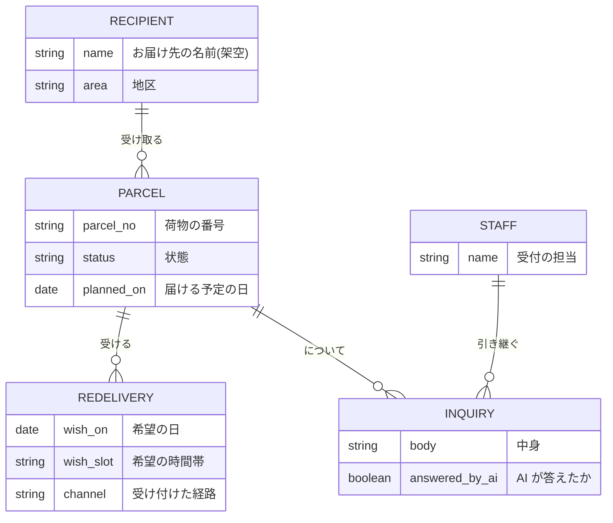
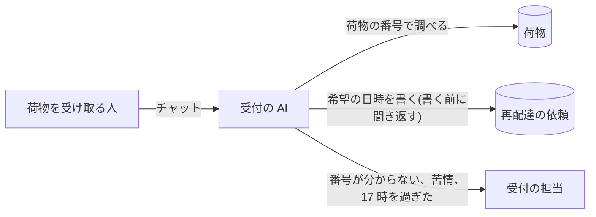

# ヒアリングの現場の 1 時間

[目的の文書](../vision.md)の 2 つ目の柱「みんなで、その場で作る」の、一番の理想の場面の設計です。コンサルが、お客さんのヒアリングの現場で Studio を使う 30 分〜1 時間を、分ごとの段に分けます。要件定義の何を、この 1 時間の成果物で置き換えるかも決めます。

- 状態: 案(task 380)。書いた日: 2026-10-29。運営者の野望(2026-10-29)を元にした
- task 416(2026-10-31)で、段 3 を AI 構成の審査に直し、分の割り当てを変えた。案で、運営者がその PR で決める
- task 384(2026-10-31)で K1 を作り、段 1 の AI の動きを「押したときに整理する」に直した([user-journey.md の 7 節](user-journey.md#k1-で決めたことtask-3842026-10-31))
- 前提: [vision.md の 10 節](../vision.md#10-野望-みんなでその場で作る)、[AI 構成の審査](ai-architecture-review.md)、[user-journey.md](user-journey.md)、[同時に作ることとコメントの流れ](collaboration.md)、[ADR 0004](../adr/0004-shared-session-and-customer-data.md)(段 1 は採用、段 2 は未決)
- 人物、会社、題材は、どれも架空。分の割り当ては、まだ測っていない仮の値

## 結論

- 1 時間を 7 つの段に分ける。聞く、AI が整理する、AI 構成の審査、試作品、見せてコメントをもらう、承認して AI が直す、要件の文書と引き継ぎ(2 節)
- 段 3 を 8 分から 12 分にした(30 分の型は 4 分から 5 分)。4 つの審査をお客さんと読むため。聞く段と見せる段を削り、見せられるまでの目安は変えない(2 節)
- 「聞く」と「AI が整理する」は並べて進める。AI は話を聞きながら、要求、使う人、場面、決まりごと、データの 5 つの欄に整理する。整理した各項目に、元の発言を付ける
- 一番時間のかかる段は「試作品」と見込む。作る AI の 1 回の起動の時間は、小さな直しで 14.6 秒と 16.4 秒(合わせて 31.1 秒)を測った。ゼロから作る時間は測っていない(4 節)
- 1 時間で出す成果物は 7 つ。要件の文書、データ設計、構成の図、AI 構成書、試作品、場面の一覧、未決事項。会の終わりの状態は「お客さんと確かめた下書き」。清書と、人が確かめ切る作業は会の後に残る(3 節)
- 「1 か月の要件定義を 1 時間で終わらせる」とは、まだ書かない。置き換えられるのは、要求の聞き取りと最初の合意まで。非機能、既存システムとのつなぎ、見積もり、契約は残る。測ってから言い方を決める(3 節)

## 1. 人物と場面

| 役 | 人(架空) | 中身 |
|---|---|---|
| 進行役 | 早瀬さん | 架空のコンサル会社「みちしるべ相談所」の人。お客さんに聞き、会を進める。試作品の持ち主 |
| 操作役 | 柚木さん | 同じ会社の人。Studio を操作し、整理を直す。1 人で来るときは、進行役が兼ねる |
| 決める人 | 野上さん | 架空の会社「しおかぜ便」(地域の小さな配送会社)の業務部長。要求を決める |
| 参加者 | 宇田さん | しおかぜ便の受付の担当。毎日、電話の問い合わせを受けている |

お客さんの悩み(架空): 再配達と「荷物はいつ届くか」の電話が多く、受付が手いっぱい。AI に問い合わせを受けさせたいが、何をどこまで任せられるかが分からない。

場所は、しおかぜ便の会議室。進行役の PC を大きな画面に映す。参加者は、自分の PC かタブレットから、整理の板と試作品を見てコメントを書く(同時に書けるかは、[collaboration.md の 6 節](collaboration.md#6-今の作りとの食い違いと両立の案)の案で変わる)。

## 2. 1 時間の段

```mermaid
gantt
  title ヒアリングの現場の 1 時間(分は仮)
  dateFormat HH:mm
  axisFormat %H:%M
  section 聞いて整理する
    0 始める(目的、データの扱い、同意)   :s0, 00:00, 5m
    1 聞く                               :s1, 00:05, 13m
    2 AI が整理する(聞きながら)         :s2, 00:05, 18m
  section 審査して作る
    3 AI 構成の審査                      :s3, 00:23, 12m
    4 試作品                             :s4, 00:35, 10m
  section 見せて直す
    5 見せて、コメントをもらう           :s5, 00:45, 7m
    6 承認して AI が直す                 :s6, 00:52, 5m
  section 渡す
    7 要件の文書と引き継ぎ               :s7, 00:57, 3m
```

### 一覧

| 段 | 60 分の型 | 30 分の型 | 人がすること | AI がすること | 成功の印 |
|---|---|---|---|---|---|
| 0. 始める | 0〜5 分 | 0〜2 分 | 会の目的、データの扱い、AI に送ることを伝え、同意をもらう | 何もしない(同意の前は送らない) | 決める人が同意を押した |
| 1. 聞く | 5〜18 分 | 2〜9 分 | お客さんに聞く。操作役が要点を打ち、区切りで「整理する」を押す | (2 段と並べて)話を整理する | 5 つの欄に 1 つずつ以上の項目がある |
| 2. AI が整理する | 5〜23 分 | 2〜11 分 | 整理の板を、お客さんと一緒に直す | 要求、使う人、場面、決まりごと、データに分ける | お客さんが「この理解で合っている」を押した |
| 3. AI 構成の審査 | 23〜35 分 | 11〜16 分 | 場面の下書きを確かめ、案を読み、4 つを承認する | 構成、harness、データと RAG、技術の組の案、画面とデータ設計の案を出す | 4 つの承認がそろい、AI 構成書ができた |
| 4. 試作品 | 35〜45 分 | 16〜21 分 | 作っている間に、場面の一覧を一緒に読む | 試作品を作り、関門で確かめる | 関門が通った試作品が出た |
| 5. 見せて、コメントをもらう | 45〜52 分 | 21〜25 分 | お客さんが触り、コメントと反応を付ける | 何もしない(承認の前は動かない) | コメントが付いた。反応が集まった |
| 6. 承認して AI が直す | 52〜57 分 | 25〜28 分 | 承認する。直った版を確かめる | 承認したコメントだけで直す | 承認から直った版まで 5 分以内(仮) |
| 7. 要件の文書と引き継ぎ | 57〜60 分 | 28〜30 分 | 未決事項と次の会を決める | 7 つの成果物をまとめる | 7 つがそろい、未決事項に持ち主が付いた |

30 分の型は、聞く段と見せる段を短くし、案を 2 つに絞る形です。どちらの型も測っていません。現場の場面の通し(K6)で測って直します。

60 分の型で段 3 を伸ばした分は、聞く段(2 分)、見せる段(1 分)、会の終わり(1 分)から取りました。30 分の型では、聞く段から 1 分取りました。見せられるまでの目安(60 分の型で 45 分、30 分の型で 21 分)は変えていません。AI が案を出す待ち時間は、整理の間に下書きを進めることで短くする見込みです(推測)。

### 段 0. 始める(目的、データの扱い、同意)

| 項目 | 中身 |
|---|---|
| 人がすること | 進行役が、会の目的と流れを 1 分で話す。何を AI に送るか、どこに残すか、いつ消すかを画面で見せる。決める人が同意を押す |
| AI がすること | 何もしない。同意の前に、整理する AI も作る AI も呼ばない |
| 画面 | 会の始めの画面(K4)。目的、流れ、データの扱い(置き場、見られる人、消す日)、送り先、「同意して始める」、「お試しの AI だけで始める」 |
| 成功の印 | 決める人が同意を押した。消す日が決まった |
| つまずき | お客さんの社内の決まりで、外の AI に送れない。その場で決められない |
| 備え | 会の前に、データの扱いの文をお客さんに送っておく。送れないときは、「お試しの AI だけで始める」で通す。要点は手で振り分け、設計は決まった案で進める。外の AI に送る接続では、作る AI は動かない |

### 段 1. 聞く

| 項目 | 中身 |
|---|---|
| 人がすること | 進行役が聞く。誰が、いつ、何に困るか。今どうしているか。うまくいったら何が変わるか。操作役は、聞いた要点を短く打ち、話の区切りで「整理する」を押す |
| AI がすること | 2 段と並べて動く。押されたときに、打たれた要点を 5 つの欄に振り分ける。打つたびには呼ばない。待つ間も要点は打てる |
| 画面 | 聞き取りの欄(新)。左に打った要点、右に整理の板 |
| 成功の印 | 要求、使う人、場面、決まりごと、データの 5 つの欄に、1 つずつ以上の項目がある |
| つまずき | 打つのが話に追いつかない。お客さんが話しながら画面を見て、話が止まる |
| 備え | 打つのは要点だけでよい。文字起こしを使うかは決めていない(7 節) |

聞く順の型(案): 今の流れ、困っている所、例外、使う人、扱うデータ、成功の印。業種ごとの型は、会の前に選べるようにします(推測。使ってから決める)。

### 段 2. AI が整理する(要求、使う人、場面、決まりごと、データ)

| 項目 | 中身 |
|---|---|
| 人がすること | 整理の板を大きな画面で見せ、お客さんと一緒に直す。違う項目は消し、足りない項目を足す。最後に決める人が「この理解で合っている」を押す |
| AI がすること | 要点を 5 つの欄に振り分ける。各項目に元の要点を付ける。話に出ていない項目は「推測」の印を付ける。矛盾と、聞いていないことを「聞くこと」に出す |
| 画面 | 整理の板(K1)。5 つの欄と「聞くこと」。今は 1 台の PC で直す。全員が同時に直せるのは K7 |
| 成功の印 | 「推測」の印の項目が、全部確かめられたか、未決事項に移った。決める人が「この理解で合っている」を押した |
| つまずき | AI が話していないことを書き足す。言葉が業界の言い方とずれる |
| 備え | 元の要点のない項目は「推測」と出す。お客さんの言葉を、そのまま項目の名前に使う |

5 つの欄の例(しおかぜ便、架空):

| 欄 | 項目の例 | 元の要点 |
|---|---|---|
| 要求 | 再配達の受付を、電話なしで済ませたい | 宇田さん「電話の半分は再配達」 |
| 使う人 | 荷物を受け取る人。受付の担当 | 野上さん「お年寄りのお客さんも多い」 |
| 場面 | 不在票を見て、今日の夜に届けてほしい | 宇田さん「夕方に電話が集中する」 |
| 決まりごと | 再配達の受付は、その日の 17 時まで | 野上さん「17 時を過ぎたら翌日」 |
| データ | 荷物の番号、お届け先、希望の日時 | 宇田さん「不在票に番号がある」 |
| 聞くこと | 荷物の番号を忘れた人は、どうするか | (AI が出した。話に出ていない) |

### 段 3. AI 構成の審査(エージェントの構成、harness、データと RAG、技術の組)

| 項目 | 中身 |
|---|---|
| 人がすること | 場面の下書きを確かめる。進行役が案を平たい言葉で話し、お客さんと読む。4 つを承認する。選んだ理由を 1 文で残す |
| AI がすること | 整理の板と場面の下書き(整理の板の場面と決まりごとから Studio が作る)を読み、4 つの案を出す。簡単な方から問いに答える(固定の流れ、単一エージェント、マスターとサブ)。足りたらそこで止まり、「要らない」と書く。画面(どこで話すか)とデータ設計(何を持つか、どうつながるか)の案もそろえる。数は書かない |
| 画面 | AI 構成の審査(#422)。構成の図、問いへの答え、何をモデルに任せ何をコードで縛るか、データの棚と RAG の判定、技術の組。設計の案の比べ(J2)。データ設計の図 |
| 成功の印 | 4 つの承認がそろった。AI 構成書に、承認した人、時刻、指紋、日付、根拠の場面が残った。データ設計の図に、整理の板のデータの欄が全部載った |
| つまずき | 技術の言葉がお客さんに伝わらない。案の違いが分からない。読まずに承認を押す。数が間に合わない |
| 備え | 技術の言葉と平たい言葉を並べる。データ設計は「何を覚えておくか」「何と何がつながるか」の言葉を添え、主キーや関係の言葉も隠さない。回していない案は「まだ測っていない」と出し、数がなくても承認できる形にする(印が残る)。「理想の構成」と言わない |

承認する人は、エージェントの構成と技術の組が進行役、harness とデータと RAG が進行役と決める人の 2 人です。1 台の PC の形では、決める人が声に出し、進行役が押します([AI 構成の審査の 9 節](ai-architecture-review.md#9-承認する人))。

この段で実モデルで案を比べるかは、決めていません([12 節](ai-architecture-review.md#12-決めていないこと))。比べるなら、同意と費用の上限を通し、見せる場面を絞ります。

審査の例(しおかぜ便の案 A、架空。まだ測っていない):

| 審査すること | 今日の一番良い推測 | 要らないと書いたもの | 承認する人 |
|---|---|---|---|
| エージェントの構成 | 固定の流れ。番号を聞く、荷物を引く、時間帯を選ぶ、確かめて書く | 単一エージェント、マスターとサブ。手順をコードに書けるため | 進行役 |
| harness | モデルは読み取りと言い方だけ。順番、書く前の確認、人に渡す条件はコード | なし | 進行役と決める人 |
| データと RAG | 荷物と再配達の依頼はツールで引く。17 時の決まりはプロンプトに入れる | RAG。表と短い決まりだけのため。約款を読む場面が要るようになったら判定し直す | 進行役と決める人 |
| 技術の組 | 試作品は代わりのモデルと架空のデータ。本番の候補は確かめていない | なし | 進行役 |

データ設計の図の例(しおかぜ便の案 A、架空):

図の名前は英語にしています(図の書き方の決まりのため)。RECIPIENT はお届け先、PARCEL は荷物、REDELIVERY は再配達の依頼、INQUIRY は問い合わせ、STAFF は受付の担当です。審査の画面とお客さんに見せる画面では、日本語の名前で出します。

構成の図の例(案 A、架空):

### 段 4. 試作品

| 項目 | 中身 |
|---|---|
| 人がすること | 4 つの承認の後に「この設計で作る」を押す。作っている間に、場面の一覧をお客さんと読み、足りない場面を足す |
| AI がすること | 整理の板と選んだ案を依頼に入れて、試作品を作る。架空のデータ(荷物 10 件など)を作る。関門で確かめ、落ちたら直す(今の作るループ)。承認した構成と違えば止め、審査に戻す |
| 画面 | 作っている途中の帯(今の作る run の段)。場面の一覧(新) |
| 成功の印 | 関門が通った試作品が出た。場面の一覧に、うまくいく場面と、分からない、断る、人に渡す場面がある |
| つまずき | 作るのに時間がかかり、会が止まる。作った試作品が、選んだ案と違う |
| 備え | 待つ間にすることを画面が示す(場面を読む)。時間の上限を超えたら、前の段の成果物で話を続ける |

### 段 5. 見せて、コメントをもらう

| 項目 | 中身 |
|---|---|
| 人がすること | お客さんが試作品を触る。気になる所にコメントを付け、ほかの人のコメントに反応(賛成など)する |
| AI がすること | 何もしない。反応がいくつ付いても、作る AI は動かない |
| 画面 | 見せる画面(J7。試作品と確かめたい問いだけ)。画面の場所に付くコメント(新) |
| 成功の印 | コメントが付いた。どのコメントに賛成が多いかが見える |
| つまずき | お客さんが、試作品を本物だと思う。コメントが「全体的に分かりにくい」のように直し方の分からない文になる |
| 備え | 見せる画面に「試作品。データは架空」と出す。コメントの欄に、場所と、どうなってほしいかの例を出す |

### 段 6. 承認して AI が直す

| 項目 | 中身 |
|---|---|
| 人がすること | 承認できる人が、送るコメントを承認する。直った版を、コメントを書いた人と一緒に確かめる。違えば元に戻す |
| AI がすること | 承認したコメントだけを依頼にして直す。直した記録(どのコメントから、何が変わったか)を残す |
| 画面 | コメントの承認と、直した結果の比べ(新)。版(今) |
| 成功の印 | 承認から直った版まで 5 分以内(仮)。コメントを書いた人が「直った」を押した |
| つまずき | 2 つのコメントが同じ所を逆の向きに直そうとする。直したら別の所が壊れる |
| 備え | 承認は 1 つずつ列に並べ、同じ所のコメントは承認の前に並べて見せる。関門が落ちたら版を戻す道を出す |

流れと決まりの全体は [collaboration.md](collaboration.md) にあります。

### 段 7. 要件の文書と引き継ぎ

| 項目 | 中身 |
|---|---|
| 人がすること | 未決事項を読み上げ、持ち主と期日を決める。次の会を決める |
| AI がすること | 7 つの成果物をまとめる。各項目に、元の要点か、承認したコメントを付ける |
| 画面 | 会の終わりの画面(新)。7 つの成果物、未決事項、書き出し |
| 成功の印 | 7 つがそろった。未決事項の全部に持ち主が付いた |
| つまずき | 会の終わりに時間が足りず、未決事項が決まらない |
| 備え | 未決事項は 2 段から溜めておき、ここでは持ち主を付けるだけにする |

## 3. 要件定義を何で置き換えるか

### 1 時間で出す成果物

| 成果物 | 中身 | AI が作るもの | 人が確かめること | 会の終わりの状態 |
|---|---|---|---|---|
| 要件の文書 | 目的、使う人、場面、要求、決まりごと、しないこと、成功の印 | 整理の板からの下書き。各項目に元の要点 | 決める人が「この理解で合っている」を押す。推測の印の項目を 1 つずつ確かめる | お客さんと確かめた下書き |
| データ設計 | 覚えておくもの、項目、つながり、誰が書くか | 図と表の案。架空のデータ | 進行役が、業務の流れと合うかを確かめる。項目の名前をお客さんの言葉にそろえる | 案。型と制約は会の後 |
| 構成の図 | AI が答える所、人に渡す所、守る所、使う道具 | 図の案(`app/composition.json` から描く) | 人に渡す条件を、お客さんが確かめる | 選んだ案 1 つと、捨てた案と理由 |
| AI 構成書 | 構成、harness、データと RAG、技術の組の審査の結果。承認した人、時刻、指紋、日付、根拠の場面 | 案。数は場面の回しの結果から Studio が入れる | 4 つを承認する | 承認済み。今日の一番良い推測で、測っていないものは印つき |
| 試作品 | 動く画面と、試作品の中の AI | 作る AI が作る。関門で確かめる | お客さんが触る。コメントを承認する | 関門が通った版 |
| 場面の一覧 | うまくいく場面、分からない、断る、人に渡す、遅い場面 | 整理の板の「場面」と「決まりごと」からの下書き | お客さんが、足りない場面を足す | 回した結果つき |
| 未決事項 | 決めていないこと、聞いていないこと、推測のまま残った項目 | 整理と設計の間に溜める | 持ち主と期日を人が付ける | 全部に持ち主 |

直した記録(どのコメントから何が変わったか)も残ります。これは成果物ではなく、上の 7 つの理由として引き継ぎに入れます。

### 置き換えないもの

ふつうの要件定義にあって、1 時間では扱わないもの。会の後に、人が続けます。

| 扱わないもの | 理由 |
|---|---|
| 非機能(性能、可用性、セキュリティ、運用) | 試作品では測れない。試作品は本番の品質を約束しない(vision.md の 5 節) |
| 既存システムとのつなぎの詳細 | 試作品は外へ通信しない(ADR 0001)。つなぐ先は構成の図に「未接続」と書くだけ |
| 見積もり、契約、体制 | Studio の範囲の外 |
| 法務、個人情報の扱いの判断 | 人と専門家が決める |
| 多くの関係者の合意 | 会に出た人の合意だけ。出ていない人の確かめは未決事項に入れる |

### 何で測るか

「1 か月を 1 時間で」は、測ってから言います。測るものの案です。目安の数は仮です。

| 測るもの | 何で測るか | 目安(仮) |
|---|---|---|
| 見せられるまでの時間 | 会の始め(同意)から、関門が通った最初の試作品を見せるまで。Studio が時刻を残す | 60 分の型で 45 分以内、30 分の型で 21 分以内 |
| 承認から直った版まで | 承認の時刻から、関門が通った版が出るまで | 5 分以内 |
| 成果物のそろい | 会の終わりに 7 つの成果物があるか | 7 つ全部 |
| 確かめた割合 | 要件の文書の項目のうち、推測の印が残っていない割合 | 9 割 |
| 会の後の直し | 会の後 1 週間で、要件の文書の項目を変えた数 | 測ってから決める |
| 要件定義にかかった期間 | 最初の会から、要件の合意までの日数と会の回数。ふつうの進め方と比べる | 測ってから決める。比べる元の「1 か月、何回も」は運営者の見立てで、測っていない |

## 4. 今の Studio との差

| 段 | 今あるもの | 無いもの | 差 |
|---|---|---|---|
| 0. 始める | 会の始めの画面、データの扱いの見せ方、消す日、同意、記録らしいものの検査、「会のデータを消す」(K4) | 本物のお客さんの会で使う前の、会社のデータの取り決め | 小 |
| 1. 聞く | 聞き取りの欄(K1) | 文字起こし | 小 |
| 2. AI が整理する | 整理する AI、整理の板、元の要点、推測の印、聞くこと、「この理解で合っている」(K1) | 同時に直すこと(K7)。使えるかの判断([#418 の記録](../evidence/real-organize/README.md)を運営者が読む) | 小 |
| 3. AI 構成の審査 | 構成の模擬(`app/composition.json`)と記録の絵。比べる表(ターミナル) | 審査の画面と AI 構成書(#422)、固定の流れのツール(#419)、親子の委任(#420)、データの棚と RAG の判定(#421)、案を並べる段(J2)、データ設計の案内と図(K2) | 大 |
| 4. 試作品 | 作るループと関門。小さな直しは、起動 2 回で 31.1 秒([実モデルの記録](../evidence/real-loop/README.md)) | 整理と設計を依頼に入れること。ゼロから作る時間の測り | 中 |
| 5. 見せて、コメントをもらう | 版 | 見せる画面(J7)、コメント、反応、ほかの人の端末からの参加 | 大 |
| 6. 承認して AI が直す | 版で戻す。1 プロジェクト 1 実行 | 承認、列、直した記録、直した結果の比べ | 大 |
| 7. 要件の文書と引き継ぎ | 引き継ぎ(形式 3) | 要件の文書、データ設計、AI 構成書、未決事項の持ち主 | 中 |

## 5. 試せるようにする順

1 台の PC だけで通す形(collaboration.md の案 A)で、まず 1 時間の流れを通します(運営者が 2026-10-29 に決めた)。同時編集は後にします。理由は、この場面の売りが「その場で整理し、作り、見せる」速さで、同時に書けることはその次だからです。カードと順は [user-journey.md の 6 節](user-journey.md#6-実装のカードの分け方)にあります。通し(K6、#396)は、審査(#422)、会の始め(K4、#390)、会の終わり(K5、#395)、引き継ぎ(J8、#392)の後です。

## 6. 確かめ方

- 現場の場面の通し(K6): 架空の台本(しおかぜ便の会の要点を順に打つもの)を、偽接続と偽の `claude` で最初から最後まで回す E2E。台本に AI 構成の審査を入れる。段ごとの時刻を残す。実モデルでの通しは、運営者が頼んだときだけ回す
- 人の確かめ: 社内の人がお客さんの役をして、架空の題材で 1 時間を通す。見せられるまでの時間、審査にかかった時間、つまずいた所を記録する。承認した人が、選んだ形を自分の言葉で言えるかを聞く

## 7. 決めていないこと、確かめていないこと

- 分の割り当て: 全部推測。段 3 の 12 分で 4 つを読めるかも測っていない。K6 と人の確かめで直す
- 段 3 で実モデルで案を比べるか: [AI 構成の審査の 12 節](ai-architecture-review.md#12-決めていないこと)
- ゼロから試作品を作る時間: 測っていない。小さな直しの 31.1 秒だけが測った値
- 聞く手段: 操作役が要点を打つ形を既定にした。文字起こしを使うか、使うならどこで動かすか(手元か外か)は決めていない。外に送るなら、お客さんの声を送ることになる
- 整理する AI の振り分けの質: 架空の台本で 3 回通した([記録](../evidence/real-organize/README.md)、#418)。K4 で指示を直して測り直した結果も同じ記録にある。使えるかは運営者が読んで決める。別の役にすることは K1 で決めた([user-journey.md の 7 節](user-journey.md#k1-で決めたことtask-3842026-10-31))
- 業種ごとの聞く順の型を持つか: 使ってから決める
- お客さんのデータの扱いは決めた(2026-10-29)。話は同意の後に扱い、記録は入れない。会社のデータの取り決めは、本物のお客さんの会で使う前に決める([collaboration.md の 7 節](collaboration.md#7-お客さんのデータの扱い)、[ADR 0004](../adr/0004-shared-session-and-customer-data.md))
