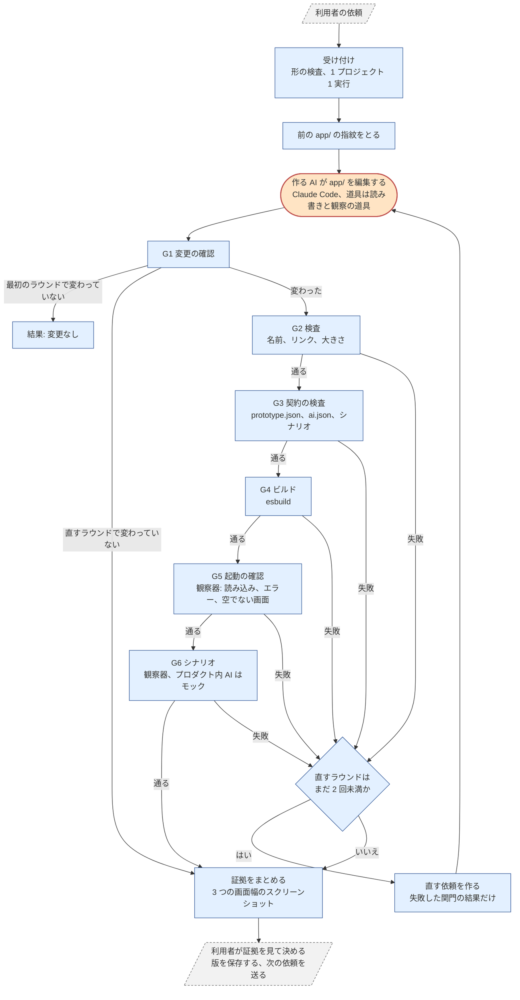
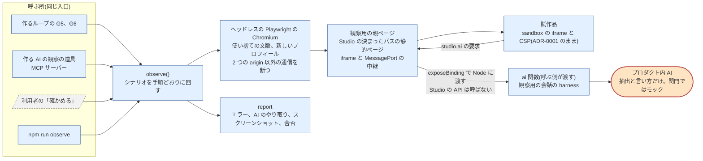
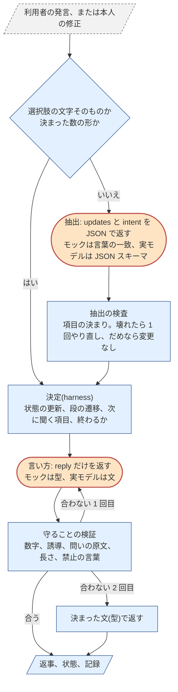
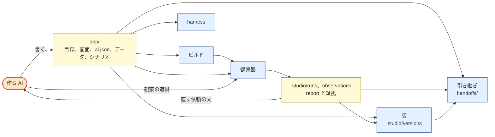
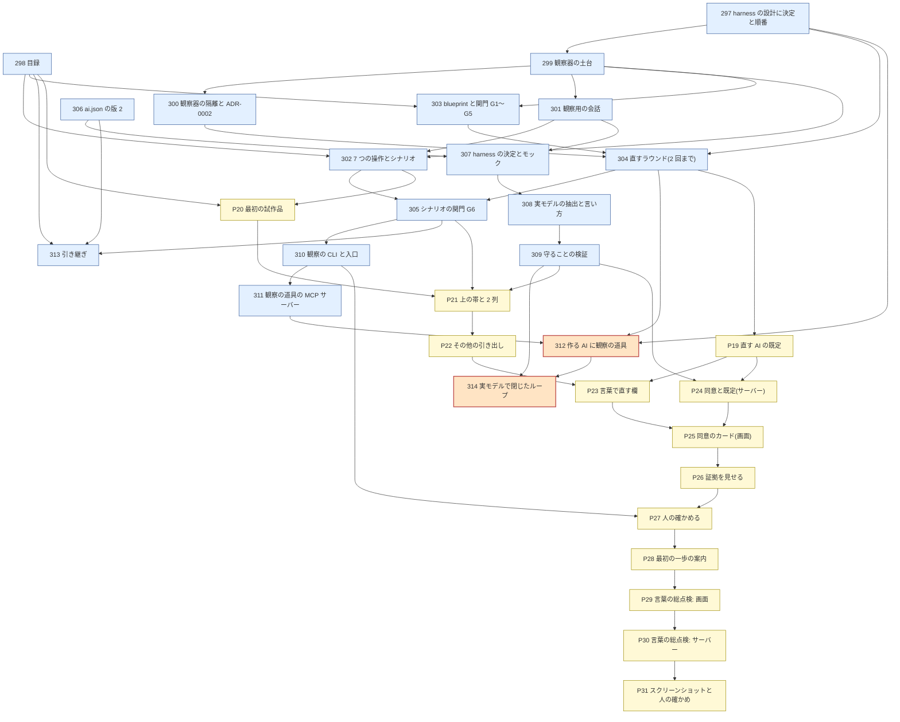

# Harness の設計(Stripe の設計思想を確かめられる基準にする)

- 状態: **案**(2026-10-28)。出典のタスク: jyoka/tasks#293(親 PRD: [docs/prd.md](../prd.md))。利用者が 2026-10-28 に決めたこと(終わりの「決めたこと」)と、カードの順番(8 節、jyoka/tasks#297)を反映した
- 読んだもの: PRD、[ADR-0001](../adr/0001-local-runtime-and-isolation.md)、[handoff.md](../handoff.md)、今のコード(`src/server/build-requests.js`、`src/runtime/runtime.js`、`src/server/product-ai/`)、Stripe の 2 記事(下の 1.1)、jyoka/aica の `docs/adr/0009-baito-consultation-harness.md` と `dip_mcp/baito/harness.py`、jyoka/tasks#292 の Goal
- 範囲: 設計だけ。実装は 8 節のカード(31 枚の「Prototype Studio (n/31)」)で行う

## 結論

- Studio の中心を、**コードで書いた作る run(blueprint)** にする。作る AI の編集の後に、決まった関門(検査、契約、ビルド、起動、シナリオ)を安い順に回す。失敗なら結果を作る AI に返して直させる。直すラウンドは 2 回まで。それでも失敗なら証拠つきで人に返す。
- **観察器**を作る。Studio がヘッドレスの Playwright の Chromium で試作品を動かし、操作、スクリーンショット、エラー、AI とのやり取りを report に残す。Harbor の Drydock に当たる、小さく独立した契約にする。作るループの関門、作る AI、人の「確かめる」、CLI が同じ観察器を使う。
- **作る AI も観察器を自分で使う。** 観察の 7 つの操作を、決まった名前の道具(MCP)として作る AI に渡す。画面を観察し、操作して直す。通ったかを決めるのは、いつも関門(コード)。
- **プロダクト内 AI の harness** を作る。何を聞くか、いつ終えるかは `ai.json` とコードが決める。モデルは抽出の JSON と返事の文だけを返す。モックと実モデルは同じ harness を通る。
- **成果物の契約**として、`app/prototype.json`(目録)と `app/scenarios/` を足す。作る AI、観察器、版、引き継ぎが、この契約でつながる。
- 確かめる基準は 1.2 のチェックリスト(S1〜S20)。どのカードも、満たす基準とそのテストを受け入れ条件に書く。jyoka/tasks#314 は、利用者の個人アカウントの Claude Code で閉じたループが回ることを確かめる。

## 1. Stripe の原則と、確かめる基準

### 1.1 読んだ記事と、言っていること・言っていないこと

| 記事 | 言っていること(原文の要約。引用は短く) | 言っていないこと |
|---|---|---|
| [Harbor: Stripe's AI-assisted prototyping tool](https://stripe.dev/blog/harbor-stripes-ai-assisted-prototyping-tool)(2026-09-14、Drydock もこの記事の中) | 作る AI が複数ファイルを書き、ブラウザでコンパイルして描画し、AI が見て直す。図の説明: "The agent writes files; Drydock compiles them in the browser; the agent inspects and iterates"。Drydock は "a small contract" で、複数ファイルの React と TypeScript の木を受け取り、動くページと report(コンパイルと実行時の失敗を含む)を返す。この契約は Harbor の他の部分に依存しないので、Kai など他の道具も使う。AI は描画されたページを読み、要素を一覧・検査し、クリック、入力、スクロール、画面幅の切り替え、スクリーンショットができる。AI は専門化させたまま、能力を MCP の道具として他の AI に出す。コメントは投稿した版に結びつき、新しい版を出すと古いコメントは stale になる。プロトタイプのファイルの木を、devbox のコーディング AI がリポジトリに取り込める | 直すループの回数の上限と止める条件、隔離とサンドボックス、権限、console のエラーを集めるか、使うモデル |
| [Minions: Stripe's one-shot, end-to-end coding agents (Part 2)](https://stripe.dev/blog/minions-stripes-one-shot-end-to-end-coding-agents-part-2) | blueprint は "a state machine that intermixes deterministic code nodes and free-flowing agent nodes"。決まった節(lint、push)は LLM を呼ばない。"putting LLMs into contained boxes"。道具は "intentionally small subset"。devbox は隔離され、"cattle, not pets"。実データ、本番、任意の外部通信に触れない。フィードバックを左へ寄せる(push の前に lint を回す)。CI は最大 2 回。1 回目の CI の後、自動で直せるもの(autofix)は先に当て、残りを AI が 1 回だけ直す。それでも失敗なら人に返す。理由は費用と、回数を増やしても得るものが減ること。部分ごとに道具、指示、会話の文脈を絞る | 使うモデル、成功率、blueprint の全体、道具の中身 |

- PRD は Kai も挙げている。Harbor の記事では、Kai は Drydock を使う側として出てくるだけなので、この設計では基準にしていない。
- Minions の Part 1 は読んでいない。
- Stripe の非公開の実装は推測しない。下の基準は、記事に書かれた原則を Studio の言葉に置き換えたもの。Stripe と同じ作りや規模を目指すとは書かない。

### 1.2 チェックリスト

出典の記号: **H** は Harbor(Drydock を含む)、**M** は Minions、**P** は PRD の長期ゴール(Minions の "contained boxes" を、プロダクト内 AI に当てはめたもの)。テストは、今あるものを「(ある)」、新しく作るものを「(新)」と書く。担うカードは 8 節の番号(jyoka/tasks の Issue の番号。画面のカードは仮の番号の P)。

| ID | 出典 | 基準(Studio で確かめられる形) | 確かめるテスト | カード |
|---|---|---|---|---|
| S1 | H | 閉ループ: 1 つの依頼の中で、作る → 動かす → 観察する → 失敗なら直す、が人の操作なしに回る | (新)`test/integration/make-loop.test.js`「関門の失敗を作る AI に返し、直した版で関門が通る」、(新)`test/e2e/make-loop.spec.js`、実機は jyoka/tasks#314 | jyoka/tasks#304、jyoka/tasks#305、jyoka/tasks#314 |
| S2 | H | 描画の契約が小さく独立している: `observe()` は「ビルドとシナリオを受け取り、report を返す」だけ。作る AI、Studio の画面、版、プロダクト内 AI の会話の実装を import しない | (新)`test/unit/observe-boundary.test.js`(観察器の import を調べる)、(新)`test/e2e/observe.spec.js`「Studio の画面を開かずに、見本の試作品を観察できる」 | jyoka/tasks#299 |
| S3 | H | report に失敗が入る: コンパイルのエラー、実行時のエラー、`console.error`、処理されない reject、読み込みの時間切れ | (新)`test/e2e/observe.spec.js`(壊した見本 4 種: ビルドの失敗、描画中の例外、`console.error`、無限ループ) | jyoka/tasks#299 |
| S4 | H | AI が描画結果を読み、操作できる: 観察器の 7 つの操作(ページを読む、要素の一覧と検査、クリック、入力、スクロール、画面幅の切り替え、スクリーンショット)を、関門と作る AI の両方が使える。7 つは記事に挙がっているもの。記事はこれで全部とは言っていない | (新)`test/e2e/observe.spec.js`「7 つの操作」、(新)`test/unit/scenario.test.js`(シナリオの形の検査)、(新)`test/integration/observe-mcp.test.js`「MCP の道具で 7 つの操作ができる」、実機は jyoka/tasks#312 と jyoka/tasks#314 | jyoka/tasks#302、jyoka/tasks#311、jyoka/tasks#312、jyoka/tasks#314 |
| S5 | H | 能力を道具でつなぐ: 観察器は、作るループ、作る AI の観察の道具(MCP)、人の「確かめる」、CLI(`npm run observe`)の 4 か所から同じ入口で呼ばれ、同じ形の report を返す | (新)`test/unit/observe-boundary.test.js`「4 か所が同じ入口を使う」、(新)`test/e2e/observe-human.spec.js`「人の確かめると作るループの report が同じ形」 | jyoka/tasks#310、jyoka/tasks#311、jyoka/tasks#312、P27 |
| S6 | H | 証拠が版に結びつき、古くなったら分かる: report は `app/` の指紋とビルドの ID を持つ。作業中が変わると、画面は前の証拠を「古い」と出す | (新)`test/integration/evidence.test.js`、(新)`test/e2e/make-loop.spec.js`「次の依頼の後、前の証拠に古い印が付く」 | P26 |
| S7 | H | 引き継ぎで手で写さない: 引き継ぎのフォルダーに、目録、`ai.json`、シナリオ、最新の証拠の要約を、機械が読める形で入れる | (ある)`test/integration/handoff.test.js` に足す | jyoka/tasks#313 |
| S8 | H、ADR-0001 | 生成コードはブラウザの中だけで動く。観察器のブラウザでも、試作品は Studio の API、親の画面、外部、他のプロジェクトに届かない | (ある)`test/e2e/isolation.spec.js`、(新)`test/e2e/observe-isolation.spec.js`(同じ悪意のある見本を観察器で開く) | jyoka/tasks#300 |
| S9 | M | blueprint: 作る run は、コードで定義した節の並び(状態機械)。決まった節はモデルを呼ばない。通った節の列を `run.json` に残す | (新)`test/unit/blueprint.test.js`「決まった節の間に呼ぶと例外を出す接続を渡しても、run が終わる」「節の列が記録に残る」 | jyoka/tasks#303 |
| S10 | M | 小さな箱の道具: 作る AI の道具は Read、Edit、Write、Glob、Grep と、決まった名前の観察の道具だけ。直すラウンドでも増やさない。プロダクト内 AI には道具を渡さない | (ある)`test/unit/claude-args.test.js` に「直すラウンドの引数も同じ」「観察の道具は決まった名前だけ」を足す、(ある)`test/unit/claude-code.test.js` | jyoka/tasks#304、jyoka/tasks#308、jyoka/tasks#312 |
| S11 | M | フィードバックを左へ: 関門は安い順(変更の確認 → 検査 → 契約 → ビルド → 起動 → シナリオ)に回し、失敗した段で止めて返す | (新)`test/unit/blueprint.test.js`「ビルドが失敗したら、起動とシナリオを行わない」 | jyoka/tasks#303 |
| S12 | M | 回数の上限と人への引き渡し: 直すラウンドは 2 回まで。作る AI の起動は 1 つの依頼で 3 回まで。それでも失敗なら、失敗と証拠を人に返す | (新)`test/integration/make-loop.test.js`「直せない作る AI では、起動は 3 回で止まり、failed と証拠を返す」「直すラウンドで何も変えなかったら failed」、実機は jyoka/tasks#314 | jyoka/tasks#304、jyoka/tasks#314 |
| S13 | M、ADR-0001 | 隔離と被害の範囲: 作る AI は `app/` だけを読み書きする。観察の道具は `app/` を書き換えない。観察器は使い捨てのブラウザの文脈(新しいプロフィール)で動き、Studio とプレビューの 2 つの origin 以外への通信を断つ。データは架空だけ | (ある)`test/integration/build-requests.test.js`「依頼の文は stdin だけで渡し…作業ディレクトリは app/」、(新)`test/e2e/observe-isolation.spec.js` | jyoka/tasks#300、jyoka/tasks#304、jyoka/tasks#312 |
| S14 | M | 文脈を絞る: 直す依頼に入れるのは、元の依頼、失敗した関門の名前と結果(8,000 文字まで)、変わったファイルの名前だけ。前の会話や全部の report は入れない | (新)`test/unit/fix-prompt.test.js` | jyoka/tasks#304 |
| S15 | M | 毎回きれいな環境: 観察は毎回新しいブラウザの文脈と、観察用の新しい会話で始める。前の観察と、利用者の試す画面の会話を持ち込まない | (新)`test/e2e/observe.spec.js`「続けて 2 回観察しても前の会話が残らない」、(新)`test/integration/observe-session.test.js`「観察しても利用者の会話は変わらない」 | jyoka/tasks#301 |
| S16 | P | プロダクト内 AI の、何を聞くか、いつ段を切り替えるか、いつ終えるかは、`ai.json` とコード(harness)が決める | (新)`test/unit/harness.test.js`「抽出の結果が同じなら、接続によらず決定が同じ」「終わる条件を満たすと done になり、それ以上聞かない」 | jyoka/tasks#306、jyoka/tasks#307 |
| S17 | P | モデルが返すのは、抽出の JSON(`updates`、`intent`)と返事の文(`reply`)だけ。決まりに合わない値は状態に入れない | (新)`test/unit/harness.test.js`、(ある)`test/unit/claude-code.test.js` を 2 つのスキーマに直す | jyoka/tasks#307、jyoka/tasks#308 |
| S18 | P | 守ることの検証: 返事を決まった手順で確かめる(数字を作らない、誘導しない、聞くべき問いが入っている、長さ、禁止の言葉)。合わなければ 1 回やり直し、だめなら決まった文で返す | (新)`test/unit/harness-guards.test.js` | jyoka/tasks#309 |
| S19 | P | モックと実モデルが同じ harness を通る。違うのは抽出と言い方の中身だけ。抽出の結果が同じなら、決定は接続によらず同じ。実モデルでも、抽出、決定、言い方、検証の 4 つの段を通ったことが記録に残る | (新)`test/unit/harness.test.js`「モックと、同じ抽出を返すテスト用の接続で回し、決定の列が同じ」「偽の CLI の実モデルの接続でも同じ」、実機は jyoka/tasks#314(記録に 4 つの段が残る) | jyoka/tasks#307、jyoka/tasks#308、jyoka/tasks#314 |
| S20 | P | 成果物の契約: 目録 `app/prototype.json` を、ビルドのたびに検査する。誤りはビルドの失敗として返す(作る AI に戻せる) | (新)`test/unit/manifest.test.js`、(ある)`test/unit/build.test.js` に足す | jyoka/tasks#298 |

作る AI が自分で描画結果を読み、操作する形(Harbor の "the agent inspects and iterates")は、今回の範囲に入れる(2026-10-28 の決定)。観察の道具の MCP サーバーは jyoka/tasks#311、作る AI への受け渡しは jyoka/tasks#312 で作る。作る AI が観察で何を見ても、通ったかを決めるのは関門で、関門は同じ観察器を決まった手順で回す。

Harbor との差(今は満たさない。記録しておく):

- Harbor は共有の URL と、版ごとのコメントを持つ。複数人の共有は、このカードの範囲外。

## 2. 作るループ

### 2.1 図

橙の角丸はモデルが判断する所。青の四角は決まった手順(コード)。灰色の点線は人。



### 2.2 節と決まり

| 節 | 判断 | 中身 | 今のコード |
|---|---|---|---|
| 受け付け | コード | 依頼の形、上限、1 プロジェクト 1 実行、接続の問題 | `BuildRequests.start`(残す) |
| 作る AI | モデル | `app/` を読み書きする。道具は Read、Edit、Write、Glob、Grep と、決まった名前の観察の道具。観察の道具で画面を見て、操作して直してよい。cwd は `app/` | `startAgentProcess`、`buildClaudeArgs`(残す。観察の道具を渡す所を足す) |
| G1 変更の確認 | コード | 前と後の `app/` を SHA-256 で比べる。AI の報告に頼らない。直すラウンドで何も変わらなければ、直せなかったとして `failed` にする(前の失敗を隠さない) | `snapshotApp`、`diffSnapshots`(残す) |
| G2 検査 | コード | 禁止の名前、シンボリックリンク、数と大きさ | `inspectApp`(残す) |
| G3 契約の検査 | コード | `prototype.json`、`ai.json`、`scenarios/*.json` の形 | `parseAiDefinition`(広げる)、目録とシナリオは新しく作る |
| G4 ビルド | コード | esbuild で 1 つの IIFE にする。import は `app/` と同梱のライブラリだけ | `buildApp`(残す) |

今の `buildApp` は、中で `inspectApp` と `ai.json` の検査を先に行い、失敗した所で止めている。G2、G3、G4 はこの 1 回の呼び出しのままにし、`buildApp` の誤りに段の名前(`inspect`、`contract`、`compile`)を付けて返すように直す。安い順に止まる決まり(S11)は、今の順のままで満たす。
| G5 起動の確認 | コード | 観察器で開き、15 秒以内に描画が終わり、実行時のエラーと `console.error` がなく、画面が空でないこと | 新しく作る(3 節) |
| G6 シナリオ | コード | `app/scenarios/` の各シナリオと、Studio が持つ基本のシナリオを回す。プロダクト内 AI はいつもモック | 新しく作る(3 節) |
| 直す依頼を作る | コード | 下の 2.3 | 新しく作る |
| 証拠をまとめる | コード | `run.json`、各ラウンドの report、スクリーンショット | 新しく作る |

- 直すラウンドは 2 回までにする(定数 `MAX_FIX_ROUNDS = 2`)。作る AI の起動は、1 つの依頼で 3 回まで(最初の 1 回と、直すラウンドの 2 回)。利用者が 2026-10-28 に決めた。ADR-0001 の「自動で直すのは 1 回まで」と、Minions の「CI は最大 2 回、間に AI の直しが 1 回」より 1 回多い。ADR-0001 の決まりの置き換えは、ADR-0002(jyoka/tasks#300)に書く。
- 関門の実行時間の上限: 起動の確認は 15 秒、シナリオは 1 本 60 秒、関門の全体は 3 分。超えたら、その関門の失敗として扱う(試作品の無限ループもここで止まる。ADR-0001 の T8)。
- 観察器が見るのは、表示中のビルドだけ(今のプレビューの配信は、表示中のビルドしか返さない。`store.build` は他のビルドを消す)。作る run の間は 1 プロジェクト 1 実行の印で、ビルド、版の保存と復元、ほかの依頼、人の「確かめる」を断るので、G5 と G6 は、その run がビルドした版を見る。
- ビルドが通ったら、関門 G5 と G6 が失敗しても、試す画面は新しいビルドにする。利用者が失敗を自分で見られるようにするため。結果には「確かめで失敗あり」と証拠を出す。ビルドが失敗したときは、今と同じく前のビルドのままにする。
- 観察器が使えないとき(ブラウザが見つからないなど)は、G5 と G6 を「未確認」にする。**通ったとは扱わない**。結果は `unverified` にし、理由を出す。
- 中断と時間切れは今の決まり(ADR-0001 の #274)のまま。直すラウンドの作る AI も、同じ手順で止める。

### 2.3 直す依頼

決まった型で作る。作る AI に渡す文脈を絞る(S14)。

```
前の依頼: <利用者の依頼の文>
Studio が確かめたところ、次の関門で失敗しました: <関門の名前>
<失敗の中身。ファイル、行、メッセージ、シナリオの手順と期待。8,000 文字まで>
変わったファイル: <名前の一覧>
失敗だけを直してください。シナリオ(app/scenarios/)を弱めたり消したりして通さないでください。
```

- 前の観察で同じ失敗が出ていたら(依頼の前から壊れていた)、その印を付ける。Studio はビルドごとの report を覚えておき、比べて決める。
- 直すラウンドで `app/scenarios/` が変わったら、結果に「確かめ方が変わりました」と出す。Studio の基本のシナリオ(起動と、AI のある試作品ではあいさつ)は `app/` の外にあり、作る AI は変えられない。

### 2.4 結果の状態

| 状態 | 意味 |
|---|---|
| `passed` | 最初のラウンドで全関門が通った |
| `fixed` | 直すラウンドの後に全関門が通った |
| `failed` | 2 回の直すラウンドの後も失敗した。直すラウンドで `app/` が変わらなかったときも含む。証拠つきで人に返す |
| `unverified` | ビルドは通ったが、観察器が使えず、G5 と G6 を確かめていない |
| `unchanged` | `app/` が変わらなかった |
| `cancelled`、`timed-out`、`agent-failed` | 今の `cancelled`、`timed-out`、`failed` に当たる |

`run.json`(`.studio/runs/<run-id>/`)に、通った節の列、ラウンドごとの関門の結果、report の場所、作る AI の起動の回数と時間を残す。作る会話の項目は、今の `items` をそのまま使う。

## 3. 観察

### 3.1 観察器の契約(Studio の Drydock に当たる)

```
observe({ build, scenarios, viewports, ai, limits }) -> report
  build      … ビルドの ID と、プレビューの配信(今の preview-server)
  scenarios  … 回すシナリオ(なければ基本のシナリオだけ)
  viewports  … mobile 390x844、tablet 820x1180、desktop 1280x800 から選ぶ
  ai         … 試作品からの AI の要求に答える関数(呼ぶ側が渡す。観察器は AiSessions を import しない)
  limits     … 時間の上限
```

- 観察器が import してよいのは、ビルドの結果、プレビューの配信、ブラウザの部品だけにする(S2)。作る AI、Studio の画面、版、会話の実装に依存しない。
- 呼ぶ所は 4 つ: 作るループの G5 と G6、作る AI の観察の道具(MCP サーバー)、利用者の「確かめる」、CLI の `npm run observe -- <project>`。同じ入口で、同じ形の report を返す(S5)。Minions の "What's good for humans is good for agents" に当たる。
  - 作るループと「確かめる」は、動いている Studio の中から呼ぶ。「確かめる」は、作る run、ビルド、版の操作の間は断る(409。1 プロジェクト 1 実行)。
  - CLI は、動いている Studio とは別に動く。`app/` を一時フォルダー(`os.tmpdir()` の下)にビルドし、loopback の空いているポートで自分のプレビューの配信を立てる。プロジェクトの `.studio/builds/` と、表示中のビルドには触れない。report は `.studio/observations/<obs-id>/` に新しいフォルダーとして書く(上書きしない)。Studio の起動ごとのトークンは使わない。
  - 作る AI の観察の道具は、CLI と同じ入口を MCP サーバー(jyoka/tasks#311)から呼ぶ。道具は観察器の 7 つの操作とシナリオを回すことだけで、決まった名前を持つ。`app/` を書き換えない。作る AI に渡す形は jyoka/tasks#312 で作る(6 節)。

report の形(`format: "prototype-studio-observation"`、`formatVersion: 1`):

| 項目 | 中身 |
|---|---|
| `buildId`、`appDigest` | どのビルドと、どの `app/` の中身を観察したか。古くなったかの判定に使う(S6) |
| `browser` | ブラウザの名前と版。どれで確かめたかを残す |
| `load` | 読み込みが終わったか、かかった時間 |
| `errors` | コンパイル、実行時、`console.error`、処理されない reject、時間切れ、断った要求(`blocked-request`。URL と、断ったもの)。メッセージ、スタック、時刻 |
| `ai` | 観察の中のプロダクト内 AI とのやり取り(発言、返事、接続、状態の変化)。今の AI の実行の記録(#277)と同じ形 |
| `scenarios[]` | シナリオごとの合否、手順ごとの結果、失敗した手順、そのときのスクリーンショット |
| `screenshots[]` | 名前、画面幅、ファイル(`.studio/` の中) |
| `page` | 最後の画面の文字と、アクセシビリティの木の要約(作る AI に文で渡せる形)、画面が空かどうか(`empty`。関門 G5 が見る) |
| `verdict` | `passed`、`failed`、`unverified` |

### 3.2 図



### 3.3 操作とシナリオ

観察器が持つ操作は、Harbor の記事の 7 つにそろえる(S4)。シナリオの手順と、作る AI の観察の道具は、同じ 7 つを使う。

| 操作 | シナリオの手順 | 中身 |
|---|---|---|
| ページを読む | `read` | 画面の文字と、アクセシビリティの木の要約を report に入れる |
| 要素の一覧と検査 | `inspect` | 役割、名前、見えているか、押せるか |
| クリック | `click` | 対象は役割と名前、ラベル、文字で指す(CSS のセレクターは使わない) |
| 入力 | `type` | 対象に文字を入れる |
| スクロール | `scroll` | 対象か、ページの端まで |
| 画面幅の切り替え | `viewport` | mobile、tablet、desktop |
| スクリーンショット | `screenshot` | 名前を付けて `.studio/` に置く |

確かめの手順は `expect` で書く。`text`(対象の中に文字がある)、`visible`、`noErrors`(ここまでにエラーがない)、`aiState`(プロダクト内 AI の状態の項目の値)の 4 つから始める。

シナリオの形(`app/scenarios/<名前>.json`。題材の言葉はシナリオの中にだけ書く):

```json
{
  "name": "学びたいことを話すと、相談の項目に出る",
  "viewport": "mobile",
  "steps": [
    { "do": "type", "target": { "label": "メッセージ" }, "text": "英会話をはじめてやりたい" },
    { "do": "click", "target": { "role": "button", "name": "送る" } },
    { "expect": "aiState", "key": "subject", "equals": "英会話" },
    { "expect": "text", "target": { "region": "相談の項目" }, "contains": "英会話" },
    { "do": "screenshot", "name": "項目が出た" }
  ]
}
```

- シナリオは成果物の一部(5 節)。作る AI も書ける。利用者は作る欄の依頼で足す。直接編集する画面は作らない(#279 の決定に合わせる)。
- Studio の基本のシナリオ(起動して描画が空でない、エラーがない。AI のある試作品では、あいさつが出る)は、Studio のコードの中に持つ。作る AI は変えられない。
- 関門(G6)の中のプロダクト内 AI は、いつもモックにする。理由は 2 つ。同じ入力で同じ結果になる。費用がかからない(ADR-0001 の T6)。実モデルでのシナリオは、利用者が「確かめる」で実モデルを選び、#276 の確認を通したときと、jyoka/tasks#314 だけで回す。1 回の確認で回すのは 1 回の観察だけにし、その呼び出しも 4.4 のプロジェクトごとの上限に数える。

### 3.4 観察用の会話

- 観察器の AI のやり取りは、利用者の試す画面の会話と分ける。今の `AiSessions` はプロジェクトごとに 1 つの会話を持つ。これを「プロジェクトと会話の ID」で分け、観察は観察ごとに新しい会話を作り、終わったら捨てる(S15)。
- 観察の会話も、AI の実行の記録(#277)に残す。記録には「観察から」と印を付ける。

### 3.5 ブラウザの部品を入れるか: 入れる

- **`playwright-core` を dependencies に入れる。** 今の `@playwright/test`(devDependencies、1.63.0)と同じ版にする。`playwright-core` はブラウザを自分でダウンロードしない。
- **観察器のブラウザは Playwright の Chromium だけにする**(2026-10-28 の決定)。`playwright-core` と同じ版の Chromium を、Playwright のキャッシュから使う。利用者の Google Chrome と Microsoft Edge は探さず、使わない。
- 利用者の PC に Playwright の Chromium が入っていなければ、観察は使えない。G5 と G6 は「未確認」になる(通ったとは扱わない)。画面に理由と、入れ方を出す。案内の文とコマンドは jyoka/tasks#299 で決める。
- Chrome と Edge を使わない理由: 組織のポリシーと拡張機能の影響を受けないため。利用者の Chrome や Edge には、組織のポリシー(強制で入る拡張機能など)が、新しいプロフィールでも効くことがある。拡張機能は試作品の中身(架空のデータと試作の設計)を読み得る。Playwright の Chromium は別のブラウザなので、利用者の Chrome や Edge の設定は効かない。
- 代わりに、利用者に Chromium のダウンロードを求める(150 MB 前後。大きさは確かめていない)。
- 起動は `launch` で行い、毎回新しい一時のプロフィールを使う。Playwright の `launch` はデバッグの口をパイプで開き、TCP のポートを開けない(Playwright の既定。jyoka/tasks#299 で確かめる)。
- ブラウザは Studio の中で 1 つだけ起動して使い回し、観察ごとに新しい文脈(`BrowserContext`)を作る。Minions の devbox の「使い捨て」と「すぐ使える」を、ローカルの規模で当てはめた。同時に回す観察は 1 つまでにする。

### 3.6 ADR-0001 の隔離との関係

ADR-0001 の 3 つの層は変えない。観察器はその内側で動く。jyoka/tasks#300 で ADR-0002 を書き、ADR-0001 の未決事項「AI が試作品の画面を見て操作する閉ループ」と「コンパイルのエラーを作る AI に 1 回だけ返すか」を、この設計で決めたと記録する。直すラウンドは 2 回まで(2.2)にしたので、ADR-0001 の「自動で直すのは 1 回まで」も ADR-0002 で置き換える。

| ADR-0001 の決まり | 観察器での扱い |
|---|---|
| 生成コードはサーバーで実行しない。ブラウザの中だけ | 同じ。観察器はヘッドレスのブラウザで開くだけで、Node の中で試作品を動かさない(S8) |
| sandbox の iframe と CSP | 同じプレビューの配信を使う。観察用の親ページは Studio の origin の決まったパスに置く静的なページで、試作品を同じ sandbox の iframe に入れる。プレビューの `frame-ancestors` は今も Studio の origin を許しているので、変えなくてよい。`page.setContent` で作ったページ(about:blank)は使わない(`frame-ancestors` に合わないため) |
| 作る AI に Bash を渡さない(候補 A' を採らない) | 同じ。作る AI に足すのは、決まった名前の観察の道具だけ。ブラウザを動かすのは Studio のコード(観察器)で、作る AI はブラウザやシェルに直接触れない |
| 起動ごとのトークン | 観察用の親ページは Studio の API を呼ばない。試作品からの AI の要求は、Playwright の `exposeBinding` で Node の `ai` 関数に直接渡す。ブラウザの中にトークンを置かない |
| 外部への通信 | (作ったものは [ADR-0002](../adr/0002-observer-and-harness.md) が正)CSP に加えて、ブラウザの文脈で Studio とプレビューの origin 以外の要求を断つ(`context.route`)。`context.route` は DNS の先読みを止めないので、起動の引数で DNS の先読みを止め、名前の解決を loopback だけにする(`--host-resolver-rules` など)。WebRTC の IP の扱いをしぼる引数も付ける。残る危険(ADR-0001 の T3)が観察器で増えないことを、jyoka/tasks#300 で確かめる |
| 管理された PC | Playwright の Chromium だけを使う(3.5)。利用者の Chrome や Edge に入った組織のポリシーと強制の拡張機能は、観察器に効かない。組織が Chromium にもポリシーを入れることはありうる(推測。確かめていない) |
| 暴走(T8) | 観察の時間の上限で文脈ごと閉じる。ブラウザが応答しなければ、ブラウザのプロセスを止めて作り直す |

## 4. プロダクト内 AI の harness

### 4.1 考え方

- jyoka/aica の harness(ADR-0009)の形を借りる。1 ターンは 3 段: 抽出 → harness の決定 → 言い方。モデルは抽出の JSON と `{reply}` だけを返す。何を聞くか、いつ段を切り替えるか、いつ終えるかはコードが決める。モデルの出力が壊れたら 1 回やり直し、だめなら決まった文で返す。
- aica の harness は求人の質問バンク、区分、未成年の決まりなどを持つ。Studio は題材の言葉を持たない。題材の言葉は `ai.json` にだけ書き、harness は汎用の決まり(項目、段、遷移、終わる条件、守ること)だけを読む。
- 今の作りとの違い: 今のモックは「未定の項目を順に聞き、全部埋まったら完了の文」をコードで決めている。今の実モデルは、何を聞くかもモデルが決めている(1 回の呼び出しで `{reply, updates}`)。新しい作りでは、この「モックだけが持っていた決定」を harness に移し、実モデルもそれに従わせる。

### 4.2 図



### 4.3 `ai.json` の形(版 2)

版 1(今の形)の項目はそのまま使い、足すだけにする。

```json
{
  "formatVersion": 2,
  "name": "あおぞら学習相談の相談役(架空)",
  "instructions": "言い方の指示。人柄、口調。何を聞くかはここに書かない",
  "fields": [
    { "key": "subject", "label": "学びたいこと", "required": true, "question": "…", "options": [ … ] },
    { "key": "minutes", "label": "1日に使える時間", "type": "number", "unit": "分", "min": 5, "max": 300, "required": false, "question": "…" }
  ],
  "initialState": {},
  "flow": {
    "steps": [
      { "id": "hear", "ask": ["subject", "level", "style", "minutes"], "next": [{ "when": { "filled": "required" }, "to": "confirm" }] },
      { "id": "confirm", "say": "summary", "next": [{ "when": { "intent": "yes" }, "to": "done" }, { "when": { "intent": "no" }, "to": "hear" }] }
    ],
    "maxTurns": 15
  },
  "end": { "say": "complete" },
  "rules": {
    "noNewNumbers": true,
    "noLeading": true,
    "mustAsk": true,
    "maxReplyChars": 300,
    "forbidden": ["実在の学校名を出す"]
  },
  "mock": { "greeting": "…", "understood": "…", "afterCorrection": "…", "notUnderstood": "…", "complete": "…", "confirm": "…",
            "intents": { "yes": ["はい", "それで"], "no": ["ちがう", "違う"], "restart": ["最初から"] } }
}
```

| 項目 | 決める人 | 意味 |
|---|---|---|
| `fields[].required` | 作り手(作る AI が書く) | 終わる条件に入る項目か |
| `flow.steps[]` | 作り手 | 段。`ask` はその段で聞く項目の順。`say` はその段で言うこと(`summary` など、決まった種類) |
| `next[].when` | 作り手 | 遷移の条件。決まった語だけ: `filled`(項目の一覧か `"required"`)、`intent`、`turnsAtLeast` |
| `flow.maxTurns` | 作り手 | この回数で終える。30 を超える値は 30 として読む(4.4 の有料のターンの上限に合わせる) |
| `mock.intents` | 作り手 | モックが `intent` を読むときの言葉。実モデルは使わない |
| `end` | 作り手 | 終わったときに言う型 |
| `rules` | 作り手 | 守ること。下の 4.5 |
| `intent` の種類 | Studio | `answer`、`yes`、`no`、`clarify`(質問を返された)、`aside`(関係のない話)、`restart`。増やすのは Studio のコードだけ |

- 版 1 の `ai.json`(`formatVersion` も `flow` もない)は、次の版 2 として読む: 段は 1 つ、全部の項目を並びの順に聞く、全部が埋まったら終わる、`rules` は既定。これは今のモックの振る舞いと同じなので、モックの E2E(`test/e2e/mock-ai.spec.js`)は変えずに通る。jyoka/tasks#307 で harness に移した後の細かな違い(30 ターンで終わる、終わった後は聞かない、数だけの答えを読む)は [configuration.md](../configuration.md) に書いた。
- 条件の語を決まったものだけにするのは、遷移をコードで確かめるため。式や関数は書かせない。

### 4.4 接続の口(モックと実モデルで同じ)

今の `respond({ definition, state, messages, text }) -> { reply, updates }` を、2 つに分ける。

```
extract({ definition, fields, state, messages, text, signal }) -> { updates, intent }
phrase({ definition, decision, state, messages, signal })     -> { reply }
  decision … { step, ask: 項目, say: 種類, changes, corrected, done, mustInclude: 問いの原文 }
```

| | モック | 実モデル(Claude Code) |
|---|---|---|
| 抽出 | 今の `extractUpdates`(言葉の一致)。`intent` は `mock.intents` の言葉で読む | `claude -p` を 1 回。`--json-schema` は抽出のスキーマ(全部の項目と `intent`) |
| 言い方 | `mock` の型に当てはめる(今の `mockReply` の文の組み立て) | `claude -p` を 1 回。`--json-schema` は `{reply}` だけ。指示は `instructions` と、決定の中身(何を聞くか、何を言うか) |
| やり直しの後の代わり | なし(いつも合う) | モックの言い方の型 |

- 起動の形と守り(`--restricted`、`--safe-mode`、`--tools ""`、`--system-prompt`、`--max-budget-usd`、stdin)は #276 のまま。
- 抽出の範囲は、モックも実モデルも全部の項目にそろえる。利用者は聞かれていない項目も一緒に話すため。どの値を入れるかは harness が項目の決まりで決める。
- 1 ターンで実モデルを呼ぶのは、多くて 4 回(抽出 2 回、言い方 2 回)。選択肢の文字そのものや、決まった数の形の答えでは、抽出を呼ばない。
- 費用の上限は 3 つにする。1 つの会話の有料のターンは 30 まで(今の 30 回を、ターンの数え方のまま残す)。1 ターンの呼び出しは 4 回まで。加えて、プロジェクトごとに、観察の会話も含めた呼び出しを 1 時間あたり 120 回までにする(案)。観察ごとに新しい会話を作る(S15)と会話ごとの上限が毎回戻るので、プロジェクトごとの上限で抑える(ADR-0001 の T6)。
- 速さの危険: 今は 1 ターン 1 回の起動。分けると 2 回以上になり、待ち時間が増える(推測。`claude -p` の起動の時間は測っていない)。jyoka/tasks#308 と jyoka/tasks#314 で測り、遅すぎれば `ai.json` に `"phrase": "template"`(言い方をモデルに頼まず型で返す)を選べるようにする。

### 4.5 守ること(決まった手順で確かめる)

| `rules` | 確かめ方(返事の文に対して) | 出典 |
|---|---|---|
| `noNewNumbers` | 返事の中の数が、状態の値、利用者の発言、問いの原文、試作品の架空のデータに出てくる数のどれかであること。それ以外の数を作らない | aica の `MONEY_RE` と金額の検証の一般化 |
| `noLeading` | 返事が、利用者がまだ言っていない選択肢の値を、決まったこととして言わないこと。今聞いている項目の問いの原文の中の選択肢は除く | aica の「推測を確かめずに入れない」 |
| `mustAsk` | 決定が項目を聞くとき、返事にその問いの原文(`question`)が入っていること。入っていなければ、harness が返事の後ろに足す | aica の「質問の原文が入っているか」 |
| `maxReplyChars` | 長さ | aica の `REPLY_MAX` |
| `forbidden` | 作り手が書いた禁止の言葉を含まない | 作り手の決まり |

- 「誘導しない」と「数字を作らない」は、形で確かめる。意味までは確かめられない。確かめた結果は AI の実行の記録(#277)に、合格、やり直し、決まった文に代えた、のどれかで残す。
- 本人の修正(`correct`)は今と同じく、harness がモデルを呼ばずに状態に入れる。次の言い方の決定に `corrected` として渡す。

### 4.6 記録

AI の実行の記録(#277)の 1 件に、段ごとの中身を足す: 抽出の入力と出力、検査で入れなかった値、決定(段、聞く項目、終わるか、その理由)、言い方の入力と出力、守ることの検証の結果。モデルの判断と決まった手順の境目が、記録の上で見える。

## 5. 成果物の契約

### 5.1 置き場所

```
~/PrototypeStudio/projects/<project-id>/
├─ app/                        … 成果物。作る AI が書ける唯一の場所(ADR-0001)。観察器の入力
│  ├─ prototype.json           … 目録(新)
│  ├─ main.jsx、App.jsx …      … 画面(今のまま)
│  ├─ ai.json                  … プロダクト内 AI の定義(版 2。なければ AI のない試作品)
│  ├─ <架空のデータ>            … 目録の data に書いたファイル(今の jobs.js など)
│  └─ scenarios/*.json         … シナリオ(新)
└─ .studio/                    … Studio だけが書く
   ├─ builds/<build-id>/       … ビルドの結果(今のまま)
   ├─ runs/<run-id>/           … 作る run の記録と証拠(新): run.json、rounds/<n>/report.json、スクリーンショット
   ├─ observations/<obs-id>/   … 利用者の「確かめる」の report(新)
   ├─ versions/<version-id>/   … 版(今のまま。最新の report の要約を足す)
   └─ handoff-notes.json       … 引き継ぎのメモ(今のまま)
```

### 5.2 試作品が持つもの

| PRD の言葉 | 置き場所と形 | 書く | 読む |
|---|---|---|---|
| 画面 | `app/` の JSX、JS、CSS。入口は目録の `entry` | 作る AI | ビルド、観察器 |
| AI の定義 | `app/ai.json`(版 2) | 作る AI | harness、ビルド(検査)、引き継ぎ |
| 初期データ | 目録の `data[]` に書いたファイル。中は架空のデータだけ | 作る AI | 画面、引き継ぎ(今の「架空のデータの手がかり(推定)」を、宣言に置き換える) |
| 状態 | 最初の値は `ai.json` の `initialState`。会話と状態は Studio のメモリー。版に入れる(#278 のまま) | Studio | 試す画面、版、引き継ぎ |
| 操作、シナリオ | `app/scenarios/*.json` | 作る AI(利用者の依頼から) | 観察器、引き継ぎ |
| 意図 | 目録の `intent`(目的、試してほしいこと) | 作る AI(利用者の依頼から) | 引き継ぎ、作る AI(次の依頼の手がかり) |
| 制約 | 目録の `constraints`(架空のデータだけ、など)と `unimplemented`(本番で作るもの) | 作る AI | 引き継ぎ(「未接続」の行) |
| 版 | `.studio/versions/`(#278 のまま) | Studio | 版の画面、引き継ぎ |
| 証拠 | `.studio/runs/`、`.studio/observations/` | Studio | 画面、作る AI(直す依頼の文として)、引き継ぎ |

目録 `app/prototype.json` の形:

```json
{
  "formatVersion": 1,
  "title": "あおぞら学習相談(架空)",
  "entry": "main.jsx",
  "intent": { "purpose": "相談者が学びたいことを話すと、合う講座が出る体験を試す", "tryThis": ["学びたいことを話す", "項目を直す"] },
  "constraints": ["データはすべて架空"],
  "unimplemented": ["ログイン", "講座の申し込み"],
  "data": [{ "file": "courses.js", "about": "架空の講座の一覧" }],
  "ai": "ai.json",
  "scenarios": "scenarios"
}
```

- 目録がない試作品は、既定の値で読む(`entry` は `main.jsx`、`ai` は `ai.json` があればそれ)。目録がないことはビルドの失敗にしない。今のプロジェクトを壊さないため。
- 目録の形の誤りは、ビルドの失敗として出す(今の `ai.json` と同じ)。関門 G3 で作る AI に戻せる。
- 利用者が書く引き継ぎのメモ(`handoff-notes.json` の目的、決まったこと、未決事項)は残す。目録の `intent` は作る AI が依頼から書くもので、引き継ぎでは両方を並べる。

### 5.3 契約でつながるもの



## 6. 役割の分け方

最初から複数のエージェントにはしない。役割の境界は、渡す道具と、読み書きする成果物で決める。

| 役割 | 担い手 | 判断 | 読むもの | 書くもの | 道具 |
|---|---|---|---|---|---|
| 作る | 作る AI(Claude Code、テストでは偽接続) | モデル | 依頼、直す依頼、`app/`、観察の report | `app/` | Read、Edit、Write、Glob、Grep と、決まった名前の観察の道具。cwd は `app/` |
| 進める(blueprint) | Studio のコード | 決まった手順 | 依頼、関門の結果 | `run.json`、直す依頼 | なし |
| 観察する | 観察器(Studio のコードとヘッドレスの Playwright の Chromium) | 決まった手順(何を操作するかは、呼ぶ側のシナリオか作る AI が決める) | ビルド、シナリオ | report、スクリーンショット | ブラウザの操作(7 つ) |
| 検証する | 関門(Studio のコード) | 決まった手順 | 検査、ビルド、report | 合否、直す依頼の中身 | なし |
| プロダクト内 AI の決定 | harness(Studio のコード) | 決まった手順 | `ai.json`、状態、抽出 | 状態、決定 | なし |
| プロダクト内 AI の抽出と言い方 | モックか実モデル | モデル(実モデルのとき) | 決定、会話 | 抽出の JSON、`reply` | なし |
| 版と引き継ぎ | Studio のコード | 決まった手順 | `app/`、`.studio/` | 版、引き継ぎのフォルダー | なし |
| 決める | 利用者 | 人 | 証拠、試す画面 | 依頼、版の保存 | Studio の画面 |

- 作る AI が観察器を自分で使う形は、今回入れる(2026-10-28 の決定)。観察の道具を持つ Studio の MCP サーバーを jyoka/tasks#311 で作り、`--mcp-config` で 1 つだけ作る AI に渡すのを jyoka/tasks#312 で作る。道具は決まった名前だけで、`app/` を書き換えない(S10、S13)。
- `--mcp-config` が `--restricted`、`--safe-mode`、`--strict-mcp-config` と一緒に動くかは、実機で確かめていない。jyoka/tasks#312 の実機の確認で確かめる。
- 「調べる」(Harbor の記事の research の AI)と「本番で作る」は、この設計の範囲外。本番で作る AI には、引き継ぎのフォルダーを渡す。

## 7. 今のコードからの移り方

### 7.1 残すもの、作り直すもの

| 部分 | 扱い | 中身 |
|---|---|---|
| ADR-0001 の 3 つの層(`claude-args.js`、`agent-process.js`、`security.js`、`preview-server.js`、`runtime.js` の隔離) | 残す | 観察器もこの内側で動く |
| `inspect.js`、`app-snapshot.js` | 残す | 関門 G1、G2 になる |
| `build.js`(`buildApp`) | 少し直す | 今は検査、`ai.json` の検査、コンパイルを 1 回の呼び出しで行う。誤りに段の名前を付け、関門 G2、G3、G4 の結果として読めるようにする(jyoka/tasks#303)。目録の検査は jyoka/tasks#298 で足す |
| `BuildRequests.execute` | 作り直す | 節の並び(blueprint)にする。起動、中断、記録、上限は今のコードを使う。「1 回で終わる」を「関門と直すラウンド」に変える |
| `runtime.js` | 広げる | 観察用の親ページでも同じ口で動く。エラーの知らせは今のまま使う |
| `product-ai/session.js`(`AiSessions`) | 広げる | 会話をプロジェクトと会話の ID で分ける(観察用)。`reply` の中を harness の `turn()` に置き換える。記録、上限、修正、リセット、試し直しは残す |
| `product-ai/mock.js` | 分ける | `extractUpdates` は抽出、文の組み立ては言い方の型になる。「未定の項目を順に聞く」決定は harness に移す |
| `product-ai/claude-code.js` | 分ける | 起動、止め方、失敗の分け方は残す。1 回の `{reply, updates}` を、抽出と言い方の 2 種の呼び出しにする |
| `product-ai/definition.js` | 広げる | 版 2 の検査と、版 1 を版 2 として読む |
| `versions.js` | 少し広げる | 版に最新の report の要約を入れる |
| `handoff.js` | 広げる | 目録、シナリオ、report の要約を入れる。`formatVersion` を 2 に上げる |
| `src/agent/fake-claude.js` | 広げる | 関門の失敗を受けて直す振る舞いと、直せない振る舞いを足す(テスト用) |
| 画面(`src/ui/`) | #292 の設計に従う | 証拠の見せ方は P26、人の「確かめる」は P27 で足す(8 節)。harness のカードが `src/ui/studio.js` で変えてよいのは、表(`ITEM_LABELS`、`RUN_STATUS`)の行と、開発者向けの記録の表示だけ |

### 7.2 #292(画面の設計し直し)との関係

この設計を書いたとき、#292 の設計メモ([ux-redesign.md](ux-redesign.md))はまだなかった。#292 の Goal に書かれた方針と、食い違わないようにした。後で入った ux-redesign.md のカードと、この設計のカードは、8 節の 31 枚にまとめた。

| #292 の方針 | この設計での扱い |
|---|---|
| 主役は「試す」。開発者向けの情報は既定で隠す | 証拠は、試す画面の近くに短い結果(通った、直した、失敗、未確認)とスクリーンショットで出す。report の中身、節の列、AI の記録は、開く操作で見える所に置く |
| 作る AI の既定は Claude Code(使えるとき)。偽接続は画面に出さない | 作るループは、どちらの接続でも同じ節を通る。偽接続はテストと開発のためだけに残す。jyoka/tasks#314 は Claude Code で確かめる |
| 開発の言葉を、利用者の言葉に置き換える | この文書の言葉(関門、report、シナリオ、観察器)は設計と開発の言葉。画面の言葉は #292 の置き換えの表に従う |
| 最初に開く試作品は AI のあるもの | 見本(求人相談、学習相談)に目録と基本のシナリオを足す(jyoka/tasks#298、jyoka/tasks#302) |
| 「開き直す」「リセット」「作り直す」をまとめる | 人の「確かめる」は、その他の引き出しの「試作品を自動で確かめる」と、証拠の帯の「もう一度確かめる」に置く(P27)。試す欄のボタンは「会話を最初から」だけ(U9)を守るため |

画面にかかわるカード(P26、P27)は、ux-redesign.md の構成のカード(P21〜P25)の後に置いた(8 節)。

## 8. 実装のカード

この文書のカード(16 枚)と、[ux-redesign.md](ux-redesign.md) の 10 節のカード(9 枚)を合わせ、31 枚の「Prototype Studio (n/31)」にした。番号は jyoka/tasks の Issue の番号。P19〜P31 は、まだ作っていない画面のカードの仮の番号で、harness の土台が終わってから作る。

1 枚 30〜60 分の目安。どのカードも、偽接続とモックで確かめるテストに加えて、実機で確かめることを 1 行書く。jyoka/tasks#312 と jyoka/tasks#314 は、利用者の個人アカウントの Claude Code で確かめる。

### 8.1 カードと待ち先

| P | カード | 待ち先 | 満たす基準 |
|---|---|---|---|
| jyoka/tasks#297 | harness の設計に 10-28 の決定とカードの順番を反映する | なし | なし(docs) |
| jyoka/tasks#298 | 成果物の目録 app/prototype.json と検査 | なし | S20 |
| jyoka/tasks#299 | 観察器の土台(Playwright の Chromium、エラー、スクリーンショット) | jyoka/tasks#297 | S2、S3 |
| jyoka/tasks#300 | 観察器の隔離と ADR-0002 | jyoka/tasks#299 | S8、S13 |
| jyoka/tasks#301 | 観察用の会話を利用者の会話と分ける | jyoka/tasks#299 | S15 |
| jyoka/tasks#302 | 観察器の 7 つの操作とシナリオの形 | jyoka/tasks#298、jyoka/tasks#299、jyoka/tasks#301 | S4 |
| jyoka/tasks#303 | 作る run を blueprint にし、関門 G1〜G5 を回す | jyoka/tasks#298、jyoka/tasks#299 | S9、S11 |
| jyoka/tasks#304 | 直すラウンド(2 回まで)で作るループを閉じる | jyoka/tasks#297、jyoka/tasks#300、jyoka/tasks#303 | S1、S10、S12、S13、S14 |
| jyoka/tasks#305 | シナリオの関門 G6 と契約の検査 | jyoka/tasks#302、jyoka/tasks#304 | S1 |
| jyoka/tasks#306 | ai.json の版 2 の形と検査 | なし | S16 |
| jyoka/tasks#307 | プロダクト内 AI の harness の決定とモック | jyoka/tasks#301、jyoka/tasks#306 | S16、S17、S19 |
| jyoka/tasks#308 | 実モデルの抽出と言い方、呼び出しの上限 | jyoka/tasks#307 | S10、S17、S19 |
| jyoka/tasks#309 | プロダクト内 AI の返事の守ることの検証 | jyoka/tasks#308 | S18 |
| jyoka/tasks#310 | 観察の CLI と、観察の入口を 1 つにする | jyoka/tasks#305 | S5 |
| jyoka/tasks#311 | 観察の道具の MCP サーバー | jyoka/tasks#310 | S4、S5 |
| jyoka/tasks#312 | 作る AI に観察の道具を渡す(実機の確認つき) | jyoka/tasks#297、jyoka/tasks#304、jyoka/tasks#311 | S4、S5、S10、S13 |
| jyoka/tasks#313 | 引き継ぎに目録、シナリオ、証拠を入れる | jyoka/tasks#298、jyoka/tasks#305、jyoka/tasks#306 | S7 |
| jyoka/tasks#314 | 実モデルで閉じたループを確かめる | jyoka/tasks#309、jyoka/tasks#312 | S1、S12、S19、S4(実機) |
| P19 | 直す AI の既定を自動にする | jyoka/tasks#304 | U8 の土台 |
| P20 | 最初の試作品とサンプルの言葉 | jyoka/tasks#298、jyoka/tasks#302 | U1 |
| P21 | 画面の骨組み: 上の帯と 2 列 | jyoka/tasks#305、jyoka/tasks#309、P20 | U6、U9 |
| P22 | 画面の骨組み: その他の引き出し | P21 | U5 |
| P23 | 言葉で直す欄と、使えないときのカード | P19、P22 | U4、U8 |
| P24 | 本物の AI の同意と既定(サーバー) | jyoka/tasks#309、P19 | T6(ADR-0001) |
| P25 | 本物の AI を使う前の同意のカード(画面) | P23、P24 | U3(カード) |
| P26 | 作るループの証拠を見せる、表示できないとき | P25 | S6、U3 |
| P27 | 人の「確かめる」 | jyoka/tasks#310、P26 | S5 |
| P28 | 最初の一歩の案内と試し直し | P27 | U2、U7 |
| P29 | 言葉の総点検: 画面の文 | P28 | U3 |
| P30 | 言葉の総点検: サーバーの文 | P29 | U3 |
| P31 | スクリーンショットと人の確かめ | P30 | U10、人の確かめ |

- S1〜S20 は 1.2 のチェックリスト。U1〜U10 は ux-redesign.md の 9 節。T6 は ADR-0001 の脅威。
- 画面のカード(P20〜P23、P25〜P31)は `src/ui/studio.js` を触るので、1 列に並べた。harness のカードが `src/ui/studio.js` で変えてよいのは、表(`ITEM_LABELS`、`RUN_STATUS`)の行と、開発者向けの記録の表示だけにした。
- 待ち先のないカードは、jyoka/tasks#297、jyoka/tasks#298、jyoka/tasks#306。並べて進められる。
- jyoka/tasks#299、jyoka/tasks#304、jyoka/tasks#312 は、この文書(jyoka/tasks#297)を待つ。2026-10-28 の決定(ブラウザ、直すラウンドの数、観察の道具)を読んでから作るため。
- jyoka/tasks#314 は、作る AI が観察の道具を使う形(jyoka/tasks#312)の後に置いた。加えて、ADR-0001 の未決事項「`--restricted` と `--safe-mode` が本人のログインで一緒に動くか」を `npm run check:claude -- --run` で確かめてから始める。

### 8.2 図

青は harness のカード、黄は画面のカード、橙は実機の Claude Code で確かめるカード。



### 8.3 元のカードとの対応

| 元のカード | 31 枚のカード | 分けた、移した理由 |
|---|---|---|
| この文書の 1 | jyoka/tasks#298 | |
| この文書の 2a | jyoka/tasks#299 | |
| この文書の 2b | jyoka/tasks#300 | |
| この文書の 3 | jyoka/tasks#302 | |
| この文書の 4 | jyoka/tasks#301 | |
| この文書の 5 | jyoka/tasks#303 | |
| この文書の 6a | jyoka/tasks#304 | |
| この文書の 6b | jyoka/tasks#305 | |
| この文書の 7 | P26 | 画面のカードの列に入れた |
| この文書の 8 | jyoka/tasks#310(CLI)、P27(画面の「確かめる」) | CLI は画面を待たずに作れるため |
| この文書の 9 | jyoka/tasks#306 | |
| この文書の 10 | jyoka/tasks#307 | |
| この文書の 11 | jyoka/tasks#308(実モデルの接続)、jyoka/tasks#309(守ることの検証) | 1 枚では大きいため |
| この文書の 12 | jyoka/tasks#313 | |
| この文書の 13 | jyoka/tasks#314 | 観察の道具(jyoka/tasks#312)の後に置いた |
| この文書の 14 | jyoka/tasks#311(MCP サーバー)、jyoka/tasks#312(作る AI への受け渡し) | 2026-10-28 に今回入れると決めた。1 枚では大きいため |
| ux-redesign.md の C1 | P19 | |
| ux-redesign.md の C2 | P20 | |
| ux-redesign.md の C3 | P21(上の帯と 2 列)、P22(その他の引き出し) | ux-redesign.md の 10 節の注のとおり |
| ux-redesign.md の C4 | P23 | |
| ux-redesign.md の C5a | P24 | |
| ux-redesign.md の C5b | P25 | |
| ux-redesign.md の C6 | P28 | |
| ux-redesign.md の C7 | P29(画面の文)、P30(サーバーの文) | ux-redesign.md の 10 節の注のとおり。7-6(試作品を表示できない)は P26 に移した |
| ux-redesign.md の C8 | P31 | |

- ux-redesign.md の 7-6 を P26 にまとめたのは、作るループの結果と同じ場所に出すため。
- 人の「確かめる」(P27)は、その他の引き出しの「試作品を自動で確かめる」と、証拠の帯の「もう一度確かめる」に置く。U9(試す欄のボタンは「会話を最初から」だけ)を守るため。
- 画面のカードの中身は ux-redesign.md の 10 節の表にある。下の 8.4 には、この文書から移した中身を持つ P26 と P27 だけを書く。

### 8.4 カードと受け入れ条件

テストの名前は案。カードで変えてよいが、基準との対応は変えない。

**jyoka/tasks#298 成果物の目録**
- [ ] `app/prototype.json` の形を検査し、誤りをビルドの失敗として出す(S20): `test/unit/manifest.test.js`
- [ ] 目録のない試作品は既定の値で読み、ビルドを失敗にしない: `test/unit/manifest.test.js`
- [ ] 見本 3 つ(求人相談、図書室、学習相談)に目録がある: (ある)`test/unit/build.test.js` に足す
- 実機: `npm start` で見本を開き、今までどおり試せる

**jyoka/tasks#299 観察器の土台**
- [ ] `playwright-core` を dependencies に入れ、Playwright の Chromium だけを使う。利用者の Chrome と Edge は探さない(3.5): `test/unit/observe-browser.test.js`
- [ ] Playwright の Chromium がなければ、`unverified` と理由と入れ方の案内を返す(通ったとは返さない): `test/unit/observe-browser.test.js`
- [ ] 観察用の親ページを Studio の決まったパスに置き、AI の要求を `exposeBinding` で渡す。親ページは Studio の API を呼ばない
- [ ] `observe()` が読み込み、エラー(4 種)、スクリーンショット、`verdict` を report で返す(S3): `test/e2e/observe.spec.js`
- [ ] 観察器の import がビルド、プレビュー、ブラウザの部品だけ(S2): `test/unit/observe-boundary.test.js`
- 実機: 手元の Mac の Playwright の Chromium で観察できる。デバッグの口が TCP で開いていないことを確かめる

**jyoka/tasks#300 観察器の隔離と ADR-0002**
- [ ] 悪意のある見本を観察器で開いても、Studio の API、外部、他のプロジェクトに届かない。Studio とプレビュー以外への要求は断たれる(S8、S13): `test/e2e/observe-isolation.spec.js`
- [ ] DNS の先読みと名前の解決を止める起動の引数が効く(外部のホスト名の画像やリンクの先読みが起きない): `test/e2e/observe-isolation.spec.js`
- [ ] `docs/adr/0002-observer-and-harness.md` に、3.5 と 3.6 の決定と、直すラウンドを 2 回までにしたこと(2.2)を書く。ADR-0001 の未決事項 2 つ(AI が画面を見て操作する閉ループ、コンパイルのエラーを 1 回だけ返すか)と、「自動で直すのは 1 回まで」を更新する
- 実機: 手元の Mac で、悪意のある見本の観察が失敗の report を返す

**jyoka/tasks#301 観察用の会話**
- [ ] 会話をプロジェクトと会話の ID で分け、観察の会話は観察が終わると消える(S15): `test/integration/observe-session.test.js`
- [ ] 続けて 2 回観察しても、前の観察の会話とブラウザの状態が残らない(S15): `test/e2e/observe.spec.js`
- [ ] 観察しても、利用者の試す画面の会話、版、試し直しの「前の会話」は変わらない: `test/integration/observe-session.test.js`
- [ ] 観察の会話は AI の実行の記録に「観察から」の印で残る: (ある)`test/unit/trace.test.js` に足す
- 実機: 試す画面で話している途中に観察を回し、会話が残っている

**jyoka/tasks#302 観察器の 7 つの操作とシナリオ**
- [ ] 7 つの操作と 4 つの `expect` がシナリオの手順で使える(S4): `test/e2e/observe.spec.js`「7 つの操作」、`test/unit/scenario.test.js`(形の検査)
- [ ] 7 つの操作は、シナリオの手順と、後で作る観察の道具(jyoka/tasks#311)が同じ関数で呼べる
- [ ] 失敗した手順と、そのときのスクリーンショットが report に入る: `test/e2e/observe.spec.js`
- [ ] Studio の基本のシナリオ(起動、あいさつ)を、`app/` の外に持つ: `test/unit/scenario.test.js`
- [ ] 見本の求人相談と学習相談に、シナリオを 1 本ずつ足す
- 実機: 見本のシナリオを手元の Playwright の Chromium で回し、スクリーンショットを見る

**jyoka/tasks#303 blueprint と関門 G1〜G5**
- [ ] `BuildRequests.execute` を節の並びにし、通った節の列を `run.json` に残す(S9): `test/unit/blueprint.test.js`
- [ ] 決まった節の間に呼ぶと例外を出す接続を渡しても、run が終わる(S9): `test/unit/blueprint.test.js`
- [ ] ビルドが失敗したら、起動の確認を行わない(S11): `test/unit/blueprint.test.js`
- [ ] `buildApp` の誤りに段の名前(`inspect`、`contract`、`compile`)を付け、`run.json` でどの関門が失敗したか分かる: (ある)`test/unit/build.test.js` に足す
- [ ] 今の作る欄のテストが通る: (ある)`test/integration/build-requests.test.js`、(ある)`test/e2e/make.spec.js`
- 実機: 偽接続で依頼を送り、`.studio/runs/` に `run.json` と report ができる

**jyoka/tasks#304 直すラウンド(2 回まで)**
- [ ] 関門(G2〜G5)の失敗を直す依頼にして作る AI に返し、直った版で関門が通ると `fixed`。2 回目の直すラウンドで通っても `fixed`(S1): `test/integration/make-loop.test.js`、`test/e2e/make-loop.spec.js`
- [ ] 直すラウンドは 2 回まで(`MAX_FIX_ROUNDS = 2`)。直せない作る AI では、起動は 3 回で止まり、`failed` と証拠を返す。直すラウンドで何も変えなかったときも `failed`(S12): `test/integration/make-loop.test.js`
- [ ] 直す依頼は、元の依頼、失敗した関門の結果(8,000 文字まで)、変わったファイルの名前だけ(S14): `test/unit/fix-prompt.test.js`
- [ ] 直すラウンドの引数は最初のラウンドと同じ(S10)。cwd は `app/` のまま(S13): (ある)`test/unit/claude-args.test.js` に足す
- [ ] 偽接続に「関門の失敗を受けて直す」「2 回目で直す」「直せない」の振る舞いを足す(題材の言葉を持たない)
- 実機: 偽接続で、壊れる依頼から `fixed` までの流れを画面で見る

**jyoka/tasks#305 シナリオの関門 G6**
- [ ] 関門 G6 で `app/scenarios/` と基本のシナリオを回し、失敗を直すラウンドに返す(S1): `test/integration/make-loop.test.js`
- [ ] 関門の中のプロダクト内 AI はいつもモック: `test/integration/make-loop.test.js`
- [ ] シナリオが変わったら「確かめ方が変わりました」と出す: `test/integration/make-loop.test.js`
- 実機: 偽接続で、シナリオの失敗から `fixed` までを画面で見る

**jyoka/tasks#306 `ai.json` の版 2**
- [ ] `formatVersion`、`required`、`flow`、`end`、`rules` の形を検査し、誤りをビルドの失敗にする: (ある)`test/unit/product-ai.test.js` に足す
- [ ] 版 1 を版 2 として読む(段は 1 つ、全部を順に聞く、全部が埋まったら終わる): (ある)`test/unit/product-ai.test.js`
- [ ] 設定の変化の説明(`describeDefinitionChanges`)が、段、終わる条件、守ることの変化も出す: (ある)`test/unit/product-ai.test.js`
- 実機: 見本の `ai.json` が変えずに読める

**jyoka/tasks#307 harness の決定とモック**
- [ ] `turn()` が抽出 → 決定 → 言い方の 3 段で動き、何を聞くか、段の遷移、終わるかを `ai.json` とコードが決める(S16): `test/unit/harness.test.js`
- [ ] 抽出の結果が同じなら、接続によらず決定が同じ。モックと、同じ抽出を返すテスト用の接続で確かめる(S19): `test/unit/harness.test.js`
- [ ] 決まりに合わない抽出の値は状態に入れず、記録に残す(S17): `test/unit/harness.test.js`
- [ ] モックの E2E が変わらずに通る: (ある)`test/e2e/mock-ai.spec.js`、(ある)`test/e2e/improve-ai.spec.js`
- 実機: 見本の学習相談で、確かめの段(`confirm`)を足した `ai.json` を作る欄の依頼で作り、モックで話す

**jyoka/tasks#308 実モデルの抽出と言い方、呼び出しの上限**
- [ ] Claude Code の接続を抽出と言い方の 2 種の呼び出しにし、スキーマは抽出の JSON と `{reply}` だけ(S17): (ある)`test/unit/claude-code.test.js`
- [ ] 偽の CLI の実モデルの接続が、モックと同じ抽出を返すとき、決定の列が同じ(S19): `test/unit/harness.test.js`
- [ ] 費用の 3 つの上限(会話の有料のターン、1 ターンの呼び出し 4 回、プロジェクトごとの 1 時間 120 回)が効く。道具は渡さない(S10): (ある)`test/unit/claude-code.test.js`、(ある)`test/unit/product-ai.test.js`
- 実機: jyoka/tasks#314 で行う

**jyoka/tasks#309 守ることの検証**
- [ ] 守ることの 5 つを確かめ、合わなければ 1 回やり直し、だめなら決まった文で返す。結果を記録に残す(S18): `test/unit/harness-guards.test.js`
- 実機: jyoka/tasks#314 で行う

**jyoka/tasks#310 観察の CLI と、観察の入口を 1 つにする**
- [ ] 作るループと `npm run observe -- <project>` が同じ入口を使い、同じ形の report を返す(S5): `test/unit/observe-boundary.test.js`
- [ ] CLI は動いている Studio とは別に動き、一時フォルダーにビルドし、`.studio/observations/<obs-id>/` に新しく書く(3.1)
- 実機: CLI で見本を観察し、report とスクリーンショットができる

**jyoka/tasks#311 観察の道具の MCP サーバー**
- [ ] 観察器の 7 つの操作とシナリオを回すことを、決まった名前の道具として出す Studio の MCP サーバーを作る。CLI と同じ入口を呼ぶ(S4、S5): `test/integration/observe-mcp.test.js`
- [ ] 道具は `app/` を書き換えない。道具の一覧は決まった名前だけ: `test/integration/observe-mcp.test.js`
- 実機: MCP サーバーを手元で起動し、道具の一覧と 1 回の観察の report を確かめる

**jyoka/tasks#312 作る AI に観察の道具を渡す(実機の確認つき)**
- [ ] 作る AI の起動に、観察の道具の MCP サーバーを `--mcp-config` で 1 つだけ渡す。道具は Read、Edit、Write、Glob、Grep と決まった名前の観察の道具だけ。直すラウンドでも同じ(S10): (ある)`test/unit/claude-args.test.js`
- [ ] cwd は `app/` のまま。Bash は渡さない(S13): (ある)`test/unit/claude-args.test.js`
- [ ] 偽接続に「観察の道具で画面を見て直す」振る舞いを足し、作るループが通る(S4、S5): `test/integration/make-loop.test.js`
- [ ] `--mcp-config` が `--restricted`、`--safe-mode`、`--strict-mcp-config` と一緒に動くかを、本人のログインの Claude Code で確かめ、結果を Report に書く。動かなければ Blocked にする
- 実機: 上の確かめ。実モデルを呼ぶのは、このカードを人が動かしたときだけ

**jyoka/tasks#313 引き継ぎ**
- [ ] 引き継ぎのフォルダーに、目録、シナリオ、最新の report の要約を入れ、`formatVersion` を 2 にする(S7): (ある)`test/integration/handoff.test.js`
- [ ] 「架空のデータの手がかり(推定)」を、目録の `data` があればそれに置き換える: (ある)`test/integration/handoff.test.js`
- [ ] `docs/handoff.md` を直す
- 実機: 見本を書き出し、`handoff.json` を読む

**jyoka/tasks#314 実モデルで閉じたループを確かめる**
- Ready conditions: jyoka/tasks#309 と jyoka/tasks#312 が main にある。利用者の個人アカウントで Claude Code にログインしている(PRD の「PRD の後に決めたこと」2026-10-28)。`npm run check:claude -- --run` が通っている。
- [ ] `npm run check:loop -- --real` を足す。`STUDIO_AGENT=claude` と本人のログインで、実行時エラーを仕込んだ見本(`test/fixtures/loop-broken/`)に、関係のない小さな依頼(見出しの文を変える、など)を送る
- [ ] 1 回目の関門で G5 か G6 が失敗し、直す依頼が作る AI に渡り、直すラウンドの後に全関門が通る(`fixed`)。`run.json` にラウンドごとの節の列、report、スクリーンショットが残る(S1、S12)。直らずに `failed` で止まった場合も、起動が 3 回で止まったことと証拠を記録し、Report に結果をそのまま書く
- [ ] 作る AI が観察の道具を使ったか、どの道具を何回使ったかが記録に残る(S4 の実機の側)
- [ ] 同じ見本のシナリオを、プロダクト内 AI を実モデル(Claude Code)にして 1 本回す。抽出、決定、言い方、守ることの検証の 4 つの段の記録が残る(S19 の実機の側)
- [ ] 作る AI の起動の回数、時間、費用の上限、プロダクト内 AI の呼び出しの回数と待ち時間を Report に書く(4.4 の速さの危険を測る)
- [ ] `test/e2e/real-loop.spec.js` を足す。`STUDIO_REAL=1` のときだけ動き、CI では飛ばす。飛ばしたことは出力に出る
- 偽接続だけでは完了にしない。実モデルで回した記録がなければ、このカードは Blocked にする

**P26 作るループの証拠を見せる、表示できないとき**(この文書の 7 と、ux-redesign.md の 7-6)
- [ ] 作る run の結果(状態、関門の合否、スクリーンショット)を証拠の帯に出す。中身は開く操作で見える: `test/e2e/make-loop.spec.js`
- [ ] 作業中の `app/` が変わると、前の証拠に古い印が付く(S6): `test/integration/evidence.test.js`、`test/e2e/make-loop.spec.js`
- [ ] 試作品を表示できないとき(ux-redesign.md の 7-6)も、同じ帯に出す。「直す AI に直してもらう」は依頼の欄に文を入れるだけで、送るのは利用者
- [ ] 帯の見える文字に、U3 の言葉がない(U3)
- 実機: 画面のスクリーンショットを Report に付ける

**P27 人の「確かめる」**(この文書の 8 の画面の側)
- [ ] その他の引き出しの「試作品を自動で確かめる」と、証拠の帯の「もう一度確かめる」が、作るループと同じ入口を使い、同じ形の report を返す(S5): `test/e2e/observe-human.spec.js`
- [ ] 試す欄のボタンは「会話を最初から」だけのまま(U9)
- [ ] 実モデルで確かめるときは、#276 の確認(送り先、費用)を通す: `test/e2e/observe-human.spec.js`
- 実機: 画面から見本を確かめ、report とスクリーンショットができる

## 決めたこと

利用者が 2026-10-28 に決めた。この文書の前の案より優先する。

| 日付 | 決めたこと | 前の案 | 直した節 |
|---|---|---|---|
| 2026-10-28 | 観察器のブラウザは Playwright の Chromium だけにする。利用者の Chrome と Edge は使わない | Chrome、Edge、Playwright の Chromium の順に探す | 結論、3.5、3.6、jyoka/tasks#299 |
| 2026-10-28 | 作る AI が観察器を自分で使って画面を観察し、操作する形を、後回しにせず今回入れる | 元のカード 14 として、実モデルの確かめの後に決める | 結論、1.2 の S4、S5、S10、S13、3.1、6、8 |
| 2026-10-28 | 直すラウンドは 2 回まで。作る AI の起動は 1 つの依頼で 3 回まで | 直すラウンドは 1 回まで(起動は 2 回まで) | 1.2 の S12、2.1、2.2、jyoka/tasks#304 |

- 同じ日に、次の 2 つも決めた。どちらも前の案や PRD のまま: 実モデルの呼び出しの上限は案のまま(プロジェクトごとに 1 時間 120 回、1 ターン 4 回まで。4.4)。実モデルは、利用者の個人アカウント(Claude Code にログインしている本人)で試してよい(PRD の「PRD の後に決めたこと」)。

## 未決事項

| 未決事項 | 決める人・場所 |
|---|---|
| この設計の案を採るか | 利用者 |
| プロジェクトごとの実モデルの呼び出しの上限を、案(1 時間 120 回)から変えるか。2026-10-28 には案のまま進めると決めた | jyoka/tasks#314 の記録を見て利用者 |
| `ai.json` の条件の語(`filled`、`intent`、`turnsAtLeast`)で足りるか | 題材を 2 つ以上作ってから |
| 「誘導しない」を形で確かめるだけで足りるか(意味を確かめる評価まで要るか) | 利用者 |
| 画面の言葉と、証拠の帯の細部 | ux-redesign.md の 4 節と P26 |
