# UI/UX v2: 動く仕組みが見える作業台

Prototype Studio の画面を作り直す設計です。運営者の[インセプションデッキ](inception-deck.md)を読み、デッキの成果物の 5 つ(体験の構想、見た目の方向、主な場面、案内、色と字と部品の決まり)を 1 つにまとめました。

- 状態: 設計(task 431、2026-11-17)。実装は UI/UX の 2〜8 枚目。2 枚目(task 432、2026-11-18)で、10 節のトークンと表示のメニューを画面に入れ、本物の画面で字と地の差を測った(3.7)。人の確かめはまだ(12 節)
- 正: UI/UX の作り直しの正はこの文書。[ux-redesign.md](ux-redesign.md)(task 292)に置き換わる。食い違う所は、この文書を正とする
- 元: デッキの本文は [inception-deck.md](inception-deck.md)。この文書の「デッキの n 枚目」は、その節の番号
- 変えないもの: [ADR 0001](../adr/0001-local-runtime-and-isolation.md) の隔離(loopback だけ、トークン、`sandbox` の iframe と CSP、`app/` の外に書かせない)。今の API と操作は全部残す(13 節)
- モック: [`ui-ux-v2/`](ui-ux-v2/) の 3 つの HTML。外から何も読み込まない。題材と人物は架空

## 結論

- 画面は、どの段でも同じ 5 つの部分でできる。上から「段の道筋」「今の行」「作業台」「次の一手の帯」。右に「仕組みの引き出し」(2 節)
- 段の道筋は 9 つの段を横に並べ、今どこか、あと何段かを出す。人が決める 4 つの段(目的、設計、審査、見せる)には「●」を付ける
- 今の行は、4 者(あなた、作る AI、試作品の中の AI、関門と守り)と、お試しか本物かを、いつも出す。4 者は形(● ■ ▲ ⬢)と名前で見分ける。色は補いだけ
- 目立つのは次の一手だけ。強い色のボタンは、次の一手の帯の 1 つだけにする
- 案内の音量は 3 段(いつも、その場で、頼んだら)。割り込みは、本物の AI を使う前の同意だけ(5 節)
- 見た目は **A 製図を採る**。細い線と図面の記号で、AI の作りを図として見せる。ライトとダークを同じに扱う。B 計器と C 紙面は採らない(3 節)
- 1 時間の会では、段の道筋が「会の帯」(7 つの帯と分)に変わり、字が 1.25 倍になる(2.7)
- 色、字、余白、動きの値は 10 節。2 枚目は、10.6 の CSS をそのまま `src/ui/studio.css` に移せる

課題(task 431)の項目との対応:

| 課題の項目 | 節 |
|---|---|
| 体験の構想(9 段、1 時間の会、4 者) | 2 |
| 見た目の方向 2〜3 案、モック、測った値 | 3 |
| おすすめを選んで採る | 3.6 |
| 主な場面のワイヤーフレーム 8 つ | 4 |
| 案内の設計(3 段の音量、3 つの問い、12 の状態) | 5 |
| 色、字、部品の決まり | 10 |
| 6 つの目標と確かめ方 | 8 |
| 「やらないこと」「使わないもの」に反しないか | 9 |
| 今の機能を落とさない | 13 |
| 人の確かめの手順 | 12 |
| 2〜8 枚目のカードの案 | 15 |

## 1. デッキから読んだこと

デッキは「どこでも疑ってください」と頼んでいる(デッキの 34 枚目)。そのまま受け取ったことと、読み替えたことを分ける。

### そのまま受け取ったこと

- 何のプロダクトか: 思いつきを AI プロダクトにしたときの作りを見せ、動かして測り、人が承認してから作る道具(4 枚目)
- 体験の土台は、4 者をいつでも見分けられること(18 枚目)
- 一番はっきり表すのは案内。中身は詳しく親切に、出し方は控えめに(2、19 枚目)
- 質感: プロフェッショナル、クール、未来的。未来的は「動く仕組みが見える、正確な動き」で、ネオンや光る効果ではない(30 枚目)
- 守ること: 字と地の差 4.5:1 以上、色だけで意味を伝えない、動きは止められる、日英で成り立つ、外から何も読み込まない、会議室の大画面で読める(31 枚目)
- 読みやすさと未来的がぶつかったら、読みやすさを取る(42、43 枚目)

### 読み替えたこと

| デッキ | この設計 | 理由 |
|---|---|---|
| 9 つの段 | 段ごとに 1 つの作業台。ただし 5〜8 は、試作品を左に置いたまま右を入れ替える | 作る、測る、質、見せるは、どれも同じ試作品を見ながら進むため |
| 整理の板(f1) | 段 2「目的」の会の形 | 1 人なら聞き出し、会なら聞き取りと整理の板。どちらも目的の文書を作る |
| 作る AI と「言葉で直す」 | 同じ者。名前は「作る AI」にそろえる | ux-redesign.md は画面で「直す AI」と呼んだが、デッキと言葉の一覧(45 枚目)は「作る AI」。同じものに 2 つの名前を使わない |
| プロダクト内 AI | 画面の名前は「試作品の中の AI」。専門の語として「プロダクト内 AI」を横に出す | ふだんの言葉を先に、専門の語をその横に(20 枚目) |
| 関門と守り | 利用者の言葉にする。今は開発の言葉として隠している | 4 者の 1 つで、「誰が止めたか」を答えるのに要る(18、29 枚目) |

## 2. 体験の構想

### 2.1 中心の考え: 動く仕組みが見える作業台

Studio は、AI の作りを図面のように広げて、人が読んで決める台です。見た目の「未来的」は、光ではなく、仕組みが図として見え、働いた部品がその場で分かることで出す。

5 つの決まり:

1. 1 つの画面に、1 つの段。次の一手は 1 つ
2. 4 者は、いつも同じ場所に、同じ形で出す
3. 仕組みは図で見せる。深い中身(プロンプト、記録、AI 構成書)は引き出しに置く
4. 人が決める所は「●」で分かる。● はあなたの形と同じ
5. お客さんの前では、試作品と問いのほかは出さない

### 2.2 画面の枠

どの段も、この枠の中で作業台だけが入れ替わる。

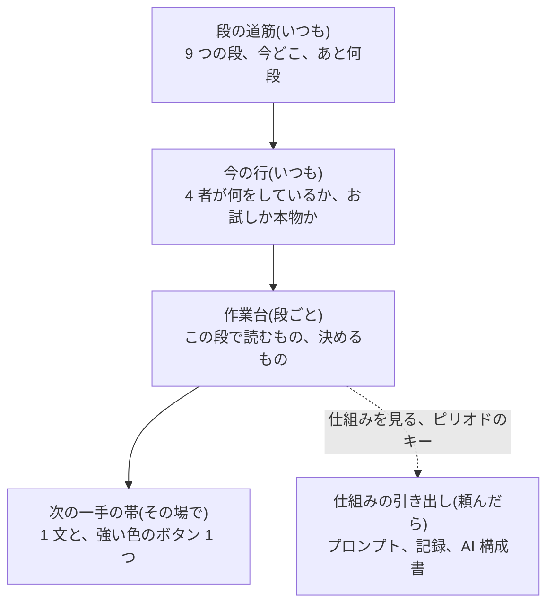

```
┌ 段の道筋 ─────────────────────────────────────────────────────────┐
│ □ Prototype Studio  [お店の問い合わせ 架空 ▾]                                 │
│ 1 話す✓ 2●目的✓ 3●設計✓ [4●審査] 5 作る 6 測る 7 質 8●見せる 9 渡す  4/9 段 │
│                                                       [保存] [素材] [表示 ▾] │
├ 今の行 ───────────────────────────────────────────────────────────┤
│ ● あなた: あなたの番  ■ 作る AI: 待っている  ▲ 試作品の中の AI: お試し      │
│ ⬢ 関門と守り: 承認まで作らせません         (○ お試しの AI・料金なし) 仕組みを見る . │
├ 作業台 ───────────────────────────────────────┬ 仕組みの引き出し ─────┤
│                                                │(頼んだときだけ開く) │
│   段ごとの中身(4 節)                           │ プロンプトの全文     │
│                                                │ 記録、AI 構成書      │
├ 次の一手の帯 ─────────────────────────────────┴─────────────────┤
│ 次の一手  harness を読み、違わなければ承認します。      [ harness を承認する ] │
└──────────────────────────────────────────────────────────┘
```

| 部分 | 何に答えるか(デッキの 28 枚目) | 決まり |
|---|---|---|
| 段の道筋 | 今どこにいる? | 9 段を 1 行で。押すと、その段の作業台に移る。まだの段も押せる。押すと、何が足りないかを作業台に出す |
| 今の行 | 今、誰が働いている? | 4 者の位置は変えない。働いている者だけ、名前を太くし、下線と動きの印を付ける |
| 作業台 | (段の中身) | 横幅の上限は 1040px。5〜8 の段は 2 列(左に試作品) |
| 次の一手の帯 | 次に何をする? | 1 文と、強い色のボタンを多くて 1 つ。AI が働いている間は、ボタンの代わりに「止める」(弱いボタン)と待つ間の 1 文 |
| 仕組みの引き出し | 本当はどう動いている? | 「仕組みを見る」か `.` のキーで開き、もう一度で閉じる。作業台を隠さず、横に並べる |

上の帯の右の 3 つ:

- 保存: 今の「保存」。版の一覧と「この状態に戻す」は、試作品の名前のメニューの中
- 素材: 自分のトークン、部品と指針をつなぐ画面(今の「その他」の 2 つ)
- 表示: ライト、ダーク、OS に従う。動きを止める。会議室の大きさ

今の「その他」の引き出しはなくす。中身は、段の作業台、素材、仕組みの引き出しに分けて移す(13 節)。

### 2.3 9 つの段と画面の流れ

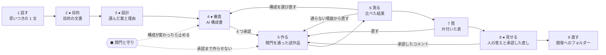

- 段の番号は流れを示すだけ。どの段にも、道筋から戻れる
- 5 に戻る矢印は、どれも「作る AI に頼む」の形になる。5 の作業台を開き、頼む文を入れた状態で始める
- 見本の試作品(求人相談など)は、1〜4 を「飛ばした」で始める。飛ばした段は「─」の印で、済み(✓)と見分ける
- 審査を飛ばしたときは、4 に「審査なし」の印が残る(今の決まりのまま)

### 2.4 段ごとの作業台

| 段 | 作業台 | 主な部品 | 次の一手(帯のボタン) | 働く者 | 残るもの |
|---|---|---|---|---|---|
| 1 話す | はじめの画面 | 1 文の欄、例の文 3 つ、深さ(速く、ふつう、深く) | 送る | あなた → Studio | 思いつきの 1 文 |
| 2 ● 目的 | 聞き出し(1 人)、聞き取りと整理の板(会) | 問いを 1 つ、「分からない」、目的の文書の下書き | これで決める | あなた、聞き出す AI | 目的の文書 |
| 3 ● 設計 | 設計の案内 | 6 つの段の帯、案 2〜3 と比べ、おすすめの 1 文 | この案にする | あなた、案を出す AI | 選んだ案と理由 |
| 4 ● 審査 | AI 構成の審査 | 流れの図、4 つの欄、承認の数 | (欄)を承認する、この構成で作る | あなた、⬢ | AI 構成書 |
| 5 作る | 作っている間 / 言葉で直す | 試作品、作る AI の欄、関門の列 | 試す | ■ 作る AI、⬢ | 動く試作品 |
| 6 測る | 試す、記録、比べる | 試作品と会話、この 1 ターン、場面、比べる表 | 通らない場面から直す、質へ進む | ▲、⬢、あなた | 比べた結果 |
| 7 質 | 質の見直し | 見直しの表(測った数と AI の判断を分ける) | (行)を直す | あなた、■ | 片付いた表 |
| 8 ● 見せる | 見せる、コメント、承認 | 見せる画面、確かめたい問い、コメントの一覧 | 承認した分を直す | 人、あなた、■ | 人の答えと記録 |
| 9 渡す | 引き継ぎ | 渡すものの一覧、未決事項、フォルダー | 本番開発へ渡す | あなた | 開発へのフォルダー |

### 2.5 4 者の見分け方

| 者 | 形 | 英語 | 色のトークン | 何をするか | 今の行の文の例 |
|---|---|---|---|---|---|
| あなた | ● 丸 | You | `--actor-you` | 決めて、承認する。送るものを握る | あなたの番: 4 つの承認 |
| 作る AI | ■ 四角 | Maker AI | `--actor-maker` | 試作品のファイルを書いて直す。書けるのは `app/` だけ | 作る AI が試作品を書いています |
| 試作品の中の AI | ▲ 三角 | In-product AI | `--actor-product` | 試作品の中で、使う人と話す。試される側 | お試しの AI が答えています |
| 関門と守り | ⬢ 六角 | Gates & guardrails | `--actor-gate` | 確かめて、止める。AI ではなくコードで、書かない | 守りが 1 つ止めました |

決まり:

- 形と名前を、いつも組で出す。色だけで者を示さない
- 記録、関門の列、会話の発言の頭にも、同じ形を付ける。どこで見ても同じ形が同じ者
- ● はあなたの形で、人が決める段の印と同じ。「● があったら、あなたの番がある」と覚えられる
- 次の一手のボタンの色(`--color-accent`)は、あなたの色と同じ。強い色が付くのは、あなたがすることだけ
- 働いている者は、名前を太くし、下に 2px の線を引く。動きを止めていなければ、線の上を短い印が流れる(10.5)

### 2.6 お試しか本物か

- 今の行の右に、いつも出す。「○ お試しの AI・料金なし」か「◉ 本物の AI・あなたの Claude Code」。印の形と文で分け、色に頼らない
- 本物のときは、押すと同意の中身(送るもの、送り先、料金、上限、同意した時刻)をもう一度見られる。今の「本物の AI(あなたの Claude Code)」の小さな印を、ここにまとめる
- 作る AI と試作品の中の AI は、それぞれ別にお試しか本物かを持つ。違うときは、今の行の各者の文に出す(例: 「▲ 試作品の中の AI: お試し」)

### 2.7 1 時間の会

会の試作品(上の帯の「お客さんとの会を始める」で作るもの)では、段の道筋の代わりに「会の帯」を出す。9 段の道筋は「9 段で見る」で出せる。

```mermaid
gantt
  title お客さんとの 1 時間(分は仮の値。デッキの 12 枚目)
  dateFormat mm
  axisFormat %M
  section 会の帯
  始める :b1, 00, 5m
  聞く、AI が整理する :b2, after b1, 20m
  審査 :b3, after b2, 8m
  作る :b4, after b3, 10m
  見せる :b5, after b4, 8m
  直す :b6, after b5, 5m
  渡す :b7, after b6, 4m
```

| 会の帯 | 開く作業台 | 9 段との対応 |
|---|---|---|
| 始める(5 分) | 会の始め(同意、消す日、データは架空) | 段の前 |
| 聞く、AI が整理する(20 分) | 聞き取りの欄と整理の板 | 2 目的 |
| 審査(8 分) | AI 構成の審査 | 4 審査(3 設計は、整理の板から案を 1 つ選ぶ形で軽く通る) |
| 作る(10 分) | 作っている間 | 5 作る |
| 見せる(8 分) | 見せる、コメント | 8 見せる |
| 直す(5 分) | 承認した分を直す | 8 から 5 |
| 渡す(4 分) | 会の終わり(成果物、持ち主の付いた未決事項) | 9 渡す |

会の決まり:

- 帯ごとに、使った分と予定の分を出す(「聞く 12 / 20 分」)。過ぎても赤くしない。「予定を 3 分過ぎています」と文で出す
- 会の試作品では、字の大きさを「会議室」(1.25 倍)で始める。表示のメニューで戻せる
- 部屋の 4 人の役(デッキの 12 枚目)ごとの見え方:

| 役 | 見るもの | Studio での動き |
|---|---|---|
| 進行役 | 会の帯、次の一手 | 帯を進める(画面は操作役が動かす) |
| 操作役 | 全部 | 要点を打ち、Studio を動かす。仕組みの引き出しを開けるのは操作役だけ |
| 決める人(お客さん側) | 審査の 4 つ、承認の名前 | 声で承認し、操作役が押す。名前は「声に出した人」に残す(今のまま) |
| お客さんの担当 | 試作品と問い | 見せる段で触り、コメントする |

- 「お客さんの前」(5.4)の決まりは、会の試作品の間、ずっと効く。開発の言葉は出さない。「データは架空です」を今の行に出し続ける

### 2.8 狭い画面と英語

- 1280x800 で、作業台の見出しと次の一手の帯が、スクロールなしで見えること
- 1024px より狭いときは、段の道筋を「4 / 9 審査 ▾」の 1 つのボタンにまとめる。押すと 9 段の一覧が開く。今の行は、働いている者だけを出し、ほかは「ほか 3 者」にまとめる
- 5〜8 の 2 列は、1024px より狭いと上下に並べる
- 英語の画面: 名前の幅を決め打ちしない。段の名前は英語で 1 語にする(Talk、Goal、Design、Review、Build、Measure、Quality、Show、Hand off)。ボタンの文は 2 行に折り返してよい。英語の言葉は [brand.md の英語の言葉](../brand.md) に合わせ、足りない語は 11 節に足した

## 3. 見た目の方向

### 3.1 3 案で同じこと

3 案は、画面の枠(2 節)、部品、案内を同じにして、見た目だけを変えた。モックは同じ HTML で、CSS だけが違う。

- 画面: AI 構成の審査(場面 1)。harness を読んでいるところ
- 字: OS の字だけ。Web フォントは読み込まない(10.2)
- ファイル: [`ui-ux-v2/`](ui-ux-v2/) の HTML。CSP で外への読み込みを全部止めている(`default-src 'none'`)
- モックの右上の「ダーク」「動きを止める」は、2.2 の「表示」のメニューの代わり。保存と素材のボタンは略した
- 開き方: ブラウザでファイルを開く。`?theme=dark`、`?theme=light` で色を固定し、`?depth=1` で仕組みの引き出しを開き、`?room=1` で会議室の大きさにする。右上の「ダーク」「動きを止める」も押せる

### 3.2 A 製図(Drafting)

AI の作りを図面として広げる。細い線、四角い角、方眼の上の流れ図。仕組みの図が主役で、ほかは静か。

| 項目 | 決め |
|---|---|
| 色 | 冷たい灰の紙(`#F4F5F6`)と白い面。色は 4 者と状態にだけ使う。強い色はインクの青(`#1D4FB0`)で、あなたと次の一手だけ |
| 字 | OS のゴシック。数、時刻、部品の種類は等幅。本文 16px、最小 13px。見出しは太さ 600 |
| 余白 | 4px を元にした 8 段(4〜64px)。作業台の幅は 1040px まで。密度は中くらい |
| 動き | 働いた部品を、流れ図の線に沿って小さな点が進む。開閉は 200ms、状態の変化は 120ms。跳ねない、光らない |
| ダーク | ライトと同じに扱う。既定は OS に従う。ダークは黒に近い灰(`#0F1113`)で、色は明るくした同じ色相 |
| モック | [a-drafting.html](ui-ux-v2/a-drafting.html) |

| ライト | ダーク |
|---|---|
| 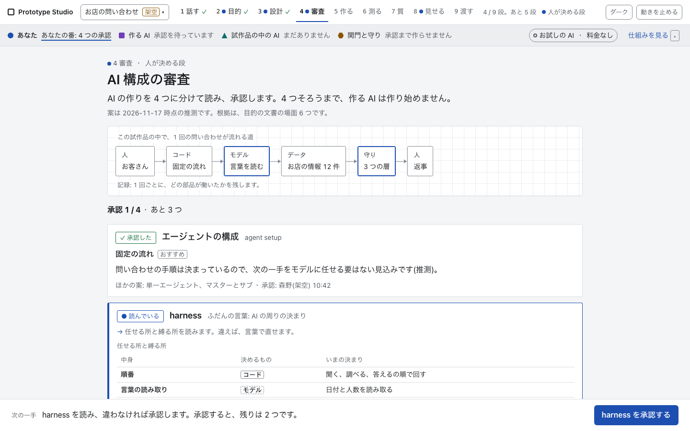 | 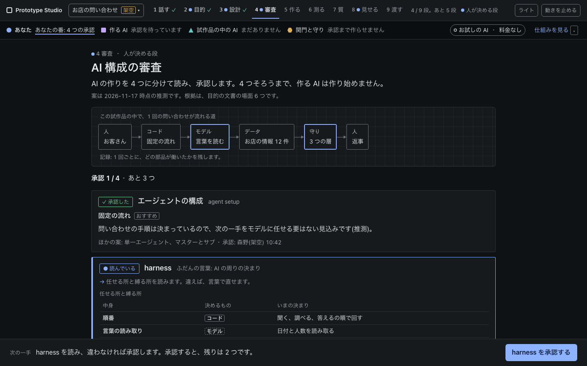 |
| 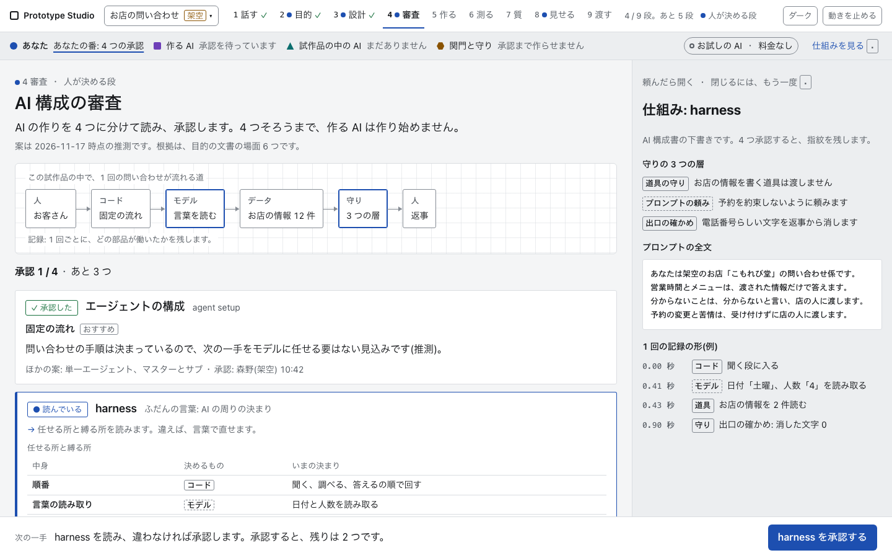 | 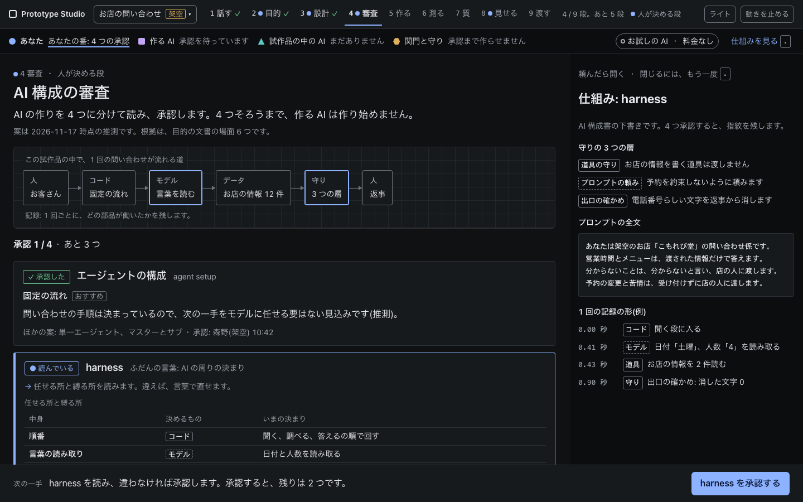 |

会議室の大きさ(1920x1080、字を 1.25 倍。本文 20px、最小 16.25px): [ライト](ui-ux-v2/shots/a-drafting-light-room.png)、[ダーク](ui-ux-v2/shots/a-drafting-dark-room.png)

### 3.3 B 計器(Instrument)

計器盤のように、密に並べて数で読む。段は目盛り、数は等幅。

| 項目 | 決め |
|---|---|
| 色 | ダークが先。黒鉛の地(`#0D1012`)に、落ち着いた水色(`#6CC4D6`)。光らせない |
| 字 | 本文 15px、最小 12px。ラベルは等幅で字間を少し空ける |
| 余白 | 狭い。欄を 2 列に並べ、1 画面に多く出す。作業台の幅は 1280px まで |
| 動き | 目盛りが 1 段ずつ進む。なめらかな動きより、刻む動き |
| ダーク | ダークを先に作り、ライトは後から合わせる |
| モック | [b-instrument.html](ui-ux-v2/b-instrument.html) |

| ライト | ダーク |
|---|---|
| 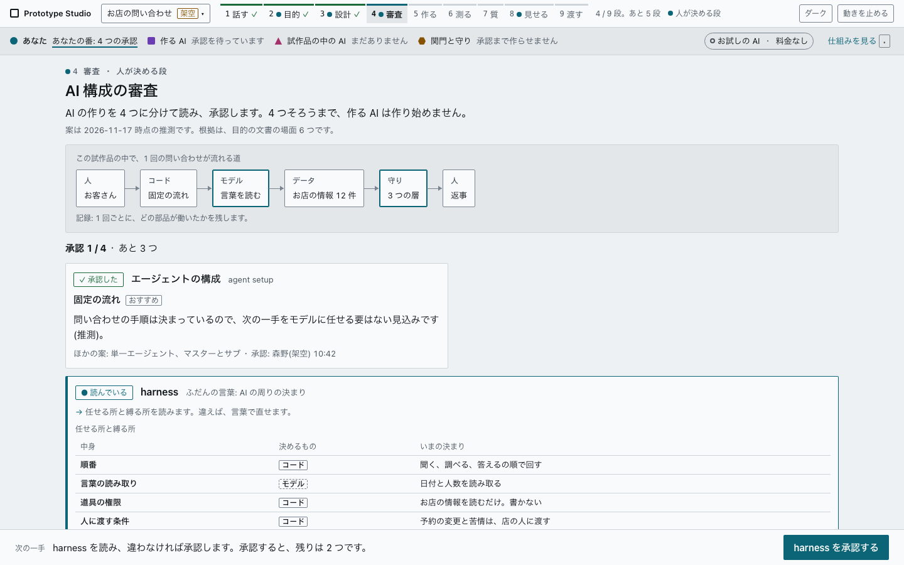 | 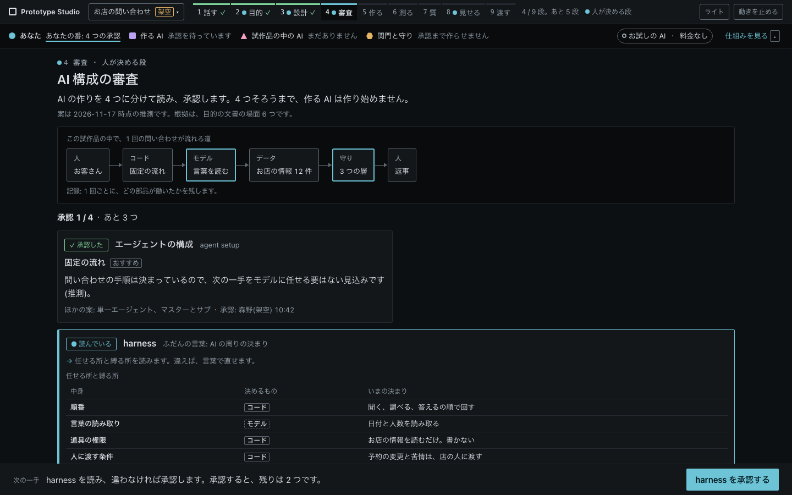 |

### 3.4 C 紙面(Broadsheet)

新聞の紙面のように、大きな字と広い余白で読ませる。案内は余白の注として右に置く。

| 項目 | 決め |
|---|---|
| 色 | ライトが先。温かい紙(`#FAF8F3`)と、藍(`#3B3A9E`) |
| 字 | 本文 17px。見出しは明朝(OS の字)。欄は箱にせず、線で区切る |
| 余白 | 広い。1 列で、右の 13rem を「その場で」の注に使う |
| 動き | ほとんど動かさない。開閉だけ |
| ダーク | ライトを先に作る。ダークは温かい墨の地 |
| モック | [c-broadsheet.html](ui-ux-v2/c-broadsheet.html) |

| ライト | ダーク |
|---|---|
| 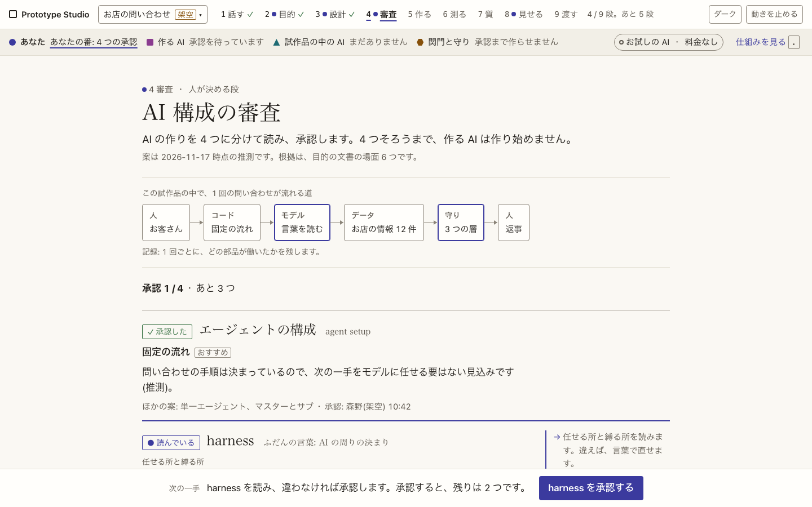 | 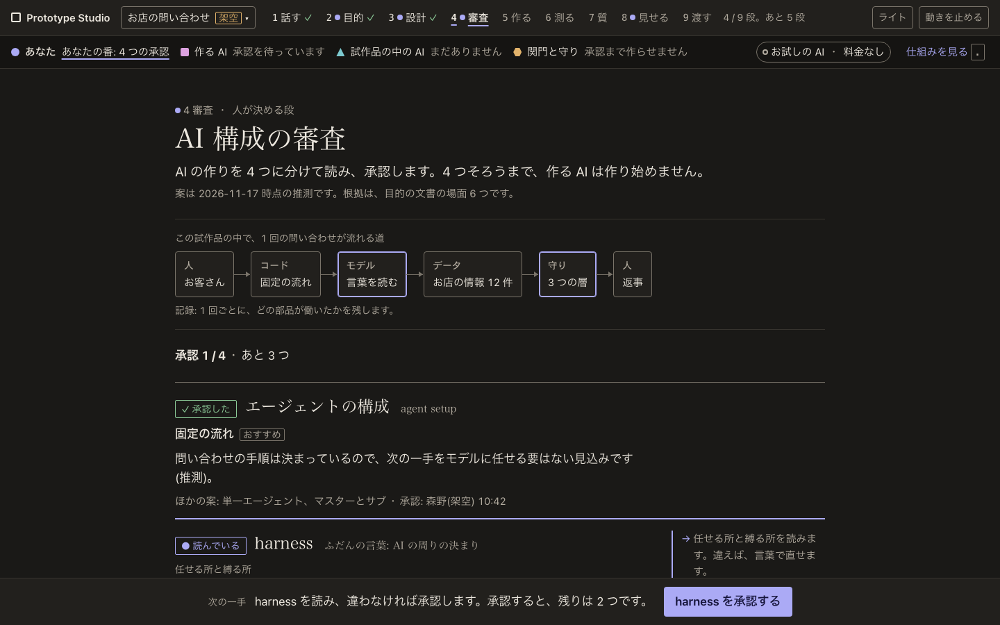 |

### 3.5 比べる

| 見るところ | A 製図 | B 計器 | C 紙面 |
|---|---|---|---|
| 動く仕組みが見える(未来的) | ◎ 流れ図が見た目の芯 | ○ 数と目盛りで見える | △ 図は脇役 |
| 読みやすさ(43 枚目で最優先) | ◎ | △ 字が小さく密 | ◎ |
| 会議室の大画面 | ○ 1.25 倍で本文 20px | △ ダークは映すと沈みやすい(推測) | ◎ |
| 専門の深さ(記録、比べる表) | ○ 中くらいの密度 | ◎ | △ 表が入りにくい |
| 初めての人 | ○ | △ 業務の計器に見える | ◎ |
| ネオンや HUD に寄る心配 | 小 | 大 | 小 |
| 今の画面からの移しやすさ | ○ 今のライトの色に近い | △ ダーク先で作り直し | ○ |

### 3.6 決めたこと: A 製図を採る

運営者が 2026-11-17 に「エージェントのおすすめで進める」と決めた。おすすめは A で、A を採る。

選んだ理由:

- デッキの「未来的」の定義(動く仕組みが見える)を、飾りではなく中身で満たす。審査の流れ図、記録、関門の列が、そのまま見た目の芯になる
- 読みやすさを先に取れる(42、43 枚目)。モックの字と地の差は、全部 6:1 以上(3.7)
- ライトとダークを同じに扱える。会議室では明るい部屋でライト、暗い部屋でダークを選べる
- 密度が中くらいで、初めての人(案内で支える)と専門の深さ(引き出しで支える)の両方に応えやすい(43 枚目の最後のつまみが真ん中)

選ばなかった案:

- B 計器: 密で数に強いが、字が小さく、ダークを先にすると映したときに沈む心配がある(推測)。「SF の HUD」に寄りやすく、デッキが「違う」と書いた方へ流れやすい。比べる表と記録の密な見せ方は、A の仕組みの引き出しの中で借りる
- C 紙面: 一番読みやすいが、表と記録が入りにくく、道具より文書に見える。「その場で」の案内を余白の注にする形は良いが、作業台の幅を食う。A では、注を欄の中の 1 行(→ の印)にした

変えたくなったときは:

- 色、字、余白、動きは 10 節のトークンに閉じている。B か C に変えるときは、トークンの値と、案ごとの CSS(モックの最後の `<style>` の数行)を入れ替える。画面の枠、部品、案内、言葉は 3 案で同じなので、変えなくてよい
- 2 枚目(見た目の土台)を作る前なら、トークンの差し替えだけで済む。後なら、スクリーンショットと `npm run media` の撮り直しが要る

### 3.7 字と地の差(測った値)

2 つの方法で測った。どちらも WCAG 2 の式。

1. トークンの組: 10 節の値から計算した(下の表)
2. モックの中の字の全部: Playwright の Chromium で、ライトとダークのモック(1440x900)を開き、見えている字の要素ごとに、字の色と、親をたどって最初に色のある地の色の差を測った。外への通信の数も数えた

| モック | 字の要素の数 | 一番低い差 | 一番低い所 | 外への通信 |
|---|---|---|---|---|
| A ライト | 124 | 6.09 | 今の行の灰色の文(地は `--color-surface-sunken`) | 0 |
| A ライト、引き出しを開く | 151 | 6.09 | 同じ | 0 |
| A ダーク | 124 | 7.36 | 段の道筋のまだの段 | 0 |
| A ダーク、引き出しを開く | 151 | 7.36 | 同じ | 0 |
| B ライト | 124 | 5.37 | 「仕組みを見る」 | 0 |
| B ダーク | 124 | 6.84 | 段の道筋のまだの段 | 0 |
| C ライト | 123 | 6.03 | 「✓ 承認した」 | 0 |
| C ダーク | 123 | 7.13 | 段の道筋のまだの段 | 0 |

採る A のトークンの組:

| 組 | ライト | ダーク | 基準 |
|---|---|---|---|
| `--color-text` / `--color-bg` | 16.30 | 15.56 | 4.5 |
| `--color-text` / `--color-surface` | 17.79 | 14.36 | 4.5 |
| `--color-text-muted` / `--color-bg` | 6.49 | 7.97 | 4.5 |
| `--color-text-muted` / `--color-surface` | 7.08 | 7.36 | 4.5 |
| `--color-text-muted` / `--color-surface-sunken` | 6.09 | 8.20 | 4.5 |
| `--color-link` / `--color-surface` | 7.51 | 8.27 | 4.5 |
| `--color-on-accent` / `--color-accent` | 7.51 | 8.40 | 4.5 |
| `--color-ok` / `--color-surface` | 6.14 | 9.19 | 4.5 |
| `--color-warn` / `--color-surface` | 6.33 | 8.83 | 4.5 |
| `--color-danger` / `--color-surface` | 6.57 | 7.63 | 4.5 |
| `--color-text-muted` / 薄い地 4 つ(`*-soft`)の一番低い所 | 6.08 | 6.60 | 4.5 |
| 状態の色 / 同じ状態の薄い地(例: `--color-ok` / `--color-ok-soft`)の一番低い所 | 5.33 | 7.18 | 4.5 |
| `--color-line-strong` / `--color-surface`(部品の縁) | 3.39 | 3.75 | 3 |
| `--color-focus` / `--color-bg`(焦点の枠) | 6.88 | 8.96 | 3 |
| 4 者の色 / `--color-surface-sunken`(形)の一番低い所 | 5.20 | 9.22 | 3 |

B と C のトークンの組も、字は 4.5 以上、縁と形は 3 以上だった(B ライトの字の最低 5.37、C ライトの字の最低 6.03)。

本物の画面(`src/ui/`、2 枚目の task 432 で測った):

同じ 2 つ目の測り方を E2E にした(`test/e2e/studio.js` の `expectReadableText`)。画面ごとに、OS の設定をライトとダークに切り替えて、見えている字の全部を測る。4.5 より低い字が 1 つでもあると落ちる。下の値は 2026-11-18 に Mac の Chromium(Playwright)で回した結果。

| 画面 | 字の要素の数 | 一番低い差(ライト) | 一番低い差(ダーク) | 一番低い所(ライト) |
|---|---|---|---|---|
| 最初の画面、表示のメニュー、AI の切り替え、その他と開発者向けの詳細(1440x900、4 つの合計) | 262 | 6.08 | 6.60 | はじめの手順のまだの手順「2 言葉で直す」(`--color-text-muted` / `--color-accent-soft`) |
| はじめの手順の最後、作るループで直した、直しきれない、人の確かめの帯 | 56〜110 | **5.27** | 6.60 | はじめの手順の済んだ手順(「1 試す」など。`--color-ok` / `--color-accent-soft`) |
| 設計の案内(データ) | 157 | **5.27** | 7.36 | 段の帯の済んだ段の小さな字(`--color-ok` / `--color-accent-soft`) |
| 設計の案内(問題、構成)、審査(承認 0、承認 4、止まった) | 44〜149 | 5.33 | 6.60 | 上の帯の「目的: 決めた」(`--color-ok` / `--color-ok-soft`) |
| 会の始め、会の整理の板、会の終わり、ヒアリングの整理 | 49〜135 | 5.33 | 7.36 | 上の帯の「会: 同意した」(`--color-ok` / `--color-ok-soft`) |
| はじめの画面、目的の文書の下書き、同意のカード、直す AI が使えないとき、直す AI が作業中、試作品を表示できないとき | 24〜51 | 5.65 | 6.60 | 「本物の AI(あなたの Claude Code)」の印(`--color-danger` / `--color-danger-soft`) |
| 最初の画面を会議室の大きさにしたもの(1920x1080) | - | 4.5 以上 | 4.5 以上 | 値は書き出していない。最小の字が 16.25px 以上かも確かめる |

- 本物の画面で一番低いのは **ライト 5.27、ダーク 6.60**。ライトの 5.27 は、済んだ印の緑(`--color-ok`)を、アクセントの薄い地(`--color-accent-soft`)の上に置いた所。トークンの組の表(状態の色と同じ状態の薄い地、5.33)にない組なので、表の最低より少し低い。基準の 4.5 は超える
- 押せないボタンは、薄くせず(`opacity` を使わず)、字を `--color-text-muted`、縁を点線にした。WCAG は押せない部品を除いてよいが、会議室で読めるように除かずに測った
- 測らないもの: 試作品の中(iframe)、図の中の字(SVG。図ごと伸び縮みする)、入力欄の中の字と例の字(placeholder)

測っていないこと:

- 試作品の中(iframe)。試作品の見た目は試作品が決める(31 枚目)
- プロジェクターや大きな画面に映したときの見え方。お客さん役の通しで確かめる(12 節)

## 4. 主な場面のワイヤーフレーム

デッキの 33 枚目の 8 つ。1〜3 を詳しく書く。図の中の ● ■ ▲ ⬢ は 4 者の形(2.5)。段の道筋と今の行は、場面 1 のほかは略した。

### 4.1 場面 1: AI 構成の審査

モックは [a-drafting.html](ui-ux-v2/a-drafting.html)。

```
┌ 段の道筋: 1 話す✓ 2●目的✓ 3●設計✓ [4●審査] 5 作る 6 測る 7 質 8●見せる 9 渡す  4/9 段 ┐
├ 今の行: ● あなた: あなたの番  ■ 作る AI: 承認を待っています  ▲ まだありません   ┤
│         ⬢ 関門と守り: 承認まで作らせません           ○ お試しの AI・料金なし     │
├────────────────────────────────────────────────────────────┤
│ ● 4 審査・人が決める段                                                    │
│ AI 構成の審査                                                              │
│ AI の作りを 4 つに分けて読み、承認します。4 つそろうまで、作る AI は作り始めません。│
│ 案は 2026-11-17 時点の推測です。根拠は、目的の文書の場面 6 つです。          │
│ ┌ この試作品の中で、1 回の問い合わせが流れる道 ──────────────────┐ │
│ │ [人 お客さん]→[コード 固定の流れ]→[モデル 言葉を読む]→[データ 12 件]   │ │
│ │   →[⬢ 守り 3 つの層]→[人 返事]     記録: 1 回ごとに残します              │ │
│ └──────────────────────────────────────────┘ │
│ 承認 1 / 4・あと 3 つ                                                      │
│ ┌ ✓ 承認した  エージェントの構成  agent setup ────────────────────┐ │
│ │ 固定の流れ [おすすめ]  問い合わせの手順は決まっているので…(推測)          │ │
│ │ ほかの案: 単一エージェント、マスターとサブ・承認: 森野(架空) 10:42         │ │
│ └──────────────────────────────────────────┘ │
│ ┃ ● 読んでいる  harness  ふだんの言葉: AI の周りの決まり                    │
│ ┃ → 任せる所と縛る所を読みます。違えば、言葉で直せます。   (その場で)        │
│ ┃ 中身        決めるもの   いまの決まり                                    │
│ ┃ 順番        [コード]     聞く、調べる、答えるの順で回す                    │
│ ┃ 言葉の読み取り [モデル]  日付と人数を読み取る                              │
│ ┃ …                                                                        │
│ ┃ ▸ これは何?   (頼んだら: 3 つの問いと「プロンプトの全文を見る」)          │
│ ┃ [言葉で直す]                                                             │
│ ┌ ○ まだ見ていない  データと RAG ──────────────────────────────┐ │
│ ┌ ○ まだ見ていない  技術の組 ────────────────────────────────┐ │
│ 審査を飛ばす(飛ばした人、時刻、理由を記録します)                          │
├────────────────────────────────────────────────────────────┤
│ 次の一手  harness を読み、違わなければ承認します。残りは 2 つです。 [harness を承認する] │
└────────────────────────────────────────────────────────────┘
```

決まり:

- 4 つの欄は上から順に並べ、1 つだけを「読んでいる」にする。読んでいる欄は左に太い線。ほかの欄は短くたたむ
- 欄の状態は 4 つで、印と文で分ける: ✓ 承認した、● 読んでいる、○ まだ見ていない(点線の縁)、! 承認が消えた
- 流れ図は、読んでいる欄に関係する部品の縁を強くする(harness なら「モデル」と「守り」)。欄にカーソルや焦点が乗ったときも同じ
- 次の一手の帯のボタンは「(読んでいる欄)を承認する」。4 つそろうと「この構成で作る」に変わる。欄の中には弱いボタン(言葉で直す)だけを置く
- 承認を押す人の名前の欄(今の「承認を押す人の名前」)は、次の一手の帯の左、1 文の下に小さく置く。会のときは「声に出した人」も出す
- コメントから審査に戻した項目(今の K3)は、欄の頭に「コメントから: …」の 1 行で出す

場面の中の状態:

| 状態 | 出し方 |
|---|---|
| 4 つそろった | 承認の数が「承認 4 / 4」。流れ図の右に「指紋 9f2c…」(等幅)。帯は「この構成で作ります。作る AI が書き始め、関門が確かめます。」と「この構成で作る」 |
| 選び直して承認が消えた | 欄が「! 承認が消えた」。欄の頭に「技術の組を選び直したので、この欄の承認を消しました。読み直して承認してください。」。数が 1 つ減る |
| 作る AI が後から構成を変えた(今の `review-stopped`) | 作業台の上に止まった理由の帯(⬢ の形)。「作る AI が AI の作りを変えようとしたので、関門が止めました。承認した構成は変わっていません。」。帯のボタンは「審査に戻る」、弱いボタンは「承認した構成に戻す」 |
| 案を出す AI が作業中 | 欄の中身の代わりに「案を作っています」と、読んでいる欄の 3 つの問いを先に出す(待つ間に読むもの) |
| 審査を飛ばす | 今のまま、たたんだ欄の中で理由を書いて「審査なしで作る」。段の道筋の 4 に「審査なし」の印 |

### 4.2 場面 2: 試す、記録を見る、比べる(段 6 測る)

```
├────────────────────────────────────┬──────────────────────────┤
│ 試作品                     [▲ お試し ▾]   │ [この 1 ターン] [場面 4/6 通った] [比べる] │
│ ┌──────────────────────────────┐ │ ─ この 1 ターン ─────────────────── │
│ │ (試作品の iframe)                     │ │ 0.00   コード   聞く段に入る           │
│ │  お客さん: 土曜に 4 人で入れますか      │ │ 0.41 ▲ モデル   日付と人数を読み取る   │
│ │  ▲ 案内役: 土曜は 4 人席が…            │ │ 0.43   道具     お店の情報を 2 件読む  │
│ │                                        │ │ 0.90 ⬢ 守り     止めました: 電話番号    │
│ └──────────────────────────────┘ │   → 止めたのは出口の確かめ。失敗ではなく、 │
│ [会話を最初から] [同じ発言で試し直す]      │     守りが働いた印です。               │
│                                            │ ▸ プロンプトの部品を見る(引き出しへ)    │
│                                            │ ─ 場面 ─────────────────────────── │
│                                            │ ✓ 通った  営業時間を聞く               │
│                                            │ × 通らない 予約の変更を頼む  [ここから直す] │
│                                            │ ○ まだ回していない 分からないときの場面   │
├────────────────────────────────────┴──────────────────────────┤
│ 次の一手  2 つの場面が通りませんでした。これを見つけるのが試す目的です。 [1 つ目から直す] │
```

決まり:

- 左は試作品、右は 3 つのタブ(この 1 ターン、場面、比べる)。タブの名前に数を添える(「場面 4/6 通った」)
- この 1 ターン: 記録の 1 行ごとに、時刻(等幅)、者の形、部品の種類、平たい 1 文。者の形はモデルの行(▲)と守りの行(⬢)にだけ付け、コードと道具の行には付けない。プロンプトの全文と道具の入出力は引き出しへ(頼んだら)
- 守りが止めた行は ⬢ と「止めました」。続く行で「失敗ではなく、守りが働いた印」と、止めた層の名前を出す
- 場面: 3 つの状態を印と文で分ける。✓ 通った、× 通らない、○ まだ回していない。「まだ」は「通った」と同じ見た目にしない
- 比べる: 構成と前提ごとの表(今の比べる表)。列は通った数、費用、待ち。数が同じ場面で測ったものかを表の上に書く。採点が AI の判断なら「AI の判断」と列の頭に書く
- 試作品の中の AI の切り替えは、試作品の上の「▲ お試し ▾」。本物を選ぶと、同意のカードを試作品の上に出す(5.4 の「同意」)
- 次の一手: 通らない場面があれば「1 つ目から直す」(作る AI の欄を開き、場面の名前を入れて始める)。全部通れば「質の見直しへ進む」
- 構成を選び直す(今の「構成と前提」)は、比べるタブの中の弱いボタン。選び直すと、4 審査の該当の欄の承認が消えることを、押す前に横の 1 文で言う

### 4.3 場面 3: 作っている間(段 5 作る)

```
├────────────────────────────────────┬──────────────────────────┤
│ 試作品                                     │ ■ 作る AI                             │
│ ┌──────────────────────────────┐ │ 依頼: 予約の変更は店の人に渡して      │
│ │ (前の版を出しています)                 │ │ ─ 今していること ─────────────── │
│ │  この版は 10:52 のものです。            │ │ ■ 試作品のファイルを読む      済み   │
│ │  新しい版は、関門を通ったら出ます。     │ │ ■ AI の設定を書く             済み   │
│ │                                        │ │ ⬢ 関門                               │
│ └──────────────────────────────┘ │   ✓ 変わったところの検査             │
│                                            │   ✓ 表示の準備                       │
│ 待つ間に                                   │   ● 決めた手順で動くか   確かめています │
│ 足りない場面がないか見てみませんか。        │   ○ 開いて表示できるか               │
│ [場面の一覧を見る]                         │   ○ AI の場面で動くか               │
│                                            │ 経過 1 分 20 秒(多くは 3 分以内。推測) │
├────────────────────────────────────┴──────────────────────────┤
│ 次の一手  作る AI が試作品を書いています。止めても、前の版は残ります。      [止める] │
```

決まり:

- 右の列は、作る AI の欄(今の「言葉で直す」の会話)。上に依頼の文、下に「今していること」の列
- 列の行は、者の形と平たい名前。関門の 1 つずつは今の利用者の言葉(表示の準備、決めた手順で動くか など)。状態は ✓ 済み、● 確かめています、○ まだ、× 落ちた
- 動きを止めていなければ、● の行の横を短い線が流れる。止めていれば「確かめています」の文だけ
- 試作品の欄は、前の版を出し続ける。白紙にしない。新しい版が出たら、「新しい版です。10:55」と 1 行出して、前の版との違いを聞けるようにする
- 次の一手の帯に強い色のボタンは出さない(あなたの番ではないため)。弱いボタン「止める」と、待つ間の 1 文だけ
- 終わったとき:

| 結果 | 帯の 1 文 | ボタン |
|---|---|---|
| 関門を全部通った | 試作品を作りました。確かめた 3 つの場面は通りました。分からないときの場面は、まだありません。 | 試す |
| 関門で落ち、作る AI が直して通った | 1 度落ちましたが、作る AI が直して通りました。直したところは記録にあります。 | 試す |
| 直しきれなかった | 試作品が起動しませんでした。前に動いた版を出しています。頼み方を変えて、もう一度試しますか。 | 頼み方を変える |
| 守りが止めた | 試作品のフォルダーの外は触れないので、やめました。試作品の中で済む依頼に言い換えてください。 | 言い換える |

- 作る AI の欄の下に、今の依頼の欄(「送る」「止める」、Ctrl+Enter)を残す。5〜8 の段では、右の列をこの欄に切り替えられる(右上の「■ 作る AI に頼む」)

### 4.4 場面 4: はじめと目的の聞き出し(段 1、段 2)

```
├──────────────────────────────────────────────────────────┤
│ 1 話す                                                                │
│ 思いつきを 1 文で書いてください                                        │
│ ┌──────────────────────────────────────────────┐ │
│ │ お店への問い合わせに AI が答えられるようにしたい                    │ │
│ └──────────────────────────────────────────────┘ │
│ → ラフな 1 文で大丈夫です。                                             │
│ 例: [お店への問い合わせに…] [社内の質問に…] [学習の相談に…]             │
│ 聞き方の深さ: (速く) (●ふつう) (深く)                                  │
│ ▸ 見本の試作品から始める(求人相談、学習相談、バイト探し、図書室)        │
├──────────────────────────────────────────────────────────┤
│ 次の一手  送ると、Studio が問いを 1 つ返します。まだ何も作りません。        [送る] │
```

段 2 は 2 列。左に問い(1 つだけ)と答えの欄、右に目的の文書の下書き(誰、問題、場面、成功の印、しないこと、決めていないこと)。

- 問いは 1 つずつ。「分からない」は答えと同じ重さのボタン。押すと「決めていないこと」に入れたと 1 文で言う
- 目的の文書の欄は、答えが入ると、その行だけ短く光らずに縁を強くする(120ms)。推測で埋めた行には「推測」の札
- 「これで決める」は次の一手の帯。押すまで段の道筋の 2 に ✓ は付かない
- 「飛ばす」は今のまま(見本の試作品の画面に移る)。段 1〜4 は「飛ばした」の印になる

### 4.5 場面 5: 整理の板(段 2 の会の形)

```
├───────────────────────┬──────────────────────────────────┤
│ 聞き取りの欄                 │ 整理の板                                    [整理する] │
│ ・土曜の予約が多い           │ 要求       使う人      場面       決まりごと   データ  │
│ ・電話が鳴りやまない         │ [予約を…]  [店長]     [土曜の夜] [変更は人]  [メニュー]│
│ ・メニューは月 1 で変わる    │  元: 1 行目 元: 2 行目  推測 ⚠      …          …      │
│ (電話番号らしいものは省きます)│ ─ 聞くこと ─────────────────────────── │
│ [要点を足す]                 │ ? 苦情は誰が受けるか(話に出ていません)               │
├───────────────────────┴──────────────────────────────────┤
│ 次の一手  「聞くこと」の 1 つ目を、お客さんに聞きます。          [審査へ進む](弱) │
```

- 板の札には、元の要点(「元: 1 行目」)か「推測」の札を必ず付ける。推測は点線の縁と文で分ける
- 「聞くこと」は矛盾と聞いていないことの一覧。会の帯の時間が残っている間は、次の一手を「聞くこと」に向ける

### 4.6 場面 6: 見せる、コメント、承認(段 8)

見せる画面(お客さんが触る画面)と、操作役の画面を分ける。

```
見せる画面(お客さんの前)
┌──────────────────────────────────────────────────────────┐
│ 試作品: お店の問い合わせ            データは架空です  ▲ お試しの AI        │
│ ┌──────────────────────────────────────────────┐ │
│ │ (試作品の iframe。画面のどこにでもコメントを付けられる)                │ │
│ └──────────────────────────────────────────────┘ │
│ 確かめたいこと: 予約の変更を頼んだとき、店の人に渡されると分かりますか?   │
│ [コメントを書く]                                    [見せるのを終える]      │
└──────────────────────────────────────────────────────────┘
```

- 見せる画面には、段の道筋、今の行の 4 者、仕組みの引き出し、開発の言葉を出さない。出すのは、試作品、確かめたいこと、「データは架空です」、お試しか本物か
- 操作役の画面では、コメントの一覧に「反応」と「承認待ち」を分けて出す。反応(いいね)では AI は動かない、と一覧の頭に 1 文
- 要件のコメントは 2 人の承認で動く(今の決まり)。承認の数を「1 / 2」と出す
- 次の一手: 「承認した 3 つを直す」。押すと段 5 の作る AI の欄に移る。直した後は「元に戻す」がコメントごとに残る

### 4.7 場面 7: 質の見直し(段 7)

```
├──────────────────────────────────────────────────────────┤
│ 7 質の見直し                                    見た 5 / 8・まだ 3     │
│ 項目           測った数        AI の判断          なぜ大事か       │       │
│ ✓ 字と地の差   最低 3.1:1      ─                  薄い字は読みにくい │[直す] │
│ ✓ 押せる大きさ 全部 44px 以上  ─                  ─                 │       │
│ ● 言葉の調子   ─               堅い(AI の判断)    お客さんが…       │[直す] │
│ ○ まだ見ていない 素材に合うか  ─                  ─                 │[見る] │
├──────────────────────────────────────────────────────────┤
│ 次の一手  薄くて読みにくいラベルが 2 つあります。直しますか。      [字と地の差を直す] │
```

- 「測った数」と「AI の判断」を別の列にする。AI の判断には「AI の判断」の札
- 見ていない行は ○ と「まだ見ていない」。✓ と同じ見た目にしない
- 「試作品を自動で確かめる」(今の観察器を人が始める所)は、この作業台の右上の弱いボタン

### 4.8 場面 8: 会の始めと終わり、引き継ぎ(段 9)

```
会の始め                                   会の終わり / 段 9 渡す
┌────────────────────────┐  ┌──────────────────────────────┐
│ 会の始め                          │  │ 渡すもの               そろった 6 / 7       │
│ この会は架空の題材で試します。     │  │ ✓ 目的の文書  ✓ 決定と理由  ✓ AI 構成書    │
│ 記録に入れないもの: お客さんの個人 │  │ ✓ 質の表      ✓ 素材の出典  ✓ 人の答え      │
│ の情報、社内のデータ               │  │ ! 未決事項  持ち主のないものが 1 つ          │
│ 消す日: 2026-12-01                 │  │   苦情は誰が受けるか  持ち主: [     ] 期日: [ ] │
│ 本物の AI: 使わない(お試し)       │  │ 消せないもの: …(今の一覧)                  │
├────────────────────────┤  ├──────────────────────────────┤
│ 次の一手  同意を記録して始めます。 [同意して始める] │  │ 次の一手  持ち主を決めてから渡します。 [本番開発へ渡す] │
```

- 会の始めは、今の画面の中身(同意、消す日、題材が架空であること)をそのまま使う。同意は安全のための例外で、作業台を占めてよい
- 渡す: 足りないものは「!」と文で出す。足りないままでも渡せる(今のまま)。渡す前に、帯の 1 文で何が足りないかを言う
- 秘密らしい文字列で止めたときは ⬢ の形で「秘密らしい文字列があったので、渡すのを止めました」と、場所を出す

## 5. 案内の設計

### 5.1 3 段の音量

| 音量 | 何を出すか | どこに | 見た目 | いつ消えるか |
|---|---|---|---|---|
| いつも | 今どこか、誰が働いているか、お試しか本物か | 段の道筋、今の行 | 小さな字(13〜14px)、灰色。働いている者だけ太く | 消えない |
| その場で | 決める瞬間の理由と次の一手を 1 文 | 決める欄の中の 1 行(→ の印)と、次の一手の帯 | 本文より小さく、灰色。→ だけあなたの色 | 同じ種類の操作を 2 回したら、その 1 行は出さない。次の一手の帯は消えない |
| 頼んだら | 3 つの問いの答え、専門の中身 | 欄の中の「これは何?」を開く。プロンプトや記録は仕組みの引き出し | 開いた所だけ広がる。作業台を隠さない | 閉じるまで出す |

- 割り込み(作業を止める表示)は使わない。例外は、本物の AI を使う前の同意だけ(5.4)
- 「覚えたら消える」の覚え方: 操作の種類ごとの回数を、利用者ごとに保存する。試作品には入れない。置き場所は 3 枚目で決める(Studio のデータの置き場の中。15 節)
- 表示のメニューに「案内をもう一度出す」を置く。消えた「その場で」を全部戻す

### 5.2 どの部分も 3 つの問いに答える

画面の部品(欄、表、印、ボタンの組)には、どれも「これは何?」を付ける。開くと、決まった形で 3 つを出す。

```
▾ これは何?
  これは何か      モデルの周りで、決め、縛り、記録するコードです。
  何をするのか    任せることと縛ることを読み、違えば直します。
  次に何が起きるか この決まりで試作品が動き、記録に残ります。
  プロンプトの全文と守りの 3 つの層を見る →(仕組みの引き出し)
```

書き方の決まり:

- 1 つの答えは 1 文。ふだんの言葉で書き、専門の語は見出しの横に置く(「harness ふだんの言葉: AI の周りの決まり」)
- 「次に何が起きるか」は、押した後に起きることを書く。取り消せるか、承認し直しになるかも書く
- 推測は「(推測)」、確かめたことは「確かめました」と書き分ける
- 開く所は `<details>` と `<summary>` で作る。キーボードで開け、読み上げで「開く」と分かる

段ごとの例(デッキの 23〜26 枚目の言葉を使う):

| 部分 | これは何か | 何をするのか | 次に何が起きるか |
|---|---|---|---|
| エージェントの構成 | 次の一手を、コードが決めるか、モデルが決めるかです。 | 3 つから 1 つ選びます。足りる中で一番簡単なものを勧めます。 | 何を作るかが決まります。変えたら、承認し直します。 |
| harness | モデルの周りで、決め、縛り、記録するコードです。 | 任せることと縛ることを読み、違えば直します。 | この決まりで試作品が動き、記録に残ります。 |
| データと RAG | AI が読むものと、その読み方です。 | 読むものと個人情報の扱いを確かめます。 | 試作品は架空のデータで動きます。 |
| 技術の組 | 試作品と本番で使う候補です。案で、決定ではありません。 | 候補を読み、違えば選び直します。 | 選び直すと、この欄の承認は消えます。 |
| 関門の列 | 新しい試作品が通るべき、自動の確かめです。AI ではなくコードです。 | 何もしなくて大丈夫です。落ちたら作る AI が直します。 | 全部通ると、新しい試作品が出ます。 |
| 場面の一覧 | 期待する振る舞いを確かめる、1 つずつの状況です。 | 足りない場面を足し、回して結果を見ます。 | 通らない場面から直せます。 |
| この 1 ターン | 1 回の返事で、どの部品が何をしたかの記録です。 | 気になる行を開き、中身を見ます。 | 何も変わりません。見るだけです。 |
| お試しの AI | 決まった言葉だけ分かる、料金のかからない AI です。 | そのまま試せます。 | 本物にするときは、先に同意を聞きます。 |

### 5.3 どの場面でも 4 つに答える

| 問い(デッキの 28 枚目) | 答える所 |
|---|---|
| 今どこにいる? | 段の道筋の今の段(太字と下線)と「4 / 9 段」。会では会の帯と分 |
| 次に何をする? | 次の一手の帯。1 文と、強い色のボタン 1 つ |
| 今、誰が働いている? | 今の行。働いている者は太字、下線、動きの印 |
| 本当はどう動いている? | 「仕組みを見る」(`.` のキー)で開く引き出し |

### 5.4 難しい 12 の状態

どの状態も「何が起きたか、今どうなっているか、次に何をするか」を、この順に 1 文ずつ出す。言葉は調子の例で、最後の言葉は実装のカードで決める。

| 状態 | 出す所と音量 | 印 | 言葉の例 | 次の一手 |
|---|---|---|---|---|
| はじめて | 段 1 の作業台。いつも | ─ | ラフな 1 文で大丈夫です。たとえば「お店への問い合わせに AI が答えられるようにしたい」。 | 送る(例を押しても入る) |
| AI が作業中 | 今の行(■ が太字)と作業台の列。いつも | ● と流れる線 | 作る AI が試作品を書いています。その間に、足りない場面がないか見てみませんか。 | 弱いボタン「止める」。強いボタンは出さない |
| 関門で落ちた | 作る AI の欄の列、次の一手の帯。その場で | × と ⬢ | 試作品が起動しませんでした。前に動いた版を出しています。もう一度試しますか。 | 頼み方を変える |
| 守りが止めた | 記録の行、作る AI の欄。その場で | ⬢ と「止めました」 | 守りが止めました。止めたのは出口の確かめです。失敗ではなく、守りが働いた印です。 | 何もしなくてよい。気になれば「止めた中身を見る」 |
| お試しか本物か | 今の行の右。いつも | ○ お試し / ◉ 本物 | お試しの AI・料金なし / 本物の AI・あなたの Claude Code | 押すと中身を見られる |
| 同意 | 使う欄の上のカード。唯一の割り込み | ◉ | 本物の AI を使う前に。送るもの、送り先、料金と上限を先に出す(ux-redesign.md の 6 節の中身のまま) | 同意して使う / やめる |
| AI の推測 | 推測で埋めた札と文の横。その場で | 「推測」の札、点線の縁 | 話に出ていないので、推測で埋めました。違えば直してください。 | 直す、または「これで決める」 |
| まだ見ていない | 審査の欄、場面、質の行。いつも | ○ と点線の縁 | まだ見ていない | 見る |
| 人を待っている | 今の行(● が太字)と次の一手の帯。いつも | ● | あなたの承認を待っています。承認するまで、作る AI は動きません。 | (欄)を承認する |
| 承認が消えた | 審査の欄の頭。その場で | ! | 技術の組を選び直したので、この欄の承認を消しました。読み直して承認してください。 | 承認し直す |
| 元に戻した | 作業台の上の 1 行。その場で(次の操作で消える) | ↶ | 10:52 の版に戻しました。戻す前の版と記録は残っています。 | 試す。弱いボタン「戻す前に戻る」 |
| お客さんの前 | 見せる画面と会の間、ずっと。いつも | 「架空」の札 | データは架空です。 | 開発の言葉と仕組みの引き出しを出さない |

### 5.5 話し方

- 隣にいる腕の良い同僚(デッキの 21 枚目)。親切だが、褒めすぎず、急かさない
- 文の順は「何が起きたか → 今どうなっているか → 次に何をするか」
- 数で言える所は数で言う(「3 つの場面は通りました」)。まだのことは「まだありません」と言う
- 言わない: 「すごい」「完璧」「!」、進み具合の百分率の褒め言葉、「エラー: 関門 G5」のような開発の言葉
- 命令の形(「〜してください!」)より、問いの形(「〜しますか」)と理由(「〜なので」)を使う

### 5.6 使わないもの(デッキの 27 枚目)

| 使わないもの | この設計で代わりにするもの |
|---|---|
| 製品ツアー | 段の作業台そのものが手順を示す。案内は欄の中の 1 行 |
| 画面を暗くする説明 | 作業台を隠さない。仕組みの引き出しも横に並べる |
| マスコット | 4 者の形だけ。顔や体のある絵は使わない |
| 紙吹雪 | 終わったときは 1 文と ✓。動きは状態の変化だけ |
| 割り込むチャット | 作る AI の欄は、頼んだときに開く列。勝手に話しかけない |
| 4 つ以上の選択肢 | 案は 2〜3。深さは 3 つ。審査の 4 つは「選ぶ」ではなく「1 つずつ読む」 |
| 同時に 2 つの問い | 聞き出しは 1 問ずつ。次の一手は 1 つ |
| 飛ばせない案内 | 「その場で」は欄の中の 1 行で、読まなくても進める。「これは何?」は閉じたまま |

## 6. 言葉

画面の言葉の決まり。ux-redesign.md の 4 節の表は、この表と食い違わない所はそのまま使う。

| 語 | 英語 | 画面での扱い | ux-redesign.md との違い |
|---|---|---|---|
| あなた | You | 4 者の 1 つ | 新しい |
| 作る AI | Maker AI | 4 者の 1 つ。試作品のファイルを書いて直す AI | 画面の「直す AI」をやめ、「作る AI」にそろえる |
| 試作品の中の AI | In-product AI | 4 者の 1 つ。専門の語「プロダクト内 AI」は「これは何?」の中にだけ | 同じ |
| 関門と守り | Gates & guardrails | 4 者の 1 つ。関門 1 つずつは平たい名前(表示の準備 など) | 「関門」を開発の言葉から外す |
| 段 | Stage | 9 つの段 | 新しい |
| 段の道筋 | Stage rail | 画面の上の 9 段 | 新しい(部品の名前。画面には出さない) |
| 今の行 | Now line | 4 者の行 | 新しい(部品の名前) |
| 次の一手 | Next step | 帯の左の札 | 新しい |
| 仕組みを見る | Show how it works | 引き出しを開くボタン | 「開発者向けの詳細」を置き換える |
| 素材 | Materials | 上の帯のボタン。トークン、部品、指針 | 「その他」から移す |
| お試しの AI / 本物の AI | Trial AI / Real AI | 今の行の右 | 同じ |
| まだ見ていない | Not checked yet | ○ の札 | 新しい |
| 飛ばした | Skipped | ─ の札 | 新しい |

開発の言葉の一覧(`test/e2e/studio.js` の `DEV_WORDS`)からは「関門」と「プロダクト内 AI」を外す。ほか(偽接続、モック、ビルド、`app/`、シナリオ、report、観察器 など)は今のまま出さない。外すのは、作る AI の名前を変えるカードと同じカードにする(15 節)。

## 7. 動きと音

- 動きは 4 つだけ: 働いている者の下の流れる線、流れ図の線を進む点、引き出しの開閉、状態の変化(縁と色)
- 動きは意味のある時だけ。飾りの動き、ずっと続く点滅、視差、跳ねる動き、光る影は使わない
- 止め方は 2 つ: OS の「視差効果を減らす」(`prefers-reduced-motion`)と、表示のメニューの「動きを止める」。止めると、流れる線と点は消え、働いている部品の縁を強くし、文で出す
- 音は出さない

## 8. 6 つの目標と確かめ方

デッキの 32 枚目。目安の数はデッキの仮の値のまま。

| 目標 | 設計のどこで満たすか | 自動の確かめ(E2E) | 人の確かめ(12 節) |
|---|---|---|---|
| 5 秒で現在地が分かる | 段の道筋の今の段と「4 / 9 段」。作業台の頭の「4 審査・人が決める段」 | どの段でも、`aria-current="step"` の段が 1 つあり、作業台の見出しと同じ名前 | 初めての 5 人に画面を 5 秒見せて隠し、「今どこ、次に何をする」を聞く。5 人のうち 4 人が段と次の一手を言える |
| 誰が働いているか分かる | 今の行の 4 者。形と名前の組。働いている者は太字、下線 | 作る、試す、関門、承認待ちの各場面で、今の行の働いている者が正しい(`data-active`)。色を消した画面(灰色にした撮影)でも、名前と形が出ている | 作業の途中で 3 回止めて「今、誰が働いていますか」と聞く。5 人のうち 4 人が 3 回とも正しく言える |
| 理解してから承認できる | 審査の流れ図、欄ごとの 3 つの問い、平たい言葉と専門の語の並び、「まだ見ていない」の印 | 4 つの欄がそろうまで「この構成で作る」が出ない。選び直すと承認が消える(今の E2E を引き継ぐ) | 承認の後に「選んだ作りを自分の言葉で説明してください」。エージェントの構成と、RAG が要るかを言える人が 5 人のうち 4 人 |
| 費用とデータで驚かない | 今の行のお試しか本物か、同意のカード、「データは架空です」 | 同意の前に実モデルを呼ばない(偽の `claude` の呼び出しが 0)。同意のカードに送るもの、送り先、料金がある | 終わった後に「お金がかかった操作はありましたか」「何が外に送られましたか」を聞く。驚いたと言う人が 0 |
| 深さは頼んだときだけ | 「これは何?」は閉じたまま。プロンプトと記録は仕組みの引き出し(1 回の操作) | 初めの画面でプロンプトの全文が見えていない。`.` か「仕組みを見る」を 1 回押すと、プロンプトと記録が見える | 慣れた人役(開発 1 人)が、プロンプトを 1 回の操作で開ける |
| 説明なしで終えられる | 次の一手の帯がいつも 1 つの操作を示す。12 の状態の言葉 | 偽接続で、段 1 から段 9 までを、次の一手の帯のボタンだけで通せる(E2E の通し) | 初めての 5 人のうち 4 人が、助けなしで段 9 まで終える。「閉じる」を探した回数を数える(0 が目標) |

## 9. 「やらないこと」と「使わないもの」に反しないか

デッキの 41 枚目の「やらないこと」と、27 枚目の「使わないもの」(5.6)を確かめた。

| やらないこと | この設計 |
|---|---|
| 本番の運用 | 渡す段は「開発へのフォルダー」を作るだけ。運用の画面は作らない |
| 本番の品質の約束 | 結果の文は「確かめた n の場面は通った」と数で言い、「本番で使える」とは言わない |
| 利用者の代わりに決める | 強い色のボタンは、あなたが押すものだけ。AI のおすすめには「おすすめ」の札と理由。承認は人が押す |
| お客さんの記録を入れる | 聞き取りの欄で記録らしいものを省く(今のまま)。会の始めで「記録に入れないもの」を出す |
| 試作品からの外への通信 | 画面の変更で通信を足さない。字も OS の字(10.2)。モックも CSP で外を止めた |
| 「理想の作り」と言い切る | 案には日付と根拠の場面と「推測」を付ける(4.1) |
| 「誰でも 5 分で」 | どの文にも書かない。待ちは「多くは 3 分以内(推測)」のように、推測と分かる形 |

モックの言葉にも、上の 2 つの一覧に当たるものがないことを読んで確かめた。

## 10. 色、字、部品の決まり

採る A 製図の値。名前は 2 枚目がそのまま CSS の変数にする。

### 10.1 色

| トークン | ライト | ダーク | 使う所 |
|---|---|---|---|
| `--color-bg` | `#F4F5F6` | `#0F1113` | 画面の地 |
| `--color-surface` | `#FFFFFF` | `#171A1D` | 欄、帯、表の地 |
| `--color-surface-sunken` | `#ECEEF0` | `#0B0D0F` | 今の行、仕組みの引き出し |
| `--color-line` | `#DADDE1` | `#2B3036` | 区切りの線(飾り) |
| `--color-line-strong` | `#868C94` | `#6E757E` | 部品の縁(ボタン、入力、流れ図の箱)。3:1 以上 |
| `--color-text` | `#16181B` | `#E7E9EC` | 本文 |
| `--color-text-muted` | `#535960` | `#A2A9B1` | 補いの文、まだの段 |
| `--color-link` | `#1D4FB0` | `#8DB2FF` | リンク、「これは何?」 |
| `--color-accent` | `#1D4FB0` | `#8DB2FF` | 次の一手のボタン、今の段の下線。あなたの色と同じ |
| `--color-on-accent` | `#FFFFFF` | `#0A1733` | 次の一手のボタンの字 |
| `--color-accent-soft` | `#E8EEFA` | `#18233A` | 読んでいる欄、選んだ行の地 |
| `--color-focus` | `#1D4FB0` | `#8DB2FF` | 焦点の枠(2px、外に 2px 空ける) |
| `--color-ok` / `--color-ok-soft` | `#17703D` / `#E6F2EA` | `#6FCF97` / `#15261C` | 済み、通った、承認した |
| `--color-warn` / `--color-warn-soft` | `#8A5300` / `#FBF1E2` | `#E0B15C` / `#2A2214` | 推測、承認が消えた、架空の札 |
| `--color-danger` / `--color-danger-soft` | `#B42318` / `#FBEAE8` | `#FF8A7A` / `#2E1A18` | 落ちた、通らない、止まった |
| `--color-fiction` | `#8A5300` | `#E0B15C` | 「架空」の札 |
| `--actor-you` | `#1D4FB0` | `#8DB2FF` | ● あなた、人が決める段の印 |
| `--actor-maker` | `#6E3FB8` | `#C3A6F7` | ■ 作る AI |
| `--actor-product` | `#0B6E6E` | `#5FC9C4` | ▲ 試作品の中の AI |
| `--actor-gate` | `#8A5300` | `#E0B15C` | ⬢ 関門と守り |

決まり:

- 状態の色は、いつも印(✓ × ○ ● ! ─)と文と組にする。色だけで状態を示さない
- 4 者の色は、形と名前の組でだけ使う
- 関門と守りの色は、警告の色と同じ系統にした。どちらも「止める、気を付ける」の意味で、印(⬢ と !)で分ける
- 試作品の中(iframe)の見た目には使わない。試作品の見た目は試作品が決める(デッキの 31 枚目)

### 10.2 字

| トークン | 値 | 使う所 |
|---|---|---|
| `--font-sans` | `system-ui, -apple-system, "Hiragino Sans", "Hiragino Kaku Gothic ProN", "Yu Gothic UI", Meiryo, "Noto Sans JP", sans-serif` | 全部の文 |
| `--font-mono` | `ui-monospace, SFMono-Regular, Menlo, Consolas, "Liberation Mono", monospace` | 時刻、数、指紋、部品の種類、プロンプト |
| `--font-display` | `var(--font-sans)` | 見出し。案を変えるときだけ差し替える |
| `--text-1` | `0.8125rem`(13px) | 札、時刻、最小の字 |
| `--text-2` | `0.875rem`(14px) | 補い、表、今の行 |
| `--text-3` | `1rem`(16px) | 本文 |
| `--text-4` | `1.125rem`(18px) | 欄の見出し、導入の文 |
| `--text-5` | `1.375rem`(22px) | 引き出しの見出し |
| `--text-6` | `1.75rem`(28px) | 作業台の見出し |
| `--text-7` | `2.25rem`(36px) | はじめの画面の問い |
| `--leading` / `--leading-tight` | `1.6` / `1.3` | 本文 / 見出し |
| `--weight-regular` / `--weight-bold` | `400` / `600` | |

- 字は OS の字を使い、同梱しない。日本語の字は数 MB あり、同梱するとライセンスの確認(運営者の役)が要る。Mac と Windows の OS の字で読みやすさは足りると見た(推測。人の確かめで見る)
- 数は `font-variant-numeric: tabular-nums` で桁をそろえる
- 字の大きさは `rem` で書く。会議室の大きさは、`html` の字の大きさを 1.25 倍にするだけで全体が大きくなる

### 10.3 余白、線、角

| トークン | 値 |
|---|---|
| `--space-1`〜`--space-8` | `4px`、`8px`、`12px`、`16px`、`24px`、`32px`、`48px`、`64px` |
| `--stroke-hair` / `--stroke-mark` / `--stroke-focus` | `1px` / `2px` / `2px` |
| `--radius-1` / `--radius-2` / `--radius-pill` | `3px` / `6px` / `999px` |
| `--rail-height` | `52px` |
| `--drawer-width` | `420px` |
| `--bench-max` | `1040px` |

影は使わない。浮いて見せたいもの(開いた一覧)は、縁の線と地の色の差で分ける。

### 10.4 部品

| 部品 | 形 | 状態 |
|---|---|---|
| 次の一手のボタン(`.primary`) | `--color-accent` の地、`--color-on-accent` の字、太さ 600、角 `--radius-2` | 押せない間は出さない(灰色のボタンを置かない)。代わりに帯の 1 文で、何が足りないかを言う |
| 弱いボタン(`.quiet`) | 地なし、`--color-line-strong` の縁、字は `--text-2` | |
| 文のボタン(リンクの形) | `--color-link`、下線 | 「これは何?」「審査を飛ばす」 |
| 段(段の道筋の 1 つ) | 番号(等幅)+ 人が決める印 ● + 名前 + 済みの ✓ | 今: 太字と 2px の下線、`aria-current="step"`。まだ: `--color-text-muted`。飛ばした: ─ |
| 者(今の行の 1 つ) | 形 12px + 名前 + 今していることの文 | 働いている: 名前を太字、文に 2px の下線、`data-active` |
| 欄(審査、場面、質の 1 つ) | `--color-surface` の地、`--color-line` の縁、角 `--radius-1` | 読んでいる: 左に 4px の `--color-accent` の線。まだ見ていない: 札が点線 |
| 札(`.badge`) | `--text-1`、縁の線、字と縁が同じ色 | ✓ 承認した(ok)、● 読んでいる(accent)、○ まだ見ていない(muted、点線)、! 承認が消えた(warn)、× 通らない(danger) |
| 部品の種類の札(`.tag`) | 等幅、`--text-1` | コード: 実線の縁。モデル: 点線の縁 |
| 流れ図の箱(`.node`) | 種類(等幅)+ 名前、`--color-line-strong` の縁 | 関係する欄を読んでいる: 縁を `--color-accent` で 2px。守り: 縁を `--actor-gate` |
| その場での 1 行(`.hint`) | → + 1 文、`--text-2`、`--color-text-muted` | 覚えたら出さない |
| これは何?(`.explain`) | `<details>`。開くと 3 つの問いの `<dl>` | |
| 同意のカード | `--color-surface`、`--color-line-strong` の縁、◉ の印 | 唯一の割り込み。中身は ux-redesign.md の 6 節のまま |
| 仕組みの引き出し | 右に `--drawer-width`、`--color-surface-sunken` | 開いても作業台は縮むだけで隠れない |

### 10.5 動き

| トークン | 値 | 使う所 |
|---|---|---|
| `--motion-quick` | `120ms` | 状態の変化(縁、色) |
| `--motion-base` | `200ms` | 引き出しと「これは何?」の開閉 |
| `--motion-draw` | `1600ms` | 流れる線と点の 1 周 |
| `--ease-out` | `cubic-bezier(0.2, 0, 0, 1)` | 開閉 |
| `--ease-linear` | `linear` | 流れる線と点 |

### 10.6 2 枚目に移す CSS

```css
:root {
  color-scheme: light;
  --color-bg: #F4F5F6;
  --color-surface: #FFFFFF;
  --color-surface-sunken: #ECEEF0;
  --color-line: #DADDE1;
  --color-line-strong: #868C94;
  --color-text: #16181B;
  --color-text-muted: #535960;
  --color-link: #1D4FB0;
  --color-accent: #1D4FB0;
  --color-on-accent: #FFFFFF;
  --color-accent-soft: #E8EEFA;
  --color-focus: #1D4FB0;
  --color-ok: #17703D;
  --color-ok-soft: #E6F2EA;
  --color-warn: #8A5300;
  --color-warn-soft: #FBF1E2;
  --color-danger: #B42318;
  --color-danger-soft: #FBEAE8;
  --color-fiction: #8A5300;
  --actor-you: #1D4FB0;
  --actor-maker: #6E3FB8;
  --actor-product: #0B6E6E;
  --actor-gate: #8A5300;

  --font-sans: system-ui, -apple-system, "Hiragino Sans", "Hiragino Kaku Gothic ProN", "Yu Gothic UI", Meiryo, "Noto Sans JP", sans-serif;
  --font-mono: ui-monospace, SFMono-Regular, Menlo, Consolas, "Liberation Mono", monospace;
  --font-display: var(--font-sans);
  --text-1: 0.8125rem;
  --text-2: 0.875rem;
  --text-3: 1rem;
  --text-4: 1.125rem;
  --text-5: 1.375rem;
  --text-6: 1.75rem;
  --text-7: 2.25rem;
  --leading: 1.6;
  --leading-tight: 1.3;
  --weight-regular: 400;
  --weight-bold: 600;

  --space-1: 4px;
  --space-2: 8px;
  --space-3: 12px;
  --space-4: 16px;
  --space-5: 24px;
  --space-6: 32px;
  --space-7: 48px;
  --space-8: 64px;
  --stroke-hair: 1px;
  --stroke-mark: 2px;
  --stroke-focus: 2px;
  --radius-1: 3px;
  --radius-2: 6px;
  --radius-pill: 999px;
  --rail-height: 52px;
  --drawer-width: 420px;
  --bench-max: 1040px;

  --motion-quick: 120ms;
  --motion-base: 200ms;
  --motion-draw: 1600ms;
  --ease-out: cubic-bezier(0.2, 0, 0, 1);
  --ease-linear: linear;
}

/* ダーク: OS の設定に従い、<html data-theme="…"> があればそれを優先する */
@media (prefers-color-scheme: dark) {
  :root:not([data-theme="light"]) {
    color-scheme: dark;
    --color-bg: #0F1113;
    --color-surface: #171A1D;
    --color-surface-sunken: #0B0D0F;
    --color-line: #2B3036;
    --color-line-strong: #6E757E;
    --color-text: #E7E9EC;
    --color-text-muted: #A2A9B1;
    --color-link: #8DB2FF;
    --color-accent: #8DB2FF;
    --color-on-accent: #0A1733;
    --color-accent-soft: #18233A;
    --color-focus: #8DB2FF;
    --color-ok: #6FCF97;
    --color-ok-soft: #15261C;
    --color-warn: #E0B15C;
    --color-warn-soft: #2A2214;
    --color-danger: #FF8A7A;
    --color-danger-soft: #2E1A18;
    --color-fiction: #E0B15C;
    --actor-you: #8DB2FF;
    --actor-maker: #C3A6F7;
    --actor-product: #5FC9C4;
    --actor-gate: #E0B15C;
  }
}
/* :root[data-theme="dark"] にも、上と同じダークの値を書く */

/* 会議室の大きさ: 字と、rem で書いた所が 1.25 倍になる(ブラウザの既定の 16px なら 20px) */
:root[data-room="on"] { font-size: 125%; }

/* 動きを止める: OS の設定か、表示のメニュー。どちらも同じ効き方 */
@media (prefers-reduced-motion: reduce) {
  :root { --motion-quick: 0ms; --motion-base: 0ms; --motion-draw: 0ms; }
  *, *::before, *::after { animation: none !important; transition: none !important; scroll-behavior: auto !important; }
}
:root[data-motion="off"] { --motion-quick: 0ms; --motion-base: 0ms; --motion-draw: 0ms; }
:root[data-motion="off"] *, :root[data-motion="off"] *::before, :root[data-motion="off"] *::after { animation: none !important; transition: none !important; scroll-behavior: auto !important; }
```

流れる線と点は、動きを止めたときに CSS で消す(`animation: none` と `display: none`)。消した後も、働いている部品の縁と文は残る。

2 枚目(task 432)で入れたときに変えたこと:

- 会議室の大きさは `20px` ではなく `125%` にした。利用者がブラウザの字の大きさを変えていても、その 1.25 倍になる。既定の 16px なら 20px で、決めた値と同じ
- 動きを止めたときは、トークンを 0 にするだけでなく、全部の要素の `animation` と `transition` を止める。3 枚目から足す動きも、何もしなくても止まる
- 色のトークンの値は 10.1 のまま。`src/ui/studio.css` の値が、この節の値と同じかを `test/unit/brand.test.js` が確かめる
- 10.4 の部品のうち、次の一手のボタン(`.primary`)、弱いボタン(`.quiet`)、文のボタン(`.text-button`)、札(`.badge`)、焦点の枠を `studio.css` に入れた。今の画面が使っているのは `.primary` と焦点の枠。`.quiet`、`.text-button`、`.badge` の印を付けた要素はまだなく、3 枚目から使う。今ある札(`.organize-badge`、`.review-badge`、`.quality-mark`、`.closing-state`、`.tag`)は、札の形(字と縁が同じ色、`--text-1`、角 `--radius-1`)にした。印のないボタンは、弱いボタンと同じ形(面の地、`--color-line-strong` の縁)にした
- 余白(`--space-*`)は、表示のメニューと部品で使った。今の画面のほかの余白は、前の値(`rem`)のまま。画面の枠を作り直す 3 枚目から後で、トークンに移す

## 11. 守ることの確かめ(デッキの 31 枚目)

| 守ること | この設計 | 確かめ方 |
|---|---|---|
| 字と地の差 4.5:1 以上 | 10.1 の値。字の組は一番低くて 5.33:1(状態の色と同じ状態の薄い地)。本物の画面では 5.27:1(3.7) | 3.7 の測り方を E2E にした(2 枚目。`test/e2e/appearance.spec.js` と、主な画面の spec の `expectReadableText`)。画面の見えている字の全部を、ライトとダークで測る |
| 色だけで意味を伝えない | 4 者は形と名前、状態は印と文 | 画面を灰色にして撮り(CSS の `filter: grayscale(1)`)、4 者と状態が読めるかを E2E で文から確かめる |
| 動きは止められる | OS の設定と表示のメニュー(7 節) | `reducedMotion: 'reduce'` と「動きを止める」の両方で、動く要素がないことを E2E で確かめる(2 枚目。`test/e2e/appearance.spec.js`) |
| 日英の両方で成り立つ | 名前の幅を決め打ちしない。英語の段の名前(2.8) | 英語の言葉を入れた画面を 1280x800 で撮り、はみ出しを見る(英語の画面を作るカードで) |
| 外から何も読み込まない | OS の字。外のファイルを足さない | E2E で、Studio の画面の読み込みが `127.0.0.1` の外に出ないことを確かめる(今の守りを引き継ぐ) |
| 会議室の大画面で読める | 会議室の大きさ(本文 20px、最小 16.25px) | 1920x1080 で撮る。本文 20px と最小 16.25px を E2E で確かめる(2 枚目)。お客さん役の通しで、部屋の後ろから読めるか(12 節) |

## 12. 人の確かめの手順

運営者が後でする。この PR は人の確かめを待たない。どれも架空の題材と架空の人物で行い、本物の個人情報や社内のデータを使わない。

### 共通の準備

- Studio は偽接続で起動する(`STUDIO_AGENT=fake`)。試作品の中の AI はお試しの AI。費用はかからない
- 作る段(段 5)で本物の作る AI を使うかは、運営者が決める。使うときは同意のカードを本人が押し、上限を決める(デッキの 44 枚目の「上限 3 USD」)。使わないときは、作る段を済ませた見本から続ける
- 題材は「お店への問い合わせに AI が答えられるようにしたい」(架空のお店)
- 記録: 画面の録画(本人の同意を取る)、時刻つきのメモ、下の記録の表

### 1. 初めての 5 人

- 誰: AI の専門家ではなく、Studio を見たことがない 5 人
- 1 人 40 分。進行役は助けない。声に出して考えてもらう
- 手順:
  1. 5 秒テスト: 段 4 の審査の画面を 5 秒見せて隠す。「今どこですか」「次に何をしますか」「誰が働いていますか」を聞く
  2. 通し: 段 1 に 1 文を書くところから、段 9 の「本番開発へ渡す」まで。止まったら 2 分待ち、それでも進めなければ「助けた」と記録して次の段へ
  3. 途中の問い: 段 5、段 6、段 4 で 1 回ずつ止め、「今、誰が働いていますか」
  4. 終わった後: 「選んだ AI の作りを、自分の言葉で説明してください」「お金がかかった操作はありましたか」「何が外に送られましたか」「『閉じる』を探しましたか」
- 合格の目安(デッキの仮の値): 5 人のうち 4 人が助けなしで段 9 まで終える。5 秒テストで 4 人が段と次の一手を言える

| 記録の表の列 | 中身 |
|---|---|
| 人(番号だけ) | P1〜P5 |
| 5 秒テスト | 段、次の一手、働いている者を言えたか |
| 段ごとの時間と助けた回数 | 段 1〜9 |
| 誰が働いているか | 3 回のうち正しく言えた数 |
| 説明 | エージェントの構成と RAG を言えたか |
| 驚き | 費用、送ったもの |
| 「閉じる」を探した回数 | |

### 2. デザイナー 1 人

- 1 時間。この文書の 3 節と 10 節を先に読んでもらう
- 見るもの: 質感が 30 枚目の 3 つの言葉に合うか。ネオンや HUD に見える所がないか。4 者の形が見分けられるか。ライトとダークで同じ道具に見えるか。会議室の大きさで崩れないか
- 作業: 段 4、段 6、段 5 の画面で、気になる所に付箋(画面のコメントでよい)。字と地の差を 3 か所、自分の道具で測る
- 記録: 付箋の一覧と、「この見た目を承認するか」の 1 文。承認しないときは理由

### 3. 開発の担当 1 人

- 1 時間。段 9 で渡したフォルダーを受け取る
- 作業: 聞き返さずに、目的、決定と理由、AI 構成書、質、素材の出典を読み、本番で作るときの最初の 1 週間の作業を書く
- 加えて: 段 6 で「仕組みを見る」を 1 回の操作で開き、プロンプトと記録が画面の中身と合っているかを見る
- 記録: 聞き返したくなった問いの一覧(0 が目標)、仕組みの引き出しで違っていた所

### 4. お客さん役の通し 1 回

- 60 分。会議室か、大きな画面(テレビかプロジェクター)のある部屋
- 役: 進行役、操作役、決める人、お客さんの担当(デッキの 12 枚目)。お客さん役の 2 人は、Studio を初めて見る人にする
- 手順: 「お客さんとの会を始める」から、会の帯の 7 つを順に通す。審査の 4 つは、決める人が声で承認し、操作役が押す
- 見るもの:
  - 部屋の一番後ろの席から、作業台の見出し、次の一手の帯、今の行が読めるか(ライトとダークの両方を 5 分ずつ)
  - 帯ごとの実際の分(仮の値の 5、20、8、10、8、5、4 と比べる)
  - 開発の言葉が画面に出たか(出たら、時刻と場所)
  - 「データは架空です」がずっと見えていたか
  - 持ち帰るもの 4 つ(確かめた要件の下書き、データ設計と AI の作り、動く試作品と場面の一覧、持ち主の付いた未決事項)がそろったか
- 記録: 帯ごとの時刻、読めなかった所、開発の言葉、お客さん役の 2 人への終わった後の問い(「何を承認しましたか」「何が架空でしたか」)

## 13. 今の機能を落とさない

今の画面の部品の置き場所。見せ方は変えるが、操作と API(`/api/...`)は全部残す。要素の `id` は、E2E が使うものを残すか、同じカードでテストを直す。

| 今の部品(`src/ui/index.html`) | v2 の置き場所 |
|---|---|
| 上の帯の試作品の切り替え、新しく作る、お客さんとの会を始める | 段の道筋の左の試作品の名前のメニュー(同じ) |
| 目的、整理、設計、審査、会の印(`*-mark`) | 段の道筋の段 2、3、4 と、会の帯。印の状態(済み、まだ、審査なし)は段の印になる |
| 開発用: 偽の直す AI の印 | 今の行の右(開発で起動したときだけ)。言葉は「開発用: 偽の作る AI」 |
| つながらないときの印、保存の印、保存 | 段の道筋の右。保存していない変更があるときだけ印 |
| その他の引き出し | なくす。中身は下の行のとおり分ける |
| はじめの手順(3 つの手順と閉じる) | なくす。段の道筋と次の一手の帯が代わる。最初の一歩の進み方(`/api/first-steps`)は、段 6 の次の一手の文に使う |
| 会の始め、会の終わり(成果物、未決事項、消せないもの) | 場面 8 |
| 目的の聞き出しと目的の文書 | 場面 4 |
| 設計の案内(段の帯、案の比べ、場面、データ、データの棚) | 段 3 の作業台 |
| AI 構成の審査(承認、飛ばす、止まった、コメント) | 場面 1 |
| ヒアリングの整理(聞き取りの欄、整理の板、聞くこと) | 場面 5 |
| 試す(試作品、AI の切り替え、本物の印、同意、応答を止める、試し直し、会話を最初から、表示できないとき) | 段 5〜8 の左の列。本物の印は今の行の右にも出す |
| 1 ターンの記録、場面の一覧と比べる表 | 場面 2 の右のタブ |
| 質の見直し | 場面 7 |
| 見せる、確かめたい問い、コメント | 場面 6 |
| 言葉で直す(例、作る会話、依頼の欄、使えないときのカード、結果の帯) | 段 5〜8 の右の列「■ 作る AI」。使えないときのカードは今のまま |
| 人に見せる(その他) | 段 8 の作業台 |
| 保存した状態(版、戻す) | 試作品の名前のメニューの中「版」 |
| 試作品を自動で確かめる(その他) | 場面 7 の右上 |
| 自分のトークンをつなぐ、部品と指針をつなぐ(その他) | 上の帯の「素材」 |
| 本番開発へ渡す(その他) | 場面 8 の段 9 |
| 開発者向けの詳細(接続、試験用の依頼、ビルド、プロダクト内 AI、構成と前提、実行の記録、試作品からの知らせ) | 仕組みの引き出し。構成と前提は場面 2 の比べるタブにも |
| スクリーンショットのダイアログ | そのまま |

消す部品はない。「はじめの手順」の見た目と「その他」の引き出しはなくすが、中身の操作と API は上の置き場所で残る。

## 14. 決めていないこと、確かめていないこと

- 決めていないこと:
  - 製品の名前(デッキの 41 枚目)。画面は今の「Prototype Studio」のまま
  - 「その場で」の 1 行を覚えた回数の置き場所(5.1)。3 枚目で決める
  - 同時編集(デッキの 41 枚目)。1 時間の通しの後で決める
- 決めたこと: トークンと LP の色(2 枚目、task 432、2026-11-18)
  - LP、README のバナー、`assets/brand/tokens.css` は、A 製図の色に**合わせる**。合わせる作業は 8 枚目(LP と README の文と画像を合わせるカード)でする
  - 2 枚目では `tokens.css` の値を変えない。頭の説明だけを「LP とバナーの決まり。8 枚目で A に移す」に直した
  - `test/unit/brand.test.js` は、「`tokens.css` と `studio.css` の同じ名前の変数は同じ値」を確かめるのをやめ、「`studio.css` のトークンは 10.6 と同じ値(ライトとダーク)」と「`src/ui/` に前の変数の名前が残らない」を確かめる。`tokens.css` は、ダークの 2 つの塊が同じ値かを確かめる
  - 理由 1: 画面の色の正は、この文書の 10 節になった。`tokens.css` と同じ値にそろえると、正が 2 つになる
  - 理由 2: `tokens.css` の名前を A に変えると、LP(`site/site.css`)の 200 か所ほどを同時に直すことになる。余白の名前(`--space-1`〜`--space-5`)は、同じ名前で値が違う(LP は `rem`、A は `px`)。LP の文と画像を合わせる 8 枚目とまとめた方が、LP を 1 度で作り直せる
  - 理由 3: バナー(SVG)の色は値のまま書いてあり、画像として撮り直しが要る。これも 8 枚目の仕事
  - 8 枚目ですること: `tokens.css` を 10.6 と同じ名前と値にする(LP だけの名前は残すか移す)。`site/site.css`、`scripts/media/compare-table.js`、バナー 2 枚を新しい名前と色に移す。`brand.test.js` に「`tokens.css` の色は `studio.css` と同じ」を戻す。`test/e2e/site.spec.js` の地の色を直す
  - それまでの間、LP と README の比べる表の画像とバナーは前の色のまま。README と LP の画面の画像(`assets/media/`)は、`npm run media` で A の色に撮り直した
- 確かめていないこと:
  - 人の確かめの全部(12 節)。デッキの気持ちの線(11 枚目)と同じく、推測の上に立つ
  - Windows の OS の字(Yu Gothic UI、Meiryo)での見え方。Mac の Chromium でだけ撮った
  - 英語の画面。名前の幅の決まりだけ書いた
  - プロジェクターに映したときのダークの読みやすさ

## 15. 実装のカードの案(2〜8 枚目)

運営者がカードを直すための案。各カードは `src/ui/index.html`、`src/ui/studio.js`、`src/ui/studio.css` を触るので、順に作る。どのカードも、偽接続と偽の `claude` で E2E を書き、ライトとダークのスクリーンショットを `test-results/ux/` に残し、画面が変わったら `npm run media` で撮り直す。

| 枚 | 名前 | 範囲 | 受け入れ条件 |
|---|---|---|---|
| 2 | 見た目の土台 | 10.6 の CSS を `studio.css` に入れる。今の変数(`--bg` など)を新しい名前に移す。表示のメニュー(ライト、ダーク、OS、動きを止める、会議室の大きさ)。`assets/brand/tokens.css` と `test/unit/brand.test.js` の扱いを決める | 見えている字の全部が 4.5:1 以上を測る E2E(ライト、ダーク)。動きを止める E2E。会議室の大きさで本文 20px。画面の構成は変えない。今の E2E が全部通る |
| 3 | 画面の枠 | 段の道筋、今の行、次の一手の帯、仕組みの引き出し(今の開発者向けの詳細を移す)。「その他」と「はじめの手順」をなくし、13 節の置き場所へ移す。「その場で」を覚える置き場所 | 5.3 の 4 つの問いに、どの段でも答える E2E。仕組みの引き出しが 1 回の操作で開く。13 節の部品が全部どこかで使える。今の API は変えない |
| 4 | 審査の作業台(場面 1) | 流れ図、欄の 4 つの状態、承認が消えた、止まった、3 つの問い | 4 つそろうまで「この構成で作る」が出ない。選び直すと「! 承認が消えた」。流れ図が読んでいる欄の部品を示す |
| 5 | 作る、試す、測る(場面 2、3) | 段 5〜8 の 2 列。作る AI の欄と関門の列。この 1 ターン、場面、比べるのタブ。名前を「作る AI」にそろえ、`DEV_WORDS` から「関門」と「プロダクト内 AI」を外す | 作っている間に強い色のボタンがない。前の版を出し続ける。守りが止めた行が ⬢ と「止めました」。「まだ回していない」と「通った」が違う印 |
| 6 | 案内と 12 の状態 | 5.4 の 12 の状態の出し方と言葉。「これは何?」を全部の部品に。話し方の総点検 | 12 の状態ごとに、何が起きたか、今どうなっているか、次に何をするかが画面にある E2E。割り込みが同意だけ |
| 7 | はじめ、目的、整理、質、見せる(場面 4〜7) | 4.4〜4.7 | 白紙で始まらない。問いが 1 つずつ。推測の札。見せる画面に開発の言葉と引き出しがない。質の「測った数」と「AI の判断」が別の列 |
| 8 | 会と引き継ぎ、通し(場面 8) | 会の帯と分、会議室の大きさ、会の始めと終わり、渡す。段 1〜9 の通しの E2E。README と LP の画像の撮り直し。`tokens.css`、LP、バナー、比べる表の画像を A 製図の色に移す(14 節)。人の確かめの準備 | 偽接続で段 1〜9 を次の一手の帯だけで通す E2E。会の帯が 7 つの帯と分を出す。`npm run media` で撮り直した |

1 枚が 60 分を超えそうなら、各カードが自分で範囲を絞り、残りを Report の「後のカードに回すもの」に書く。
