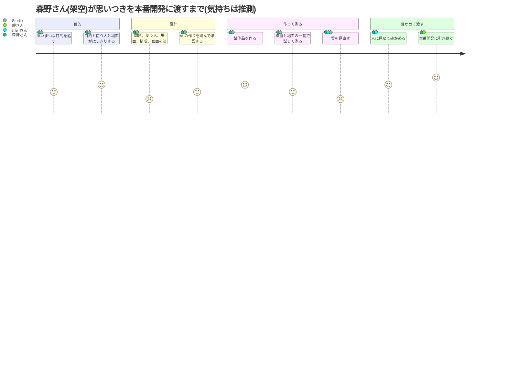
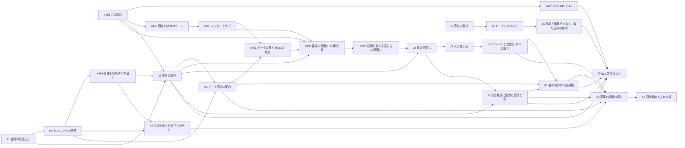

# ユーザージャーニーとカスタマージャーニー

[目的の文書](../vision.md)を、利用者の流れに直した設計です。今の Studio との差、今のカードへの影響、実装のカードの分け方もここに書きます。

- 状態: 案(task 378)。書いた日: 2026-10-29。task 380 で、2 つ目の柱「みんなで、その場で作る」のカード(K1〜K7)を 6 節に足した
- 5 節(1 文を直すか)、段 7(人に見せる形)、6 節(作る順)は、運営者が 2026-10-29 に決めた(task 381)。決めたことは 7 節
- task 416(2026-10-31)で、段 3、段 5、5 節、6 節を、AI 構成の審査を中心にする形に直した。段 3 と段 5 と 1 文は案で、運営者がその PR で決める。作る順は jyoka/tasks の Blocked by に合わせた
- J1 を task 382(2026-10-31)で作った。聞き出しの AI と目的の文書の置き場所の決めたことは 7 節
- K1 を task 384(2026-10-31)で作った。整理する AI と板の決めたことは 7 節
- J2 を task 385(2026-11-02)で作った。案を出す AI、設計の置き場所、Studio が `app/` に書くファイルの決めたことは 7 節。審査の画面は #422(2026-11-08)で作った。決めたことは [ai-architecture-review.md の 14 節](ai-architecture-review.md#14-422-で決めたこと)
- J4 を task 386(2026-11-02)で作った。決めたことは [design-materials.md の 4 節](design-materials.md#j4-で決めたこと)
- J5 の前半(取り込みの案内、指針の文、Storybook)を task 388(2026-11-07)で作った。npm のパッケージは後半の別のカード(jyoka/tasks#427)に分けた。J9(#394)は後半を待たない(2026-11-11 に決めた)。決めたことは [design-materials.md の 5 節](design-materials.md#j5-で決めたこと)
- J6 を task 389(2026-11-11)で作った。見直しの表と、画面の検査の決めたことは 7 節
- 前提: [vision.md](../vision.md)、[AI 構成の審査](ai-architecture-review.md)、[PRD](../prd.md)、[ADR 0001](../adr/0001-local-runtime-and-isolation.md)、[ux-redesign.md](ux-redesign.md)。ADR 0001 の隔離は変えない
- 人物、会社、題材は、どれも架空。気持ちの点は、利用者の調べをしていないので推測

## 結論

- ユーザージャーニーは 8 段。あいまいな目的を話す段から、本番開発に引き継ぐ段まで(2 節)
- 今の Studio が強いのは、後半(作る、試して測る、引き継ぐ)。目的の聞き出しは J1、設計の案内は J2、質の見直しの表は J6、見せる画面は J7 で入れた。AI 構成の審査は無い(4 節。書いた日の差)
- 気持ちが一番下がるのは、設計の過程(3 段)と、質を見直す段(6 段)の見込み。ここを導くことが、目的の中心になる
- 段 3 に AI 構成の審査を置く。構成を日常の言葉で選ばせて裏で書く形をやめ、AI の作りを見せて、人が 4 つを承認する([ai-architecture-review.md](ai-architecture-review.md))
- カスタマージャーニーは 4 段(知る、試す、使い続ける、人に勧める)。信頼を一番壊すのは、できていない機能を約束すること(3 節)
- 1 文、README、LP は、#417 で先に直す。できていないものは「作っているもの」に分けて書き、機能のカードの後に J9(#394)が畳む。1 文の第一の候補は [vision.md の「何の製品か」](../vision.md#何の製品か)(5 節。案)
- 実装のカードは J 9 枚と K 7 枚に、task 416 に続くカードを 7 枚足した(6 節)。作る順は jyoka/tasks の Blocked by に合わせる。1 時間の通し(K6、#396)は、会の始め(K4、#390)、会の終わり(K5、#395)、引き継ぎ(J8、#392)の後。同時編集(K7)は、通しで要ると分かってから

## 1. 人物

| 役 | 人(架空) | 中身 |
|---|---|---|
| 主 | 森野 灯さん | 架空の会社「みなと町くらし案内」の企画担当。AI は文を書くのに使う程度。設計を学んだことはない。思いつきは「商店街のお店への問い合わせに、AI が答えられるようにしたい」 |
| 副 | 川辺さん | 同じ会社のデザイナー。会社の部品集(Storybook)と色のトークンを持っている |
| 副 | 岬さん | 本番を作る開発の担当。引き継ぎを受け取る |

## 2. ユーザージャーニー

森野さんが、思いつきを試作品にし、人に見せ、本番開発に渡すまでの流れです。

### 一覧

| 段 | 気持ち(推測) | 成功の印 |
|---|---|---|
| 1. あいまいな目的を話す | 期待と不安 | 1 文を送れた。問いが返ってきた |
| 2. 目的と使う人と場面がはっきりする | ほっとする | 目的の文書に「決めた」の印が付いた |
| 3. 設計の過程と AI 構成の審査 | 重い、迷う。読めると手ごたえ | 6 つの段の成果物がそろい、案を 1 つ選び、4 つを承認した |
| 4. 試作品を作る | うれしい | 動く試作品が出た。関門が通った。承認した構成のまま |
| 5. 試して測る | 驚く、少し不安 | 場面の一覧で、通らない場面が分かった |
| 6. 質を見直す | 面倒、気づく | 見直しの表の「直す」が 0 になった |
| 7. 人に見せて確かめる | 緊張、手ごたえ | 確かめたい問いに、人の答えが付いた |
| 8. 本番開発に引き継ぐ | 達成感 | 開発の担当が、聞き返さずに読めた |

### 段 1. あいまいな目的を話す

| 項目 | 中身 |
|---|---|
| 本人がすること | 「商店街のお店への問い合わせに、AI が答えられるようにしたい」と 1 文で書く |
| 考えていること | 何から決めればいいか分からない。AI に任せれば何か出てくるはず |
| 気持ち | 期待と不安 |
| つまずき | 白紙の欄で手が止まる。「全部作って」と頼み、中身のない画面が出る |
| Studio が導くこと | 例の 1 文を 3 つ出す。送ると、作り始める前に問いを 1 つ返す(誰が困っているか)。案内の深さ(速く、ふつう、深く)を選べる。既定は「ふつう」 |
| 触れる画面 | はじめの画面(新)。目的の聞き出しの会話(新) |
| 成功の印 | 1 文を送れた。最初の問いが返った |

### 段 2. 目的と使う人と場面がはっきりする

| 項目 | 中身 |
|---|---|
| 本人がすること | 問いに答える(誰が、いつ、何に困るか。うまくいったら何が変わるか) |
| 考えていること | お店の人とお客さんの、どちらのための道具だろう |
| 気持ち | ほっとする。考えが言葉になる |
| つまずき | 問いが多すぎて疲れる。答えを知らない問いが出る |
| Studio が導くこと | 1 度に 1 つ聞く。「分からない」も答えにでき、決めていないことに入る。答えから目的の文書を作り、人が直して「これで決める」を押す |
| 触れる画面 | 目的の聞き出しの会話(新)。目的の文書(新。誰、何の問題、場面、成功の印、しないこと、決めていないこと) |
| 成功の印 | 目的の文書に「決めた」の印。決めていないことが一覧になっている |

### 段 3. 設計の過程と AI 構成の審査(問題、使う人、場面、データ、エージェントの構成、画面)

| 項目 | 中身 |
|---|---|
| 本人がすること | 6 つの段を順に決める。問題(何を解くか)、使う人(お客さん、お店の人)、場面(よくある問い合わせ、答えられない問い合わせ)、データ(何を覚えておくか。K2 で足した)、エージェントの構成、画面(どこで話すか)。構成の段では、AI の作りの案を読み、4 つを承認する。エージェントの構成、harness(何をモデルに任せ、何をコードで縛るか)、データと RAG、技術の組 |
| 考えていること | 構成って何。AI が答えられないときはどうするの。なぜこの形を勧めるの |
| 気持ち | 重い。迷う。読めると手ごたえ |
| つまずき | 構成の言葉(ツール、守り)が分からない。最初の案から離れられない。読まずに承認を押す |
| Studio が導くこと | 各段で案を 2〜3 並べ、おすすめと理由を 1 文で出す。場面の段の答えから、場面(`app/evals/`)の下書きを先に作る。構成は隠さない。簡単な方から問う(固定の流れ、単一エージェント、マスターとサブ)。足りたらそこで止まり、「要らない」と書く。技術の言葉と平たい言葉を並べる。案には日付と根拠の場面を付け、数がなければ「まだ測っていない」と出す。「理想の構成」と言わない。選んだ案の構成のファイルを Studio が `app/` に書き、指紋を取ってから承認を受ける。承認の結果は AI 構成書になる。戻れる。選び直すと承認は消える。飛ばすと「審査なし」の印が残る |
| 触れる画面 | 設計の段の帯(新)。各段の案の比べ(新)。AI 構成の審査(新。#422) |
| 成功の印 | 6 つの段の成果物がそろう。選んだ案、捨てた案、理由が残る。4 つを承認した人と時刻が AI 構成書に残る |

### 段 4. 試作品を作る

| 項目 | 中身 |
|---|---|
| 本人がすること | 4 つの承認の後に「この設計で作る」を押す。出た試作品を言葉で直す |
| 考えていること | 思ったとおりの画面になるか |
| 気持ち | うれしい |
| つまずき | 作る AI に、目的と設計が伝わらず、別の画面ができる。作る AI が承認していない構成に変える |
| Studio が導くこと | 目的の文書と設計の成果物を、作る AI への依頼に入れる。既定の素材で組む。作るループの関門を回し、落ちたら直す(今の作るループ)。承認した構成と違えば関門 GA で止め、審査に戻す |
| 触れる画面 | 試す、言葉で直す(今の 2 列)。最初の一歩の案内(今) |
| 成功の印 | 動く試作品が出た。関門が通った |

### 段 5. 試して測る(模擬と場面の一覧)

| 項目 | 中身 |
|---|---|
| 本人がすること | 自分で話して試す。どのエージェント、道具、守りが働いたかを、試す画面の横で読む。場面の一覧を回し、通らない場面を見る。構成を替えて比べる |
| 考えていること | 答えられない問い合わせで、AI は何と言うのか。どの守りが止めたのか。承認した形で足りているのか |
| 気持ち | 驚く。少し不安 |
| つまずき | 場面の一覧と比べる表が、ターミナルにしかない。記録が開発者向けの詳細の奥にある。お試しの AI の数を、案の良し悪しと読み違える |
| Studio が導くこと | 1 ターンの記録(参加者、道具、守りの層、時間、費用)を主の画面に出す。場面の一覧を画面で回し、比べる表を出す。通らない場面に「直す」を付ける。押すと、言葉で直す欄に依頼が入る。数には接続と日付を付け、お試しの AI の数は形の確かめだと書く。本物の AI で試す前に同意を取る(今)。構成を変えるときは審査に戻る。新しいモデルが出たら、同じ場面で測り直せる |
| 触れる画面 | 試す(今)。実行の記録(主の画面に移す。#423)。場面の一覧と比べる表(新。今は `npm run evals`) |
| 成功の印 | 通らない場面が分かり、直して通った。どの守りが効いたかを読めた |

### 段 6. 質を見直す(UX、使いやすさ、アクセシビリティ、素材に合っているか)

| 項目 | 中身 |
|---|---|
| 本人がすること | 見直しの表を開き、「直す」を順に片付ける。デザイナーに見てもらう |
| 考えていること | 動くけど、これで良いのかは分からない |
| 気持ち | 面倒。気づきがある |
| つまずき | 何を見ればいいか分からない。アクセシビリティの言葉が分からない |
| Studio が導くこと | 測るもの(アクセシビリティの違反、字と地の差、素材に合わない色と部品、場面の結果)と、AI の判断(使いやすさの見直し)を分けた表にする。各行に「なぜ大事か」1 文と「直す」を付ける |
| 触れる画面 | 質の見直しの表(新) |
| 成功の印 | 「直す」が 0。見ていない項目は「まだ見ていない」と出ている |

### 段 7. 人に見せて確かめる

| 項目 | 中身 |
|---|---|
| 本人がすること | 同僚やお店の人(架空)に試作品を触ってもらい、確かめたい問いを聞く |
| 考えていること | 本当に使ってもらえるか |
| 気持ち | 緊張。手ごたえ |
| つまずき | Studio の画面には開発の欄があり、見せにくい。感想がどこにも残らない |
| Studio が導くこと | 見せる画面(試作品だけと、確かめたい問い)にする。問いは目的の文書の「成功の印」から作る。感想を版に残す。手元の PC で見せる形だけにする(2026-10-29 に決めた。共有は PRD の範囲外のまま) |
| 触れる画面 | 見せる画面(新)。版(今) |
| 成功の印 | 問いに人の答えが付き、版に残った |

### 段 8. 本番開発に引き継ぐ

| 項目 | 中身 |
|---|---|
| 本人がすること | 「本番開発へ渡す」でフォルダーを作り、開発の担当に渡す |
| 考えていること | 意図がちゃんと伝わるか |
| 気持ち | 達成感 |
| つまずき | 目的と設計の理由が、ソースと会話だけでは伝わらない |
| Studio が導くこと | 引き継ぎに、目的の文書、設計の段ごとの決定と理由、場面の結果、質の見直しの結果、素材の出典とライセンス、人の確かめの答えを入れる |
| 触れる画面 | その他の「本番開発へ渡す」(今) |
| 成功の印 | 開発の担当が、聞き返さずに読めた(人の確かめ) |

## 3. カスタマージャーニー

Studio を知ってから、人に勧めるまでの流れです。今は LP を公開しておらず、リポジトリも private です([site/README.md](../../site/README.md)、[brand.md](../brand.md))。公開した後を前提に書きます。

| 段 | 接点 | 本人の問い | 信頼を作るもの | 信頼を壊すもの | 測るもの(案) |
|---|---|---|---|---|---|
| 知る | README、LP、人の紹介 | 何の道具か。自分に関係あるか | 1 文で目的が分かる。本物の画面と、架空の例で見せる。できないことも書く | できていない機能の約束。「誰でも」「5 分で」。中身のない派手な絵 | README から「はじめる」へ進んだ数(公開後。測り方は不明) |
| 試す | `npm start`、最初の画面、最初の 1 分 | 本当に導いてくれるか。お金はかかるか | 料金なしで最後まで試せる(お試しの AI)。本物の AI の前の同意。最初の問いがすぐ返る | 起動の失敗が開発の言葉で出る。勝手にモデルを呼ぶ。最初に白紙の欄だけ | 人の確かめ: 初めての人が 10 分で目的の文書を書けるか(仮) |
| 使い続ける | 自分の題材、自分の素材、版 | 自分の仕事で使えるか。前の作業に戻れるか | 自分の素材がつながる。版で戻れる。質の見直しが毎回同じ基準 | 試作品がどれも同じ見た目。直すたびに壊れる。素材のライセンスが分からない | 2 つ目の試作品を作った人の数(手元だけなので、測り方は不明) |
| 人に勧める | 引き継ぎのフォルダー、見せる画面、同僚 | 人に見せても恥ずかしくないか | 引き継ぎが本番開発に通じる。見せる画面に開発の言葉がない | 引き継ぎで意図が消える。見せた先で壊れる | 開発の担当の聞き返しの数(人の確かめ) |

## 4. 今の Studio との差

| 段 | 今あるもの | 無いもの | 差 |
|---|---|---|---|
| 1. あいまいな目的を話す | はじめの画面、例の 1 文、問いを返す会話、案内の深さ(J1)。言葉で直す欄。最初の一歩の案内 | 人の確かめ(初めての人が説明なしで進めるか) | 小 |
| 2. 目的と使う人と場面 | 目的の文書(誰、何の問題、場面、成功の印、しないこと、決めていないこと)と「決めた」の印(J1)。目録の `intent`(作る AI が書く `purpose` 1 文と `tryThis`)。「この設計で作る」で文書を依頼に入れる(J2)。引き継ぎに入る(J8) | なし | 小 |
| 3. 設計の過程と審査 | 6 つの段の帯、案の比べ、場面の下書き、選んだ案の構成のファイル(J2)。データ設計の表と図、架空のデータ(K2)。構成の模擬(`app/composition.json`、ツール、3 つの層の守り)。場面(`app/evals/`) | AI 構成の審査、AI 構成書、関門 GA、固定の流れのツール、親子の委任、データの棚と RAG の判定、人が読む案の質の確かめ | 大 |
| 4. 試作品を作る | 作るループと関門(検査、ビルド、場面、起動、シナリオ)。直すラウンド 2 回。言葉で直す。既定の素材(J3)。「この設計で作る」で目的と設計を依頼に入れる(J2) | 依頼の後の「言葉で直す」に設計を入れること(1 回目の依頼だけに入る) | 小 |
| 5. 試して測る | お試しの AI と本物の AI。同意のカード。構成の模擬。場面の回し(`npm run evals`)と比べる表。観察器と「試作品を自動で確かめる」。試し直し | 主の画面の記録、場面の一覧、比べる表。通らない場面から直す依頼への道 | 中 |
| 6. 質を見直す | 観察器がアクセシビリティの木の要約を読む。関門の結果の帯 | アクセシビリティの判定、字と地の差、素材に合っているかの検査、使いやすさの見直し、見直しの表 | 大 |
| 7. 人に見せて確かめる | 版の保存と戻す。見せる画面、成功の印から作る問い、版に残る答え(J7)。答えは引き継ぎに入る(J8) | 人の確かめ(相手が問いに答えやすいか) | 小 |
| 8. 本番開発に引き継ぐ | 引き継ぎ(形式 4。ソース、AI の設定、構成、場面、証拠の要約、未接続の一覧、目的の文書、設計の決定と理由、質の結果、見せた答え、AI 構成書と承認、素材の出典とライセンス、確かめていないこと。J8) | 人の確かめ(開発の担当が聞き返さずに読めるか)。会の終わりの成果物(要件の文書、データ設計、直した記録)は K5 で入れた | 小 |
| 知る | README、LP(`site/`、公開しない)、バナー、動く画像 | 新しい目的の 1 文。ジャーニーの絵 | 中 |
| 素材(全段) | `assets/brand/tokens.css`(Studio の画面の色。試作品には効かない)。既定の素材(`materials/default/`)。自分のトークン(J4)。指針の文と Storybook の部品の一覧の取り込みの案内(J5) | npm のパッケージ(部品のコード)をつなぐ形([design-materials.md](design-materials.md))、選べる素材(Material 3) | 小 |

## 5. 今のカードへの影響

### 直すか

直します(運営者が 2026-10-29 に決めた)。今の 1 文と LP には「人が承認してから作る」が入っていません。

できていないことを、できると書くと「信頼できる」の原則に反します。そこで、#417 で先に直し、README と LP に「今できること」と「作っているもの」を分けて書きます。機能のカードの後に J9(#394)が「作っているもの」を畳みます(2026-10-29 の「J1 ができてから J9 で直す」を変えた)。

### 1 文の案

| 案 | 日本語 | 英語 | 見立て |
|---|---|---|---|
| D(第一の候補。task 416) | 思いつきを AI プロダクトにすると、どんな作りになるか。動かして測り、人が承認してから作る。 | See how your idea works as an AI product, test it, and approve the architecture before you build. | 中心の 3 つ(見せる、測る、承認する)が入る。2 文で 45 字ほど |
| A(2026-10-29 の第一の候補。#394 の本文で使わないとした) | あいまいな思いつきを、質を確かめながら、本物のプロダクトの設計にする。 | Turn a rough idea into a real product design, checking quality at every step. | 目的、導くこと、質が入る。33 字。AI の作りが入らない |
| B | 何を作るかから、AI プロダクトの設計を一歩ずつ導く。 | Guides your AI product design step by step, starting from what to build. | 短い。質が抜ける |
| C | 作る前に、AI エージェントの試作品を構成ごと試し、質を測る。 | Try an AI agent prototype with its whole setup and measure its quality before you build. | 今の文に近い。導くことが抜ける |

D を第一の候補にする(案)。D は AI プロダクトに絞る。1 文と絞るかは、運営者が task 416 の PR で決める。A、B、C の英語は確かめていない訳(推測で作った案)。D の日本語と英語は jyoka/tasks#416 の本文のまま。

### 直す順

`test/unit/brand.test.js` が、README の太字、`package.json` の `description`、バナー、LP、brand.md の 1 文が同じかを確かめます。1 文は 1 枚のカードで全部を一度に変えます。

1. 運営者が vision.md を決める。PRD の「PRD の後に決めたこと」に 1 行足す(2026-10-29 に済んだ。task 381)
2. 運営者が task 416 の PR で 1 文を決める
3. `docs/brand.md`: 1 文、機能のカード、英語の言葉、絵の位置(#417)
4. README: 冒頭の太字と 2〜3 行、しくみの図、特長の表。「今できること」と「作っているもの」を分ける(#417)
5. LP(`site/`): 見出し、真ん中の絵、できること、比べる(軸を「AI の作りを見せるか」「人が承認するか」「測るか」に。ほかの道具の欄は確かめた事実だけ)、`site/llms.txt`。`package.json` の `description`、バナー、`test/unit/brand.test.js` も一度に変える(#417)
6. 機能のカードの後に(待ち先は下の表)、「作っているもの」を畳み、機能のカード、真ん中の絵、バナー、画像(`npm run media`)を本物の画面で撮り直す(#394)

## 6. 実装のカードの分け方

J を 9 枚に分けました。どのカードも、偽接続(`STUDIO_AGENT=fake`)と偽の `claude` で E2E を書きます。実モデルを呼ぶのは、カードに書いた所だけです(#418、#420、#422)。下の図と順は jyoka/tasks の Blocked by に合わせました(2026-10-31 に読んだ)。

J は 1 人で使うときのカード(task 378)、K は 2 つ目の柱「みんなで、その場で作る」のカード(task 380)です。`#` の番号は task 416 に続くカードで、下の「審査のカード」に書きました。K7 のカードは、まだ jyoka/tasks にありません。

番号は J の番号で、作る順ではありません。作る順は下の「作る順」の表です。

| 番号 | カード | 中身 | 満たす原則 | 確かめるテスト |
|---|---|---|---|---|
| 1 | J1 目的の聞き出しと目的の文書 | はじめの画面、例の 1 文、問いを 1 つずつ返す会話、案内の深さ(速く、ふつう、深く。既定は「ふつう」)。答えから目的の文書(誰、何の問題、場面、成功の印、しないこと、決めていないこと)を作り、人が「これで決める」を押す。置き場所は目録(`app/prototype.json`)の `intent` を広げるか、新しいファイルにするかをこのカードで決める。聞き出しに使う AI(作る AI の書かない使い方か、別の役か)もこのカードで決める | 導く、人が決める、理由を残す | E2E(偽接続): あいまいな 1 文で問いが返る。「分からない」が決めていないことに入る。押すまで「決めた」の印が付かない。飛ばすと「目的なし」の印。場面: 問いの数が深さごとの上限を超えない(偽の `claude`)。人の確かめは K6 と一緒に行う(運営者が 2026-10-31 に決めた) |
| 2 | J2 設計の案内(5 つの段) | 問題、使う人、場面、エージェントの構成、画面の段の帯。各段で案を 2〜3 並べ、おすすめと理由。構成の段は、日常の言葉で選ばせて裏で書くのをやめ、AI 構成の審査(#422)につなぐ。このカードは段の帯と案の比べまでで、審査の画面は作らない。場面の段の答えから `app/evals/` の下書き。戻れる。「この設計で作る」で、目的と設計を作る AI の依頼に入れる | 導く、人が決める、本物を見せる | E2E: 5 段を進んで戻れる。場面の段から作った場面で関門 GE が回る。場面の一覧に、分からない、断る、遅いの場面が 1 つずつ以上ある |
| 3 | J3 既定の素材 | 運営者が選んだ既定の素材を同梱し、ビルドの import を許す(`src/server/build.js` の `ALLOWED_PACKAGES`)。アイコンは同梱する。字は OS の字で、同梱しない([design-materials.md の 3 節](design-materials.md#決めたこと)に合わせた)。どちらも外から読まない。指針の要約を作る AI の決まりに入れる。出典とライセンスの一覧を置く。ADR 0001 の「同梱するライブラリの範囲」を直す | 素材を流用できる、信頼できる | 単体: 許した部品の import が通り、ほかは今どおり落ちる。E2E: 既定の素材の部品を使った見本が、外への通信なしで描ける(今の隔離の E2E と同じ確かめ方)。単体: 出典とライセンスの一覧に、同梱した全部が載る |
| 4 | J4 自分のトークンをつなぐ | W3C の Design Tokens の形(2025.10)の JSON を受け取り、検査して CSS の変数にする。試作品は変数だけを使う。作る AI が素材を書き換えないように、Studio の持つ場所に置く | 素材を流用できる、理由を残す | 単体: 形の誤りを利用者の言葉で返す。E2E: 架空のトークンをつなぐと、見本の色と字が変わる。作る AI が素材を変えると関門で止まる |
| 5 | J5 部品と指針をつなぐ、取り込みの案内 | 取り込みの案内の画面(聞く、確かめる、見本で試す、有効にする)。指針の文(Markdown)、Storybook の静的なビルド(部品の一覧と使い方の文だけ)、npm のパッケージ(検査して、試作品ごとに import を許す)。大きいので、指針と Storybook、npm のパッケージの 2 枚に分けてよい | 素材を流用できる、信頼できる、導く | E2E: 架空の部品集(テストの fixtures)で、案内の 4 歩が通る。ライセンスが分からないときは「有効にする」が押せず、理由が出る。外への URL を含む部品は警告が出て、試作品から外へ通信しない。人: デザイナーが案内だけで素材をつなげる(10 分以内、仮) |
| 6 | J6 質の見直し | 見直しの表。測るもの(アクセシビリティの違反、字と地の差、素材に合わない色と部品の数、場面の結果)と、AI の判断(使いやすさの見直し)を分けて出す。各行に「なぜ大事か」と「直す」。道具の呼び方の正しさ、守りの効き、費用、待ち時間の行を足す(2026-10-31)。素材が入っていないときは、素材に合わない部品の行を「まだ見ていない」と出す。アクセシビリティの検査の道具は、ライセンスを確かめてから選ぶ(未確認) | 質を測る、導く、信頼できる | 単体と E2E: わざと壊した見本(字と地の差が足りない、ラベルのない入力、値のまま書いた色、わざと壊した構成)で、それぞれの行が出る。見ていない項目は「まだ見ていない」。AI の判断の行に「判断」の印が付く |
| 7 | J7 人に見せる | 見せる画面(試作品と確かめたい問いだけ。開発の欄を隠す)。問いは目的の文書の成功の印から作る。答えを版に残す。手元の PC で見せる形だけ。共有の公開はしない | 本物を見せる、理由を残す | E2E: 見せる画面に開発の言葉が出ない(今の `expectNoDevWords`)。答えが版に残り、戻しても消えない |
| 8 | J8 引き継ぎに目的と設計と質を足す | 引き継ぎの形式 4。目的の文書、設計の段ごとの決定と理由、質の見直しの結果、素材の出典とライセンス、人に見せた答え、AI 構成書と承認の記録。`docs/handoff.md` を直す | 理由を残す、信頼できる | 単体: `handoff.json` に 6 つが入る。E2E: 書き出して、別の場所で README を読める(今の引き継ぎの E2E を広げる)。人: 開発の担当が聞き返さずに読める |
| 9 | J9 伝え方の仕上げ | 全部の機能の後の仕上げ(1 文と README、LP の書き直しは #417 が先に行う)。5 節の順の 6。「作っているもの」を畳む。機能のカード、真ん中の絵、バナー、画像を、審査を含む本物の画面で撮り直す。調子の決まり(vision.md の 7 節)を、作る AI と試作品の中の AI への Studio の決まりにも入れる | 信頼できる | 単体: `brand.test.js` が #417 で決めた 1 文で通る。E2E: `site.spec.js` と `media.spec.js` |

大きさの見込みは推測です。J2、J5、J6 は大きいので、60 分を超えそうなら 2 枚に分けます。J5 は task 388 で 2 枚に分けました。前半(#388)は案内の 4 歩、指針の文、Storybook です。後半は npm のパッケージで、ADR 0001 の「同梱するライブラリだけ」を直してから作ります(jyoka/tasks#427)。J9 は後半を待ちません(2026-11-11 に決めた)。J6 は既定の素材(J3)を待ちません(2026-10-31 に変えた)。既定の素材は 2026-10-29 に決まりました([design-materials.md の 3 節](design-materials.md#3-既定の素材))。J3 は、同梱の前に止まり、運営者がライセンスの原文を読んでから同梱に進みます(J3 の PR を merge して確定します)。Material 3 は J3 に入れません([design-materials.md の 3 節](design-materials.md#j3-で確かめたこと))。

### 現場の場面のカード(task 380)

[field-session.md](field-session.md) と [collaboration.md](collaboration.md) を作るカードです。J と同じく、偽接続と偽の `claude` で E2E を書き、実モデルは呼びません。

| カード | 中身 | 満たす原則 | 確かめるテスト |
|---|---|---|---|
| K1 ヒアリングの整理 | 聞き取りの欄と整理の板。打った要点を、要求、使う人、場面、決まりごと、データの 5 つの欄に振り分け、各項目に元の要点を付ける。話に出ていない項目に「推測」の印。矛盾と聞いていないことを「聞くこと」に出す。決める人が「この理解で合っている」を押す。整理する AI は J1 の聞き出しの AI と同じ決め方で選ぶ | 導く、人が決める、理由を残す | E2E(偽の `claude`): 架空の要点 10 個で、5 つの欄に振り分けられ、全項目に元の要点か「推測」の印がある。押すまで「確かめた」の印が付かない。単体: 偽の `claude` が元の要点のない項目を返すと、Studio が「推測」の印を付ける |
| K2 データ設計の案内 | J2 の設計の段に「データ」を足す。整理の板のデータの欄から、覚えておくもの、項目、つながりの案を 2〜3 出し、日常の言葉の表と図で見せる。選んだ案から試作品の架空のデータを作る | 導く、本物を見せる、理由を残す | 単体: データ設計の形の検査(つながりの先がある、項目の名前が重ならない)。E2E: 整理の板のデータの欄が、全部データ設計に載る。選んだ案の架空のデータで試作品が描ける |
| K3 コメントと承認と AI への送り(1 台) | 見せる画面(J7)の上に、画面の場所に付くコメント、反応、承認、列、直した記録、直した結果の比べ、元に戻すを足す。コメントの種類に「構成」を足す(2026-10-31)。1 台の PC の形(collaboration.md の案 A)。役は進行役と決める人だけ | 承認してから直す、人が決める、理由を残す | E2E(偽の `claude`): 反応を 10 個付けても起動しない。承認で 1 回だけ起動する。承認を取り消すと起動しない。要件のコメントは 2 人の承認がそろうまで起動しない。構成のコメントは承認しても起動せず、審査に戻る。元に戻すと前の版になり、記録に「戻した」が足される。単体: 直した記録の項目(collaboration.md の 5 節)がそろう |
| K4 会の始めとお客さんのデータ | 会の始めの画面(目的、流れ、送り先、置き場、見られる人、消す日、同意)。同意の前は整理する AI と作る AI を呼ばない。記録らしい文字列(名前と電話番号など)を整理の板に入れない。「会のデータを消す」と、消す日を過ぎた会の知らせ | お客さんのデータを守る、信頼できる | E2E: 同意の前に偽の `claude` が起動しない。消すと、プロジェクト、版、直した記録、run、引き継ぎの書き出しが消え、消した一覧が出る。単体: 架空の電話番号を含む要点が、整理の板の項目にならない |
| K5 会の終わりの成果物 | 会の終わりの画面。7 つの成果物(要件の文書、データ設計、構成の図、AI 構成書、試作品、場面の一覧、未決事項)と、未決事項の持ち主と期日。引き継ぎの形式 4(J8)に、要件の文書、データ設計、直した記録の一覧を足す | 理由を残す | 単体: 書き出しに 7 つの成果物と直した記録が入る。E2E: 持ち主のない未決事項があると、会の終わりの画面に出る |
| K6 現場の場面の通し | 架空の台本(しおかぜ便の会の要点を順に打つ)で、会の始めから会の終わりまでを、偽接続と偽の `claude` で回す E2E。段ごとの時刻を Studio が残し、見せられるまでの時間と、承認から直った版までの時間を出す。人の確かめ(社内の人がお客さんの役)の手順も書く | 質を測る([vision.md の 10 節](../vision.md#何で測るか)の測るもの) | E2E: 台本に AI 構成の審査を入れて最後まで通り、7 つの成果物がそろう。段ごとの時刻が記録に残る。人: 架空の題材の 1 時間で、見せられるまでの時間を測る(目安は 45 分以内、仮)。人: 初めての人 5 人が説明なしで目的の文書を書き終える(仮。J1 から移した) |
| K7 同時編集と共有の場 | ADR 0004 の段 2(案 C)。手元で作り、中継のサーバーで文書、コメント、反応、承認、試作品の静的なファイルを同期する。人ごとの招待と役。参加者の画面のプロダクト内 AI はモックだけ。中継のサーバーの写しも消せる。大きいので、文書の同時編集と、招待と役と承認の 2 枚以上に分ける | みんなで作る、お客さんのデータを守る | E2E: 2 つのブラウザで同じ文書の別の所を同時に直し、両方に出る。中継のサーバーからの承認を、Studio が役で確かめるまで偽の `claude` が起動しない。消すと中継のサーバーの写しも消える。ADR 0001 の隔離の E2E が今のまま通る |

### 審査のカード(task 416 に続くカード)

[AI 構成の審査](ai-architecture-review.md)を作るカードです。

| カード | 中身 | 満たす原則 | 確かめるテスト |
|---|---|---|---|
| #417 README と LP | 新しい目的に合わせて書き直す。「今できること」と「作っているもの」を分ける。画像は本物の画面だけ。公開はしない | 信頼できる | 単体: `brand.test.js` が新しい 1 文で通る。E2E: `site.spec.js`。人: 初めての人が README の最初の画面で、何の製品かを 1 文で言える |
| #418 整理の板を実モデルで通す | K1 の整理する AI を、架空の台本で 3 回通す(合計 3 USD まで)。整理が使えないと分かったら、後ろのカードの前に止める | 質を測る | 結果を `docs/evidence/real-organize/README.md` に書き、運営者が読む |
| #419 固定の流れからツールを呼ぶ | harness の参加者の流れの段から、コードがツールを呼ぶ。モデルにはツールを渡さない | 人が決める、本物を見せる、質を測る | 単体: モデルの返事で順番が変わらない。E2E: 見本の場面が関門 GE で通る。今の構成とテストは変えずに通る |
| #420 マスターとサブ | 構成に親子の委任を足す。深さと回数の上限はコードが守る | 本物を見せる、質を測る | 単体: 上限を超えた委任が止まる。E2E(モック): 3 つの形を同じ場面の一覧で比べる。実モデル: 1 回(3 USD まで) |
| #421 データの棚と RAG の判定 | データの棚、RAG の判定、文書を検索するツールの処理、再現率と引用の確かめ。手元で動かす | 質を測る、理由を残す、信頼できる | E2E: RAG ありとなしの差が表に出る。短い決まりと表だけの題材で「要らない」になる。隔離の E2E が今のまま通る |
| #422 審査の画面と AI 構成書 | 4 つの審査、案の数、AI 構成書、関門 GA。4 つの承認まで作り始めない | AI の作りを見せて人が承認する、人が決める、理由を残す | E2E(偽の `claude`): 4 つの承認まで起動しない。選び直すと承認が消える。承認後に変えると止まる。実モデル: 形の違う架空の題材 3 つで案を出す(3 USD まで)。運営者が案を読む |
| #423 記録と比べる表を主の画面に | 1 ターンの記録、場面の一覧、比べる表、「直す」 | 本物を見せる、質を測る、導く | E2E(モック): 画面から回して表が出る。止めた層が記録に出る。同意の前に本物の AI を呼ばない。見せる画面に記録は出ない |

### 作る順(jyoka/tasks の Blocked by)

jyoka/tasks の Blocked by に合わせて、1 本に並べた順です(2026-10-31 に読んだ)。待ち先が全部終わっていれば、並べて始めてよいです。運営者が task 416 の PR を読むまで、#417、#419、J2、#422 は始めません。

| 順 | カード | 待ち先 | 理由 |
|---|---|---|---|
| 1 | #416 この設計 | なし | 中心を決める |
| 2 | J1(#382) | なし | K1 の土台。聞き出しの AI と文書の形をここで決める |
| 3 | K1(#384) | J1 | 理想の場面の売りの中心 |
| 4 | #418 整理を実モデルで通す | K1 | 整理が使えるかを、後ろのカードの前に確かめる |
| 5 | #419 固定の流れのツール | #416 | 一番簡単な選択肢を動くようにする |
| 6 | #420 マスターとサブ | #419 | 3 つの形を比べられるようにする |
| 7 | J2(#385) | J1、#416、#418 | 整理から試作品への橋 |
| 8 | K4(#390) | K1、#418 | 1 時間の通しに要る |
| 9 | K2(#387) | K1、J2 | データの棚の下書き |
| 10 | #421 データの棚と RAG の判定 | K2、#420 | 審査の 1 つ |
| 11 | #422 審査の画面と AI 構成書 | J2、#416、#420、#421 | 中心の原則 |
| 12 | #423 記録と比べる表 | #422 | 審査の数を主の画面で読む |
| 13 | J6(#389) | J2、#423 | 表の行に、記録の数を使う |
| 14 | J7(#391) | J6 | 見せる画面 |
| 15 | K3(#393) | J7 | 見せる画面の上にコメントを足す |
| 15 | J8(#392) | J2、J6 | AI 構成書を引き継ぎに入れる |
| 16 | K5(#395) | K2、K3、J8 | 会の終わりの成果物 |
| 17 | K6(#396) | K2、K3、K4、K5、J8 | 受け入れ条件の「会の始めから会の終わりまで」に、その画面が要る(運営者が 2026-10-31 に決めた) |
| 18 | J9(#394) | J2、J5、J8、K5、#417 | 機能の後の仕上げ。K6 は人を待つので待たない。K4 は待ち先にない。J5 の後半(jyoka/tasks#427)は待たない |
| 後 | K7(カードはまだない) | K6 | K6 で操作役が詰まりになると分かり、運営者が ADR 0004 の段 2 を採ってから。共有の場で、進行役のログインの作る AI をほかの人の承認で動かしてよいか(Claude の利用の決まり)を、K7 の前に確かめる |

並べて進めるカード:

- #417 README と LP は、#416 の後すぐに始められる
- J3(#383)、J4(#386)、J5(#388)は、上の順と並べて進める。この順に待つ

K の大きさの見込みは推測で、K1、K3、K7 は 60 分を超えそうなら分けます。

## 7. 決めたこと、決めていないこと、確かめていないこと

### 決めたこと

運営者が 2026-10-29 に、おすすめのとおりに決めた(task 381)。2026-10-31 に変えた所は、行の中に書いた。

| 決めたこと | 中身 | 書いた所 |
|---|---|---|
| 1 文を直すか | 直す(2026-10-29)。いつ、どの文にするかは、2026-10-31 に変えた。#417 で先に直す。1 文は運営者が task 416 の PR で決める | 5 節 |
| 人に見せる段で、手元の PC の外に見せるか | 手元の PC で見せる形だけ | 段 7、J7 |
| 作る順 | jyoka/tasks の Blocked by に合わせる。K6 は K4、K5、J8 の後(2026-10-31 に変えた) | 6 節 |
| 案内の深さ | 「速く」「ふつう」「深く」から選べる。既定は「ふつう」 | 段 1、J1([vision.md の 9 節](../vision.md#9-決めたこと)) |
| 手元か共有か、お客さんのデータの扱い | まず 1 台の PC でみんなで(案 A)。お客さんの話は同意の後に扱い、記録は入れない | [collaboration.md の 8 節](collaboration.md#8-決めたこと決めていないこと確かめていないこと) |

### J1 で決めたこと(task 382、2026-10-31)

カードが「このカードで決める」とした 2 つを、エージェントが決めた。運営者の確かめは PR で受ける。

| 決めたこと | 中身 | 理由 | 採らなかった案 |
|---|---|---|---|
| 聞き出しに使う AI | 別の役「聞き出す AI」にする(`src/server/intent-ai.js`)。起動はプロダクト内 AI と採点と同じ形(`--restricted`、`--safe-mode`、`--tools ""`、`--json-schema`、空の一時フォルダー)。接続の判定は作る AI と同じものを使う | 聞き出しにファイルの道具は要らない。道具を渡さなければ、`app/` の外にも中にも書けない(ADR 0001 の守りが、指示ではなく起動の形で保たれる)。返事の形を固定でき、1 回の費用の上限も付けられる | 作る AI の書かない使い方。cwd が `app/` で、試作品のファイルを読め、観察の道具も持つ。聞き出しに要らない力を渡すことになる |
| 目的の文書の置き場所 | 新しいファイル `projects/<ID>/.studio/intent.json`。目録の `intent` は広げない。目録の `intent` は今のまま、作る AI が書く 1 文として残す | `.studio/` は Studio だけが書く場所で、作る AI は読み書きできない。`app/` に置くと、作る AI が「決めた」の印を書き換えられ、「人が決める」を守れない。版で戻しても目的の文書は戻らない(J7 の「戻しても消えない」と同じ扱いにできる) | 目録の `intent` を広げる。ビルドのたびの検査に、人の決定の検査が混ざる。作る AI が書ける |

作って決めた細かいこと:

- 問いの数の上限は、速く 2、ふつう 4、深く 7(仮)。数えるのは Studio で、AI が聞き続けても超えない。最初の 1 問は必ず返す([vision.md の 5 節](../vision.md#5-しないこと)の「まず目的を 1 つ聞き返す」)
- AI を使わない道を残す。同意しない、Claude Code がない、AI の返事を使えない(2 回続けて壊れている、失敗、止めた)ときは、Studio の決まった問い(5 つ)で進む。料金はかからない
- 「分からない」は、ボタンでも文でも答えにできる。入れるのは Studio で、AI の返事によらず決めていないことに入る
- 「決めた」の印は、人が「これで決める」を押したときだけ付く。決めた後に「直す」と印が外れ、もう一度押すまで付かない。書いていない項目は、決めるときに決めていないことへ足す
- 1 文から新しい試作品を作る。今の Studio には試作品を画面で作る道がなかったので、はじめの画面に付けた。サンプルの目的にはしないため
- はじめの画面は、起動して最初の画面で出す。文書のある試作品があるか、閉じた後は出さない(閉じたことは Studio を止めるまで覚える。最初の一歩の案内と同じ)。「新しく作る」からはいつでも開ける
- 決めた後の次の一手は「この目的で試作品を作り始める」。文書から作った文を言葉で直す欄に入れ、人が送る。依頼に自動で入れるのは J2

### K1 で決めたこと(task 384、2026-10-31)

カードが「J1 と同じ決め方で選ぶ」とした整理する AI と、設計に書いていなかった細かいことを、エージェントが決めた。運営者の確かめは PR で受ける。

| 決めたこと | 中身 | 理由 | 採らなかった案 |
|---|---|---|---|
| 整理する AI | 別の役にする(`src/server/organize-ai.js`)。起動は聞き出す AI と同じ形で、1 か所にまとめた(`structured-ai.js`)。接続の判定は作る AI と同じ | 整理にファイルの道具は要らない。道具を渡さなければ、ADR 0001 の守りが起動の形で保たれる。返事の形を固定でき、費用の上限も付く | 作る AI の書かない使い方。cwd が `app/` で、要らない力を渡す |
| 板の置き場所 | 新しいファイル `projects/<ID>/.studio/organize.json` | `.studio/` は Studio だけが書く。作る AI が「確かめた」の印を書き換えられない。版で戻しても板は戻らない | `app/` に置く。目的の文書に混ぜる(役目が違い、K2 と K5 が板だけを読む) |
| いつ AI を呼ぶか | 操作役が「整理する」を押したときだけ。打つたびには呼ばない。[field-session.md の段 1](field-session.md#段-1-聞く)を、この形に直した | 打つたびに呼ぶと、費用が読めない。1 回押して 1 回(形が壊れたときのやり直しを入れて多くて 2 回)なら、同意のカードにそのまま書ける。待つ間も要点は打てるので、聞くことは止まらない | 打つたびに、または間を置いて自動で呼ぶ。#418 の実モデルの通しで、足りないと分かったら考え直す |
| 「推測」の印 | Studio が決める。今ある要点を指す番号がない項目に付ける。AI の返事に印を書く口はない | 「AI が話していないことを書き足す」を、指示ではなく検査で止める | AI に印を付けさせる |

作って決めた細かいこと:

- 番号が今ある要点を指すかは確かめる。要点の中身が項目の根拠になっているかは、Studio には確かめられない。元の要点の文を項目の下に出し、人が読んで確かめる
- 人が足した項目は、打った文を要点にも足し、その要点を元にする。全部の項目に、元の要点か「推測」の印があるようにするため
- 要点を消すと、それだけを元にしていた項目は「推測」になる
- 「推測」の項目は、人が「この項目は合っている」を押すと印が外れ、「人が確かめた」になる。押さなければ、聞くことに残る([field-session.md の段 2](field-session.md#段-2-ai-が整理する要求使う人場面決まりごとデータ)の「未決事項に移った」は、K5 までこの形で持つ)
- 聞くことには、AI が出した矛盾と聞いていないことに、Studio が 2 つを足す。「推測」のままの項目と、空の欄。空の欄は AI の返事によらず出る
- 整理し直しても、人が直した項目は残り、人が消した文と直す前の文は戻らない。AI の前の項目は入れ替わる。AI が言い換えて返したものは、Studio には同じと分からない
- 使える項目のない返事では、板を変えない。空の返事で板を消さないため。人が決めた項目だけの板は、空の返事を受ける
- 「確かめた」の印は、板が変わると外れる。読んだ後に板が変わっていたら、押しても断る(押すときに、読んだ板の版を送る)。読んでいない中身を確かめたことにしないため。押せるのは項目が 1 つ以上あるときで、AI を待つ間は押せない
- 押した人の名前は残さない。1 台の PC の形では、誰が押したかを Studio は知らない。役は K3 で入れる
- AI を使えないとき(同意しない、Claude Code がない、本物の AI を止めた設定)は、要点の横の欄で手で振り分ける。料金はかからない
- 1 回の呼び出しの上限は 120 秒、0.3 ドル(仮)。要点が多いと返事が長いので、聞き出す AI より高くした。#418 で測った値は、要点 11 個で 14 秒ほど、0.03〜0.05 ドル([記録](../evidence/real-organize/README.md))。多い要点では測っていないので、値は変えていない
- はじめの画面は、整理の板のある試作品があれば出さない。文書のある試作品と同じ扱い
- 名前や電話番号の検査は K4 で入れた(下の「K4 で決めたこと」)

### J2 で決めたこと(task 385、2026-11-02)

カードに書いていなかったことを、エージェントが決めた。運営者の確かめは PR で受ける。

| 決めたこと | 中身 | 理由 | 採らなかった案 |
|---|---|---|---|
| 案を誰が出すか | 別の役「案を出す AI」にする(`src/server/design-ai.js`)。起動は聞き出す AI と同じ形(`structured-ai.js`)。AI を使えないときは、Studio の決まった案を出す | [ai-architecture-review.md の 7 節](ai-architecture-review.md#7-案を出す-ai)が同じ決め方を勧めている。#422 はこの役に 4 つの案を足せる。AI なしでも料金なしで最後まで通る | 決まった案だけにする。目的に合った案にならない |
| 設計の置き場所 | 新しいファイル `projects/<ID>/.studio/design.json` | `.studio/` は Studio だけが書く。作る AI が「決めた」の印を書き換えられない。版で戻しても設計は戻らない | `app/` に置く |
| 構成の段で何を書くか | 選んだ案を `app/composition.json` に写す。固定の流れは `ai.json`、単一エージェントは `assumptions/studio-default.json` と `mocks/studio-main.json` も書く | [ai-architecture-review.md の 6 節](ai-architecture-review.md#承認までの流れ)の 5 に合わせた。受け入れ条件の「構成の段の選択から書いた `composition.json`」のため。案ごとのファイル(`app/compositions/<案の id>.json`)と指紋は #422 | 選択を記録するだけで書かない。関門を通るか分からない |
| マスターとサブ | 並べるが、選べない。理由を出す | 構成には書ける(#420)が、Studio がこの案の構成のファイルをまだ書けない。書けない形を選ばせない。AI も勧められない | 隠す。「構成は隠さない」に反する |
| AI の設定が残る試作品 | 単一エージェントを並べるが、選べない。理由を出し、おすすめは固定の流れに移す。選んだ後に設定が置かれたら「確かめ直す」にする。単一エージェントの依頼には、`ai.json` を置かないよう書く | 基本のシナリオは `ai.json` のあいさつが画面に出ることを求める。回し手が `agent` だとあいさつは出ず、関門 G6 で必ず止まる。基本のシナリオは作る AI には変えられない。消すと持ち主の設定を失う | `agent` のときはあいさつを求めない。残った設定が読まれないまま、画面だけが変わる |
| 審査がない間 | 構成の段に「審査の画面はまだない。審査なしで作る」と出し、`.studio/design.json` の `composition.review` に `none` と残す。`.studio/project.json` の `review` は書かない | 審査の画面は #422。「審査必須」の印だけ先に付けると、作れなくなる | 構成の段を飛ばす |
| 持ち主のファイル | Studio が書いた中身の指紋を覚え、指紋が同じファイルだけを上書き、消す。今の構成があれば「今の構成のまま」だけを選べる | [ai-architecture-review.md の 6 節](ai-architecture-review.md#今の構成を審査する)の「書き換えません」。作る AI と人の変更を消さない | 毎回上書きする |
| 場面の 3 つの種類 | 分からない、断る、遅いは、種類の語を増やさず、今の `kind` に当てる(`question`、`risky`、`tool-fault`)。種類は `about` の頭と場面の id に入る | 種類を足すとコードが要る(R3)。今の語で回せる | `kind` を 3 つ足す |
| 場面の確かめ | 長さ、作った数、採点(`judge`)。お試しの AI では採点しないので、関門 GE で見るのは形だけ | 下書きの段で文の中身を決められない。画面で「まだ測っていない」と出す | お試しの返事の文を確かめる。固定の流れでは同じ文を返せない |

作って決めた細かいこと:

- 案は 1 回の呼び出しで 5 段分をまとめてもらう。段を移るたびには呼ばない。呼ぶのは「案を作る」か「案を作り直す」を押したときだけ
- 構成と画面の選択肢は Studio のデータ。AI はどれを勧めるかと理由だけを返す。使わない言葉(理想、最適、ベストプラクティス、最新の正解)を含む案は捨て、2 つ残らない段は決まった案にする
- 前の段を選び直すと、後ろの選んだ段に「確かめ直す」が付き、選び直すまで作れない。文が変わった前提で後ろの段を読み直すため。同じ案を押すと印が外れ、直した場面は消えない
- 「この設計で作る」の依頼は 4000 文字まで。入らない分は場面の末尾から切れる(場面の全部はファイルにある)
- 依頼に入るのは最初の 1 回だけ。作る AI は依頼ごとに新しく起動するので、後の「言葉で直す」には設計が入らない。要るかは J6 と K6 で見る
- 「決めた」の印は人が「この設計で作る」を押したときだけ付く。決めた後に選び直すと外れる
- 「この設計で作る」の前にファイルを選んだ案に合わせ直す。版を戻してファイルが違っていても、依頼の文と合うように
- 目的の文書のない試作品でも設計の案内を使える。1 文か試作品の名前を材料にし、依頼に「目的の文書は決めていません」と書く。飛ばす道を残すため
- 整理の板は材料にする(要求、使う人、場面の欄)。データの欄はカード K2(下の「K2 で決めたこと」)
- 飛ばすと Studio が書いたファイルを取り除く。「設計なし」の印のまま、書いた構成が動かないように。案を選び直すと書き直す
- 「遅い」の場面は、待たされた人の発言を試すもので、遅さそのものは起こさない(`toolCalling.delayMs` はツールを呼ぶときだけ効き、下書きの構成にはツールがない)
- 書いた後の検査で落ちたとき、書いたファイルの誤りなら元に戻して断る。画面のソースの誤りなど案と関係のない失敗では止めない
- 「言葉で直す」の 1 回目の依頼と同じ道で送るので、同意のカードも同じ。案を出す AI の同意とは 1 つの同意で済む

### K4 で決めたこと(task 390、2026-11-02)

カードに書いていなかったことを、エージェントが決めた。運営者の確かめは PR で受ける。

| 決めたこと | 中身 | 理由 | 採らなかった案 |
|---|---|---|---|
| 会と試作品の関係 | 「会を用意する」で新しい試作品を作る。会は 1 つの試作品と同じ長さ。記録は `projects/<ID>/.studio/meeting.json` | 消すときに試作品ごと消せる。サンプルや別の試作品を、間違って消さない。`.studio/` は Studio だけが書く | 今の試作品に会を付ける。消すときに、ほかの仕事まで消す恐れがある |
| 同意の前に止めるもの | 整理する AI、作る AI、聞き出す AI、案を出す AI、試作品の中の本物の AI。要点、聞き出しの答え、設計の入力も受けない。本物の AI の同意とは別に止める | 話は同意の後に扱う決まり(collaboration.md の 7 節)。本物の AI の同意は Studio 全体に効くので、前の会の同意で次の会が動かないように | 本物の AI の同意だけを見る。2 つ目の会で止まらない |
| 同意と本物の AI の同意 | 「同意して始める」は、外の AI に送る接続なら本物の AI の同意も兼ねる。同じ画面で送るもの、送り先、料金を見せる。外へ送らないと見せて取った同意(偽接続の起動)は、外の AI につないで起動し直すと、同意の前に戻す | 会の途中で同意のカードがもう一度出ると、話が止まる。見せていない送り先へ送らない | 2 回聞く |
| 同意しない道 | 「お試しの AI だけで始める」。外の AI に送らない。要点は手で振り分け、目的は決まった問い、設計は決まった案。外の AI に送る接続では作る AI を断る | 今の Studio の、AI を使えないときの道をそのまま使える。実モデルの代わりに偽接続へ切り替えると、試作品が変わらないのに動いたように見える | 偽接続へ切り替える |
| 記録らしい形 | 電話番号(全角、空白、かっこ、前後の文字も。区切りを除いた桁で見る)、メールアドレス、番地のある住所、名乗りと「氏名:」の後の名前(4 文字以上)、敬称の付いたフルネーム(漢字 4 文字以上。役職と組織の語は除く)、9 桁以上の番号。`redact.js` の `findRecords` | 打ち方の違いで漏れないように、数字は桁で見る。普通の話(東京都みほん区の店舗、お名前は受付で聞く、協力会社さん)を止めないように、住所と氏名は引き継ぎの検査より狭くした | 名字とさんも止める。会に出た人の呼び名(field-session.md の例の宇田さん)まで止まる |
| 打った文の扱い | 要点の全体を保存せずに断り、文を欄に戻す。番号だけを伏せて残さない | #418 のおすすめと受け入れ条件。伏せて残すと、話の中の記録の痕が板に残る。打ち直す手間は 1 回で済む | 伏せて残す |
| AI の役目 | 形で見分けられない記録のために、返事に `recordPoints` を足した。言われた要点は一覧から消す。その要点を元にした項目も作らない | collaboration.md の 7 節の「整理する AI は項目にせず、省いたと出す」の口がなかった(#418)。一度 AI に届くので、確実に止めるのは形の検査 | 形の検査だけ |
| 消す | 2 段で聞く。置き場を別の名前へ移してから消し、途中で止まっても次の起動で書き出しまで続きを消す。消せなかった場所は画面に出し、消せたものだけを一覧に出す。動いている間は断り、消している間の書き換えも断る。消した一覧は、中身ではなく数と書き出しの名前。ファイルには残さない | 消した記録に、お客さんの言葉を残さない | 消した記録をファイルに残す |
| 消す日 | 既定は 30 日後。今日より前には変えられない。過ぎても知らせるだけ | 消すのは取り返しがつかないので、人が押す | 自動で消す |

作って決めた細かいこと:

- 直した記録はまだない(K3)。置き場を `.studio/fix-records/` と決め、消す一覧で数える。K3 はここに書く(K3 で書いた。1 件が 1 つのフォルダー)
- 会の始めの流れの 7 段のうち、まだ作っていない段は「まだ作っていません」と出す。K6 までに外す
- 会の試作品の ID は `meeting-…` で始める。`meeting.json` が壊れても消えても、同意の前として扱う。読めないまま AI を呼ばないため。消す口も残る
- 消す日を過ぎた知らせに会の目的は出さない。ほかのお客さんの前で、別の会の目的を見せないため。上の帯の一覧には今も出る(会ごとに分けるかは K6 で見る)
- 消した後は、会ではない試作品を選ぶ。同じ理由
- 同意の後はお試しに戻せない。送った分を取り消せないため。やめるときは会のデータを消す
- 目的の文書の 1 文と答えは、整理の板ではないので検査しない。会の目的は試作品の名前になるので検査する

### K2 で決めたこと(task 387、2026-11-07)

カードに書いていなかったことを、エージェントが決めた。運営者の確かめは PR で受ける。

| 決めたこと | 中身 | 理由 | 採らなかった案 |
|---|---|---|---|
| データの段の場所 | 場面の段と構成の段の間。6 つの段の 4 番目 | データの案は構成の前提になる(#421 のデータの棚、道具で引くか)。場面を決めてから、場面で使うものを決める | 画面の段の後に置く |
| 案を誰が出すか | J2 の案を出す AI の返事に `data` を足す。呼ぶ回数は 1 回のまま。AI を使えないときと、使える案が 2 つそろわないときは、データの段だけ Studio の決まった案にする | 呼ぶ回数と費用と同意を増やさない | データの段だけ別に呼ぶ |
| 形を誰が整えるか | 番号(主キー)とつながりの番号(外部キー)は Studio が付ける。AI が返すのは、名前、項目、例、つながり、元にした欄の印だけ。先のないつながり、自分へのつながり、重なる名前、番号と同じ名前の項目は捨てる(`data-design.js` の `shapeDataOption`、`dataDesignProblems`) | 受け入れ条件の形の検査を、指示ではなくコードで守る | AI に主キーまで書かせる |
| 欄が全部載ること | 整理の板のデータの欄は、項目の id の印で AI に渡し、案は印で元を指す。AI の案に載っていない欄は、Studio が「聞いたことのメモ」に足し、画面でそう出す。案を作った後に足した欄は「まだ載っていません」と出し、作り直すと載る | 受け入れ条件。AI が落としても欠けない | 載っていない案を捨てる。AI の案がほとんど使えなくなる |
| 図 | 画面が SVG で描く。外の部品(Mermaid など)は使わない | 外への通信と同梱を足さない。ADR 0001 の CSP のまま | Mermaid を同梱する |
| 架空のデータ | 選んだ案から、Studio が `app/data/design-data.json` を作る。表ごとに 3 行。値は案の例か「項目の名前の例 1(架空)」の形。記録らしい例は捨てる。目録の `data` への宣言と、データを読む画面は、依頼で作る AI に頼む | 試作品のソースを書くのは作る AI だけ([collaboration.md の 2 節](collaboration.md))。Studio が書くのは JSON の値だけ | Studio が目録や画面の部品も書く |
| 前の設計 | データの段のない設計は、読むときに決まった案を足す。選ぶまで作れない。選ぶと、ほかの段と同じく構成と画面が確かめ直しになる。決めた設計は「決めた」の印のままにし、「データの段が増えた」と次にすることを出す | J2 の決まり(前の段を選ぶと、後ろの段は確かめ直し)を変えない | 決めた設計のまま作れるようにする |

作って決めた細かいこと:

- 項目の種類は、文、数、日付、選ぶものと、Studio が付ける番号(主キー)、つながりの番号(外部キー)。つながりは「1 つの A に、いくつもの B」(1 対 多)だけ。多対多は、間に覚えておくものを置く
- 覚えておくものごとに「誰が書くか」を持つ([field-session.md の 3 節](field-session.md#3-要件定義を何で置き換えるか)の成果物の表)
- 整理の板にデータの欄がないときの決まった案は、相談の記録だけと、相談の記録とよくある問いと答えの 2 つ。欄があるときは、欄ごとに分ける、1 つの表にまとめる、使う人ごとにまとめる(使う人の欄があるとき)
- 型と細かい決まり(必須、数の範囲)は書かない。会の後に決める(field-session.md の 3 節の「型と制約は会の後」)
- 依頼では、データ設計を場面の一覧より前に置き、1200 文字で切る(全部はファイルにある)。上限で切れても、データ設計と場面の決まりの文が残るように
- 「案を作り直す」では、前に選んだ案も今の整理の板で整え直す。中身が変わればデータの段を確かめ直しにする。後から足した欄も、選んだ案に載るように
- 飛ばすと Studio が書いたファイルを取り除くが、目録が架空のデータを宣言していれば残す。試作品が読んでいて、消すと描けなくなるため
- 持ち主が直した架空のデータは書き換えない。依頼にも「Studio が書いた」と書かない
- 記録らしい形の欄の文は、項目の名前と架空のデータに入れない(「聞いたこと」の名前にする)。整理の板は記録を入れない作りだが、架空のデータに本物の記録が混ざらないよう、ここでも見る
- 案と選んだ案は `.studio/design.json` の `steps.data` に残る。#421 のデータの棚は、ここを下書きとして読む

### J6 で決めたこと(task 389、2026-11-11)

カードに書いていなかったことを、エージェントが決めた。運営者の確かめは PR で受ける。

| 決めたこと | 中身 | 理由 | 採らなかった案 |
|---|---|---|---|
| アクセシビリティの検査の道具 | 外の道具を入れない。Studio のコードの小さな検査(`src/observer/audit.js`)で、ラベルのない入力、名前のないボタン、代わりの文のない画像、字と地の差(WCAG 2.2 の 1.4.3 の式)だけを見る | カードは「ライセンスを確かめてから選ぶ(未確認)」。ライセンスを確かめずに依存を足さない。外への通信も足さない | 検査の道具(axe-core など)を同梱する。ライセンスと同梱の範囲(ADR 0001 の「J3 で決めたこと」)の確かめが先 |
| どの画面を検査するか | 観察の最後の画面を、最後に使った画面幅で 1 回。report の `audit` に入れる。関門の合否には入れない。表が使うのは、画面の「確かめる」(表示中の試作品を見た観察。report の `mode` が `shown`)の audit だけ | 観察器の同じ文脈とブラウザを使い、新しい起動を足さない。関門に入れると、今ある試作品の作る run が止まる | 見直し専用の観察を足す。画面幅ごとに検査する |
| 見直しを始める口 | 表の「画面を確かめて見直す」は、お試しの AI での確かめを始めるだけ。表は記録を読むだけで、何も動かさない | 確かめは今の 1 プロジェクト 1 実行の決まり(`claimCheck`)にそのまま乗る。費用も同意も要らない | 表が観察と場面の回しを自分で動かす |
| 素材に合わない色 | `app/` の文の、値のまま書いた色(`#rgb` などと色の関数)を数える。素材の有無によらず測る。`var()` の後ろの値、名前の色、コメントは数えない | 既定の素材(Radix Colors の変数)はどの試作品でも読めるので、比べる色がいつもある | 素材をつないだ試作品だけで測る |
| 素材に合わない部品 | 既定の素材(`@radix-ui/themes`)を読む試作品でだけ、`<button>`、`<input>`、`<select>`、`<textarea>` をじかに書いた所を数える。読まない試作品では「まだ見ていない」 | カードの「素材が入っていないときは、素材に合わない部品の行を『まだ見ていない』と出す」。部品の素材が入ったかは、import で分かる | トークンをつないだら測る。トークンは値で、部品ではない |
| 場面の行の元 | 一番新しい場面の回しの結果の、今の既定の構成の組(本物の AI の組と 1 回目を先にする)。回している最中と途中で止めた回しは「問題なし」にしない。費用と待ち時間はお試しの AI では「まだ見ていない」。目安がないので「直す」にしない(`info`) | 比べる表(#423)と同じ結果を読む。目安の値を決めた根拠がない | 構成ごとに行を分ける。費用の上限を目安にする |
| AI の判断の行 | 返事の自然さ(場面の回しの採点。`npm run evals -- --real` のときだけ)と、使いやすさの見直し(いつも「まだ見ていない」)。どちらも「判断」の印を付け、別の表にする | 採点は今ある AI の判断。画面を AI に見せる見直しは、本物の AI の呼び出し、同意、費用の上限が要り、このカードの大きさを超える | 使いやすさの見直しを、このカードで本物の AI につなぐ |
| 構成のない試作品 | 場面を回せない試作品(構成を書いていない試作品)では、場面から待ち時間までの行と返事の自然さを「当てはまらない」(`na`)にし、「まだ見ていない」と分ける | 回せる場面がないので、見ていないのではない | 「まだ見ていない」に入れる |

作って決めた細かいこと:

- 大きな字は 24px 以上か、18.66px 以上の太字。基準は 3:1。押せない部品(`disabled`)と隠れた要素は数えない
- 地は祖先の地の色を重ねて求める。地に絵(`background-image`)がある所と、色を読めない所は「測れない」に数え、違反にしない。重なり(`position`)と字の影は見ない
- 名前の求め方は、アクセシビリティの名前の計算を小さくしたもの(`aria-labelledby`、`aria-label`、ラベル、代わりの文、`title` の順)。置き場所の字(`placeholder`)はラベルに数えない
- 試作品の中で作った検査の値は、Studio が決まった形と長さに写してから report に入れる。読むときも写し直す
- 検査は試作品の画面の中(同じ JavaScript の場)で動く。試作品のコードが検査の使う関数を書き換えれば、数は変わる。わざと隠す相手の守りではない(分けた場で動かすのは後のカード)
- 色は、CSS では宣言の値だけ、JS と HTML では色だけの文字列と「名前: 値」の形だけを数える。リンクと要素を選ぶ所の `#…` は数えない
- 色の場所と部品の場所は、ファイルと行を出すので「開発者向け: 場所」の中に閉じて出す
- 「直す」は、言葉で直す欄に依頼を入れるだけ(場面の「直す」と同じ)。守りの依頼は、プロンプトの頼みでなく、コードの守りを足すように書く

後のカードに回すもの:

- 使いやすさの見直しを本物の AI につなぐ(画面と場面を AI に見せ、指摘を「判断」の行に出す。同意と費用の上限を通す)
- アクセシビリティの検査の道具を選ぶ(ライセンスを確かめてから。キーボードで使えるか、見出しの順、ARIA の正しさなど、小さな検査が見ない規則)
- 見直しの結果を引き継ぎに入れる(J8)。J8 で入れた
- 画面幅ごとの検査と、シナリオの途中の画面の検査
- 検査を試作品と分けた場で動かす(試作品のコードが数を変えられないように)

### J7 で決めたこと(task 391、2026-11-11)

カードに書いていなかったことを、エージェントが決めた。運営者の確かめは PR で受ける。

| 決めたこと | 中身 | 理由 | 採らなかった案 |
|---|---|---|---|
| 見せる画面の形 | 同じ画面の中の形にする。その他の引き出しの「人に見せる」で、試作品(そのまま)と、右の問いの欄だけを出す。上の帯、知らせ、言葉で直す欄、試す欄の道具、`data-studio-only` の欄、その他の引き出しは隠す | 試作品の iframe を読み直さず、見せる直前の会話のまま渡せる。ボタンは引き出しの一番上に置く。上の帯は幅 1024 で足りず、試す欄の上はボタンを増やさない決まり(ux-redesign.md の U9)。人の「確かめる」と同じ置き方。新しい URL や別のポートを足さないので、ADR 0001 の守り(loopback、トークン、CSP)がそのまま効く | 別の URL の見せる専用の画面。トークンの扱いと CSP を足すことになる |
| 答えの置き場所と「版に残す」 | 答えは `.studio/show.json` に、見せた版の ID と番号を付けて残す。版の一覧は、版ごとの答えを載せる。見せ始めたときに、今の状態が自分で保存した版と同じならその版に結び付け、違えば(自動の版と同じときも)「人に見せた状態」の名前で版を保存してから見せる | 版の写し(`.studio/versions/<ID>/`)の中に置くと、戻すたびに写しが入れ替わり、答えが消えたり戻ったりする。写しの外に置き、版の ID で結べば「戻しても消えない」。目的の文書と同じ扱い(J1 で決めたこと)。見せた版が必ずあるので、答えがどの状態への答えかが分かる | 版の `version.json` に書き足す。版は後から変わらない決まり(usage.md の「版を保存して戻す」)に反する |
| 問いの作り方 | 成功の印を改行と句点で分け(行の頭の箇条書きの印は外し、文の中の中黒では分けない)、印ごとに「この試作品で「…」に近づきそうですか?」。最後に「使ってみて、分かりにくいところや困ったところはありましたか?」を足す。印は 5 つまで。成功の印がないときは決まった問いを出し、そう書く。AI は呼ばない | 決まった形なら、同意も費用も要らず、何度見せても同じ問いで比べられる。困ったところを聞く問いは、印にない気づきを拾うため | 聞き出す AI に問いを作らせる。同意と費用が要り、問いが毎回変わる |
| 見せた相手 | 名前ではなく「同僚」「お店の人」のような言葉を、なくてもよい欄で書く | 本物の個人の名前を残さない。誰の答えかの見分けは、役で足りる | 名前の欄 |

作って決めた細かいこと:

- 見せる画面にも「これは試作品です。出てくるデータは、すべて架空です。」を出す(vision.md の 7 節の「試作品とデータが架空であることを必ず出す」)
- 1 回見せる間に、何度でも答えを残せる。1 回ごとに別の記録になる(次の人に続けて見せるため)
- 残していない答えがあるまま「見せ終わる」を押すと、1 回目は知らせて止まる。もう一度押すと、残さずに閉じる
- 見せている間の、試作品の中の AI との会話は、今の状態に入る(見せる前と同じ扱い)
- 会の試作品では、答えも「会のデータを消す」で消える(消すものの一覧の「人に見せた答え」)
- 1 つの試作品に残す答えは 200 回まで。超えたら古いものから消す
- 読めない `show.json`(形の違う記録が混ざったものも)は上書きせず、答えを残すのを断る
- 試作品の中の AI が本物の AI のときは、見せる画面にも印を出す(試す欄の上の印は隠れるため)
- 見せている間に、ほかの画面(目的、整理、設計、審査、会)が開いても、見せる画面を隠さない

後のカードに回すもの:

- 答えを引き継ぎに入れる(J8)。J8 で入れた
- 見せる画面の上のコメント、反応、承認(K3)。K3 で入れた
- 見せる前に問いを直す、足す欄(今は成功の印から作った問いだけ)
- 答えを消す、直す画面

### J8 で決めたこと(task 392、2026-11-11)

カードに書いていなかったことを、エージェントが決めた。運営者の確かめは PR で受ける。形は [handoff.md](../handoff.md) の形式 4。

| 決めたこと | 中身 | 理由 | 採らなかった案 |
|---|---|---|---|
| 読み方 | 目的の文書、設計、見せた答え、AI 構成書は、`.studio/` の記録をそのまま読む(`src/server/handoff-decisions.js`)。質の見直しは、画面の表と同じ関数(`quality.js` の `readQuality`)で作る | 読むだけで何も動かさない。画面と引き継ぎで、表の中身が食い違わない | 書き出しのときに観察や場面の回しを動かす。時間と費用がかかり、同意も要る |
| 目的の文書で入れるもの | 状態、決めた日時、最初の 1 文、文書の 6 項目。聞き出しの問いと答えの全部は入れない | 人が「決めた」ものが正。問いと答えは決める途中の材料で、文書に写してある | 問いと答えも全部入れる |
| 設計の理由 | 選んだ案に付いていた理由(AI か Studio の決まった案が書いたもの)と、選んだ人のメモ。選ばなかった案の題と理由も入れる。案を出した日も入れ、「推測」と書く | 理由は案を出した日の推測で、測った結果ではない。選ばなかった案がないと「なぜこちらか」を読めない | 選んだ案だけ入れる |
| 質の見直しで入れないもの | 「直す」の依頼の文 | 作る AI への頼みで、開発の担当が読む文ではない。行の結果、なぜ大事か、直し方、場所で足りる | 依頼の文も入れる |
| AI 構成書 | 写しを `handoff.json` の `review.record` に入れる。文は伏せる処理を通し、指紋は伏せない。押した人の名前は承認の記録なので残る(申告の名前。伏せる処理は名前だけの文字列を見分けられない)。書き出す `app/` の写しの指紋と比べ、違えば「承認と違う」と出し、未決事項にも出す | 伏せる処理は長い符号も伏せるので、指紋を伏せると照合できない(ai-architecture-review.md の 6 節) | 別のファイル(`review/architecture.json`)に写す。同じ中身が 2 か所になる |
| 素材の出典とライセンス | 既定の素材(J3)の出典の記録とライセンスの文を、どの書き出しにも `materials/default/` に写す。試作品が直に import しているパッケージに印を付ける | 試作品は同梱のパッケージで動くので、本番でも同じライセンスの確かめが要る。つないだトークンと部品と指針(J4、J5)は今までどおり、あるときだけ | 試作品が import しているものだけ写す。間接に使うパッケージ(Radix の中の部品)が漏れる |
| 壊れた記録 | 形の違う要素(手で直したファイルなど)は捨てて読み、書き出しは止めない | 今まで読んでいなかった記録で、書き出し全体が止まらないように | 読めなければ書き出さない |
| 未決事項に足すもの | 目的の文書がない、決めていない。設計がない、決めていない、確かめ直しの段がある。質の「直す」、画面の検査が古い。人に見せた答えがない。承認と違う、承認の途中、審査なし、AI 構成書を読めない、測らずに承認した | 開発の担当が「何が決まっていないか」を 1 か所で読めるように。今ある試作品でも、ないことを隠さない(原則 7) | ないときは何も書かない |
| 確かめていないこと | README に「確かめていないこと」の節を足す。質の見直しの「まだ見ていない」の行、見せていない、場面の数で確かめていない、本物のデータと本番の環境で試していない、を並べる | vision.md の原則 7 の確かめ方(「引き継ぎに確かめていないことの節がある」) | 未決事項の中にまとめる |

後のカードに回すもの:

- 会の終わりの成果物(要件の文書、データ設計、直した記録の一覧)を形式 4 に足す(K5、jyoka/tasks#395)。K5 で入れた
- 引き継ぎを開発の担当が聞き返さずに読めるかの人の確かめ(運営者が後でまとめてする。2026-11-11 に決めた)

### K3 で決めたこと(task 393、2026-11-11)

カードに書いていなかったことを、エージェントが決めた。運営者の確かめは PR で受ける。使い方は [usage.md の「画面へのコメントと承認」](../usage.md#画面へのコメントと承認)。

| 決めたこと | 中身 | 理由 | 採らなかった案 |
|---|---|---|---|
| 置き場所 | 見せる画面(J7)の右の、問いの下。コメントは `.studio/comments.json`、直した記録は `.studio/fix-records/<記録の ID>/`(`record.json` と前と後の画面) | カードの「見せる画面の上に」。`.studio/` は Studio だけが書くので、作る AI は記録を書き換えられない | 言葉で直す欄の横に置く。お客さんに見せる画面から離れる |
| 画面の場所 | 見えている枠の中の位置(左からと上からの %)。枠の上に重ねた層を押して選び、番号の印を出す。選ばなければ「画面の全体」 | 試作品は別の場所で動く(sandbox の iframe。ADR 0001 の層 2)。中の要素を読む口を足すと守りが弱まる | 試作品の中の要素(見出しやボタン)を記録する |
| 役 | 進行役と決める人の 2 つ。会でない試作品でも同じ。押した人と声に出した人は申告で、書かなくてもよい。Studio は誰が押したかを確かめない | カードの「役は進行役と決める人だけ」。1 台の形では、決める人が声に出し、進行役が押す(collaboration.md の 3 節) | 会でない試作品では本人 1 人 |
| 構成のコメント | 1 人の承認で、作る AI に送らず、新しい審査にする(`reopenFromComment`)。4 つの承認は全部やり直し。審査のない試作品(サンプルなど)と飛ばした試作品も、審査が要る試作品になる。審査の画面に、戻したコメントを出す | 作る AI に送らないので、重みは審査の承認が持つ。コメントが構成を問い直したので、前の承認を写すと何も変わらずに作れてしまう | 要件と同じ 2 人の承認。「審査に戻る」と同じく、指紋が同じ承認を写す |
| 列 | 承認がそろうと列に並ぶ。作る run が動いていなければ、すぐ先頭を送る。どの run が終わっても(言葉で直す欄の依頼も)次を進める。列は承認した順で、先頭が止まると後ろも待つ。止めた理由(同意の前、会の同意の前、審査の承認の前、ほかの作業中、表示できない状態)は列に平たい文で出し、「列を進める」で再開する | 1 プロジェクト 1 実行のまま(collaboration.md の 2 節)。止まった理由を人が見て片付ける。順を変えると、承認した順と直った順が食い違う | 止まったら列から外す。止まったものを飛ばして後ろを送る |
| 承認の取り消し | 作る AI を起動する直前まで(列にいる間も)取り消せる。起動した後は「元に戻す」 | collaboration.md の 5 節の「AI が動き出す前なら取り消せる」 | 列に入ったら取り消せない |
| 起動し直したとき | 直している途中だったものは「落ちた」、列に残ったものは止めた状態にする | 人の見ていないところで、作る AI を動かさない | 起動したら列を進める |
| 依頼の形 | 「画面へのコメントから頼みます。」で始め、どうなってほしいか(コメントの文)、画面の場所、種類、目的の文書の要点を並べる。要件では整理の板の項目を足す。4000 文字で切る | collaboration.md の 5 節の「決まった形に包む」。要件の文書は K5 で作るので、今ある整理の板を渡す | コメントの文をそのまま送る |
| 直す前と後の版 | 直す前は、今と同じ自分の版があればそれ、なければ「コメント n の前」で保存する。直した後は「コメント n で変えた状態」で保存する。見せる画面の答えを残す先も、直した後の版(戻したときは戻した版)に移す | 元に戻す先がいつもあるように。自動の版は古いものから消える。答えが、見ている状態と違う版に付かないように | 自動の版に戻す |
| 前と後の比べ | 直す前の画面を、送る直前に観察器で撮る(広い画面 1 枚、手順は回さない)。直した後は、作る run の起動の確認の画面を写す。2 枚を並べて出す | 試作品を 2 つ同時に表示するには、前のビルドを残す口が要り、プレビューの作りが変わる | 前の版と後の版を 2 つの枠で同時に開く |
| 元に戻す | 直す前の版に戻し、記録に「戻した」(押した人と時刻)を足す。後に直したコメントがあれば、1 回目は知らせて止まり、2 回目で一緒に戻す。一緒に戻った記録にも「戻した」と理由を足す | collaboration.md の 5 節の「どこまで戻るかを画面に出し、確かめてから戻す」 | 後の直しを残して、前の直しだけを取り除く(作る AI がまた要る) |
| 記録らしい形 | K4 と同じ形(`findRecords`)のあるコメントは残さない | お客さんの記録を入れない決まり(collaboration.md の 7 節) | 会の試作品だけ見る |
| 要件の文書 | 要件のコメントでも、Studio は要件の文書を変えない。記録の「変えた項目」は空 | 要件の文書は K5 で作る。作る AI は `app/` だけを書く | 整理の板を書き換える |

作って決めた細かいこと:

- 反応は「同じ意見」の数だけ(上限 999)。誰が付けたかは残さない
- 同じ所に向いた開いたコメント(枠の 12% 以内)は、コメントの下に並べて出す。逆の向きかは見ない
- 閉じるのは開いているコメントだけ。戻した、落ちた、閉じたコメントは「開き直す」で承認の前に戻る(承認は消える)
- 「直った」は、直した版ができた後だけ押せる。押した人と時刻を記録に残す
- コメントは 1 つの試作品に 300 個まで。文は 1000 文字まで
- 読めない `comments.json` は上書きせず、書く操作を断る
- 直した記録の開発者向けの中に、依頼の全文、変わったファイル、関門の結果と run の記録の場所を閉じて出す。見える文には開発の言葉を出さない
- AI 構成書(`architecture.json`)には、戻したコメントがあるときだけ `comments` を足す。ないときの形は今のまま
- 直す前の画面を撮ってから、直す前の版を決め、すぐ作る AI に渡す(撮る間に状態が変わっても、戻す先がずれないように)
- 構成のコメントの承認は、審査に戻せたときだけ残す。戻せなければ承認しなかったことにする
- 書き込みは試作品ごとに 1 つずつ並べる(後から計った中身を、先に計った中身で上書きしない)

後のカードに回すもの:

- 本物の AI の同意を、見せる画面の中で取る。今は列で止めて理由を出すだけで、見せ終わってから同意し、「列を進める」を押す
- 直した記録の一覧を、引き継ぎと会の終わりの成果物に入れる。要件の文書の項目から、それを変えたコメントへたどる(K5)。K5 で入れた(下の「K5 で決めたこと」)
- 逆の向きのコメントを見分けて、承認の画面に出す(今は近い場所だけ)
- コメントを消す(書いた本人と進行役)。今は閉じるだけ
- 直すたびに自分の版を 2 つまで使う(直す前と後)。版の上限(100)に近づくと、列が止まる。直す前と後を自動の版の扱いにするかを決める
- 「変わったもの」は、ファイルの一覧と数だけ。差分の要約(collaboration.md の 5 節)はまだ
- 元に戻すときの「後の直し」は、コメントから直したものだけを数える。言葉で直す欄の直しは数えない(戻す前の状態は自動の版に残る)
- 画面の場所に、スクロールの位置と画面幅を足す
- 同時編集とほかの端末からのコメント(K7、ADR 0004 の段 2)
- 人の確かめ(運営者が後でまとめてする。2026-11-11 に決めた)

### K5 で決めたこと(task 395、2026-11-11)

カードに書いていなかったことを、エージェントが決めた。運営者の確かめは PR で受ける。使い方は [usage.md の「会の終わり」](../usage.md#会の終わり7-つの成果物と未決事項の持ち主)、書き出しの形は [handoff.md](../handoff.md) の `requirements`、`dataDesign`、`fixRecords`、`closing`。

| 決めたこと | 中身 | 理由 | 採らなかった案 |
|---|---|---|---|
| 画面の場所 | 会の画面の中の 1 つの面にする。会の始めの画面の「会の終わりへ」で開き、「会の始めに戻る」で戻る。同意の後(お試しの AI だけの会も)に出す | 会の始めと会の終わりは同じ会の記録を読む。上の帯の印を増やさない | 上の帯に新しい印を足す |
| 要件の文書の作り方 | 目的の文書の 5 項目(目的、使う人、場面、しないこと、成功の印)と、整理の板の項目(データの欄を除く)と、2 人が承認した要件のコメント(戻した、落ちた、閉じたものを除く)から、Studio が作る。文書を別のファイルには持たない | 決めた人の記録(目的の文書、板の「確かめた」、承認)が正。写しを持つと食い違う。AI を呼ばないので費用も同意も増えない | 要件の文書を別のファイルに書き、人が直せる欄にする(同時編集の K7 で考える) |
| 項目の元 | 各項目に、元の要点、推測、人が確かめた、目的の文書、承認したコメントのどれかを付ける。コメントの項目には、コメントの番号と直した記録の ID を付ける。直した記録の側には `requirementItem`(項目の ID)を付ける | collaboration.md の 5 節の「要件の文書の各項目から、それを変えたコメントへたどれる」 | 直した記録の `changes.requirementItems` を書き換える。K3 の記録は Studio が書いた後に変えない |
| 未決事項 | 整理の板の聞くこと(矛盾、聞いていないこと、推測のまま、空の欄)、目的の文書の決めていないこと、設計の確かめ直し、AI 構成書の承認の途中、片付いていないコメント。質の見直しと見せた答えの指摘は入れない(引き継ぎの「Studio が見つけたこと」に今までどおり出る) | field-session.md の 3 節の「決めていないこと、聞いていないこと、推測のまま残った項目」と、会の中で決めること。試作品の質の指摘は会の後の作業 | 引き継ぎの未決事項の全部に持ち主を付ける |
| 持ち主と期日の置き場所 | `.studio/closing.json` に、未決事項の印(`key`)ごとに持ち主、期日、書いた時刻を置く。印は、板の推測と空の欄とコメントは ID、ほかは文の指紋。文が変わると別の未決事項になる | 未決事項は記録から毎回作るので、持ち主だけを別に持つ。文が変われば決め直す | 未決事項の一覧をファイルに写して持つ |
| 持ち主の検査 | 名前か役を 40 文字まで。記録らしい形(K4 の `findRecords`)は断る。会の同意の前は書けない | お客さんの記録を入れない決まり(collaboration.md の 7 節) | 役だけを選ばせる。会に出た人の呼び名で決めることが多い |
| 成果物の状態 | そろった、下書き、ないの 3 つ。要件の文書は「この理解で合っている」を押し、推測の印がないとき。データ設計は案を選び、データの欄が全部載ったとき。構成の図は構成のファイルがあるとき。AI 構成書は 4 つの承認がそろったとき。試作品は最後の自動の確かめが通り、その後に変わっていないとき。場面の一覧は回した結果があり、その後に変わっていないとき。未決事項は全部に持ち主がいるとき(整理の板も目的の文書もなければ「ない」) | field-session.md の 3 節の「会の終わりの状態」に合わせた。ないことを隠さない(原則 7) | あるかないかの 2 つ |
| 書き出し | 会の終わりの「書き出す」は、本番開発へ渡すフォルダー(引き継ぎ)と同じものを書き出す。形式 4 に `requirements`、`dataDesign`、`fixRecords`、`closing` を足した。前の項目の形は変えないので `formatVersion` は 4 のまま | カードの「引き継ぎの形式 4(J8)に足す」。書き出しを 2 種類にすると、どちらが正か迷う | 会の終わりだけの別の書き出し。形式を 5 に上げる |

作って決めた細かいこと:

- 会の終わりの画面では、整理の板とコメントの文を伏せない(その場で見せるため)。目的の文書は、引き継ぎと同じ読み方なので伏せて出る。書き出しでは、全部をほかの文と同じく伏せる
- 書き出しは、前に「本番開発へ渡す」に書いたメモをそのまま使う
- 持ち主のない未決事項が 1 つ以上あると、引き継ぎの「Studio が見つけたこと」にも件数を書く
- データの欄は要件の文書に入れず、データ設計の「整理の板のデータの欄」に並べる。案に載っていない欄に印を付ける
- 会の始めの流れの「要件の文書と引き継ぎ」を「まだ作っていません」から外した。ほかの 3 つの段(AI 構成の審査、見せて、コメントをもらう、承認して AI が直す)は、まだ「まだ作っていません」のまま(K6 までに外す)

後のカードに回すもの:

- 次の会を決める欄(field-session.md の段 7 の「次の会を決める」)
- 要件の文書の項目を、会の終わりの画面で直す。今は整理の板と目的の文書で直す
- データ設計の項目の名前を、お客さんの言葉に直す(下の「決めていないこと」)
- 会の始めの流れの、残りの 3 つの段の「まだ作っていません」を外す(K6)
- 人の確かめ(運営者が後でまとめてする。2026-11-11 に決めた)

### 決めていないこと、確かめていないこと

- 引き継ぎの README を、開発の担当が聞き返さずに読めるか: 人の確かめをしていない。運営者が後でまとめて確かめる(2026-11-11 に決めた)
- 会の終わりの画面の人の確かめ: していない。60 分の型の 3 分で、未決事項を読み上げて持ち主を付け切れるか、7 つの成果物の状態が読めるかは、運営者が後でまとめて確かめる(2026-11-11 に決めた)
- コメントと承認と列の人の確かめ: していない。1 台の画面で、進行役が迷わずに承認と元に戻すを押せるか、前と後の比べで直ったと分かるかは、運営者が後でまとめて確かめる(2026-11-11 に決めた)
- 見せる画面と問いの言い回しの人の確かめ: していない。相手が問いに答えやすいかは、運営者が後でまとめて確かめる(2026-11-11 に決めた)
- データ設計の項目の名前を、画面でお客さんの言葉に直すこと: 今は案を選ぶだけで、直せない。field-session.md の 3 節は「項目の名前をお客さんの言葉にそろえる」を人の確かめにしている。K5 か別のカードで足すかを運営者が決める
- データの段の実モデルでの確かめ: していない。偽接続と偽の `claude` だけ
- 記録らしい形の漏れと誤り: 架空の例でしか確かめていない。名前の形は特に漏れる。本物のお客さんの会の前に、運営者が見直す
- 目的の文書と依頼の文に記録が入ったとき: 検査していない。K6 で要るかを見る

- 案を出す AI の案の質: 実モデルで確かめていない(偽接続と偽の `claude` だけ)。`--json-schema` の形を本物が受けるかも、費用の上限(0.3 ドル、仮)も確かめていない。人の確かめも K6 まで。場面の下書きがどの程度使えるかも同じ

- 整理する AI の振り分けの質: 架空の台本で通した([記録](../evidence/real-organize/README.md)、#418、K4 で測り直し)。崩れた台本は 3 回読んだ。要点の多い台本は確かめていない。使えるかは運営者が読んで決める

- 気持ちの点と、つまずき: 利用者の調べをしていない。推測。J1 と J6 の人の確かめで直す
- 質の見直しの表が導くか(「直す」を順に片付けられるか、アクセシビリティの言葉が分かるか): 人の確かめをしていない。運営者が後でまとめて確かめる(2026-11-11 に決めた)
- 小さな画面の検査の見落とし: 字の影、重なり、半分透けた要素は見ていない。架空の見本だけで確かめた
- 聞き出す AI の問いの質: 実モデルで確かめていない(偽接続と偽の `claude` だけ)。`--json-schema` の形を本物が受けるかも、実機では確かめていない。深さごとの上限の値も仮。人の確かめ(jyoka/tasks#396)で直す
- カスタマージャーニーの「測るもの」: 公開の後の測り方は決めていない。手元で動く道具なので、利用の数を集める仕組みはない。集めるなら同意と送り先を決める
- 現場の場面(K)の分の割り当てと目安の時間: どれも推測。K6 で測る
- 1 文と、AI プロダクトに絞るか: 運営者が task 416 の PR で決める
- AI 構成の審査で決めたこと: [ai-architecture-review.md の 12 節](ai-architecture-review.md#12-決めたこと)
- ADR 0004 の段 2(案 C)を採るか、進行役のログインの作る AI をほかの人の承認で動かしてよいか: [collaboration.md の 8 節](collaboration.md#8-決めたこと決めていないこと確かめていないこと)
