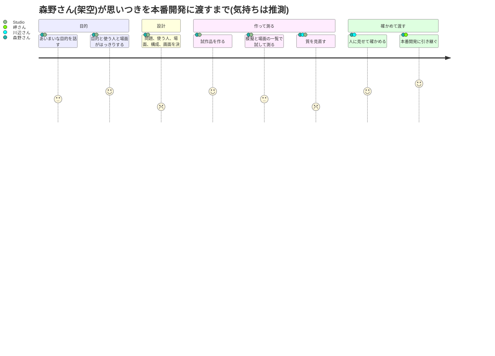
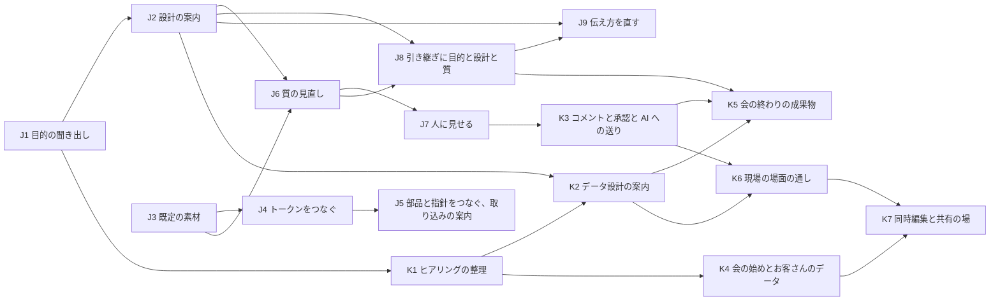

# ユーザージャーニーとカスタマージャーニー

[目的の文書](../vision.md)を、利用者の流れに直した設計です。今の Studio との差、今のカードへの影響、実装のカードの分け方もここに書きます。

- 状態: 案(task 378)。書いた日: 2026-10-29。task 380 で、2 つ目の柱「みんなで、その場で作る」のカード(K1〜K7)を 6 節に足した
- 5 節(1 文を直すか)、段 7(人に見せる形)、6 節(作る順)は、運営者が 2026-10-29 に決めた(task 381)。決めたことは 7 節
- 前提: [vision.md](../vision.md)、[PRD](../prd.md)、[ADR 0001](../adr/0001-local-runtime-and-isolation.md)、[ux-redesign.md](ux-redesign.md)。ADR 0001 の隔離は変えない
- 人物、会社、題材は、どれも架空。気持ちの点は、利用者の調べをしていないので推測

## 結論

- ユーザージャーニーは 8 段。あいまいな目的を話す段から、本番開発に引き継ぐ段まで(2 節)
- 今の Studio が強いのは、後半(作る、試して測る、引き継ぐ)。前半(目的の聞き出し、設計の案内)と、質の見直し、人に見せる段は無い(4 節)
- 気持ちが一番下がるのは、設計の過程(3 段)と、質を見直す段(6 段)の見込み。ここを導くことが、目的の中心になる
- カスタマージャーニーは 4 段(知る、試す、使い続ける、人に勧める)。信頼を一番壊すのは、できていない機能を約束すること(3 節)
- 1 文、README、LP は直す。ただし J1(目的の聞き出し)ができてから、J9 で全部を一度に直す。1 文は案 A を第一の候補にする(5 節。決めた)
- 実装のカードは 9 枚(6 節)。task 380 で、現場の場面のカードを 7 枚足した(K1〜K7)。作る順は、J1、K1、J2 と K2、J7 と K3、K6、K4、K5、K7(決めた)。J3〜J6、J9 は並べて進める。同時編集(K7)は、通し(K6)で要ると分かってから

## 1. 人物

| 役 | 人(架空) | 中身 |
|---|---|---|
| 主 | 森野 灯さん | 架空の会社「みなと町くらし案内」の企画担当。AI は文を書くのに使う程度。設計を学んだことはない。思いつきは「商店街のお店への問い合わせに、AI が答えられるようにしたい」 |
| 副 | 川辺さん | 同じ会社のデザイナー。会社の部品集(Storybook)と色のトークンを持っている |
| 副 | 岬さん | 本番を作る開発の担当。引き継ぎを受け取る |

## 2. ユーザージャーニー

森野さんが、思いつきを試作品にし、人に見せ、本番開発に渡すまでの流れです。

### 一覧

| 段 | 気持ち(推測) | 成功の印 |
|---|---|---|
| 1. あいまいな目的を話す | 期待と不安 | 1 文を送れた。問いが返ってきた |
| 2. 目的と使う人と場面がはっきりする | ほっとする | 目的の文書に「決めた」の印が付いた |
| 3. 設計の過程 | 重い、迷う | 5 つの段の成果物がそろい、案を 1 つ選んだ |
| 4. 試作品を作る | うれしい | 動く試作品が出た。関門が通った |
| 5. 試して測る | 驚く、少し不安 | 場面の一覧で、通らない場面が分かった |
| 6. 質を見直す | 面倒、気づく | 見直しの表の「直す」が 0 になった |
| 7. 人に見せて確かめる | 緊張、手ごたえ | 確かめたい問いに、人の答えが付いた |
| 8. 本番開発に引き継ぐ | 達成感 | 開発の担当が、聞き返さずに読めた |

### 段 1. あいまいな目的を話す

| 項目 | 中身 |
|---|---|
| 本人がすること | 「商店街のお店への問い合わせに、AI が答えられるようにしたい」と 1 文で書く |
| 考えていること | 何から決めればいいか分からない。AI に任せれば何か出てくるはず |
| 気持ち | 期待と不安 |
| つまずき | 白紙の欄で手が止まる。「全部作って」と頼み、中身のない画面が出る |
| Studio が導くこと | 例の 1 文を 3 つ出す。送ると、作り始める前に問いを 1 つ返す(誰が困っているか)。案内の深さ(速く、ふつう、深く)を選べる。既定は「ふつう」 |
| 触れる画面 | はじめの画面(新)。目的の聞き出しの会話(新) |
| 成功の印 | 1 文を送れた。最初の問いが返った |

### 段 2. 目的と使う人と場面がはっきりする

| 項目 | 中身 |
|---|---|
| 本人がすること | 問いに答える(誰が、いつ、何に困るか。うまくいったら何が変わるか) |
| 考えていること | お店の人とお客さんの、どちらのための道具だろう |
| 気持ち | ほっとする。考えが言葉になる |
| つまずき | 問いが多すぎて疲れる。答えを知らない問いが出る |
| Studio が導くこと | 1 度に 1 つ聞く。「分からない」も答えにでき、決めていないことに入る。答えから目的の文書を作り、人が直して「これで決める」を押す |
| 触れる画面 | 目的の聞き出しの会話(新)。目的の文書(新。誰、何の問題、場面、成功の印、しないこと、決めていないこと) |
| 成功の印 | 目的の文書に「決めた」の印。決めていないことが一覧になっている |

### 段 3. 設計の過程(問題、使う人、場面、エージェントの構成、画面)

| 項目 | 中身 |
|---|---|
| 本人がすること | 5 つの段を順に決める。問題(何を解くか)、使う人(お客さん、お店の人)、場面(よくある問い合わせ、答えられない問い合わせ)、エージェントの構成(AI がどこまで答え、どこで人に渡すか)、画面(どこで話すか) |
| 考えていること | 構成って何。AI が答えられないときはどうするの |
| 気持ち | 重い。迷う |
| つまずき | 構成の言葉(ツール、守り)が分からない。最初の案から離れられない |
| Studio が導くこと | 各段で案を 2〜3 並べ、おすすめと理由を 1 文で出す。構成は「AI が答える」「人に渡す」「守る(保存の前に聞く)」の日常の言葉で選ばせ、`app/composition.json` は Studio が書く。場面の段の答えから、場面(`app/evals/`)の下書きを作る。戻れる |
| 触れる画面 | 設計の段の帯(新)。各段の案の比べ(新)。構成の模擬の絵(今の記録の画面を使う) |
| 成功の印 | 5 つの段の成果物がそろう。選んだ案と理由が残る |

### 段 4. 試作品を作る

| 項目 | 中身 |
|---|---|
| 本人がすること | 「この設計で作る」を押す。出た試作品を言葉で直す |
| 考えていること | 思ったとおりの画面になるか |
| 気持ち | うれしい |
| つまずき | 作る AI に、目的と設計が伝わらず、別の画面ができる |
| Studio が導くこと | 目的の文書と設計の成果物を、作る AI への依頼に入れる。既定の素材で組む。作るループの関門を回し、落ちたら直す(今の作るループ) |
| 触れる画面 | 試す、言葉で直す(今の 2 列)。最初の一歩の案内(今) |
| 成功の印 | 動く試作品が出た。関門が通った |

### 段 5. 試して測る(模擬と場面の一覧)

| 項目 | 中身 |
|---|---|
| 本人がすること | 自分で話して試す。場面の一覧を回し、通らない場面を見る。構成を替えて比べる |
| 考えていること | 答えられない問い合わせで、AI は何と言うのか |
| 気持ち | 驚く。少し不安 |
| つまずき | 場面の一覧と比べる表が、ターミナルにしかない |
| Studio が導くこと | 場面の一覧を画面で回し、通らない場面に「直す」を付ける。押すと、言葉で直す欄に依頼が入る。本物の AI で試す前に同意を取る(今) |
| 触れる画面 | 試す(今)。場面の一覧(新。今は `npm run evals`)。実行の記録(今。開発者向けの詳細) |
| 成功の印 | 通らない場面が分かり、直して通った |

### 段 6. 質を見直す(UX、使いやすさ、アクセシビリティ、素材に合っているか)

| 項目 | 中身 |
|---|---|
| 本人がすること | 見直しの表を開き、「直す」を順に片付ける。デザイナーに見てもらう |
| 考えていること | 動くけど、これで良いのかは分からない |
| 気持ち | 面倒。気づきがある |
| つまずき | 何を見ればいいか分からない。アクセシビリティの言葉が分からない |
| Studio が導くこと | 測るもの(アクセシビリティの違反、字と地の差、素材に合わない色と部品、場面の結果)と、AI の判断(使いやすさの見直し)を分けた表にする。各行に「なぜ大事か」1 文と「直す」を付ける |
| 触れる画面 | 質の見直しの表(新) |
| 成功の印 | 「直す」が 0。見ていない項目は「まだ見ていない」と出ている |

### 段 7. 人に見せて確かめる

| 項目 | 中身 |
|---|---|
| 本人がすること | 同僚やお店の人(架空)に試作品を触ってもらい、確かめたい問いを聞く |
| 考えていること | 本当に使ってもらえるか |
| 気持ち | 緊張。手ごたえ |
| つまずき | Studio の画面には開発の欄があり、見せにくい。感想がどこにも残らない |
| Studio が導くこと | 見せる画面(試作品だけと、確かめたい問い)にする。問いは目的の文書の「成功の印」から作る。感想を版に残す。手元の PC で見せる形だけにする(2026-10-29 に決めた。共有は PRD の範囲外のまま) |
| 触れる画面 | 見せる画面(新)。版(今) |
| 成功の印 | 問いに人の答えが付き、版に残った |

### 段 8. 本番開発に引き継ぐ

| 項目 | 中身 |
|---|---|
| 本人がすること | 「本番開発へ渡す」でフォルダーを作り、開発の担当に渡す |
| 考えていること | 意図がちゃんと伝わるか |
| 気持ち | 達成感 |
| つまずき | 目的と設計の理由が、ソースと会話だけでは伝わらない |
| Studio が導くこと | 引き継ぎに、目的の文書、設計の段ごとの決定と理由、場面の結果、質の見直しの結果、素材の出典とライセンス、人の確かめの答えを入れる |
| 触れる画面 | その他の「本番開発へ渡す」(今) |
| 成功の印 | 開発の担当が、聞き返さずに読めた(人の確かめ) |

## 3. カスタマージャーニー

Studio を知ってから、人に勧めるまでの流れです。今は LP を公開しておらず、リポジトリも private です([site/README.md](../../site/README.md)、[brand.md](../brand.md))。公開した後を前提に書きます。

| 段 | 接点 | 本人の問い | 信頼を作るもの | 信頼を壊すもの | 測るもの(案) |
|---|---|---|---|---|---|
| 知る | README、LP、人の紹介 | 何の道具か。自分に関係あるか | 1 文で目的が分かる。本物の画面と、架空の例で見せる。できないことも書く | できていない機能の約束。「誰でも」「5 分で」。中身のない派手な絵 | README から「はじめる」へ進んだ数(公開後。測り方は不明) |
| 試す | `npm start`、最初の画面、最初の 1 分 | 本当に導いてくれるか。お金はかかるか | 料金なしで最後まで試せる(お試しの AI)。本物の AI の前の同意。最初の問いがすぐ返る | 起動の失敗が開発の言葉で出る。勝手にモデルを呼ぶ。最初に白紙の欄だけ | 人の確かめ: 初めての人が 10 分で目的の文書を書けるか(仮) |
| 使い続ける | 自分の題材、自分の素材、版 | 自分の仕事で使えるか。前の作業に戻れるか | 自分の素材がつながる。版で戻れる。質の見直しが毎回同じ基準 | 試作品がどれも同じ見た目。直すたびに壊れる。素材のライセンスが分からない | 2 つ目の試作品を作った人の数(手元だけなので、測り方は不明) |
| 人に勧める | 引き継ぎのフォルダー、見せる画面、同僚 | 人に見せても恥ずかしくないか | 引き継ぎが本番開発に通じる。見せる画面に開発の言葉がない | 引き継ぎで意図が消える。見せた先で壊れる | 開発の担当の聞き返しの数(人の確かめ) |

## 4. 今の Studio との差

| 段 | 今あるもの | 無いもの | 差 |
|---|---|---|---|
| 1. あいまいな目的を話す | 言葉で直す欄。最初の一歩の案内(試す、言葉で直す、直った結果を試す) | はじめの画面、例の 1 文、問いを返す会話、案内の深さ | 大 |
| 2. 目的と使う人と場面 | 目録の `intent`(作る AI が書く `purpose` 1 文と `tryThis`) | 目的の文書(誰、何の問題、場面、成功の印、しないこと、決めていないこと)と「決めた」の印 | 大 |
| 3. 設計の過程 | 構成の模擬(`app/composition.json`、ツール、3 つの層の守り)。場面(`app/evals/`) | 5 つの段の案内、案を並べて比べる、日常の言葉で構成を選ぶ画面 | 大 |
| 4. 試作品を作る | 作るループと関門(検査、ビルド、場面、起動、シナリオ)。直すラウンド 2 回。言葉で直す | 目的と設計を依頼に入れること。既定の素材(同梱は React だけ) | 中 |
| 5. 試して測る | お試しの AI と本物の AI。同意のカード。構成の模擬。場面の回し(`npm run evals`)と比べる表。観察器と「試作品を自動で確かめる」。試し直し | 画面の中の場面の一覧と比べる表。通らない場面から直す依頼への道 | 中 |
| 6. 質を見直す | 観察器がアクセシビリティの木の要約を読む。関門の結果の帯 | アクセシビリティの判定、字と地の差、素材に合っているかの検査、使いやすさの見直し、見直しの表 | 大 |
| 7. 人に見せて確かめる | 版の保存と戻す | 見せる画面、確かめたい問い、感想の記録 | 大 |
| 8. 本番開発に引き継ぐ | 引き継ぎ(形式 3。ソース、AI の設定、構成、場面、証拠の要約、未接続の一覧) | 目的の文書、設計の決定と理由、質の結果、素材の出典 | 小 |
| 知る | README、LP(`site/`、公開しない)、バナー、動く画像 | 新しい目的の 1 文。ジャーニーの絵 | 中 |
| 素材(全段) | `assets/brand/tokens.css`(Studio の画面の色。試作品には効かない) | 既定の素材、自分の素材をつなぐ形、取り込みの案内([design-materials.md](design-materials.md)) | 大 |

## 5. 今のカードへの影響

### 直すか

直します(運営者が 2026-10-29 に決めた)。今の 1 文と LP は、手段(構成ごと試して測る)を主役にしていて、新しい目的(導く、質)とずれています。

ただし、目的の聞き出しのカード(6 節の J1)ができる前に 1 文を変えると、できていないことを約束します。これは「信頼できる」の原則に反します。そこで、文書を先にし、伝え方は J1 ができてから J9 で直します。

### 1 文の案

| 案 | 日本語 | 英語 | 見立て |
|---|---|---|---|
| A(第一の候補) | あいまいな思いつきを、質を確かめながら、本物のプロダクトの設計にする。 | Turn a rough idea into a real product design, checking quality at every step. | 目的、導くこと、質が入る。33 字 |
| B | 何を作るかから、AI プロダクトの設計を一歩ずつ導く。 | Guides your AI product design step by step, starting from what to build. | 短い。質が抜ける |
| C | 作る前に、AI エージェントの試作品を構成ごと試し、質を測る。 | Try an AI agent prototype with its whole setup and measure its quality before you build. | 今の文に近い。導くことが抜ける |

A を第一の候補にする(2026-10-29 に決めた)。A は「AI」の語を含まない。AI プロダクトに絞るかは、J9 で運営者が決める。英語は確かめていない訳(推測で作った案)。

### 直す順

`test/unit/brand.test.js` が、README の太字、`package.json` の `description`、バナー、LP、brand.md の 1 文が同じかを確かめます。1 文は 1 枚のカードで全部を一度に変えます。

1. 運営者が vision.md を決める。PRD の「PRD の後に決めたこと」に 1 行足す(2026-10-29 に済んだ。task 381)
2. J1(目的の聞き出し)と J2(設計の案内)を作る
3. `docs/brand.md`: 1 文、機能のカード(導く、質、素材を足し、構成、守り、場面を 1 枚にまとめる)、英語の言葉、分解の絵の位置
4. README: 冒頭の太字と 2〜3 行、しくみの図(目的から引き継ぎまで)、特長の表
5. LP(`site/`): 見出し、真ん中の絵(ジャーニー)、できること、比べる(軸を「導くか」「質を測るか」「素材をどう入れるか」に。Replica の欄は確かめた事実だけ)、`site/llms.txt`
6. バナー(`assets/brand/banner-*.svg`)と画像(`npm run media`)。新しい画面ができてから撮る

## 6. 実装のカードの分け方

9 枚に分けました。どのカードも、偽接続(`STUDIO_AGENT=fake`)と偽の `claude` で E2E を書き、実モデルは呼びません。番号の J は仮です。

J は 1 人で使うときのカード(task 378)、K は 2 つ目の柱「みんなで、その場で作る」のカード(task 380)です。

| 順 | カード | 中身 | 満たす原則 | 確かめるテスト |
|---|---|---|---|---|
| 1 | J1 目的の聞き出しと目的の文書 | はじめの画面、例の 1 文、問いを 1 つずつ返す会話、案内の深さ(速く、ふつう、深く。既定は「ふつう」)。答えから目的の文書(誰、何の問題、場面、成功の印、しないこと、決めていないこと)を作り、人が「これで決める」を押す。置き場所は目録(`app/prototype.json`)の `intent` を広げるか、新しいファイルにするかをこのカードで決める。聞き出しに使う AI(作る AI の書かない使い方か、別の役か)もこのカードで決める | 導く、人が決める、理由を残す | E2E(偽接続): あいまいな 1 文で問いが返る。「分からない」が決めていないことに入る。押すまで「決めた」の印が付かない。飛ばすと「目的なし」の印。場面: 問いの数が深さごとの上限を超えない(偽の `claude`)。人: 初めての人 5 人が説明なしで目的の文書を書き終える(仮) |
| 2 | J2 設計の案内(5 つの段) | 問題、使う人、場面、エージェントの構成、画面の段の帯。各段で案を 2〜3 並べ、おすすめと理由。構成は日常の言葉で選ばせ、Studio が `app/composition.json` を書く。場面の段の答えから `app/evals/` の下書き。戻れる。「この設計で作る」で、目的と設計を作る AI の依頼に入れる | 導く、人が決める、本物を見せる | E2E: 5 段を進んで戻れる。構成の段の選択から書いた `composition.json` が関門 G3 の検査を通る。場面の段から作った場面で関門 GE が回る。場面の一覧に、分からない、断る、遅いの場面が 1 つずつ以上ある |
| 3 | J3 既定の素材 | 運営者が選んだ既定の素材を同梱し、ビルドの import を許す(`src/server/build.js` の `ALLOWED_PACKAGES`)。字とアイコンは同梱し、外から読まない。指針の要約を作る AI の決まりに入れる。出典とライセンスの一覧を置く。ADR 0001 の「同梱するライブラリの範囲」を直す | 素材を流用できる、信頼できる | 単体: 許した部品の import が通り、ほかは今どおり落ちる。E2E: 既定の素材の部品を使った見本が、外への通信なしで描ける(今の隔離の E2E と同じ確かめ方)。単体: 出典とライセンスの一覧に、同梱した全部が載る |
| 4 | J4 自分のトークンをつなぐ | W3C の Design Tokens の形(2025.10)の JSON を受け取り、検査して CSS の変数にする。試作品は変数だけを使う。作る AI が素材を書き換えないように、Studio の持つ場所に置く | 素材を流用できる、理由を残す | 単体: 形の誤りを利用者の言葉で返す。E2E: 架空のトークンをつなぐと、見本の色と字が変わる。作る AI が素材を変えると関門で止まる |
| 5 | J5 部品と指針をつなぐ、取り込みの案内 | 取り込みの案内の画面(聞く、確かめる、見本で試す、有効にする)。指針の文(Markdown)、Storybook の静的なビルド(部品の一覧と使い方の文だけ)、npm のパッケージ(検査して、試作品ごとに import を許す)。大きいので、指針と Storybook、npm のパッケージの 2 枚に分けてよい | 素材を流用できる、信頼できる、導く | E2E: 架空の部品集(テストの fixtures)で、案内の 4 歩が通る。ライセンスが分からないときは「有効にする」が押せず、理由が出る。外への URL を含む部品は警告が出て、試作品から外へ通信しない。人: デザイナーが案内だけで素材をつなげる(10 分以内、仮) |
| 6 | J6 質の見直し | 見直しの表。測るもの(アクセシビリティの違反、字と地の差、素材に合わない色と部品の数、場面の結果)と、AI の判断(使いやすさの見直し)を分けて出す。各行に「なぜ大事か」と「直す」。アクセシビリティの検査の道具は、ライセンスを確かめてから選ぶ(未確認) | 質を測る、導く、信頼できる | 単体と E2E: わざと壊した見本(字と地の差が足りない、ラベルのない入力、値のまま書いた色)で、それぞれの行が出る。見ていない項目は「まだ見ていない」。AI の判断の行に「判断」の印が付く |
| 7 | J7 人に見せる | 見せる画面(試作品と確かめたい問いだけ。開発の欄を隠す)。問いは目的の文書の成功の印から作る。答えを版に残す。手元の PC で見せる形だけ。共有の公開はしない | 本物を見せる、理由を残す | E2E: 見せる画面に開発の言葉が出ない(今の `expectNoDevWords`)。答えが版に残り、戻しても消えない |
| 8 | J8 引き継ぎに目的と設計と質を足す | 引き継ぎの形式 4。目的の文書、設計の段ごとの決定と理由、質の見直しの結果、素材の出典とライセンス、人に見せた答え。`docs/handoff.md` を直す | 理由を残す、信頼できる | 単体: `handoff.json` に 5 つが入る。E2E: 書き出して、別の場所で README を読める(今の引き継ぎの E2E を広げる)。人: 開発の担当が聞き返さずに読める |
| 9 | J9 伝え方を直す | 5 節の順の 3〜6。1 文、機能のカード、README、LP、バナー、画像。調子の決まり(vision.md の 7 節)を、作る AI と試作品の中の AI への Studio の決まりにも入れる | 信頼できる | 単体: `brand.test.js` が新しい 1 文で通る。E2E: `site.spec.js` と `media.spec.js`。人: 初めての人が README の最初の画面で、何の道具かを 1 文で言える |

大きさの見込みは推測です。J2、J5、J6 は大きいので、60 分を超えそうなら 2 枚に分けます。既定の素材は 2026-10-29 に決まりました([design-materials.md の 3 節](design-materials.md#3-既定の素材))。J3 は、同梱の前に止まり、運営者がライセンスの原文を読んでから同梱に進みます。

### 現場の場面のカード(task 380)

[field-session.md](field-session.md) と [collaboration.md](collaboration.md) を作るカードです。J と同じく、偽接続と偽の `claude` で E2E を書き、実モデルは呼びません。

| カード | 中身 | 満たす原則 | 確かめるテスト |
|---|---|---|---|
| K1 ヒアリングの整理 | 聞き取りの欄と整理の板。打った要点を、要求、使う人、場面、決まりごと、データの 5 つの欄に振り分け、各項目に元の要点を付ける。話に出ていない項目に「推測」の印。矛盾と聞いていないことを「聞くこと」に出す。決める人が「この理解で合っている」を押す。整理する AI は J1 の聞き出しの AI と同じ決め方で選ぶ | 導く、人が決める、理由を残す | E2E(偽の `claude`): 架空の要点 10 個で、5 つの欄に振り分けられ、全項目に元の要点か「推測」の印がある。押すまで「確かめた」の印が付かない。単体: 偽の `claude` が元の要点のない項目を返すと、Studio が「推測」の印を付ける |
| K2 データ設計の案内 | J2 の設計の段に「データ」を足す。整理の板のデータの欄から、覚えておくもの、項目、つながりの案を 2〜3 出し、日常の言葉の表と図で見せる。選んだ案から試作品の架空のデータを作る | 導く、本物を見せる、理由を残す | 単体: データ設計の形の検査(つながりの先がある、項目の名前が重ならない)。E2E: 整理の板のデータの欄が、全部データ設計に載る。選んだ案の架空のデータで試作品が描ける |
| K3 コメントと承認と AI への送り(1 台) | 見せる画面(J7)の上に、画面の場所に付くコメント、反応、承認、列、直した記録、直した結果の比べ、元に戻すを足す。1 台の PC の形(collaboration.md の案 A)。役は進行役と決める人だけ | 承認してから直す、人が決める、理由を残す | E2E(偽の `claude`): 反応を 10 個付けても起動しない。承認で 1 回だけ起動する。承認を取り消すと起動しない。要件のコメントは 2 人の承認がそろうまで起動しない。元に戻すと前の版になり、記録に「戻した」が足される。単体: 直した記録の項目(collaboration.md の 5 節)がそろう |
| K4 会の始めとお客さんのデータ | 会の始めの画面(目的、流れ、送り先、置き場、見られる人、消す日、同意)。同意の前は整理する AI と作る AI を呼ばない。記録らしい文字列(名前と電話番号など)を整理の板に入れない。「会のデータを消す」と、消す日を過ぎた会の知らせ | お客さんのデータを守る、信頼できる | E2E: 同意の前に偽の `claude` が起動しない。消すと、プロジェクト、版、直した記録、run、引き継ぎの書き出しが消え、消した一覧が出る。単体: 架空の電話番号を含む要点が、整理の板の項目にならない |
| K5 会の終わりの成果物 | 会の終わりの画面。6 つの成果物(要件の文書、データ設計、構成の図、試作品、場面の一覧、未決事項)と、未決事項の持ち主と期日。引き継ぎの形式 4(J8)に、要件の文書、データ設計、直した記録の一覧を足す | 理由を残す | 単体: 書き出しに 6 つの成果物と直した記録が入る。E2E: 持ち主のない未決事項があると、会の終わりの画面に出る |
| K6 現場の場面の通し | 架空の台本(しおかぜ便の会の要点を順に打つ)で、会の始めから会の終わりまでを、偽接続と偽の `claude` で回す E2E。段ごとの時刻を Studio が残し、見せられるまでの時間と、承認から直った版までの時間を出す。人の確かめ(社内の人がお客さんの役)の手順も書く | 質を測る([vision.md の 10 節](../vision.md#何で測るか)の測るもの) | E2E: 台本が最後まで通り、6 つの成果物がそろう。段ごとの時刻が記録に残る。人: 架空の題材の 1 時間で、見せられるまでの時間を測る(目安は 45 分以内、仮) |
| K7 同時編集と共有の場 | ADR 0004 の段 2(案 C)。手元で作り、中継のサーバーで文書、コメント、反応、承認、試作品の静的なファイルを同期する。人ごとの招待と役。参加者の画面のプロダクト内 AI はモックだけ。中継のサーバーの写しも消せる。大きいので、文書の同時編集と、招待と役と承認の 2 枚以上に分ける | みんなで作る、お客さんのデータを守る | E2E: 2 つのブラウザで同じ文書の別の所を同時に直し、両方に出る。中継のサーバーからの承認を、Studio が役で確かめるまで偽の `claude` が起動しない。消すと中継のサーバーの写しも消える。ADR 0001 の隔離の E2E が今のまま通る |

### 作る順(理想の場面を早く試す)

運営者が 2026-10-29 に、おすすめのとおりに決めた。

| 順 | カード | 理由 |
|---|---|---|
| 1 | J1 目的の聞き出し | K1 の土台。聞き出しの AI と文書の形をここで決める |
| 2 | K1 ヒアリングの整理 | 理想の場面の売りの中心。これが無いと現場で使えない |
| 3 | J2 と K2(設計の案内とデータ設計) | 整理から試作品への橋。データ設計は J2 の 1 段として一緒に作る |
| 4 | J7 と K3(見せる画面とコメントと承認) | J と K の両方に要る。J1 と並べて先に始めてもよい(版の仕組みだけに頼る) |
| 5 | K6 現場の場面の通し | ここで初めて、架空の題材で 1 時間を通して測れる |
| 6 | K4 会の始めとお客さんのデータ | 本物のお客さんの会の前に要る。架空の題材の通しには要らない |
| 7 | K5 会の終わりの成果物 | J8 と一緒に作る |
| 8 | K7 同時編集と共有の場 | K6 で操作役が詰まりになると分かり、運営者が ADR 0004 の段 2 を採ってから。共有の場で、進行役のログインの作る AI をほかの人の承認で動かしてよいか(Claude の利用の決まり)を、K7 の前に確かめる |

J3〜J6、J9 は、この順と並べて進めてよいです。K の大きさの見込みは推測で、K1、K3、K7 は 60 分を超えそうなら分けます。

## 7. 決めたこと、決めていないこと、確かめていないこと

### 決めたこと

運営者が 2026-10-29 に、おすすめのとおりに決めた(task 381)。

| 決めたこと | 中身 | 書いた所 |
|---|---|---|
| 1 文を直すか | 直す。ただし J1 ができてから(J9 で)。案 A を第一の候補にする。AI プロダクトに絞るかは J9 で決める | 5 節 |
| 人に見せる段で、手元の PC の外に見せるか | 手元の PC で見せる形だけ | 段 7、J7 |
| 作る順 | J1、K1、J2 と K2、J7 と K3、K6、K4、K5、K7。J3〜J6、J9 は並べて進める | 6 節 |
| 案内の深さ | 「速く」「ふつう」「深く」から選べる。既定は「ふつう」 | 段 1、J1([vision.md の 9 節](../vision.md#9-決めたこと)) |
| 手元か共有か、お客さんのデータの扱い | まず 1 台の PC でみんなで(案 A)。お客さんの話は同意の後に扱い、記録は入れない | [collaboration.md の 8 節](collaboration.md#8-決めたこと決めていないこと確かめていないこと) |

### 決めていないこと、確かめていないこと

- 気持ちの点と、つまずき: 利用者の調べをしていない。推測。J1 と J6 の人の確かめで直す
- 聞き出しに使う AI: 作る AI(Claude Code)を書かない使い方で呼ぶか、別の役にするかは決めていない。どちらも ADR 0001 の守り(`app/` の外に書かせない)の中で作る
- 目的の文書の置き場所と形: 目録の `intent` を広げるか、新しいファイルか。J1 で決める
- カスタマージャーニーの「測るもの」: 公開の後の測り方は決めていない。手元で動く道具なので、利用の数を集める仕組みはない。集めるなら同意と送り先を決める
- 現場の場面(K)の分の割り当てと目安の時間: どれも推測。K6 で測る
- 1 文を AI プロダクトに絞るか: J9 で運営者が決める
- ADR 0004 の段 2(案 C)を採るか、進行役のログインの作る AI をほかの人の承認で動かしてよいか: [collaboration.md の 8 節](collaboration.md#8-決めたこと決めていないこと確かめていないこと)
