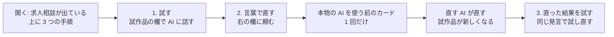
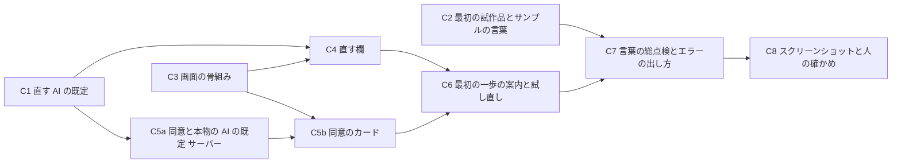

# 初見で分かる画面の設計(UX の設計し直し)

> **この文書は [ui-ux-v2.md](ui-ux-v2.md) に置き換わりました(task 431、2026-11-17)。** 画面の設計の正は ui-ux-v2.md です。食い違う所は ui-ux-v2.md を正とします。この文書は、今の画面がなぜこの形かを知るために残します。ui-ux-v2.md と食い違わない所(たとえば 6 節の同意のカードの中身、4 節の言葉のうち ui-ux-v2.md の 6 節で変えていないもの)は、そのまま使えます。

- 状態: 設計(task 292)。実装は、最後の「実装のカードの分け方」のカードで行う。
- 書いた日: 2026-10-28
- 前提: [PRD](../prd.md)、[ADR 0001](../adr/0001-local-runtime-and-isolation.md)。ADR 0001 の隔離の決まりは変えない。

## 結論

- 画面は「試す」と「言葉で直す」の 2 つを主役にする。試作品の一覧、版、引き継ぎ、開発者向けの情報は、上の帯と「その他」の引き出しに移す。
- 最初に開く試作品は求人相談にする。開いた画面の上に、3 つの手順(試す → 言葉で直す → 直った結果を試す)の案内を出す。
- 作る AI(新しい名前は「直す AI」)の既定は、Claude Code が使えるなら Claude Code にする。使えないときは、何ができないかと、どうすれば使えるかを画面で説明する。偽接続は開発とテストだけで使い、利用者の画面には出さない。
- 試作品の中の AI の既定は「お試しの AI」(今のモック)のままにする。「本物の AI」(Claude Code)へは、試す欄の上の切り替えで移れる。
- 本物の AI を初めて使う前に、送るもの、送り先、料金の枠を 1 枚のカードで出す。同意は Studio を止めるまで覚える。
- 開発の言葉(偽接続、モック、`ANTHROPIC_API_KEY`、`app/ai.json`、ビルド、プロダクト内 AI など)は、利用者の画面から消す。開発者向けの詳細の中にだけ残す。

課題(task 292)の「やること」との対応:

| やること | この文書の節 |
|---|---|
| 1. 最初の 1 分の流れ | 2 |
| 2. 画面の構成 | 3 |
| 3. 画面の言葉 | 4 |
| 4. 既定の動き | 5 |
| 5. 費用とデータの送信の見せ方 | 6 |
| 6. ワイヤーフレーム | 7(7 つ) |
| 7. 「分かるか」の確かめ方 | 9 |
| 8. 実装のカードの分け方 | 10 |
| 今の画面の問題 1〜7 | 8 |

## 1. 今の画面(2026-10-28 に起動して見たもの)

`npm ci` の後、一時フォルダーを `STUDIO_HOME` にして Studio を起動し、Playwright の Chromium(1440x900)で撮った。見た設定は 3 つ。

| 設定 | 見た画面 |
|---|---|
| 既定(作る AI は偽接続、試作品の中の AI はモック) | 最初の画面、作る欄に自由な依頼を送った画面、求人相談でモックと話した画面 |
| `STUDIO_ALLOW_CLAUDE_CODE=1` と偽の Claude Code | 試作品の中の AI を Claude Code に切り替える前の確認 |
| `STUDIO_AGENT=claude` と、ない場所の `STUDIO_CLAUDE_BIN` | Claude Code が見つからないときの作る欄 |

課題に書かれた問題 1〜7 は、どれも画面で確かめられた。加えて、次のことに気づいた。

- A. 何もしていないのに、最初から「作業中(まだ保存していません)」の札が出る。警告に見える。
- B. 作る欄の上の枠に、「Claude Code に切り替えたときの認証の見込み」の長い文が、偽接続でもいつも出る。
- C. 偽接続に「ボタンをもっと大きくして」と送ると、試験用の依頼の一覧を並べた返事と「app/ のファイルは変わっていません」だけが返る。最後に「終わりました(認証の報告: none)」と出る。
- D. Claude Code が見つからないと、作る欄に赤字で `spawn /nonexistent/claude ENOENT` と出て、送るボタンが押せなくなる。何をすればよいかは、画面にない。
- E. 右の「詳細」は、求人相談で接続の確認を開くと、1440x900 で縦に約 3.6 画面分になる。版と引き継ぎの入力欄が上にあり、AI の接続や記録は下に隠れる。
- F. 詳細の「AI が理解した状態」は、試作品の中の「希望条件」と同じ中身で、二重に出ている。
- G. 作る会話は試作品ごとに分かれる。試作品を切り替えると作る欄が空になるが、その理由は画面にない。
- H. 試作品の中の AI を Claude Code にする欄は、`STUDIO_ALLOW_CLAUDE_CODE=1` がないと「まだ使えない設定です」と環境変数の名前を出す。2026-10-28 に個人アカウントで試してよいと決めた(PRD の「PRD の後に決めたこと」)ので、この止め方は今の方針に合わない。
- I. 上の「つながっています」は、問題がないときも出ている。初めての人には意味が分からない。

## 2. 最初の 1 分の流れ

J1(task 382)で、この流れの前に、はじめの画面(目的の聞き出し)を足しました。「飛ばす」を押すと、ここに書いた最初の画面になります([user-journey.md の段 1](user-journey.md#段-1-あいまいな目的を話す))。

初めて開いた人が「分かった」と感じる流れを、次の 4 歩に決める。各歩で「何を見て」「何を押し」「何が起きるか」をそろえる。



| 秒(目安) | 見るもの | 押すもの | 起きること | 「分かった」の手ごたえ |
|---|---|---|---|---|
| 0〜5 | 上の 1 行「試作品を試して、気になるところを言葉で直す場所です」と、3 つの手順。左に求人相談の試作品。1 番目の手順が強調されている | なし | なし | 何をする画面か、どこから始めるかが分かる |
| 5〜20 | 試作品の会話欄。入力欄に例の文がある | 例の文を送る(または自分の言葉で書く) | 案内役が返事をし、「希望条件」に読み取った条件が出る | 試作品が動くものだと分かる |
| 20〜40 | 手順の 2 番目が強調される。右の「言葉で直す」に、押せる例が 3 つある | 例を押して「送る」 | 初回だけ、本物の AI を使う前のカードが出る。「同意して使う」で、直す AI が動き始める。何をしているかが短く出る | 言葉で頼めば直ると分かる |
| 40〜60 | 直す AI の返事「〜を変えました」。試作品が新しくなり、手順の 3 番目が強調される。試作品の上に「同じ発言で試し直す」 | 「同じ発言で試し直す」 | 前と同じ発言が送り直され、直す前と後の返事が並ぶ | 直した結果を、同じ条件で確かめられると分かる |

決まり:

- 手順の案内は、状態から決める。1 番は試作品の中の AI に 1 回話すと済み、2 番は直す AI の依頼が 1 回終わると済み、3 番は試し直すと済み。新しい保存の仕組みは足さない(Studio のメモリーに持つ)。
- 案内は「閉じる」で隠せる。閉じたことは、Studio を止めるまで覚える。
- AI のない試作品(図書室)を選んだときは、1 番を「試作品の画面を触る」に変える。

## 3. 画面の構成

### 重さと置き場所

| 重さ | 中身 | 置き場所 | 既定 |
|---|---|---|---|
| 主役 | 試す(試作品そのもの、試作品の中の AI の切り替え、会話を最初から、試し直し) | 左、横幅の約 6 割 | いつも出す |
| 主役 | 言葉で直す(例、依頼の欄、直す AI の会話) | 右、横幅の約 4 割 | いつも出す |
| 案内 | 1 行の説明と 3 つの手順 | 上の帯の下 | 出す(閉じられる) |
| 補助 | 試作品の切り替え、保存 | 上の帯 | 出す |
| その他 | 保存した版と戻す、自分のトークンをつなぐ、部品と指針をつなぐ、本番開発へ渡す、画面を読み込み直す | 「その他」の引き出し(右から出る) | 隠す |
| 開発者向け | 準備(ビルド)の結果、AI の接続の詳細、AI が覚えていること、AI のやりとりの記録、試作品からの知らせ、ファイルから作り直す、試験用の依頼(偽接続のときだけ) | 「その他」の中の「開発者向けの詳細」(開く操作で見える) | 隠す |

### 今の 4 列からの移し先

| 今 | 新しい置き場所 |
|---|---|
| 左「試作品」 | 上の帯の「試作品: 求人相談 ▾」。一覧の各行に「AI と話せる」「表示できません」などの短い印 |
| 「作る」 | 右「言葉で直す」 |
| 「試す」 | 左「試す」 |
| 詳細「版」 | 上の帯の「保存」と、その他「保存した版」 |
| 詳細「本番開発への引き継ぎ」 | その他「本番開発へ渡す」 |
| 詳細「ビルド」 | 開発者向けの詳細。失敗したときだけ、試す欄に利用者の言葉で出す(ワイヤーフレーム 6) |
| 詳細「プロダクト内 AI」の接続を選ぶ | 試す欄の上「AI: お試し ▾」。切り替えの前の確認は 1 枚のカード(6 節) |
| 詳細「プロダクト内 AI」の状態、最後の応答の秒数と費用 | 開発者向けの詳細 |
| 詳細「試し直しの結果」 | 試す欄の上の試し直しの帯の中(開いて見る) |
| 詳細「AI の実行の記録」「試作品からの知らせ」 | 開発者向けの詳細 |
| 上の「つながっています」 | 問題のあるときだけ出す |

### 狭い画面

1280x800 でも、試す欄と直す欄の「送る」がスクロールなしで見えることを条件にする(9 節)。1024 より狭いときは、試すと直すを上下に並べる。

## 4. 画面の言葉

利用者の画面では、左の言葉を使わない。開発者向けの詳細と README の開発の節では、今の言葉を使ってよい。

| 今の言葉 | 利用者の画面の言葉 | 補足 |
|---|---|---|
| 作る(欄の名前) | 言葉で直す | |
| 作る AI | 直す AI | 試作品のファイルを変える AI。試作品の中の AI と混ぜないため、名前を分ける(PRD 利用者と体験 5) |
| プロダクト内 AI | 試作品の中の AI | |
| 偽接続 | (出さない) | 開発者が `STUDIO_AGENT=fake` で起動したときだけ、上の帯に「開発用: 偽の直す AI」 |
| モック | お試しの AI | 説明は「決まった言葉だけ分かります。無料で、いつも同じ返事です」 |
| Claude Code(実モデル) | 本物の AI | 説明は「あなたの Claude Code で動きます」 |
| 接続を選ぶ | AI: お試し / 本物 | |
| `ANTHROPIC_API_KEY` | API キー | 利用者の画面では「使った分だけ料金がかかる設定です」と出し、変数の名前は開発者向けの詳細にだけ出す |
| Console(API)のアカウント | 従量課金のアカウント | |
| サブスクの枠 / Pro や Max | Claude の定額プランの利用枠 | |
| `app/ai.json` | AI の設定 | |
| `app/`、app/ のファイル | 試作品のファイル | |
| ビルド、ビルドに成功 | (出さない) | 試作品が出ていれば成功 |
| ビルドに失敗 | 試作品を表示できません | 前に表示できた状態を出していることを添える |
| 作り直す | ファイルから作り直す(開発者向け) | 直す AI の変更は自動で作り直されるので、利用者には要らない |
| 開き直す | 画面を読み込み直す(その他) | 試作品が止まったように見えるときだけ使う |
| リセット | 会話を最初から | |
| 作業中 | 今の状態 | |
| 作業中(まだ保存していません) | (出さない) | 変更があるときだけ「保存していない変更があります」 |
| 保存版 v1、今の作業中を保存 | 保存 1、保存 | 名前を付けたときは、その名前 |
| 復元 | この状態に戻す | |
| 本番開発への引き継ぎ、引き継ぎ用に書き出す | 本番開発へ渡す、渡すフォルダーを作る | |
| 試し直し、前の発言で試し直す | 同じ発言で試し直す | |
| 試し直しの結果(前の設定 → 今の設定) | 直す前と後の返事 | |
| AI の実行の記録 | AI のやりとりの記録(開発者向け) | |
| AI が理解した状態 | AI が覚えていること(開発者向け) | |
| 中断、応答を止める | 止める | |
| 権限の確認で断られた操作 | 試作品のフォルダーの外は触れないので、やめました | |
| 認証の報告: none など | (出さない) | 開発者向けの詳細にだけ出す |
| つながっています | (出さない) | つながらないときだけ「Studio が止まっています」と、直し方 |
| サンプル: 架空の求人相談(プロダクト内 AI) | 求人相談(架空・AI と話せる) | 図書室は「図書室(架空・AI なし)」、学習相談は「学習相談(架空・AI と話せる)」 |

作るループの言葉(harness.md の 7.2。P29 で足した)。関門、シナリオ、report、観察器は設計と開発の言葉で、利用者の画面には出さない。開発者向けの詳細(「開発者向け: 節の列と記録の場所」など)では、今の言葉を使ってよい。

| 今の言葉 | 利用者の画面の言葉 | 補足 |
|---|---|---|
| 関門、関門の結果(G1〜G6、GE) | 自動の確かめ | 作る会話の項目の名前。1 つずつは、確かめることの名前で出す(下の 4 行と「変わったところ」「ファイルの名前と大きさ」「AI の設定と確かめ方の形」) |
| ビルド(G4) | 表示の準備 | |
| 起動の確認(G5) | 開いて表示できるか | |
| シナリオ(G6) | 決めた手順で動くか | シナリオのファイルの全体は「確かめ方」、1 本ずつの手順は「決めた手順」 |
| 場面(GE) | AI の場面で動くか | |
| 直すラウンド | もう一度直す(作る会話の項目の名前)、直す AI が直した回数(結果の帯) | 直しきれなかったときは「直す AI が直そうとした回数」 |
| 直す依頼(Studio から作る AI へ) | 直す依頼(Studio から直す AI へ) | |
| 人に返す | ここで止めました | |
| ガードレールが変わりました | AI の守ることが変わりました | |
| 権限の確認で断られた操作(項目の名前) | やめた操作 | 本文は上の表の「権限の確認で断られた操作」の行(サーバーの文。P30) |
| report、run.json の場所 | (出さない) | 「開発者向け: 節の列と記録の場所」にだけ出す |
| 観察器 | (出さない) | 人が始めるときは「試作品を自動で確かめる」 |
| 接続を選ぶ(試す欄の上の選び方の見出し) | 試作品の中の AI | 選ぶものは「お試しの AI」「本物の AI」。説明は上の表の「モック」「Claude Code(実モデル)」の行 |
| 実機、モック、未接続(引き継ぎの件数) | 本物につないだもの、お試しのもの、つないでいないもの | 書き出すフォルダーの中の区分の名前は変えない(開発の担当者が読むため) |
| ビルドできない状態(保存の一覧) | 表示できない状態 | |
| ビルド中(試作品の一覧の印) | 表示の準備をしています | |

サンプルの中の言葉も合わせる。`samples/*/app/App.jsx` の返事の印「モック」は「お試しの AI」、上の注意書きの「案内役の AI はモックで、決まった応答を返します」は「いまの案内役はお試しの AI です。決まった言葉だけ分かります」にする。`ai.json` の `mock.notUnderstood` には「自由な言葉は、上の『AI: 本物』で試せます」を足す。

## 5. 既定の動き

### 直す AI(作る AI)

| 状態 | 画面 | 送れるか |
|---|---|---|
| Claude Code があり、版が足り、ログインしている | 直す欄はそのまま使える。初回の送信の前に 6 節のカードを出す | 送れる |
| Claude Code がない | 「言葉で直すには、Claude Code が要ります」と、できること、使えるようにする手順(ワイヤーフレーム 5) | 送れない。試す、保存、本番へ渡すは使える |
| 版が古い | 「Claude Code が古いので使えません」と、更新の手順 | 送れない |
| ログインしていない | 「Claude Code にログインしていません」と、ログインの手順 | 送れない |
| 開発者が `STUDIO_AGENT=fake` で起動した | 上の帯に「開発用: 偽の直す AI」。試験用の依頼は開発者向けの詳細の中にだけ出す | 送れる(決まった依頼だけ) |

- `STUDIO_AGENT` の既定を `fake` から「自動」に変える。自動は、上の表の 1 行目なら Claude Code、そうでなければ「使えない」状態にする。偽接続には落とさない。偽接続は `STUDIO_AGENT=fake` と書いたときだけ使う。`STUDIO_AGENT=claude` は今どおり Claude Code に固定する。
- ログインしているかは、Claude Code 自身に聞く。手元の Claude Code 2.1.311 には `claude auth status`(`--json` が既定)がある。Studio はログインの情報のファイルを読まず、この出力から「ログインしているか」と「どの方式か」だけを使う。メールアドレスなど他の値は、画面にも記録にも出さない。出力の形は確かめていない(不明)。実装のカード C1 で確かめる。形が分からない版では、最初の送信の失敗で見分ける(今の動き)。
- 使えない状態から直したときは、Studio を起動し直してもらう。確かめ直すボタンは、新しい機能になるので足さない。
- E2E と単体のテストは、`STUDIO_AGENT=fake` か偽の `claude` を必ず明示する。既定が変わると、`test/e2e/studio.js` の `launchStudio` は `STUDIO_AGENT` を消しているので、手元の本物の Claude Code を呼んでしまう。C1 で直す。
- ADR 0001 の「仮に決めたこと」の「作る AI の既定は偽接続」は、この設計で置き換える。隔離の決まり(`--restricted`、`app/` の中だけ、コマンドと Web なし、引数が偽接続と同じ)は変えない。

### 試作品の中の AI

- 既定は「お試しの AI」(今のモック)のままにする。理由は 3 つ。返事がすぐ出る。料金の枠を使わない。直す前と後を同じ条件で比べられる。
- 「本物の AI」は、Claude Code が使えれば選べる。`STUDIO_ALLOW_CLAUDE_CODE=1` の要件はやめ、画面のカード(6 節)での同意に置き換える。会社として止めたいときのために、`STUDIO_ALLOW_CLAUDE_CODE=0` で本物の AI を選べなくする(既定は選べる)。
- 本物の AI を選んでいる間は、試す欄の上の印を「AI: 本物」にし、返事ごとに「本物の AI」の印を付ける(サンプルの画面)。
- 選んだ AI は試作品ごとに覚え、Studio を止めるとお試しに戻る(今どおり)。

### 最初に開く試作品

- 初めて開いたときは「求人相談」(`sample-job-consult`)を選ぶ。今は `src/ui/studio.js` の `render()` が `sample-library` を選んでいる。
- 一覧の順も、求人相談、学習相談、図書室にする。sim-5(jyoka/tasks#343)で、AI と話せるバイト探し(構成 A の見本)を図書室の前に足した。

### 試験用の依頼の例

- 「壊して」「直して」「失敗して」「ゆっくり進めて」「ログインしていないふりをして」「app/ の外にメモを書いて」は、利用者の画面から外す。`STUDIO_AGENT=fake` のときだけ、開発者向けの詳細の「試験用の依頼」に出す。
- 利用者の画面の例は、本物の直す AI で意味のある依頼にする。試作品に合わせて 3 つ出す。
  - AI のある試作品: 「{最後の項目}を先に聞くようにして」「案内役の話し方を、もっとやわらかくして」「見出しの色を落ち着いた青にして」
  - AI のない試作品: Studio の共通の例(「見出しの色を落ち着いた青にして」「ボタンを大きくして」「説明の文を短くして」)だけにする。試作品ごとの例は題材に依存するので、持たない。

### 「開き直す」「リセット」「作り直す」

| 今 | 何をするか | 新しい形 |
|---|---|---|
| リセット | 会話と状態を最初に戻し、画面を読み直す | 試す欄の上の唯一のボタン「会話を最初から」 |
| 開き直す | 画面だけを読み直す。会話はそのまま | その他「画面を読み込み直す」。試作品が止まったように見えるときだけ使う |
| 作り直す | `app/` のファイルから試作品を作り直す | 開発者向けの詳細「ファイルから作り直す」。直す AI の変更の後は自動で作り直されるので、手でファイルを変えたときだけ要る |

## 6. 費用とデータの送信の見せ方

本物の AI を初めて使う瞬間に、1 枚のカードを出す。直す AI の最初の送信と、試作品の中の AI を「本物」に切り替えたときの、早い方で出す。1 回同意すれば、Studio を止めるまで両方に効く。

```
┌ 本物の AI を使う前に ───────────────────────────────┐
│ AI は、あなたの Claude Code で動きます。                  │
│                                                          │
│ 送るもの   頼んだ文と試作品のファイル(言葉で直すとき)     │
│            試作品の中の会話と AI の設定(本物の AI と話すとき)│
│ 送らないもの PC のほかのファイル、ほかの試作品              │
│ 送り先     Anthropic(Claude を作っている会社)             │
│ 料金       Claude の定額プランなら、その利用枠を使います。   │
│            従量課金のアカウントなら、使った分だけかかります。│
│            どちらかは、この画面からは分かりません。          │
│                                                          │
│ 架空のデータだけで試してください。実在の人や会社の情報は    │
│ 入れないでください。                                     │
│                                                          │
│ ▸ 詳しく(AI への指示の全文、1 回の上限、記録の扱い)       │
│                                                          │
│ [ 同意して使う ]   [ やめる ]                              │
└──────────────────────────────────────────┘
```

- 料金の行は、分かることだけを出す。API キーの環境変数があるときは「API キーの設定があるので、使った分だけ料金がかかります。1 回の上限は、直すとき 1 ドル、話すとき 0.1 ドルです」。Bedrock などの環境変数があるときは「送り先と料金は、あなたの PC の設定に従います」。`claude auth status` で方式が分かるときは、その方式の 1 文だけにする。
- 「詳しく」の中に、今の確認の中身(送る指示の全文、項目と選択肢、会話の件数、上限、回数の制限、ツールを渡さないこと)を残す。今の文は消さずに、ここへ移す。
- 本物の AI を使っている間は、試す欄の上と直す欄の上に、小さく「本物の AI(あなたの Claude Code)」と出す。押すと、このカードの中身をもう一度見られる。
- 「やめる」を選んだときは、直す欄に「言葉で直すには、本物の AI を使うことへの同意が要ります」と「確かめる」ボタンを出す。試作品の中の AI はお試しのままにする。
- ADR 0001 の脅威 T6(意図しない課金)の「実モデルは利用者が明示して切り替える」は、このカードで満たす。
- サーバーの同意(C5a、P24)は、カードの画面(C5b、P25)より先に入れた。その間のつなぎだった試す欄の確認(印を付けて「Claude Code に切り替える」)と、直す欄の小さな確認(「同意して送る」)は、P25 でこのカードに置き換えた。

## 7. ワイヤーフレーム

### 7-1. 最初の画面

```
┌──────────────────────────────────────────────────────────────────────┐
│ Prototype Studio   試作品: 求人相談(架空・AI と話せる) ▾      [保存] [その他 ▾] │
├──────────────────────────────────────────────────────────────────────┤
│ 試作品を試して、気になるところを言葉で直す場所です。                         [閉じる] │
│ (1 試す)  →   2 言葉で直す   →   3 直った結果を試す                              │
├───────────────────────────────────────────┬──────────────────────────┤
│ 試す                 AI: お試し ▾  [会話を最初から] │ 言葉で直す                  │
│ ┌───────────────────────────────────────┐ │ 気になったところを、ふだんの │
│ │ しおかぜ求人相談                      │ │ 言葉で頼んでください。      │
│ │ ┌ 案内役 ─────────────────┐ │ │ 直す AI が試作品を直します。│
│ │ │ こんにちは。どんなお仕事を…    │ │ │                            │
│ │ └─────────────────────┘ │ │ 例(押すと入ります)        │
│ │                                       │ │ [時給の下限を先に聞くようにして]│
│ │ [例: カフェで働きたいです     ] [送る]│ │ [話し方をもっとやわらかくして]│
│ │                                       │ │ [見出しの色を落ち着いた青に]│
│ │ 希望条件  職種: 未定 …                │ │                            │
│ │ 条件に合う求人(架空)                  │ │ ┌────────────────┐│
│ └───────────────────────────────────────┘ │ │                        ││
│  ↑ まずここで、案内役に話しかけてみましょう   │ └────────────────┘│
│                                             │                    [送る] │
└───────────────────────────────────────────┴──────────────────────────┘
```

- 上の帯の右に、問題がないときの「つながっています」は出さない。
- 保存していない変更がないときは、保存の印を出さない。

### 7-2. AI と話している画面

```
┌──────────────────────────────────────────────────────────────────────┐
│ Prototype Studio   試作品: 求人相談 ▾                         [保存] [その他 ▾] │
├──────────────────────────────────────────────────────────────────────┤
│ ✓ 1 試す   →   (2 言葉で直す)   →   3 直った結果を試す                [閉じる] │
├───────────────────────────────────────────┬──────────────────────────┤
│ 試す                 AI: お試し ▾  [会話を最初から] │ 言葉で直す                  │
│ ┌───────────────────────────────────────┐ │ ← 返事で気になったところを  │
│ │ あなた: カフェで働きたいです          │ │   頼んでみましょう          │
│ │ 案内役 [お試しの AI]:                 │ │                            │
│ │  職種「カフェのホール」と理解しました。│ │ 例(押すと入ります)        │
│ │  働き方の希望はありますか?           │ │ [時給の下限を先に聞く…]    │
│ │                                       │ │ [話し方をもっとやわらかく…]│
│ │ 希望条件  職種: カフェのホール        │ │                            │
│ └───────────────────────────────────────┘ │ [                    ] [送る]│
│                                             │                            │
│ AI: お試し ▾ を開いたとき                    │                            │
│ ┌──────────────────────────────┐ │                            │
│ │ ● お試しの AI  決まった言葉だけ分かる。無料。 │ │                            │
│ │ ○ 本物の AI    自由な言葉が分かる。         │ │                            │
│ │               あなたの Claude Code で動く。 │ │                            │
│ └──────────────────────────────┘ │                            │
└───────────────────────────────────────────┴──────────────────────────┘
```

### 7-3. 言葉で直している画面(初回のカード → 作業中)

```
初回の「送る」の後(右の欄)             作業中(右の欄)
┌──────────────────────────┐   ┌──────────────────────────┐
│ 言葉で直す                  │   │ 言葉で直す  本物の AI(あなたの Claude Code)│
│ あなた: 時給の下限を先に     │   │ あなた: 時給の下限を先に     │
│         聞くようにして       │   │         聞くようにして       │
│ ┌ 本物の AI を使う前に ───┐│   │ 直す AI: AI の設定を読んで  │
│ │ (6 節のカード)            ││   │   います…                   │
│ │ [同意して使う] [やめる]   ││   │ ・AI の設定を読みました      │
│ └─────────────────┘│   │ ・聞く順を変えています       │
│                            │   │                     [止める]│
│ [時給の下限を先に聞く… ] [送る]│   │ [                   ] (送れません)│
└──────────────────────────┘   └──────────────────────────┘
```

- 作業中の行は、今の会話の「操作」を短い文にしたもの。ファイルの名前やツールの名前は、開発者向けの詳細に回す。
- 終わったら「聞く順を変えました。試作品は新しくなっています」と出す。

### 7-4. 直った結果を試す画面

```
├──────────────────────────────────────────────────────────────────────┤
│ ✓ 1 試す   →   ✓ 2 言葉で直す   →   (3 直った結果を試す)               [閉じる] │
├───────────────────────────────────────────┬──────────────────────────┤
│ 試す                 AI: お試し ▾  [会話を最初から] │ 言葉で直す                  │
│ ┌ AI の設定が変わりました ─────────────┐ │ あなた: 時給の下限を先に     │
│ │ 前の会話(発言 2 件)を、新しい設定で    │ │         聞くようにして       │
│ │ 送り直せます。   [同じ発言で試し直す]  │ │ 直す AI: 聞く順を変えました。│
│ │ ▾ 直す前と後の返事                     │ │   試作品は新しくなっています。│
│ │  あなた: カフェで働きたいです          │ │                            │
│ │  前: …働き方の希望はありますか?       │ │                            │
│ │  後: …時給はいくら以上を希望しますか? │ │                            │
│ │  [変わりました]                        │ │                            │
│ └───────────────────────────────┘ │                            │
│ ┌ 試作品 ───────────────────────────────┐ │ [                    ] [送る]│
└───────────────────────────────────────────┴──────────────────────────┘
```

- 本物の AI を選んでいるときは、ボタンの横に「発言 2 回分、本物の AI を使います」と出す(今の `retry-cost` の中身を利用者の言葉にしたもの)。

### 7-5. エラー: 直す AI が使えない(Claude Code がない、古い、ログインしていない)

```
┌──────────────────────────┐
│ 言葉で直す                  │
│ ┌ 言葉で直すには、Claude Code が要ります ┐│
│ │ この PC で Claude Code が見つかりません。 ││
│ │                                    ││
│ │ 今できること                        ││
│ │ ・試作品を試す(お試しの AI)        ││
│ │ ・保存、本番開発へ渡す              ││
│ │                                    ││
│ │ 使えるようにするには                ││
│ │ 1. Claude Code を入れる             ││
│ │ 2. ターミナルで claude を起動して    ││
│ │    ログインする                      ││
│ │ 3. Studio を止めて、もう一度起動する ││
│ │ ▸ 詳しい手順(README)               ││
│ │ ▸ 開発者向け: 見つからなかった場所   ││
│ └──────────────────┘│
│ [ (送れません)            ]      │
└──────────────────────────┘
```

- 見出しの 1 文を状態で変える。古いとき「Claude Code が古いので使えません」、ログインしていないとき「Claude Code にログインしていません」。
- `spawn … ENOENT` のようなエラーの文は「開発者向け」の中にだけ出す。
- 試す欄の「AI: 本物」も、同じ理由で選べないと出す。

### 7-6. エラー: 試作品を表示できない(準備の失敗)

```
├───────────────────────────────────────────┬──────────────────────────┤
│ 試す                 AI: お試し ▾  [会話を最初から] │ 言葉で直す                  │
│ ┌ 試作品を表示できません ──────────────┐ │ 直す AI: 〜を変えました。    │
│ │ 直した後の試作品に誤りがあります。       │ │                            │
│ │ 下には、前に表示できた状態を出しています。│ │                            │
│ │ [直す AI に直してもらう]                │ │                            │
│ │ ▸ 開発者向け: 誤りの場所(ファイルと行) │ │                            │
│ └───────────────────────────────┘ │                            │
│ ┌ 試作品(前に表示できた状態) ────────┐ │                            │
```

- 「直す AI に直してもらう」は、依頼の欄に「表示できるように直して」を入れる。送るのは利用者。

### 7-7. その他の引き出し

```
                                   ┌ その他 ──────────────[×]┐
                                   │ 保存した状態                │
                                   │  保存 1「最初に話した後」   │
                                   │   10:20  [この状態に戻す]    │
                                   │ 試作品を自動で確かめる      │
                                   │  AI: (o)お試し ( )本物      │
                                   │  [試作品を自動で確かめる]   │
                                   │ 本番開発へ渡す              │
                                   │  目的 / 決まったこと / 未決 │
                                   │  [渡すフォルダーを作る]     │
                                   │ 画面を読み込み直す          │
                                   │ ▸ 開発者向けの詳細          │
                                   │   準備の結果、AI の接続、    │
                                   │   AI が覚えていること、      │
                                   │   AI のやりとりの記録、      │
                                   │   試作品からの知らせ、       │
                                   │   ファイルから作り直す、     │
                                   │   試験用の依頼(偽接続だけ)  │
                                   └──────────────────┘
```

## 8. 今の画面の問題への対応

| 問題 | 直し方 | 節 | カード |
|---|---|---|---|
| 1. 4 列が同じ重さで、どこから始めるか分からない | 試すと直すの 2 列にし、他は上の帯と引き出しへ。上に 1 行の説明と 3 つの手順。1 番目を強調 | 2、3、7-1 | C3、C6 |
| 2. 作る AI の既定が偽接続で、自由な言葉に反応しない | 既定を「Claude Code が使えれば Claude Code」に。使えないときは、できないことと手順を出す。偽接続は `STUDIO_AGENT=fake` だけ | 5 | C1、C4 |
| 3. 開発者の言葉が前に出ている | 言葉の置き換え表。開発の言葉は開発者向けの詳細だけ。見える文字を E2E で検査 | 4、9 | C2、C7 |
| 4. 試験用の言葉が依頼の例に並ぶ | 利用者の画面から外し、偽接続のときだけ開発者向けの詳細に。利用者には本物の AI で意味のある例を 3 つ | 5 | C4 |
| 5. 詳細がいつも全部出ている | 「その他」の引き出しへ。開発者向けは、さらに開く操作の中へ。既定で閉じる | 3、7-7 | C3 |
| 6. 最初の試作品が AI のない図書室 | 最初は求人相談。一覧の順も変える | 5 | C2 |
| 7. 開き直す、リセット、作り直すの違いが分からない | 試す欄には「会話を最初から」だけ。開き直すはその他、作り直すは開発者向け | 5 | C3 |
| 気づいたこと A、I(最初から警告や接続の印が出る) | 変更があるときだけ保存の印、問題があるときだけ接続の印 | 3、4 | C3 |
| 気づいたこと B、C、D(作る欄の長文、偽接続の返事、ENOENT) | 直す欄の上の枠を消す。使えないときのカード(7-5) | 5、7-5 | C4 |
| 気づいたこと E、F(詳細が長い、状態が二重) | 引き出しへ移し、AI が覚えていることは開発者向けへ | 3 | C3 |
| 気づいたこと G(試作品を切り替えると直す欄が空) | 直す欄の上に「求人相談への依頼」と試作品の名前を出す | 7-3 | C4 |
| 気づいたこと H(`STUDIO_ALLOW_CLAUDE_CODE` の止め方) | 画面のカードでの同意に置き換え。`=0` で止められる | 5、6 | C5a、C5b |

## 9. 「分かるか」の確かめ方

### 自動で確かめる(E2E とスクリーンショット)

実装のカードの受け入れ条件に使う。どれも実モデルを呼ばない(直す AI は偽の `claude`、試作品の中の AI はお試しか偽の Claude Code)。

| ID | 確かめること | 方法 |
|---|---|---|
| U1 | 初めて開くと、求人相談が選ばれている | 新しい `STUDIO_HOME` で起動し、試作品の切り替えの表示と、iframe の見出し「しおかぜ求人相談」を見る |
| U2 | 最初の画面に、1 行の説明と 3 つの手順があり、1 番目が強調されている | 役割と `aria-current="step"` で確かめる |
| U3 | 最初の画面の見える文字に、開発の言葉がない | Studio の画面(iframe の外)の、見えている要素の `innerText` に、次のどれも含まれない: `偽接続` `モック` `ANTHROPIC_API_KEY` `Console` `app/ai.json` `app/` `ビルド` `プロダクト内 AI` `認証の報告` `STUDIO_` `--`。試す、話す、直す、直った後、エラー(7-5、7-6)の各画面でも同じ |
| U4 | 試験用の依頼が利用者の画面にない | 既定の起動で「壊して」「ゆっくり進めて」などが見えない。`STUDIO_AGENT=fake` では、開発者向けの詳細を開いたときだけ見える |
| U5 | 開発者向けの情報は既定で隠れ、開くと見える | 準備の結果、AI のやりとりの記録、AI が覚えていることが、最初は見えない(`toBeHidden`)。その他 → 開発者向けの詳細を開くと見える |
| U6 | 主役が 1 画面に収まる | 1440x900 と 1280x800 で、試作品の会話の欄、直す欄の依頼の欄と「送る」が、スクロールなしで見える(`boundingBox` が画面の中) |
| U7 | 最初の 1 分の流れが通る | 偽の `claude` で起動し、例の文を送る → 返事 → 手順 2 が強調 → 直す欄の例を押して送る → カードが出る → 同意 → 直す AI が終わる → 手順 3 が強調 → 「同じ発言で試し直す」→ 直す前と後の返事が出る |
| U8 | Claude Code がないとき、何ができないかが出る | `STUDIO_AGENT` を消し、`STUDIO_CLAUDE_BIN` をない場所にして起動する。直す欄に「言葉で直すには、Claude Code が要ります」と手順が出て、試すは使える |
| U9 | 試す欄のボタンは「会話を最初から」だけ | 試す欄の上の `button` の名前を数える(AI の切り替えを除く) |
| U10 | スクリーンショットを残す | U7 と U8 の各場面を 1440x900 で撮り、`test-results/ux/` に置く(`test-results/` は git が無視する)。最後のカードの Report に付ける |

### 人で確かめる(最後のカードの受け入れ条件)

- 5 秒の見せ方: 初めて Studio を見る非エンジニア 3 人に、最初の画面(U10 のスクリーンショットか実物)を 5 秒見せて隠し、2 つ聞く。
  - 「何をする画面ですか」: 「試作品を試して、言葉で直す」に近い答え
  - 「最初に何をしますか」: 「試作品の中で AI に話しかける」に近い答え
  - 合格: 3 人のうち 2 人以上が、2 つとも近い答えを言える。
- 1 人で通す: 同じ人に、案内なしで「試す → 言葉で直す → 直った結果を試す」を頼む。合格: 3 分以内に、口頭の助けなしで 3 番まで終わる。
- 結果(答えた言葉、つまずいた場所)を、最後のカードの Report に書く。合わなかったときは、つまずいた場所を直すカードを出す。

これはエージェントだけでは行えない。最後のカード(C8)は、自動の U1〜U10 を終えた後、人の確かめを待つ印を付けて止める。

## 10. 実装のカードの分け方

実装の順番は、[harness.md の 8 節](harness.md#8-実装のカード)にまとめた。この節のカードと harness.md のカードを合わせ、31 枚の「Prototype Studio (n/31)」にした(2026-10-28)。下の図と表は、分ける前の案として残す。

- C3 と C7 は、下の注のとおり 2 枚ずつに分けた。C3 は P21(上の帯と 2 列)と P22(その他の引き出し)、C7 は P29(画面の文)と P30(サーバーの文)。
- 7-6(試作品を表示できない)は、C7 から外し、証拠を見せるカード(P26)にまとめた。作るループの結果と同じ場所に出すため。
- 人の「確かめる」(P27)の置き場所は、その他の引き出しの「試作品を自動で確かめる」と、証拠の帯の「もう一度確かめる」にした。U9(試す欄のボタンは「会話を最初から」だけ)を守るため。
- 元のカードと 31 枚のカードの対応は、harness.md の 8.3 にある。P19〜P31 は仮の番号。
- P21 で決めたこと(2026-10-29):
  - 今の詳細は、P22 まで 2 列の下に置き、上の帯の「その他」でそこへ移る。「開き直す」は「試作品からの知らせ」に、「作り直す」は「ビルド」に置いた。
  - 保存の印は、版がまだないときは、会話が進んだか、`app/` を変え得る直す AI の依頼があったときに出す。サーバーは最初の `app/` との違いを知らないため。
  - U6 のため、AI のあるサンプル 2 つの `style.css` の `.columns` に `align-items: start` を足した。会話の欄が隣の求人の一覧の高さまで伸び、入力欄が画面の外に出ていたため。
- P22 で決めたこと(2026-10-29):
  - 引き出しは、右の「言葉で直す」の上に重ねて出す。外を押しても閉じない。閉じるのは、閉じるボタン、もう一度「その他」、Esc。開いたまま左の「試す」で話し、開発者向けの詳細の記録を見られるようにするため。
  - 引き出しの見出し(保存した状態、本番開発へ渡す、画面を読み込み直す、開発者向けの詳細)だけを 4 節の言葉にした。開発者向けの詳細の中の見出し(ビルド、プロダクト内 AI、AI の実行の記録、試作品からの知らせ)とボタンの中の文は、今の言葉のまま(4 節の表の前の文のとおり、開発者向けの詳細では今の言葉を使ってよい)。
  - 「応答を止める」は、開発者向けの詳細に入れず、応答を待つ間だけ試す欄の上に出す。閉じた引き出しの中では止められないため。U9 の確かめ(試す欄の上の帯のボタン)には入らない。
  - 本物の AI を選んでいる間の送り先と費用は、試す欄の上の「AI: … ▾」の中に移した。開発者向けの詳細に入れると、既定で見えなくなるため。6 節の小さな印(P25)ができるまでのつなぎ。
  - 試し直しの結果は、P28 で試し直しの帯に移すまで、開発者向けの詳細の「プロダクト内 AI」に残した。試し直しの帯の文は、その場所を指す。
  - 試験用の依頼(偽接続の例)は、言葉で直す欄の下に残した。開発者向けの詳細へ移すのは P23(U4)。
- P23 で決めたこと(2026-10-29):
  - 直す欄の上の枠(接続、版、認証と課金の見込み、実行ファイル)は、開発者向けの詳細の最初の「直す AI(作る AI)の接続」へ移した。試験用の依頼(`STUDIO_AGENT=fake` のときだけ)は、その次に置いた。押すと依頼の欄に入り、引き出しは閉じる。引き出しが依頼の欄の上に重なるため。
  - 利用者向けの例の「{最後の項目}を先に聞くようにして」は、7-1 のとおり「」で囲まない。偽接続も、この形を扱うようにした。
  - 例の「案内役の話し方を…」の「案内役」は、試作品の AI の設定の名前(`name` の最後の「の」の後ろ。求人相談は「案内役」、学習相談は「相談役」)から取る。題材の言葉を Studio に持たないため(generality の E2E)。取れないときは「AI」。
  - 作業中の短い文は、サーバーが作る(`stream-json.js` の `summarizeTool`、項目の `summary`)。続けて同じ文はまとめる。文は道具を呼んだときに作り、結果を待たないので、`app/` の外への読み書き(ADR 0001 で断られる)は「試作品のフォルダーの外のファイルに書こうとしました」のように、しようとしたとだけ言う。ファイルと道具の名前の入った文、接続の名前、認証の報告は、依頼ごとの「開発者向け: 操作の詳細」に出す。会話の「誰が」は「直す AI」にした。
  - 「〜を変えました。試作品は新しくなっています。」の「〜」は、Studio が確かめた変わったファイルから作る(`app/ai.json` なら「AI の設定」、ほかは「試作品のファイル」)。直す AI の返事の文は使わない。関門で止まらず、ビルドに成功したときだけ出す。関門と直すラウンドの出し方は今のまま(P26)。
  - 使えないときのカードの見出しは、7-5 の 3 通りに、それ以外(起動できない、Windows の npm 版)の「この Claude Code は、Studio から使えません」を足した。カードの間は、依頼の例を出さない。7-5 の「詳しい手順(README)」はリンクにせず、README の「はじめる」と docs/claude-code.md を文で指した。
  - 7-5 の注の「試す欄の『AI: 本物』も同じ理由で選べないと出す」は、このカードでは変えていない。今の「接続を選ぶ」の理由の文のまま。同意のカード(P25)で合わせる。
- P25 で決めたこと(2026-10-29):
  - 試す欄で出すカードは、「AI: … ▾」の中ではなく、試す欄の上(試作品の上)に出し、「AI: … ▾」は閉じる。「AI: … ▾」は Esc や外の操作で閉じるので、決める場面のカードが消えないようにするため。直す欄で出すカードは、7-3 のとおり会話の中に出す。
  - カードはいつも 1 枚にした。直す欄のカードが出ている間に「AI: 本物」を選ぶと、試す欄のカードに入れ替える(依頼の文は欄に残る)。
  - 料金の行は、サーバーの料金の文だけにした。使った分だけかかる見込みのとき(API キーの設定、Bedrock などの設定、ログインの方式が API キー)だけ、上限の文も添える(6 節の注)。上限の文は、いつも「詳しく」の「1 回の上限」にある。
  - 「詳しく」の「記録の扱い」は、サーバーが返す(`/api/real-ai` の `details.records`)。直した結果は `.studio/runs` に残り、試作品の中の AI の記録はメモリーにだけ置く、と書いた。
  - 「やめる」の後の「確かめる」で開いたカードで同意しても、欄の依頼は送らない。利用者が「送る」を押していないため。送ったときに出たカードだけ、同意すると送る。
  - 小さな印は、試す欄では試作品の中の AI が本物のとき、直す欄では同意の後で直す AI が Claude Code のときに出す。押すと、同じ中身に同意した時刻を添え、「閉じる」だけのカードを開く。同意の状態は一覧の API(`/api/projects` の `consent`)で読む。
  - 7-5 の注に合わせ、Claude Code が見つからないときの「AI: 本物」の理由は、直す欄の使えないときのカードと同じ「この PC で Claude Code が見つかりません。」にし、場所と変数の名前の入った文は「開発者向け: 確かめた結果」の中に移した。古いとき、ログインしていないときは、試作品の中の AI は見分けていない(使うときの失敗の文で出る)。
  - 「AI: モック」「AI: Claude Code」の札の言葉は変えていない(言葉の総点検 P29)。
- P28 で決めたこと(2026-10-29):
  - 手順の進み方と閉じたことは、サーバーのメモリー(`src/server/first-steps.js`)に持つ。画面のメモリーだと読み込み直しで消え、`sessionStorage` だと同じ番号のポートで起動し直しても残るため。`/api/projects` で返す。
  - 手順は試作品ごとに進む。3 番の「直った結果」は、その試作品を直した結果のため。閉じたことは Studio 全体で 1 つ。
  - 2 番の済みは、作る run の状態(メモリーだけ)から読む。`passed`、`fixed`、`unverified` で済み。`failed` では済みにせず、案内の 1 文で「右の『言葉で直す』の結果を見て、頼み方を変えてもう一度送ってください」と言う。`unchanged`、`agent-failed`、中断、時間切れは、ふつうの 2 番の文のまま。
  - 3 番は、2 番が済んだ後に試し直すと済む。ほかに、もう一度話しても済む。AI の設定(`app/ai.json`)を変えない直し(見出しの色など)では、試し直しの帯が出ず、3 番が済まないままになるため。
  - AI のない試作品の「試作品の画面を触る」は、試作品の iframe に焦点が移ったこと(Studio の画面の `blur`)で知る。試作品は別の origin で、中の操作は見えないため。画面が `POST /api/first-steps` の `touched` で送る。
  - 案内の 2 行目に、今の手順ですることを 1 文で出す(7-1 の「↑ まずここで…」、7-2 の「← 返事で気になったところを…」)。矢印の吹き出しを欄ごとに置かず、案内の中にまとめた。2 列の高さを削りすぎないため。役の名前は、例と同じく AI の設定の名前から取る。
  - 2 列の高さは、`100vh` から上の帯を引く式をやめ、`body` を縦の flex にして残りを使う形にした。案内と知らせの高さが変わっても、主役が 1 画面に収まるため(U6)。
  - 試し直しの帯の「直す前と後の返事」は、試し直しが終わると開く。閉じたら、次の描画でも閉じたまま。前と後で AI(お試しか本物か)が違うときだけ、どちらの返事かを添える。開発者向けの詳細の「試し直しの結果」は消した。
  - ボタンは、結果の前は「同じ発言で試し直す」、結果の後は「もう一度試し直す」。

- P29 で決めたこと(2026-10-29):
  - 試す欄の上の札は「AI: お試し」「AI: 本物」にした。選び方の見出しは「試作品の中の AI」、選ぶものは「お試しの AI」「本物の AI」と、4 節の説明の文。サーバーが返す接続の名前(モック、Claude Code)は、開発者向けの詳細にだけ出す。画面が接続の種類(`kind`)から言葉を選ぶ。
  - 保存の札は、7-7 のとおり番号と名前の両方を出す(「保存 1「最初に話した後」」)。4 節の「名前を付けたときは、その名前」は、名前を添えると読んだ。
  - 直す欄の「中断」と、試す欄の「応答を止める」は、どちらも「止める」にした(4 節の「中断、応答を止める」の行)。
  - 引き出しの「試作品を自動で確かめる」で本物の AI を選べない理由も、Claude Code が見つからないときは 7-5 と同じ 1 文にした。サーバーの理由の文には、環境変数の名前が入るため。
  - Studio につながらないときは、上の帯の印と、上の知らせ(直し方)の両方に「Studio が止まっています」と出す。印は目に入りやすく、知らせは読み上げで届くため。ほかの問題の印は「問題があります」のまま。
  - 作る会話の項目の本文(サーバーの文)と、直す AI の返事(モデルの出力)は変えていない。項目の名前だけを 4 節の言葉にした。本文に残る開発の言葉は P30 で直す。U3 の E2E(`test/e2e/words.spec.js`)は、この 2 つを外して確かめる版と、含めて確かめる版(`test.fixme`、P30 で通す)に分けた。直す AI の返事をどこに出すかも P30 で決める。
  - U3 の言葉に、作るループの設計の言葉(関門、シナリオ、report、観察器)を足した。共通の確かめ(`test/e2e/studio.js` の `expectNoDevWords`)も、この 15 語で確かめる。
- P30 で決めたこと(2026-10-29):
  - 作る会話の項目は、本文(`text`)を 4 節の言葉で書き、開発者向けの文(`detail`)を別に持つ。`detail` には、関門の名前(`G4 ビルド`)、変わったファイルの名前、断られた操作と場所、接続の名前、Claude Code が返した誤りの文を書く。画面は `detail` を、依頼ごとの「開発者向け: 操作の詳細」にだけ出す。認証の報告と操作の詳細(道具の名前とファイルの名前)は、P29 までと同じくそこにある。
  - 項目の本文で関門を指すときは、結果の帯の「確かめた中身」と同じ名前(「表示の準備」「決めた手順で動くか」など)を「」で囲んで出す。サーバー(`build-requests.js` の `GATE_WORDS`)と画面(`studio.js` の `ITEM_LABELS` の `gate:`)で同じ名前を持つ。
  - 構成とガードレールの変化の行(`ai-settings`)は、ファイルの名前と設定の名前を含むので、本文には「【AI の守ることが減りました】」の印と、か所の数だけを出す。1 行ずつは `detail` に置く。`ai.json` の変化の行(聞く順、項目、守ることなど)は、モック、実モデル、プロダクト内 AI の言葉を置き換えて、本文に残す。
  - 権限で断られたときは、4 節の 1 文「試作品のフォルダーの外は触れないので、やめました」の後に「試作品の中で済む依頼に言い換えて、もう一度送ってください。」を続けた。5 秒の確かめの代わり(新しい文脈のエージェント)で、次に何をすればよいか分からないと答えたため。
  - 失敗したときの「次にすること」は、利用者がすることで書く(「もう一度送ってください」「依頼を小さく分けて送ってください」「下の「確かめた中身を見る」で問題を確かめ、直したいことを言葉で送ってください」)。`STUDIO_` の名前は、試作品の中の AI の失敗の文と次にすることから外した。
  - 未確認の理由(結果の帯の 1 文に出る)は、最初の 1 文を 4 節の言葉にし、開発者向けの中身は 2 文目に続ける。結果の帯、「確かめた中身を見る」、作る会話の項目(`launch-unverified`、`scenarios-unverified`)の本文は、最初の 1 文だけを出す。項目の本文には「試す欄で、動きを確かめてください。」を続ける。全文(Chromium の名前と入れ方、例外の文)は、項目の `detail` と、結果の帯の「開発者向け」の関門の行に出す。Chromium がないときの最初の 1 文は「この PC には、試作品を開いて確かめるためのブラウザーが入っていません」。
  - 版の保存と本番開発へ渡すときの「表示できない状態」の断りには、ファイルの名前を入れない。誤りの場所は、ターミナルと開発者向けの詳細の「ビルド」に出る。自動の保存の名前は「戻す前の状態(自動)」にした。前に保存した版の名前は変えない。
  - 直す AI の返事は、作る会話にそのまま出す。本物のモデルの返事は Studio が決められないので、U3 の確かめは偽接続の決まった返事で行う。偽接続の返事も 4 節の言葉にした。利用者が書いた依頼の文(「あなた」)は、Studio の文ではないので、U3 の確かめから外す(試験用の依頼に「app/」がある)。
  - 点検したが変えなかったもの: ツールの守りの断りの文(`sim/tool-gate.js`)は、模擬のエージェント(モデル)に返す文で、画面では開発者向けの詳細の「AI のやりとりの記録」にだけ出る。構成とツールの検査の誤り(`sim/composition.js`、`sim/tools.js`)は、ビルドの誤り(関門 G3)として開発者向けの詳細の「ビルド」と、結果の帯の「確かめた中身を見る」、直す依頼の文に出る。利用者の画面の 1 文は「AI の設定か、確かめ方のファイルの形に誤りがあります」(P29)。つないだ素材の誤りのときは「つないだ素材と合わないところがあります」(J4)。場面の回しの `report.md` は、ファイルに書くだけで画面には出さない(開発の担当者が読む)。直す依頼の文(`fix-prompt.js`)は、直す AI への指示なので変えていない。

- P31 で決めたこと(2026-10-29):
  - U10 の画像は、`test/e2e/screenshots.spec.js` で `test-results/ux/U10-*.png` に撮り、`docs/evidence/ux/final/` に写して PR に入れる。テストから docs へ直接書かないのは、テストを回すたびにリポジトリのファイルが変わらないようにするため。
  - 直す AI は、偽接続(`STUDIO_AGENT=fake`)ではなく、既定の起動で偽の `claude` を使って撮る。偽接続では上の帯に「開発用: 偽の直す AI」の印が出て、人の確かめで見せる画面と違うため。結果の帯(`fixed`、`failed`)も、同意のカードで同意してから撮る。
  - 撮る場面は、U7 の 6 つ、U8 の 2 つ、結果の帯の 2 つに、見本 A(バイト探し)のトークの枠の 2 つと、開発者向けの詳細の記録の 1 つを足した(agent-simulation.md の 8.2 の (c))。開発者向けの詳細の画像だけ、U3 の確かめを外す。
  - 人の確かめの手順書は `docs/evidence/ux/final/check.md`。1 人で通す確かめは、参加者ごとに新しい `STUDIO_HOME` で起動し直す。直す AI を本物にするか偽物にするかは、行う人が決めて記録する(本物は料金がかかり、偽物は上の帯に開発用の印が出る)。

1 枚 30〜60 分で終わる大きさに分けた。どのカードも、変えた画面に合わせて E2E と README を直す。実モデルを呼ぶテストは足さない。



| 順 | カード | 中身 | 待ち先 | 受け入れ条件 |
|---|---|---|---|---|
| 1 | C1 直す AI の既定を自動にする | `STUDIO_AGENT` の既定を「自動」に。Claude Code が見つかり、版が足り、ログインしていれば Claude Code。そうでなければ「使えない」と理由(ない、古い、ログインしていない)。偽接続は `fake` と書いたときだけ。`claude auth status --json` の出力の形を確かめ、ログインと方式だけを使う。`launchStudio` と単体テストで `STUDIO_AGENT=fake` を明示する。ADR 0001 の「仮に決めたこと」と README の環境変数の表を直す | なし | 単体: 自動の判定 4 通り(使える、ない、古い、ログインしていない)が通る。E2E が手元の本物の `claude` を起動しないこと(`STUDIO_AGENT` を消したテストで、偽の `claude` か「ない場所」を指す)。`claude auth status` の出力を記録に書かないこと |
| 2 | C2 最初の試作品とサンプルの言葉 | 最初に選ぶ試作品を `sample-job-consult` に。一覧の順と名前(4 節)。サンプル 2 つの「モック」の印と注意書き、`mock.notUnderstood` の文 | なし | U1。既存の E2E で、図書室を前提にしたもの(`launch`、`make`、`failures`、`versions`、`improve-ai`、`isolation`)を、図書室を明示して選ぶ形に直して通る |
| 3 | C3 画面の骨組み | 上の帯(試作品の切り替え、保存、その他)、2 列(試す、言葉で直す)、その他の引き出し(保存した状態、本番開発へ渡す、画面を読み込み直す、開発者向けの詳細)。今の詳細の中身は、言葉を変えずに引き出しへ移す。試す欄は「会話を最初から」だけ。保存の印と接続の印は、必要なときだけ | なし | U5、U6、U9。版、引き継ぎ、記録、試し直し、隔離の既存の E2E が、引き出しを開く手順を足して通る |
| 4 | C4 言葉で直す欄 | 上の枠(接続と認証の長文)を消す。使えないときのカード(7-5)。利用者向けの例 3 つ。試験用の依頼は `fake` のときだけ開発者向けの詳細へ。作業中の表示を短い文に。試作品の名前を欄の上に | C1、C3 | U4、U8。偽接続の E2E は、開発者向けの詳細から試験用の依頼を選ぶ形で通る |
| 5 | C5a 同意と本物の AI の既定(サーバー) | 同意の状態を Studio のメモリーに持ち、直す AI と試作品の中の AI の本物の利用の前に確かめる。`STUDIO_ALLOW_CLAUDE_CODE=1` の要件をやめ、`=0` で選べなくする。料金の文を利用者の言葉で返す(6 節) | C1 | 結合: 同意の前は、直す AI の送信と本物の AI への切り替えが断られる(理由のコードつき)。同意の後は通る。`=0` では本物を選べない。Studio を起動し直すと同意は消える |
| 6 | C5b 同意のカード(画面) | 6 節のカード。直す欄の初回の送信と、「AI: 本物」を選んだときに出す。「詳しく」に今の確認の中身を移す。「やめる」の後の表示 | C3、C5a | E2E: 初回の送信でカードが出て、依頼の文は欄に残る。同意すると送られる。2 回目は出ない。「やめる」で送られない。カードの見える文字に U3 の言葉がない |
| 7 | C6 最初の一歩の案内と試し直し | 1 行の説明と 3 つの手順。状態で進む。閉じられる。試し直しの帯を試す欄の上に置き、直す前と後の返事をその中で開けるようにする | C4、C5b | U2、U7 |
| 8 | C7 言葉の総点検とエラーの出し方 | 4 節の表を画面とサーバーの文の全体に当てる(作る会話の項目、失敗の理由と次にすること、版の札)。準備の失敗(7-6)と「直す AI に直してもらう」。つながらないときの表示 | C2、C6 | U3 を全場面で。既存のエラーの E2E(`failures`、`claude-code`、`trace`)が新しい言葉で通る |
| 9 | C8 スクリーンショットと人の確かめ | U10 のスクリーンショットを撮る E2E。README の「起動のしかた」と「画面の見方」を新しい画面で書き直す。9 節の人の確かめを行う(人を待つ) | C7 | U10 の画像が揃う。README の手順どおりに画面が進む。人の確かめの結果が Report にある |

大きさの見込みは、ファイルの数と既存の E2E の直しの量から出した推測。C3 と C7 は E2E の直しが多いので、60 分を超えそうなら、C3 は「上の帯と 2 列」と「引き出し」に、C7 は「Studio の画面の文」と「サーバーの文」に分ける。

## 11. 決めていないこと、確かめていないこと

- `claude auth status --json` の出力の形と、方式(定額プランか従量課金か)が分かるか: 不明。C1 で確かめる。分からなければ、料金の行は今どおり「どちらかは分かりません」にする。
- 本物の直す AI の応答の速さ: 実機で測っていない(不明)。最初の 1 分の目安(20〜40 秒の段)は、直す AI が 20 秒前後で終わる前提の推測。遅いときは、作業中の短い文で待たせる。
- 定額プランで「追加の料金がかからない」と書けるか: 確かめていない。カードには「その利用枠を使います」とだけ書く。
- 同意を Studio を止めるまでにしたこと: 毎回の起動で 1 回聞く。ディスクに覚えると新しい保存の仕組みが要るので、今回は足さない。人が望めば別のカードで足す。
- 試作品の中の AI の既定をお試しにしたこと: 本物を既定にすると、自由な言葉がすぐ通る代わりに、返事が遅く、直す前と後の比べが毎回ぶれる。人の確かめ(9 節)で、自由な言葉で話してつまずく人が多ければ、既定を見直す。
