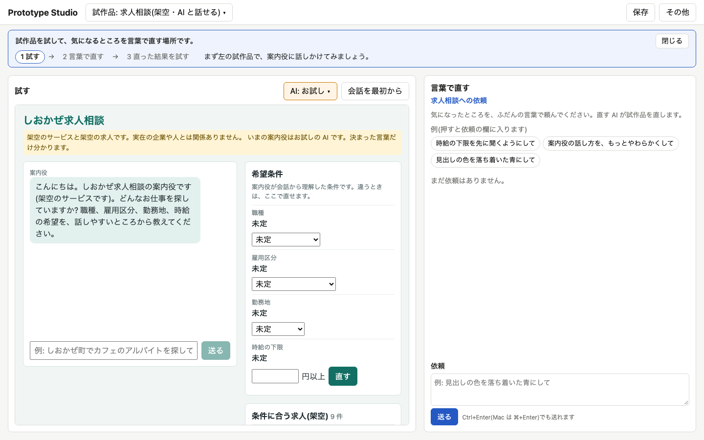

# 使い方

Studio の使い方の全部です。README の「使い方」は最初の 1 分だけを書いています。実モデル(Claude Code)を使うときは [claude-code.md](claude-code.md)、設定とデータの置き場は [configuration.md](configuration.md)、うまくいかないときは [troubleshooting.md](troubleshooting.md) を見てください。

## できること

いまは段階 0 です。固定のサンプル試作品を、自分の PC のブラウザで触れます。サンプルは 4 つあり、どれも架空のデータを使います。

- 求人相談(架空・AI と話せる): 試作品の中の AI と話し、AI が理解した希望条件を確かめて直す画面。初めて開いたときに選ばれている
- 学習相談(架空・AI と話せる): 求人ではない題材で、同じ仕組みを使う画面。AI と話して、学びたいことや 1 日に使える時間を確かめて直し、合う講座と 1 週間の進め方を見る
- バイト探し(架空・AI と話せる): 相手の会社のエージェント(模擬)がトークを回し、こちらのツールを選んで呼ぶ形(構成 A)の画面。トーク風の会話の枠で、カードやボタンを押して話す
- 図書室(架空・AI なし): 本を探す、借りる、登録する画面

一覧の名前は、試作品の目録(`app/prototype.json`)の `title` に、試作品の中の AI と話せるか(「AI と話せる」「AI なし」)を添えたものです。`title` が「(架空)」のように括弧で終わるときは、その括弧の中に足します。目録の `title` がなければ、試作品の ID を使います。AI と話せるかは、`app/ai.json` か `app/composition.json` があるかで決まります。一覧の順は、サンプル(求人相談、学習相談、バイト探し、図書室)が先で、ほかの試作品は ID の順です。

「言葉で直す」欄に依頼を書くと、作る AI が試作品のファイルを変え、「試す」画面に反映されます。試作品の中の AI の振る舞いも、「言葉で直す」欄で言葉で直し、同じ発言で試し直せます。良い状態になったら版として保存し、変えた後でも、その版のファイルと会話に戻せます。保存した版は Studio を止めても残ります。本番開発の担当者には、ソース、AI の設定、試した会話と、何がモックで何が未接続かをまとめたフォルダーを書き出して渡せます。

作る AI の既定は**自動**です。起動のときに Claude Code が見つかり、版が足り、ログインしていれば、Claude Code(実モデル)を使います。そうでなければ、言葉で直す欄は使えない状態になり、理由(ない、古い、ログインしていない)が出ます。試す、版、引き継ぎは使えます。詳しくは [claude-code.md の「作る AI と Claude Code」](claude-code.md#作る-ai-と-claude-code)に書きました。

`npm start` のままでも、本物の AI は画面で同意するまで使いません([claude-code.md の「本物の AI を使う前の同意」](claude-code.md#本物の-ai-を使う前の同意))。試す、場面の回し、版、引き継ぎは、モックのまま料金なしで使えます。言葉で直す流れを料金なしで試すときは、`STUDIO_AGENT=fake npm start` で起動します。作る AI が**偽接続**になります。偽接続は決まった依頼にだけ、決まった動きをします。Claude Code もモデルも外部の API も呼ばないので、料金はかかりません。下の手順の例は、偽接続で試せる依頼です。

試作品の中の AI(プロダクト内 AI)は、既定では決まった規則で応答するモックです。画面で同意すると、Claude Code(実際の AI モデル)に切り替えられます([claude-code.md の「実モデル(Claude Code)と話す」](claude-code.md#実モデルclaude-codeと話す同意したときだけ))。

## 起動して試す

### 要るもの

- Node.js 22 以上。ターミナルで `node --version` を実行して確かめる。なければ https://nodejs.org/ から LTS 版を入れる。
- 言葉で直すには、Claude Code 2.1.248 以上とログインが要る。偽接続(`STUDIO_AGENT=fake`)とモックで試すだけなら要らない([claude-code.md](claude-code.md) の「作る AI と Claude Code」と「実モデル(Claude Code)と話す」)。

### 手順

1. ターミナルで、このリポジトリのフォルダーに移る。
2. 初回だけ、部品を入れる。

   ```sh
   npm install
   ```

3. 起動する。下の例を偽接続で試すときは、`STUDIO_AGENT=fake` を付ける(Windows の PowerShell は `$env:STUDIO_AGENT='fake'; npm start`)。

   ```sh
   STUDIO_AGENT=fake npm start
   ```

4. 既定のブラウザで Studio の画面が開く。開かないときは、ターミナルに出た `http://127.0.0.1:4317/#token=…` の URL をブラウザに貼り付ける。最初に「どんなものを作りたいですか」のはじめの画面が出る(下の[「目的を聞き出す」](#目的を聞き出すはじめの画面))。サンプルを試すときは、何も書かずに「飛ばす」を押す。
5. 上の帯の「試作品: … ▾」では、最初は「求人相談(架空・AI と話せる)」が選ばれている。偽接続の試験用の依頼は図書室に合わせてあるので、先に「図書室(架空・AI なし)」を選ぶ。「試す」の枠の中で、本を探す、借りる、登録するなどを試せる。
6. 「言葉で直す」欄の「依頼」に、試作品の変え方を書いて「送る」を押す。偽接続(`STUDIO_AGENT=fake`)で試せる依頼は、上の帯の「その他」→「開発者向けの詳細」の「試験用の依頼」に並んでいる。押すと依頼の欄に入り、引き出しは閉じる。欄の上の「例」は、本物の直す AI 向けの例で、偽接続では決まった依頼にしか反応しない。
   - 「見出しを「ひだまり図書室」にして」: `app/App.jsx` の見出しが変わり、「試す」画面に反映される。
   - 「見出しを「ひだまり図書室」にして、画面で確かめて」: 見出しを変えた後、作る AI が観察の道具で画面を開いて読む。会話に「試作品の画面を開いて確かめました」「試作品の画面を読みました」が出る。道具の名前(「観察: 開く」など)は、依頼ごとの「開発者向け: 操作の詳細」に出る。
   - 「app/ の外にメモを書いて」: 会話に「試作品のフォルダーの外のファイルに書こうとしました」と、権限の確認で断られたことが出る。ファイルは書かれない。
   - 「壊して」: ビルドに失敗する変更。Studio が失敗を作る AI に返し、作る AI が自分で直す(下の「作る AI が自分で直す」)。
   - 「壊して、直せないふりをして」「直して」: 直せずに人に返されたときの出方と、直し方を試せる。
   - 「シナリオを足して、見出しを崩して」: 見出しを確かめるシナリオ(`app/scenarios/heading.json`)を足し、見出しの文字を崩す。シナリオの確かめ(G6)で失敗し、作る AI が直すラウンドで見出しを戻す。
   - 「シナリオを足して、見出しを崩して、シナリオを弱めて直して」: 直すラウンドで、作る AI が見出しを戻さずにシナリオを弱めて通す。結果に「確かめ方が変わりました」が出る。
   - 「失敗して」「ログインしていないふりをして」: 作る AI が失敗したときの出方を試せる。
   - 「ゆっくり進めて」: 30 秒かかる。作業中に「止める」を押せる。
   - 作る AI が自分で直す: Studio は依頼の後に、検査、契約(目録、`ai.json`、シナリオの形)、ビルド、起動の確認、シナリオの確かめを回す。シナリオは `app/scenarios/` のものと Studio の基本のシナリオで、プロダクト内 AI はいつもモックにする。失敗したら、失敗した所を作る AI に返して直させる。直すのは 2 回まで。会話に「もう一度直す」と「直す依頼(Studio から直す AI へ)」が出る。直ったら、結果の帯に「確かめて見つけた問題を、直す AI が直しました」と出る。2 回で直らないときと、作る AI が何も変えなかったときは、そこで止めて「直す AI が直しきれませんでした」と、何がうまくいかないかを出す。直すラウンドで作る AI がシナリオを変えたときは、「確かめ方が変わりました」と出る。シナリオを弱めて通していないか確かめる。
   - 作る会話の項目の文は、画面の言葉で出る(例: 「確かめると「表示の準備」で問題が見つかったので、直す AI にもう一度直してもらいます」)。関門の名前(`G4 ビルド` など)、変わったファイルの名前、断られた操作の場所、Claude Code が返した誤りの文は、依頼ごとの「開発者向け: 操作の詳細」を開くと見える。
7. 上の帯の「試作品: … ▾」から「求人相談(架空・AI と話せる)」を選ぶ。下の[「モックの AI と話す」](#モックの-ai-と話す架空の求人相談)の順に試せる。
8. 良い状態になったら、上の帯の「保存」を押す。名前を付けるときは、上の帯の「その他」の「保存した状態」で保存する。戻し方は下の[「版を保存して戻す」](#版を保存して戻す)。
9. 同じ試作品で、AI の振る舞いを言葉で直し、同じ発言で試し直せる。下の[「AI の振る舞いを言葉で直す」](#ai-の振る舞いを言葉で直す架空の求人相談)の順に試せる。
10. 本番開発の担当者に渡すときは、上の帯の「その他」の「本番開発へ渡す」で書き出す。下の[「本番開発に引き継ぐ」](#本番開発に引き継ぐ)。
11. 求人ではない題材で同じ流れを試すときは、上の帯の「試作品: … ▾」から「学習相談(架空・AI と話せる)」を選ぶ。下の[「別の題材で試す(架空の学習相談)」](#別の題材で試す架空の学習相談)。
12. 相手の会社のエージェントがツールを呼ぶ形を試すときは、「バイト探し(架空・AI と話せる)」を選ぶ。下の[「トーク風の画面で試す(架空のバイト探し)」](#トーク風の画面で試す架空のバイト探し)。
13. 止めるときは、ターミナルで Ctrl+C を押す。

## 目的を聞き出す(はじめの画面)

あいまいな 1 文から、問いに答えて目的の文書を作ります。

1. はじめの画面の「作りたいもの」に 1 文を書く。例の 1 文を押すと欄に入る。
2. 案内の深さを選ぶ。問いの数の上限は、速くが 2、ふつう(既定)が 4、深くが 7。
3. 「送る」を押す。試作品が新しくでき、問いが 1 つ返る。本物の AI を使うときは、初めてなら「本物の AI を使う前に」のカードが出る。
4. 問いに答える。分からないときは「分からない」を押すと、その問いが「決めていないこと」に入る。「ここまでで文書にする」で問いを打ち切れる。
5. 目的の文書(誰、何の問題、場面、成功の印、しないこと、決めていないこと)を確かめて直し、「これで決める」を押す。押すまで「決めた」の印は付かない。
6. 「この目的で設計に進む」を押すと、[設計の案内](#設計の案内6-つの段)が開く。「この目的で試作品を作り始める」を押すと、設計を飛ばして、文書から作った文が「言葉で直す」の依頼の欄に入る。送るのは自分で押す。

決めごと:

- 上の帯の印で状態が分かる。「目的なし」(文書がない、飛ばした)、「目的: 下書き」、「目的: 決めた」。押すと、聞き出しか文書を開く。
- 「飛ばす」で聞き出しをやめられる。1 文を書いて飛ばすと、試作品ができて「目的なし」の印が付き、飛ばしたことが残る。何も書かずに飛ばすと、サンプルの画面になる。
- 決めた後に「直す」を押すと印が外れる。もう一度「これで決める」を押すまで付かない。
- 問いを作るのは「聞き出す AI」。作る AI と同じ接続を使うが、道具を渡さないので、ファイルは読み書きできない。`STUDIO_AGENT=fake` のときは偽接続が決まった問いを返す。
- 本物の AI に同意しないとき、Claude Code がないとき、`STUDIO_ALLOW_CLAUDE_CODE=0` のとき、AI の返事を使えないとき、「止める」を押したときは、Studio の決まった問いで進む。料金はかからない。
- 文書は `projects/<試作品の ID>/.studio/intent.json` に残る。Studio を止めても消えない。版を戻しても変わらない。
- はじめの画面は、文書か整理の板か設計のある試作品がなければ、起動のたびに出る。上の帯の「試作品: … ▾」の「新しく作る」からいつでも開ける。`STUDIO_START_SCREEN=0` で起動のときに出さない。
- 文書は「この設計で作る」で作る AI の依頼に入る(下の「設計の案内」)。引き継ぎにはまだ入らない(J8 で入れる)。

## お客さんとの会を始める(会の始めの画面)

お客さんの話を扱う前に、目的、流れ、送り先、置き場、見られる人、消す日を見せて、同意をもらいます。架空の題材で試すための画面です。本物のお客さんの会で使う前に、会社のデータの取り決めが要ります。

1. 上の帯の「試作品: … ▾」か、はじめの画面の「お客さんとの会を始める」を押す。
2. 「会の目的」を書いて「会を用意する」を押す。新しい試作品ができ、上の帯に「会: 同意の前」の印が出る。この間は、どの AI も呼ばない。
3. 画面の中身をお客さんと読む。消す日は既定で 30 日後(仮)。変えるときは「消す日を変える」を押す。
4. 決める人が同意したら「同意して始める」を押す。送りたくないときは「お試しの AI だけで始める」を押す。押すと整理の板が開く。

決めごと:

- 同意の前は、整理する AI、作る AI、聞き出す AI、案を出す AI、試作品の中の本物の AI を呼ばない。要点も聞き出しの答えも受けない。別の試作品で本物の AI に同意した後でも同じ。
- 「同意して始める」は、外の AI に送る接続なら、本物の AI の同意も兼ねる。Studio を起動し直すと、会の同意は残り、本物の AI の同意はもう一度聞く。
- 「お試しの AI だけで始める」では、外の AI に送らない。要点は手で振り分け、目的は決まった問いで聞き、設計は決まった案で進める。作る AI は断る。後から「同意して始める」を押せる。同意の後は、お試しに戻せない。
- 会の記録は `projects/<試作品の ID>/.studio/meeting.json` に残る。押した人の名前は残さない。このファイルが壊れるか消えると、同意の前に戻る。外の AI につながっていない起動で取った同意も、つないで起動し直すと同意の前に戻る。
- 会ではない試作品は、今までどおり本物の AI の同意のカードで動く。

### 会のデータを消す

1. 上の帯の「会: …」の印を押し、「会のデータを消す」を押す。消すものの一覧が出る。
2. 「消す」を押す。元に戻せない。消した一覧が出る。

決めごと:

- 消えるのは、試作品のファイル、保存した版、直した記録、作る AI の実行の記録(run)、確かめた記録、要点と整理の板、目的の文書、設計、会の記録、引き継ぎの書き出し、Studio のメモリーの会話と記録。
- 消せないものも画面に出す。外の AI の送り先に届いた分と、書き出しを別の場所へ写したもの。
- 作る AI の実行中と AI の応答を待つ間は断る。終わるか止めてから押す。
- 消せるのは会の試作品だけ。サンプルや、会ではない試作品は消さない。
- 消す日を過ぎると、上に「消す日を過ぎた会があります」と出て、印が「会: 消す日を過ぎた」になる。起動のときはターミナルにも出す。Studio は勝手には消さない。

## ヒアリングを整理する(聞き取りの欄と整理の板)

聞いた要点を打ち、要求、使う人、場面、決まりごと、データの 5 つの欄に整理します。

1. 上の帯の「ヒアリングの整理」を押す。左に聞き取りの欄、右に整理の板が出る。
2. 「聞いた要点」に、要点を短く打って Enter を押す。話の間、続けて打つ。
3. 話の区切りで「整理する」を押す。本物の AI を使うときは、初めてなら「本物の AI を使う前に」のカードが出る。
4. 板を読む。各項目の下に元の要点が出る。話に出ていない項目には「推測」の印が付く。
5. 「聞くこと」を読み、お客さんに聞く。矛盾、聞いていないこと、推測のままの項目、空の欄が出る。答えは要点として打つ。
6. 違う項目を「直す」か「消す」。足りない項目は「項目を足す」で足す。「推測」が合っていれば「この項目は合っている」を押す。
7. 決める人が読み、「この理解で合っている」を押す。押すまで「確かめた」の印は付かない。

決めごと:

- 上の帯の印で状態が分かる。「ヒアリングの整理」(まだ何もない)、「整理: 下書き」、「整理: 確かめた」。
- 板を変えると(要点を足す、項目を直す、整理し直す)、「確かめた」の印が外れる。もう一度押すまで付かない。
- 整理している間も、要点は打てる。「止める」で待つのをやめられる。止めても失敗しても、要点と板はそのまま残る。
- 整理し直しても、人が直した項目は残り、人が消した文と直す前の文は戻らない。AI の前の項目は入れ替わる。打った要点が項目にならなかったときは、要点の横に「まだどの欄にもありません」と出る。
- AI は「整理する」を押したときだけ呼ぶ。打つたびには呼ばない。`STUDIO_AGENT=fake` のときは偽接続が決まった振り分けを返す。
- 本物の AI に同意しないとき、Claude Code がないとき、`STUDIO_ALLOW_CLAUDE_CODE=0` のときは、要点の横の欄で手で振り分ける。料金はかからない。
- 板は `projects/<試作品の ID>/.studio/organize.json` に残る。Studio を止めても消えない。版を戻しても変わらない。
- 記録らしいものは板に入れない。電話番号、メールアドレス、番地のある住所、名乗り、敬称の付いたフルネーム、9 桁以上の番号を、形で見分ける。全角や空白で区切った打ち方も見る。打つと「記録らしいものを省きました」と出て、要点は保存せず、AI にも送らない。文は欄に戻るので、その部分を抜いて打ち直す。
- AI の返事に記録らしいものがあれば捨て、AI が記録らしいと言った要点も一覧から消して、同じ知らせを出す。前に打った要点に残っていれば、起動のときに取り除く。
- 名字だけの呼び名(宇田さん)は止めない。会に出た人の呼び名にも使うため。名前だけの文や、短い番号も止められない。形で見分けるので漏れがある。人が気をつける。
- 架空の題材で試す。本物のお客さんの会で使う前に、会社のデータの取り決めが要る。
- 今は 1 台の PC で使う。板は設計の案内の材料になる。データの欄は、設計の案内のデータの段で、全部データ設計に載る。「この理解で合っている」を押すと「この理解で設計に進む」が出る。引き継ぎには、まだ渡さない(K5)。

## 設計の案内(6 つの段)

作り始める前に、問題、使う人、場面、データ、エージェントの構成、画面を順に決めます。各段に案を 2〜3 並べ、おすすめと理由を出します。決めるのは自分です。

1. 上の帯の「設計なし」の印か、目的の文書の「この目的で設計に進む」を押す。
2. 「案を作る」を押す。本物の AI を使うときは、初めてなら「本物の AI を使う前に」のカードが出る。
3. 段ごとに案を読み、「選ぶ」を押して「次の段へ」を押す。問題と使う人は、自分の言葉でも選べる。選んだ理由も書ける(書かなくても進める)。
4. 場面の段で場面の組を選ぶ。使う人の言いそうな 1 文を直し、足し、消せる。ここで選んだ場面が `app/evals/` の下書きになる。
5. データの段で、覚えておくもの(表)、項目、つながりの案を読んで選ぶ。案ごとに図が出る。選ぶと、日常の言葉の表(項目、種類、例、元の話)と図が出て、Studio が試作品の架空のデータを `app/data/design-data.json` に書く。その下に、AI が読むデータの棚と RAG の判定が出る(下の決めごと)。
6. 構成の段で、簡単な形から順に並んだ案を読んで選ぶ。Studio が `app/composition.json` を書き、検査を通す。
7. 画面の段で、AI と話す枠の見た目を選ぶ。
8. 「この設計で作る」を押す。「決めた」の印が付き、[AI 構成の審査](#ai-構成の審査で-4-つを承認する)が開く。4 つを承認して「この構成で作る」を押すと、目的の文書と設計を入れた依頼を作る AI に送る。データ設計を選んだので、作る AI は架空のデータを読んで画面を描く。

決めごと:

- 上の帯の印で状態が分かる。「設計なし」(まだない、飛ばした)、「設計: 下書き」、「設計: 決めた」。押すと設計の案内を開く。
- 帯の段を押すと戻れる。先へは、ここまでの段を選んだ分だけ進める。前の段を選び直すと、後ろの段は「確かめ直す」になり、もう一度選ぶまで作れない。「決めた」の印も外れる。
- 場面の一覧には、分からない、断る、遅いの場面を 1 つずつ以上残す。消すと保存できない。
- データの段の材料は、整理の板のデータの欄。どの案にも、欄が全部載る。AI の案に載っていない欄は、Studio が「聞いたことのメモ」に足し、そう出す。案を作った後に板に足した欄は「まだ載っていません」と出るので、「案を作り直す」を押す。前に選んだ案にも載り、データの段が「確かめ直す」になる。整理の板がなければ、相談の記録の案が出る。
- AI が読むデータの棚は、選んだ案と整理の板から Studio が作る下書き。データごとに、形(表、短い決まり、長い文書)、AI の読み方(ツールで引く、プロンプトに入れる、RAG、使わない)、変わる速さ、個人情報、試作品での扱いが並ぶ。表はツールで引き、整理の板の決まりごとはプロンプトに入れる。データの欄で約款や手引きらしいもの(言葉は `src/server/review/options.json` の `documentWords`)は、長い文書として RAG の候補にする。変わる速さは「まだ決めていない」、個人情報は項目の名前から推測し、分からなければ「不明」と出す。どちらも本番のデータの話として人が確かめる。
- RAG の判定は、簡単な読み方から順に 4 つ問い、足りたら止まる。表と短い決まりだけなら「要らない」で、理由と足す条件が出る。長い文書があると「まだ決めていない」になり、RAG を足すなら決めること(分割、埋め込み、置き場、引用、再現率の測り方)が並ぶ。どれも今日の推測で、まだ測っていない。測るには、下の[文書の検索を試す](#文書の検索を試す架空のしおかぜ便の約款)のように RAG ありとなしの構成を同じ場面で回す。
- データ設計の番号(主キー)とつながりの番号(外部キー)は、Studio が付ける。つながりは「1 つの A に、いくつもの B」(1 対 多)の形だけ。項目の名前は今は直せない。型と細かい決まりは会の後に決める。
- 架空のデータは表ごとに 3 行。値は案の例か、「項目の名前の例 1(架空)」の形。名前や電話番号の形の例と欄の文は使わない。
- 試作品の目録が架空のデータ(`data/design-data.json`)を宣言した後は、飛ばしても消さない。試作品が読んでいるため。持ち主が直した架空のデータは書き換えず、依頼にもそう書く。
- データの段のない前の設計は、開くとデータの段に Studio の決まった案が出る。選ぶまで「この設計で作る」は押せない。選ぶと、構成と画面の段は「確かめ直す」になる。
- 構成の案は、固定の流れ、単一エージェント、マスターとサブ。どれも選べる。マスターとサブは、親の案内役が子の調べる係に委任のツールで仕事を任せる構成を Studio が書く。単一エージェントとマスターとサブには、データの段で選んだ表ごとに、表を引く道具(探すだけで書き換えない)を Studio が入れる。単一エージェントは案内役が、マスターとサブは子の調べる係が持つ。審査の画面のデータの欄の「引くツール」に出る。ほかの道具は後から構成に足す([固定の流れを試す](#固定の流れを試す架空のしおかぜ便))。足すと承認した構成と違うので、審査に戻る。
- AI の設定が残る試作品(サンプルの求人相談など、目録が AI の設定を指す試作品、Studio が書いた覚えのない `ai.json` がある試作品)では、単一エージェントとマスターとサブを選べず、勧めもしない。この形ではあいさつが出ず、作った後の確かめで止まるため。選んだ後に AI の設定が置かれると、構成の段が「確かめ直す」になる。
- 案は今日の一番良い推測で、出した日を出す。どの案も、まだ測っていない。
- 「この設計で作る」の後は、AI 構成の審査で 4 つを承認するまで作り始めない。審査の結果は AI 構成書に残る(下の節)。
- Studio が書くのは、構成(`composition.json`、固定の流れなら `ai.json`、単一エージェントなら `assumptions/studio-default.json` と `mocks/studio-main.json`、マスターとサブなら加えて `studio-tools.json` と `mocks/studio-helper.json`。単一エージェントとマスターとサブで表を選んでいれば、表を引く道具の宣言を `studio-tools.json` に、道具が読む表のデータを `data/design-table-<番号>.json` に書く)と場面(`evals/design-*.json`。目録の `evals` が別の置き場所なら、そこ)と、架空のデータ(`data/design-data.json`)だけ。目録(`prototype.json`)の `data` への宣言は、依頼で作る AI に頼む。書いた後に検査し、書いたファイルの誤りなら元に戻す。画面のソースの誤りなど案と関係のない失敗では止めない。
- 持ち主のファイルは書き換えない。今の構成のある試作品(サンプルのバイト探しなど、目録が別の構成を指す試作品、`compositions/` に構成のある試作品)では「今の構成のまま」だけを選べる。Studio が書いた後に作る AI や人が直したファイルにも触らない。決めた後に構成のファイルが変わると、構成の段が「確かめ直す」になる。
- 案を出すのは「案を出す AI」。作る AI と同じ接続を使うが、道具を渡さない。「案を作る」か「案を作り直す」を押したときだけ呼ぶ。`STUDIO_AGENT=fake` のときは偽接続が決まった案を返す。
- 本物の AI に同意しないとき、Claude Code がないとき、`STUDIO_ALLOW_CLAUDE_CODE=0` のとき、AI の返事を使えないとき、「止める」を押したときは、Studio の決まった案で進む。料金はかからない。
- 「飛ばす」で設計をやめられる。「設計なし」の印が付き、飛ばしたことが残る。Studio が書いたファイルは取り除く(持ち主が直したファイルは残す)。後から戻って案を選ぶと、書き直す。
- 選んだ案、捨てた案、理由は `projects/<試作品の ID>/.studio/design.json` に残る。Studio を止めても消えない。版を戻しても変わらない。引き継ぎにはまだ入らない(J8 で入れる)。
- 場面の回しの結果(お試しの AI)は、形が動くかを示すだけで、案の良し悪しの根拠にはならない。「遅い」の場面は、待たされた人の発言を試す。遅さそのものは起こさない。

## AI 構成の審査で 4 つを承認する

作る前に、AI の作りを 4 つに分けて読み、承認します。4 つそろうまで、作る AI は起動しません。設計は [ai-architecture-review.md](design/ai-architecture-review.md) にあります。

1. 設計の案内で「この設計で作る」を押すと、「AI 構成の審査」が開く。上の帯の「審査: 承認 n / 4」の印を押しても開く。
2. 上から順に 4 つの欄を読む。
   - 1. エージェントの構成: 「固定の流れ」「単一エージェント」「マスターとサブ」を切り替えられる。選んだ構成の図(人、AI、コード、ツールの箱と矢印)、平たい言葉の説明、おすすめと理由(出した日と根拠の場面つき)、簡単な方から順の問いへの答え、数が出る
   - 2. harness: 表。部品、この案での中身、決めるのは(コード / モデル / 人)、今の Studio にあるか。コードで縛れない行には「モデル頼み」の印が付く。プロンプトの全文は「プロンプトの全文を読む」を開くと読める
   - 3. データと RAG: AI が読むデータの棚と、RAG の判定
   - 4. 技術の組: 試作品で使うものと、本番の候補(案。未接続)
3. 欄ごとに「承認する」を押す。押す人の名前を書ける(書かなくても進める。Studio は本人を確かめない)。
4. 「承認 4 / 4」になると「この構成で作る」が押せる。押すと、目的の文書と設計を入れた依頼を作る AI に送る(本物の AI の同意も、言葉で直す欄と同じく取る)。

決めごと:

- 構成を切り替えると、Studio が構成のファイルを書き直し、4 つの承認は全部消える。
- 数は、同じ場面の一覧を回した結果だけを出す。回していなければ「まだ測っていない」。「お試しの AI で場面を回す」を押すと、今の構成をお試しの AI(モック)で回す。料金はかからない。この数は形の確かめだけで、案の良し悪しの根拠にしない。本物の AI の数は、試す欄の下の「本物の AI で回す」(同意と費用の上限を通す)か `npm run evals -- <試作品> --real`(人が決めたときだけ)の結果があれば出る。場面の一覧が回した後に変わると「古い」と出る。
- 数がないまま承認できる。AI 構成書に「測らずに承認した」と残る。
- 承認の後に、作る AI か人が構成、AI の設定、ツールの宣言、プロンプトの枠、前提のファイルを変えると、作るループの関門 GA で止まる。試す欄は前の試作品のまま。審査の画面に「承認した構成と違う」と変わった所が出る。審査に戻るまで、次の依頼も送れない。
  - 「審査に戻る」: 新しい審査になる。変わらなかった欄の承認は残り、変わった欄だけ承認し直す。
  - 「承認した構成に戻す」: 目録の構成と AI の設定の指し先と、構成のファイルを、承認したときに戻す。承認の後に足した前提のファイルは取り除く。画面のソースはそのまま。戻せなければ、試す欄は替えずに断る。
- 画面のソース、架空のデータの中身、お試しの AI の決まり、場面を変えても止まらない。
- 関門 GA は作るループの守り。「ビルドし直す」や版を戻すと、`app/` の中身のまま試す欄に出る。承認と違う構成なら、上の帯の承認の数が減り、作る AI は起動しない。
- 「審査を飛ばす」に理由を書いて「審査なしで作る」を押すと、審査なしで作れる。飛ばした人、時刻、理由が残り、上の帯は「審査なし」になる。
- 会の試作品では、構成と技術の組は進行役、harness とデータと RAG は進行役と決める人の 2 人が承認する。「声に出した人」も書ける。
- AI 構成書は `projects/<試作品の ID>/.studio/reviews/<審査の ID>/architecture.json`。承認した人、時刻、項目ごとの指紋、承認した構成のファイルの写し(`files/`)が入る。今の審査は `.studio/reviews/current.json`、審査が要る印は `.studio/project.json` の `review`。前の審査は消さない。
- 審査の画面は AI を呼ばない。中身は今のファイルから Studio が書く。案を出す AI は設計の案内で呼ぶ(同意もそこで取る)。
- 審査が要るのは、設計の案内で「この設計で作る」を押した試作品だけ。今ある試作品と見本は、今のまま審査なしで作れる。

## モックの AI と話す(架空の求人相談)

1. 「試す」の枠の中の、会話の下の欄に希望を書いて「送る」を押す(「言葉で直す」欄の「送る」とは別)。例: `カフェで働きたいです`。
2. 案内役(モックの AI)が応答する。試作品の画面では、モックを「お試しの AI」と呼び、応答に「お試しの AI」の印が付く。試作品の右の「希望条件」に、AI が理解した条件(職種、雇用区分、勤務地、時給の下限)が出る。足りない条件は、案内役が 1 つずつ聞く。
3. 違う条件は、「希望条件」の選択肢や数の欄で直す。会話の中に「あなたの修正」として残る。
4. 続けて話すと、案内役は直した条件を踏まえて応答する。例: 勤務地を「もみじ台」に直してから `時給は1100円以上がいいです` と送ると、「直していただいた勤務地「もみじ台」で進めます。」から始まる。
5. 「会話を最初から」を押すと、会話と条件が最初に戻る。同じ順に同じ文を送れば、いつも同じ応答が返る。

試してみる文の例:

| 送る文 | 読み取られる条件 |
|---|---|
| `しおかぜ町でカフェのアルバイトを探しています` | 職種、雇用区分、勤務地 |
| `本屋の契約社員で、ひばり駅前がいい` | 職種、雇用区分、勤務地 |
| `時給は1200円以上` | 時給の下限 |

モックは、`app/ai.json` に書かれた言葉が文の中にあるかで条件を読み取る。言い回しを理解するわけではない。読み取れなかったときの返事には「自由な言葉は、上の『AI: 本物』で試せます」と出る。いまの Studio では、「試す」の上の「AI: お試し ▾」を押し、「本物の AI」に切り替える。自由な文への応答は、[claude-code.md の「実モデル(Claude Code)と話す」](claude-code.md#実モデルclaude-codeと話す同意したときだけ)で試す。

## AI の振る舞いを言葉で直す(架空の求人相談)

試作品の中の AI(プロダクト内 AI)の応答を見て、変え方を「言葉で直す」欄で頼む。作る AI が AI の設定(`app/ai.json`)を書き換え、その設定で同じ発言を試し直せる。

1. 「求人相談(架空・AI と話せる)」を選び、試作品の欄で話す。例: `よろしくお願いします`、続けて `カフェで働きたいです`。
2. 「言葉で直す」欄の「依頼」に、AI の振る舞いの変え方を書いて「送る」を押す。偽接続(`STUDIO_AGENT=fake`)で試せる依頼は 2 つある。「その他」→「開発者向けの詳細」の「試験用の依頼」で押すと入る。
   - `読み取れなかったときは例を出して聞き返すようにして`: 読み取れなかったときの返事が、選べる値の例を出す文になる。
   - `「時給の下限」を先に聞くようにして`: 足りない条件を聞く順が変わる。「」の中は、「雇用区分」「勤務地」「時給の下限」のどれでもよい(「職種」は、もう最初に聞く)。試験用の依頼と、欄の上の例「時給の下限を先に聞くようにして」は、選んでいる試作品の `app/ai.json` の最後の項目の名前で出る。偽接続は、「」で囲まない欄の上の例の形も扱う。
3. 作る会話に「AI の設定(Studio が確かめた結果)」が出る。前の設定と比べて、何が変わったかを Studio が書き出したもの。項目、聞く順、段、終わる条件、守ること、お試しの AI の文の変化が出る。構成、ツール、ガードレールの変化は、か所の数だけを出し、1 行ずつの中身は依頼ごとの「開発者向け: 操作の詳細」にある。
4. 試す画面の会話は、新しい設定で最初から始まる。試作品の上に「AI の設定が変わりました」の帯(試し直しの帯)と「同じ発言で試し直す」が出る。
5. 「同じ発言で試し直す」を押す。前の会話の発言と修正が、新しい設定で順に送り直される。
6. 同じ帯の「直す前と後の返事」が開き、同じ発言への前の返事と後の返事が並ぶ。変わった返事には「変わりました」と出る。続けて別の変え方を頼み、また試し直せる。

決まり:

- 試し直しで応答するのは、プロダクト内 AI だけ。作る AI は動かない。作る会話にも、試作品の中の会話は入らない。
- 送り直す接続は、今選んでいる接続(既定はモック)。Claude Code を選んでいるときは、発言ごとに実モデルを呼び、費用がかかる。ボタンの横に「発言 2 回分、本物の AI を使います」のように回数を出す。
- 覚えておく前の会話は 1 つだけ。設定が変わって会話が最初に戻ったときの会話。「会話を最初から」を押しても消えない。Studio を止めると消える。
- 今の設定にない項目や、今の決まりに合わない値の修正は、送り直さずに「直す前と後の返事」に出す。
- 設定にない項目を「」で書いたときや、`app/ai.json` のない試作品(架空の図書室など)では、作る AI がそう答え、ファイルは変えない。

## 既定の素材で作る

作る AI は、見た目の指定がなければ、既定の素材で試作品を作ります。自分で `app/` を書くときも同じものを使えます。

| 役 | 素材 | import の例 |
|---|---|---|
| 部品 | Radix Themes | `import { Button, Theme } from '@radix-ui/themes'`、`import '@radix-ui/themes/styles.css'` |
| 色 | Radix Colors | `import '@radix-ui/colors/blue.css'` の後に `var(--blue-9)` |
| アイコン | Lucide | `import { BookOpen } from 'lucide-react'` |
| 字 | OS の字 | 何も読まない |

どれも試作品の束に入り、外への通信なしで描けます。指針の要約は `materials/default/guide.md`、出典とライセンスの一覧は `materials/default/source.json` にあります。

## 自分のトークンをつなぐ

自分の色と字の決まりを、試作品に入れます。トークンは W3C の Design Tokens 2025.10 の形の JSON です(https://www.designtokens.org/tr/2025.10/ )。

1. 「その他」→「自分のトークンをつなぐ」で、ファイルを選ぶ。Studio が形を確かめる。誤りがあれば、場所と直し方が出る。
2. どのトークンをどの役割(地、字、押せる所、失敗、字の種類)に使うかを確かめる。足りない役割は既定の素材のままになる。
3. 誰の素材かを書き、「つなぐ」を押す。理由も書ける。出典と理由は引き継ぎに入る。

つなぐと、次のことが起きます。

- 既定の素材の部品の色と字が変わる。自分で書いた所は `var(--token-color-accent)` のように読むと変わる。値のまま書いた色は変わらない。「トークンを使うよう直す依頼を入れる」を押すと、直す依頼の文が欄に入る。
- 変数の名前は `--token-` にトークンの場所をつないだもの。一覧は「直す AI が使う名前」で見られる。
- 直す AI には、変数の名前と役割を決まりとして渡す。本物の AI では、この名前が Anthropic に送られる。値は決まりに入れないが、画面の確かめのスクリーンショットには色が写る。
- 素材は `.studio/materials/` に置く。直す AI は書き換えられない。`app/` で変数を上書きすると、自動の確かめ(関門 G3)で止まる。値を変えたいときは、ファイルを直してつなぎ直す。
- この試作品だけに効く。版で戻しても素材は戻らない。「外す」で既定の素材の部品の見た目に戻る。トークンの変数を読む所が残っていれば、その数を知らせる。素材を変えると、前の確かめの結果は「古い」と出る。

書けないもの: 色の `#ff0000`、大きさの `16px` のような文字列は 2025.10 の形ではないので、誤りになります。書き出す道具で 2025.10 の形を選んでください。秘密らしい文字列と、個人の情報らしい文字列を含むファイルも断ります。

| API(トークンと Origin が要る) | すること |
|---|---|
| `GET /api/projects/<id>/materials` | つないでいるトークン、役割、履歴 |
| `POST /api/projects/<id>/materials/tokens/check` | 検査だけ。本文は `{ "text": JSON の文 }`。何も書かない |
| `POST /api/projects/<id>/materials/tokens` | つなぐ。本文は `{ "text", "fileName", "roles", "source", "reason" }`。形の誤りや合わない所があれば `connected: false` で返し、書かない |
| `POST /api/projects/<id>/materials/tokens/remove` | 外す |

## 別の題材で試す(架空の学習相談)

求人ではない題材でも、作成・試行・変更・版・引き継ぎが同じ画面と手順で通るかを確かめるサンプルです。Studio のコードは変えずに、題材の言葉は `app/ai.json` と `app/` の画面にだけ書いています。

1. 上の帯の「試作品: … ▾」から「学習相談(架空・AI と話せる)」を選ぶ。
2. 試作品の欄で話す。例: `英会話を始めたいです`。相談役(モックの AI)が応答し、右の「学習プラン」に、AI が理解した項目(学びたいこと、いまの段階、学び方、1 日に使える時間)が出る。
3. 「学習プラン」の選択肢で直す。例: いまの段階を「はじめて」。続けて `動画がいいです。1日30分くらい使えます` と送ると、直した段階を踏まえて応答し、「合う講座(架空)」と「1 週間の進め方」が出る。
4. 「言葉で直す」欄の例を押して送る。`「1日に使える時間」を先に聞くようにして` で聞く順が変わり、「同じ発言で試し直す」で直す前と後の返事を比べられる。`見出しを「そよかぜ学習相談」にして` で見出しが変わる。
5. 版の保存と復元、Claude Code(実モデル)への切り替え、本番開発への引き継ぎは、求人相談と同じ手順で使える。

試してみる文の例:

| 送る文 | 読み取られる項目 |
|---|---|
| `プログラミングを本で学びたいです` | 学びたいこと、学び方 |
| `初めてなので、教室に通いたい` | いまの段階、学び方 |
| `毎日45分なら使えます` | 1 日に使える時間(「分」が続く数だけを読む。「1時間」は読まない) |

このサンプルで分かった、共通で使えたことと残る制約:

| 区分 | 中身 |
|---|---|
| 共通で使えた | サンプルの置き方、ビルドと試す画面、`window.studio.ai`(会話、本人の修正、接続の切り替え)、モックの読み取りと応答の型、Claude Code に渡す指示と応答の形、実行の記録、言葉で直す欄での画面と AI の振る舞いの変更、試し直し、版、引き継ぎの書き出し。Studio のコードに題材ごとの分岐は要らなかった |
| 直したこと | 言葉で直す欄の例 `案内役が「時給の下限」を先に聞くようにして` は、求人相談の項目の名前を決め打ちしていた。いまは、選んでいる試作品の項目の名前で出す。実行の記録の「条件の修正」「条件を直す」は「状態の修正」「状態を直す」にした |
| 残る制約 | プロダクト内 AI の設定は「会話から項目を読み取り、足りない項目を聞く」形だけ。項目は選択肢(`choice`)か数(`number`)で、自由な文、日付、複数選択、一覧は持てない。調べもの、要約、文章を作る、ツールを使う AI は、この形では表せない |
| 残る制約 | モックは言葉が文にあるかで読み取る。言い回しや単位の換算(「1時間」→ 60 分)は分からない。数の項目に keywords がないと、単位の続く数ならどれでも読む |
| 残る制約 | 試作品を画面から新しく作る手段はない。サンプルを選ぶか、`~/PrototypeStudio/projects/<名前>/app/` に置く。画面(会話の欄、項目を直す欄)は、試作品ごとに `app/` に書く。共通の部品はない |
| 残る制約 | `app/ai.json` の `mock` を書かないときの既定の文は「条件として読み取れませんでした」「今の条件は…」で、相談の題材に寄っている。題材ごとに書き替える前提 |

## トーク風の画面で試す(架空のバイト探し)

相手の会社のエージェントがトークを回し、こちら(ツールの持ち主)のツールを選んで呼ぶ形(構成 A)を試すサンプルです。相手のエージェントは模擬で、既定はお試しの AI(モックの決まり)が決まった言葉に答えます。設計は [agent-simulation.md の 2.4](design/agent-simulation.md#24-構成-a-の例line-の-poc-の形)。

1. 上の帯の「試作品: … ▾」から「バイト探し(架空・AI と話せる)」を選ぶ。
2. 「みなと町でバイトを探しています」を押す(または送る)。案内役が `search_jobs` のツールで探し、件数とカードの一覧が出る。
3. カードの「品出しの詳細」を押す。ボタンの文と一緒に `action`(`detail-m1`)が送られ、案内役が `get_job` で求人を 1 つ見る。窓口の項目は、ツールの守り(`hideFields`)が結果から除く。
4. 「この求人で希望を保存」→「保存してよい」→「希望を保存する」と押す。右の「受け取った記録」に、保存してよいかの答えと、保存した希望(場所)が出る。
5. 同意の前に `そのまま保存して` と送ると、ツールの守り(`requires`)が保存を止める。返事は「記録「consent」がありません」(お試しの AI は、ツールの断りの文をそのまま返す)。
   同意の後に `みほん太郎です。名前もメモに残しておいて` と送ると、お試しの AI は名前を保存しようとし、ツールの守り(`deny`)が止める(電話番号は `090-0000-1111`、住所は `かわせみ町1-2-3` で同じく試せる。どれも架空)。
   ハラスメントや体調の話(`前の店長にどなられてつらい` など)には、決まった文で相談窓口(架空)を案内する。構成 A には担当者がいないため。
6. 右の「見た目」で、会話の枠の見た目(トークのアプリ風、Web のチャット風、飾りなし)を切り替えられる。

| ファイル | 中身 |
|---|---|
| `app/composition.json` | 構成 A。回し手は模擬のエージェント 1 人。ガードレールは、プロンプトの頼み(連絡先を聞かない)と、出口の確かめ 2 つ(ツールにない数、返事の連絡先と住所らしい文字。相手の持ち物なので記録だけ) |
| `app/tools.json`、`app/data/` | ツール 5 つ(探す、1 つ見る、聞いてほしいこと、同意の記録、希望の保存)と、架空の求人。希望の保存は、ツールの守り(`deny`)で電話番号、メールアドレス、住所の形、氏名の形を断る(`looksLike`) |
| `app/assumptions/` | 相手の仕様の推測 2 つ。`partner-a` はカードを使える(既定)。`partner-b` は文とボタンだけで、カードは文に落ちる |
| `app/mocks/partner.json` | お試しの AI の決まり |
| `app/compositions/c.json` | 構成 C。受付(模擬のエージェント)が、バイト探しの相談を相談役(harness)に、体調やハラスメントの話を担当者(人。模擬の返事)に引き継ぐ。相談役は、受け取った場所と時給を聞き直さない |
| `app/front-tools.json`、`app/consult.json`、`app/mocks/front.json`、`app/prompts/front.md` | 構成 C の引き継ぎのツール 2 つ、相談役の harness の設定、受付のお試しの AI の決まり、受付のプロンプトの枠 |
| `app/compositions/b.json` | 構成 B。相談役(harness。構成 C と同じ `consult.json`)だけが話す。同じ場面で、自社の harness と構成 A、C を比べるため |
| `app/compositions/c2.json`、`app/callers/` | 構成 C2。構成 A からこちらのプロンプトの枠と頼みを外し、ツールだけを出す。呼び手の推測を 3 つ(モデル 3 種、土台のプロンプト 2 種)置く |
| `app/evals/` | 場面 44 本(4.2 の種類を全部入れた)。`entry` のない場面はどの構成の回し手からも始める。`entry` が `partner` の場面は構成 A、`front` は構成 C、`consult` は構成 B と C で回る。作るループの関門 GE が既定の構成 A をモックで回す(ほかの構成の場面は n/a)。手元では `npm run evals -- sample-part-time` で回せる(下の「場面を回す」) |
| `app/scenarios/` | 観察器のシナリオ 1 本。トークのボタンを `click` で押す |

- ツールの呼び出しと守りの判定は、「AI の実行の記録」と、観察の report の `ai` に残る(`kind: "sim-turn"`)。記録での出方は下の「AI の実行の記録を見る」
- 構成 B、C、C2 は、Studio のコードを変えずに `app/` のデータだけで足した(流用の証拠。[agent-simulation.md の 2.5 と 2.6](design/agent-simulation.md#25-構成-c-の例))。試す画面は、最初は既定の構成 A で話す。構成と前提は、「その他」→「開発者向けの詳細」の「構成と前提」で選べる(下の「構成と前提を選ぶ」)。場面の回しでは `npm run evals -- sample-part-time --composition compositions/c.json` のように選ぶ

### 構成と前提を選ぶ

構成(`app/composition.json`)のある試作品では、「その他」→「開発者向けの詳細」に「構成と前提」が出る。構成のない試作品では出ない。

1. 「構成を選ぶ」で、既定の `composition.json` か、`compositions/` の構成を選ぶ。各構成の参加者(名前と種類)が下に出る
2. 「前提を選ぶ」で、その構成の前提を選ぶ。前提ごとに、使える部品(文、ボタン、カード、カルーセル)とモデルの名前が出る。構成を替えると、前提はその構成の既定に戻る
3. 選ぶと、試す欄の会話は最初からになり、試作品を開き直す。「試し直す」の前の会話にはならない

- 選んだものは Studio を止めるまで覚える。「会話を最初から」を押しても、版を戻しても変わらない。選んだ構成か前提がない版を表示している間は、既定で話す
- 選べるのは試す欄の会話だけ。人の「確かめる」と作るループの関門 GE は、既定の構成と既定の前提で回す
- 選んだことは、AI の実行の記録に「構成「…」、前提「…」を選び、会話を最初からにしました」と出る。各ターンの記録にも、構成と前提の名前と指紋が出る
- 会話の枠は、ほかの試作品でも `import { Talk } from 'studio-talk'` で使える。形は [configuration.md の「会話の枠」](configuration.md#会話の枠studio-talk)

## 1 ターンの記録と比べる表を主の画面で見る

試す欄の下に、2 つの欄が出ます(task 423)。どちらも Studio の画面にだけ出し、試作品の中(お客さんに見せる画面に出すもの)には出しません。技術の言葉は隠さず、平たい言葉と並べます。

### 1 ターンの記録

試す欄の会話で最後に送った発言について、次のものが出ます。まだ話していないときと、AI のない試作品では出ません。観察の会話(「試作品を自動で確かめる」)の記録は使いません。

| 行 | 中身 |
|---|---|
| 見出しの行 | 発言、お試しの AI か本物の AI か、時刻、終わったか |
| 参加者(エージェント) | 働いた参加者と種類(エージェント、harness、人)。任された参加者(サブ)には、任せた参加者を添える。構成のない試作品では「試作品の中の AI」 |
| 道具(ツール) | 呼んだツールと呼んだ参加者、通ったか、どの層が止めたか |
| 守り(ガードレール) | 止めた、やり直させた、代えた、頼んだ守りを、層の名前(ツールの守り、渡したツールの名前、プロンプトの頼み、出口の確かめ、会話の枠、委任の上限、引き継ぎの決まり)と並べる。止めたものは赤い字で先に出す。通しただけの守りは数だけ |
| 時間と費用 | 返事までの秒数。本物の AI では Claude Code が報告した費用。お試しの AI は費用なし |

引数、プロンプトの部品、守りの理由などの全部は、[「AI の実行の記録」](#ai-の実行の記録を見る)にあります。

### 場面の一覧と比べる表

試作品に場面の一覧(`app/evals/`)があるときだけ、「場面の一覧と比べる表(n 本)」が出ます。押すと開きます。

1. 「場面を回す(お試しの AI)」を押す。既定の構成と、`compositions/` の構成を全部、それぞれの既定の前提で回す。料金はかからない。
2. 構成ごとの比べる表が出る。列は、構成(名前、形、ファイル)、回した AI、通った場面(通らない数と、当てはまらない数)、道具の呼び方の正しさ(ツールの再現率と誤った呼び出し)、費用、待ち時間(返事の中央値)。
3. 通らない場面には「直す」が付く。押すと、場面の id、通らなかった確かめの期待と実際、ツールの呼び出しを書いた依頼が、言葉で直す欄に入る。送るのは人。依頼には、場面の一覧と守りを弱めずに直すことも書く。

決めごと:

- お試しの AI の数は、形が動くかの確かめだけ。費用と待ち時間は「かかりません」「測れません」と出し、構成の良し悪しの根拠にしない([ai-architecture-review.md の 4 節](design/ai-architecture-review.md#数の読み方))。
- 「本物の AI で回す」は、費用の上限(USD。既定 1、最大 100)を欄に書いて押す。同意の前なら「本物の AI を使う前に」のカードが欄の中に出て、同意するまで本物の AI を呼ばない。同意は言葉で直す欄や試す欄と同じ 1 つで、Studio を止めるまで有効。`STUDIO_ALLOW_CLAUDE_CODE=0` で起動したとき、会の同意の前、お試しだけの会では、本物の AI で回せない。
- 本物の AI で回すと、場面の発言ごとに試作品の中の AI(模擬のエージェントと harness)を呼ぶ。使った費用は台帳(`.studio/evals/ledger.jsonl`)に足し、上限に達したら次の返事を始めずに止める。そこまでの結果は残り、表に「途中で止めた」と出る。自然さの採点(`judge`)はしない(採点するのは `npm run evals -- --real` だけ)。
- 回している間は「止める」で止められる。1 つの試作品で同時に回すのは 1 つだけ。
- 結果は `npm run evals` と同じ所(`.studio/evals/<回しの ID>/`)に残る。表は、ターミナルや審査の画面で回したものも含めて、一番新しい結果から作る。回した後に場面の一覧が変わると「古い」と出る。
- AI 構成の審査のある試作品では、回した後に審査の数も取り直す。

## AI の実行の記録を見る

上の帯の「その他」の「開発者向けの詳細」を開くと、「AI の実行の記録」に、試作品の中の AI が何をしたかが、新しい順に出る。引き出しを開いたままでも、左の「試す」で話せる。モックでも Claude Code でも同じ形で出る。

| 出るもの | 中身 |
|---|---|
| 今の接続 | 「モック(AI モデルは呼んでいません)」か「Claude Code(実際の AI モデル)」 |
| AI が使えるツール | どちらの接続も、ツールはない。モックは規則で応答する。Claude Code にはツールを渡していない(`--tools ""`) |
| 試作品から AI への操作 | 会話を読む、発言を送る、状態を直す。接続の切り替えと、応答を「止める」は Studio の画面だけ |
| 各記録 | 発言、返事、状態の変化(例: `職種: 未定 → カフェのホール`)、AI が返したが決まりに合わず状態に入れなかった値、かかった秒数 |
| 失敗したとき | 「理由」と「次にすること」。例: 利用の上限なら「時間をおいてから送り直すか、「試す」の上の「AI」でお試しの AI に戻してください」 |
| 「AI に渡したもの、受け取ったもの(開発向け)」 | 押すと開く。Claude Code を起動できなかったときは「送っていません」と出る。送り先、渡した会話の件数と状態、Claude Code の起動の形、抽出の指示(`--system-prompt`)と本文(標準入力)の全文、言い方の起動の形と指示と本文の全文、実際の AI モデルの呼び出し(回数、1 回ずつの待ち時間、壊れた出力)、受け取った `updates`、応答の形、費用の目安 |
| 「harness の段: 抽出 → 決定 → 言い方(開発向け)」 | 押すと開く。1 ターンの 3 段の中身。抽出(どう読んだか、入力、出力、検査で入れなかった値)、決定(段の移り、ターン、聞く項目、言うこと、終わるか、その理由)、言い方(どう作ったか、入れる問いの原文、返事)。実モデルの出力が壊れてやり直したときや、代わりの値(抽出は変更なし、言い方はモックの型)にしたときは、その理由も出る。決定は Studio のコードが行い、接続は抽出と言い方だけを返す。最後に、返事の守ることの確かめ(合格、やり直して合格、決まった文に代えた、のどれかと、合わなかった決まり)と、1 ターンの期限を過ぎたときの時間切れが出る。確かめ方は [configuration.md](configuration.md#守ることrulesの確かめ方) |
| 「模擬の会話の中身: 参加者、ツール、守り(開発向け)」 | 構成(`app/composition.json`)のある試作品の記録だけ。押すと開く。上の 2 つの代わりに出る。構成と前提(名前と指紋)、参加者(名前、`id`、種類)、ターンと話す参加者の替わり、通った節、段の並び(参加者の発言とプロンプトの部品、ツールの呼び出しの引数と結果、返事の部品)、引き継ぎと受け渡した値、前提の `logging` で見える記録。段ごとに、守りの層(ツールの守り、渡したツールの名前、プロンプトの頼み、出口の確かめ、会話の枠)と判定(通した、止めた、頼んだ、合わなかった(記録だけ)、文に落とした など)、持ち主、理由が出る。ツールの結果は長さと件数と項目の名前だけで、全文は出さない。harness の参加者の段は、上の「harness の段」と同じ形で出る |

ほかに、状態の修正、接続の切り替え、リセット、構成と前提の選び方も記録に出る。版の復元で会話と状態が戻ったことは、まだ記録に出ない。

記録の決まり:

- Studio のメモリーにだけ置く。ディスクとターミナルには書かない。Studio を止めると消える。「記録を消す」でも消せる。
- 試作品ごとに、新しい方から 50 件まで。「会話を最初から」を押しても、版を復元しても残る。版には入らない。
- メールアドレス、電話番号(ハイフンで区切るか続けて書いた 10 桁か 11 桁)、住所(番地の形、都道府県の後の市区町村など)、氏名(「〜と申します」「名前は〜」の名前)、API キーやトークンらしい文字列は、伏せて記録する(`[伏せた: メールアドレス]` など)。空白で区切った電話番号は見分けない。Claude Code のエラーの文も、画面に出す前に伏せる。伏せるのは記録と表示だけで、AI に送る中身は変えない。形で見分けるので、漏れることがある。架空のデータだけで試す決まりは変わらない。
- 環境変数の値と、ログインの情報は記録しない。
- 試作品(iframe)からは記録を読めない。

試してみる(偽の Claude Code を使う。実モデルは呼ばない):

1. macOS のターミナルで、`STUDIO_AGENT=fake STUDIO_CLAUDE_BIN=test/fixtures/fake-claude.js npm start` で起動する。偽の CLI は Node のスクリプトなので、Windows では起動できない。Windows では、モックの記録だけを試せる。
2. 「求人相談(架空・AI と話せる)」を選び、「試す」の上の「AI: お試し ▾」で「本物の AI」を選ぶ。出てきた「本物の AI を使う前に」のカードで「同意して使う」を押すと、本物の AI を使う同意になり、切り替わる(偽の CLI でも同じ手順)。
3. 試作品の欄に、次の文を送る。偽の CLI は文の中の合図で失敗を再現する。

| 送る文 | 記録に出るもの |
|---|---|
| `書店の売り場で、正社員がいいです` | 状態の変化と、渡した指示と本文の全文 |
| `[範囲外]` | 状態に入れなかった値 |
| `[上限] もう一回` | 利用の上限の理由と、次にすること |
| `[鍵を出す]` | ログインできていない理由。エラーの中の鍵らしい文字列は伏せる |
| `[遅い] よく考えて` | 「応答を待っています…」。試す欄の上の「止める」を押すと「止めました」 |

## 版を保存して戻す

「作業中」(画面では「今の状態」)は、今の `app/` のファイルと、今のプロダクト内 AI の会話と状態です。作る AI と「試す」の操作は、作業中を変えます。「保存版」(画面では「保存 1」「保存 2」…)は、ある時点の作業中を写したもので、後から変わりません。

1. 上の帯の「その他」の「保存した状態」で、名前を書いて(なくてもよい)「保存」を押す。上の帯の「保存」でも、名前なしで保存できる。`app/` のファイルと、そのときの会話と状態が、保存 1、保存 2… として残る。
2. 言葉で直す欄で試作品を変えたり、会話を続けたりする。「保存した状態」に、今の状態が保存したものと同じかが出る。保存していない変更があるときだけ、上の帯に「保存していない変更があります」と出る。
3. 戻したい保存の「この状態に戻す」を押す。そのときのファイルに戻してビルドし直し、会話と状態も保存したときに戻す。同じ順に同じ文を送れば、保存したときと同じ応答が返る。
4. 戻す前の作業中が、どの保存版とも違うときは、先に「戻す前の状態(自動)」として自動で保存する。戻して作業中を失うことはない。会話が最初のままで、ファイルも保存版と同じときは、自動の保存はしない。版にできないほど大きい作業中(500 個か 5 MB を超える)は、版にせず `.studio/set-aside/` に移してから戻す。プロダクト内 AI が応答を待っている間は、戻さない。
5. Studio を止めて起動し直すと、作業中の会話は最初に戻る(ファイルは残る)。保存した版は残っているので、「この状態に戻す」を押せば保存したときの会話から再開できる。

「保存した状態」に出る文:

| 文 | 意味 |
|---|---|
| 今の状態は保存 1 と同じです。 | ファイルも会話と状態も、保存 1 と同じ |
| 今の試作品のファイルは保存 1 と同じです。会話と状態は最初のままです。… | ファイルは保存 1 と同じ。会話と状態は最初のまま(起動し直した後など) |
| 今の試作品のファイルは保存 1 と同じです。会話と状態は、保存したときから変わっています。 | ファイルは保存 1 と同じ。会話と状態は、保存したときから進んでいる |
| 今の状態には、保存していない変更があります(保存 1 から)。 | どの保存版とも違うファイルがある |
| 今の状態: まだ保存していません。… | 保存した版がまだない |

- ビルドできない状態は保存できない。「良い版」だけを残すため。自動の保存だけは、ビルドできない状態も残す(「表示できない状態」と出る)。
- 版に入るのは、`app/` のファイルと、プロダクト内 AI の会話と状態だけ。言葉で直す欄の会話(依頼の履歴)と、AI の実行の記録は入らない。
- 自分で保存する版は、1 つの試作品で 100 個まで。自動の版は、新しいものから 30 個だけ残し、古いものから消す。ただし、いま復元している版は消さない。残したい自動の版は、戻してから「保存」で保存する。
- 版を消す画面はまだない。消すときは、Studio を止めてから、データの置き場の `.studio/versions/<版の ID>` を消す。
- 保存と復元の間は、言葉で直す欄の依頼、「ファイルから作り直す」、試作品からプロダクト内 AI への発言を断る。

## 本番開発に引き継ぐ

試作品を、本番開発の担当者に渡すフォルダーに書き出す。ソース、AI の設定、会話と状態、未接続と未決事項、目録、シナリオ、最新の証拠の要約が入る。何が実機で、何がモックや未接続かを、表で区別する。

1. 上の帯の「その他」の「本番開発へ渡す」に、目的(この試作品で確かめたいこと)、決まったこと、未決事項を書く。なくてもよい。書いたメモは試作品ごとに残り、次に開いたときにも出る。
2. 「渡すフォルダーを作る」を押す。本物につないだもの(実機)、お試しのもの(モック)、つないでいないもの(未接続)、未決事項の件数と、フォルダーの場所が出る。「場所をコピー」で場所をコピーできる。
3. Finder(Windows はエクスプローラー)でその場所を開き、フォルダーごと開発の担当者に渡す。最初に `README.md` を読んでもらう。

| 区分 | 意味 | 例 |
|---|---|---|
| 実機 | 試作品の中で、本物が動いている | 画面と操作、実モデル(Claude Code)で確かめた応答 |
| モック | 決まった規則や架空のデータが、本物の代わりをしている | モックの AI の応答、`app/` に書いた架空のデータ、会話と状態の置き場 |
| 未接続 | 試作品にはない。本番で作る | サーバーと保存、外部の API、ログイン、AI の本番の接続、本物のデータ |

- 書き出す先は `~/PrototypeStudio/handoffs/<試作品の ID>-<日時>/`。中身は `README.md`(人が読む)、`handoff.json`(機械が読む)、`app/`(ソース)、`ai/`(実モデルに渡す指示の全文と応答の形)。形は [handoff.md](handoff.md)。
- 会話の各応答に、モックか、実際の AI モデル(Claude Code)かが付く。
- 目録(`app/prototype.json`)があれば、作る AI が書いた意図と制約を、書き出した人のメモと並べて出す。目録の未実装と制約は「未接続」の行に、架空のデータの宣言は「データ」の行に出る。
- 最新の作る run の結果と関門ごとの結果を「最新の証拠」に出す。その後に `app/` が変わっていたら、古いと書く。
- 書き出すのは作業中。保存版と同じかどうかも書く。ビルドできない状態は書き出さない。
- `app/` に API キーやトークンらしい文字列があると、書き出さない。画面に場所(ファイルと行)が出るので、消してから書き出し直す。`.env` などの秘密を入れるファイルは、中を見ずに外す。
- 会話とメモの中のメールアドレス、電話番号、住所、氏名らしい文字列は伏せる。AI の実行の記録、ログインの情報、環境変数、PC のフォルダーの場所は入れない。形で見分けるので、漏れることがある。架空のデータだけで試す決まりは変わらない。
- 受け取った人が試作品を動かすときは、`app/` を `~/PrototypeStudio/projects/<英小文字・数字・ハイフンの名前>/app/` に写して Studio を起動する。

## 試作品を自動で確かめる(画面の「確かめる」)

いま表示している試作品を、画面から自動で動かして確かめます。作る run の起動の確認(G5)とシナリオの確かめ(G6)、ターミナルの `npm run observe` と同じ観察の入口を使い、同じ形の report を書きます。

1. 上の帯の「その他」を押し、引き出しの「試作品を自動で確かめる」を見る。
2. AI と話せる試作品では、「確かめるときの試作品の中の AI」を選ぶ。既定は「お試しの AI」(無料で、いつも同じ返事)。
3. 「試作品を自動で確かめる」を押す。右の「言葉で直す」の会話に「試作品を自動で確かめる」が足され、終わると結果の帯が出る。
4. 結果の帯は、作る依頼の結果の帯と同じ形(状態の 1 文、3 つの画面幅のスクリーンショット、「確かめた中身を見る」)。いちばん新しい結果の帯には「もう一度確かめる」が出る。押すと、引き出しで選んだ AI で、もう一度確かめる。

確かめること:

- 表示中の試作品を、スマートフォン、タブレット、パソコンの幅で開いて撮る。
- Studio の基本のシナリオと、目録のシナリオ(既定は `app/scenarios/`)を回す。
- 結果は「開いて表示できるか」(G5 と同じ決め方)と「決めた手順で動くか」(G6 と同じ決め方)の 2 つにまとめる。

決まり:

- 試す欄の会話と条件は変わらない。確かめの中の試作品の中の AI は、確かめごとに新しい会話を作り、終わったら捨てる。やり取りは report の `ai` と、AI の実行の記録に「観察から」の印つきで残る。
- 作る AI が作業している間、ビルドの間、版の保存・復元と本番開発への書き出しの間は、押せない(API も 409 で断る)。確かめている間は、ほかの 3 つを始めない(1 つの試作品で動くものは 1 つだけ)。
- 「本物の AI」を選ぶと、同意の前は引き出しに「本物の AI を使う前に」のカードが出る。「同意して使う」で確かめを始める。「やめる」では確かめない。同意は、言葉で直すときと試作品の中の AI を本物にするときと共通で、Studio を止めるまで有効([claude-code.md の「本物の AI を使う前の同意」](claude-code.md#本物の-ai-を使う前の同意))。
- 本物の AI で確かめるのは、1 回押して 1 回の観察だけ。その呼び出しも、試作品ごとの上限(1 時間に 120 回)に数える。
- report とスクリーンショットは `<プロジェクト>/.studio/observations/<観察の ID>/` に新しいフォルダーとして書く。場所は、結果の帯の「確かめた中身を見る」→「開発者向け: 記録の場所」に出る。
- 確かめの一覧は Studio のメモリーにだけ置き、Studio を止めると画面から消える(report のフォルダーは残る)。

API(画面が使うもの。トークンと Origin が要る):

| API | すること |
|---|---|
| `POST /api/projects/<id>/checks` | 確かめを始める。本文は `{ "connection": "mock" }` か `{ "connection": "claude-code" }`(なければ `mock`)。動いている確かめを返す。作る run などの間は 409(`busy`)、本物の AI で同意の前は 403(`consent-required`) |
| `GET /api/projects/<id>/checks` | 確かめの一覧(古い方から)。終わったものは `gates`(作る run の G5、G6 と同じ形)、`report` の場所、`appDigest` を持つ |

## ターミナルで観察する(npm run observe)

試作品を、Studio の画面を開かずにヘッドレスのブラウザで動かして確かめます。作る run の起動の確認(G5)とシナリオの確かめ(G6)と同じ観察器を使い、同じ形の report を書きます。動いている Studio とは別に動くので、Studio を起動していなくても使えます。

```sh
npm run observe -- sample-job-consult
npm run observe -- sample-job-consult --viewports mobile
```

- 指定するもの: データの置き場(`STUDIO_HOME`。既定は `~/PrototypeStudio`)の `projects/` の下の ID か、`app/` を持つフォルダーのパス。
- `--viewports`: スクリーンショットを撮る画面幅。`mobile`、`tablet`、`desktop` をカンマで区切る。既定は 3 つとも。
- 観察器のブラウザ(Playwright の Chromium)が要る。なければ `npm run install:chromium` で入れる。

観察すること:

1. 作業中の `app/` を一時フォルダー(OS の一時フォルダーの下)にビルドする。ビルドに失敗したら、ブラウザを開かずに失敗を返す。
2. loopback の空いているポートに、自分の試作品の配信と観察用の親ページを立てる。Studio の起動ごとのトークンは使わない。
3. 画面幅ごとにスクリーンショットを撮り、Studio の基本のシナリオと、目録のシナリオ(既定は `app/scenarios/`)を回す。
4. 終わったら配信を止め、一時フォルダーを消す。Ctrl+C で止めたときも消す(report を書く前の観察のフォルダーも消す)。

決まり:

- プロダクト内 AI はいつもモック。CLI では実モデルを選べない。
- プロジェクトの `.studio/builds/` と、Studio の表示中のビルドには触れない。Studio が動いていても、「試す」の画面は変わらない。
- report とスクリーンショットは `<プロジェクト>/.studio/observations/<観察の ID>/` に新しいフォルダーとして書く。前の観察は上書きしない。

ターミナルに出るもの(例):

```text
結果: passed(通った)
エラー: 0 件
シナリオ: 3 本のうち 3 本が通った
  通った 起動して描画が空でなく、エラーがない(基本)
  通った プロダクト内 AI のあいさつが出る(基本)
  通った 希望を話すと、希望条件が埋まり、合う求人が絞られる(app/scenarios/talk-and-narrow.json)
report: ~/PrototypeStudio/projects/sample-job-consult/.studio/observations/<観察の ID>/report.json
スクリーンショット: 4 枚(~/PrototypeStudio/projects/sample-job-consult/.studio/observations/<観察の ID>)
```

終了コード:

| コード | 意味 |
|---|---|
| 0 | `passed`。読み込みが終わり、エラーがなく、シナリオがすべて通った |
| 1 | `failed`。ビルドの失敗、実行時のエラー、失敗したシナリオのどれかがある |
| 2 | `unverified`。観察できなかった(ブラウザがない、時間の上限を超えた、`.studio/` に書けないなど)。理由が出る |
| 3 | 観察していない。プロジェクトが見つからないか、引数が正しくない |

report の形は [harness.md の 3.1](design/harness.md#31-観察器の契約studio-の-drydock-に当たる) にあります。

### 観察の道具の MCP サーバー(npm run observe:mcp)

同じ観察を、作る AI が呼べる道具(MCP)として出すサーバーです。作る AI には、作る依頼ごとに Studio が渡します([claude-code.md](claude-code.md#作る-ai-と-claude-code))。ここでは、手元で道具の一覧と動きを確かめるときの起動のしかたを書きます。

```sh
npm run observe:mcp -- sample-job-consult
```

- 標準入力と標準出力で MCP(JSON-RPC)に答える。知らせは標準エラーに出る。
- 道具は `open`、`read_page`、`inspect`、`click`、`type`、`scroll`、`set_viewport`、`screenshot`、`run_scenarios` の 9 つだけ。どれも `app/` を書き換えない。
- `--max-seconds`: サーバーの全体の時間の上限(既定は 1800 秒)。超えたら、ブラウザと一時フォルダーを片付けて終わる。
- 入力が閉じる、時間の上限、Ctrl+C、SIGTERM のどれで終わっても、ブラウザと一時フォルダーを片付ける。強制終了されて残った一時フォルダー(`prototype-studio-observe-mcp-<番号>-…`)は、次の起動で消す。
- プロダクト内 AI はいつもモック。report とスクリーンショットは CLI と同じ `.studio/observations/<観察の ID>/` に書く。

道具ごとの中身と時間の上限は [hld.md の「観察の道具の MCP サーバー」](architecture/hld.md#観察の道具の-mcp-サーバー) にあります。

### ツールの MCP サーバー(npm run tools:mcp)

試作品の `app/tools.json` のツールを、MCP の道具として出すサーバーです。構成で会話を回すとき、Studio は模擬のエージェント(Claude Code)にこのサーバーを `--mcp-config` で 1 つだけ渡します。ここでは、手元でツールの一覧と呼び出しを確かめるときの起動のしかたを書きます。モデルは呼びません。

```sh
npm run tools:mcp -- <プロジェクト> --conversation try-1
```

- 標準入力と標準出力で MCP(JSON-RPC)に答える。知らせは標準エラーに出る。
- 道具は `app/tools.json` のツールだけ。呼び出しはツールの口を通るので、形の検査とツールの守りが効く。断ったときは、理由の文を誤りの結果(`isError`)で返す。
- `app/` は読むだけで、書き換えない。`tools.json` とデータは起動のときに 1 回読む。直したら起動し直す。
- 書くのは `.studio/sim/<会話の ID>/` だけ。`store.json` は記録の店、`counts.json` はツールごとの呼び出しの数、`calls.jsonl` は呼び出しの記録(1 回で 1 行。引数と結果は伏せた形)、`handoff.json` は通った引き継ぎの行き先と受け渡す値(Studio が返事の後に読んで消す)。
- Studio が模擬のエージェントに渡すときは、起動の前に同じフォルダーへ `context.json` を書く。呼んだ参加者、その参加者のツールの名前、構成の引き継ぎの辺、前提のツールの呼び方(遅れ、失敗、結果の長さ)、1 回の返事のツールの数の上限、構成の `tools` のファイルが入る。サーバーは起動のときに読む。参加者のツールの名前があれば、道具の一覧に出すのも呼べるのもその名前だけ。単独の起動(このファイルがない)では使わない。
- `--conversation`: 会話の ID(英小文字、数字、`-` だけで 64 字まで)。同じ ID で起動し直すと、記録の店と呼び出しの数の続きから始める。書かなければ、起動ごとに新しい会話(`mcp-<8 文字>`)になる。Studio は起動のときに、データの置き場の試作品の `.studio/sim/` を全部消す(前の起動の会話は残らないため)。
- `--max-seconds`: サーバーの全体の時間の上限(既定は 1800 秒)。
- 入力が閉じる、時間の上限、Ctrl+C、SIGTERM のどれで終わっても、受けた呼び出しを書き終えてから終わる。同じ会話に 2 つのサーバーは起動できない。強制終了で残ったロックと書き途中のファイルは、次の起動で消す。
- `tools.json` がない、誤りがある、`.studio/` の中にシンボリックリンクがある、などのときは起動せず、終了コード 3 で理由を出す。

細かい決まりは [agent-simulation.md の 3.6](design/agent-simulation.md#36-ツールの-mcp-サーバー) にあります。

## 固定の流れを試す(架空のしおかぜ便)

手順をコードが決め、モデルは言葉の読み取りと言い方だけを担当する形です。書き方は [agent-simulation.md の 2.8](design/agent-simulation.md#28-固定の流れharness-の参加者からツールを呼ぶ) にあります。同じ見本に、単一エージェントと、マスターとサブ(親の AI が子の AI に仕事を任せる形。[2.9](design/agent-simulation.md#29-マスターとサブ親の-ai-が子の-ai-に仕事を任せる))の構成も置いてあります。見本は `samples/redelivery/app/` です。見本の一覧には出ないので、試作品のフォルダーに写して使います。

```sh
mkdir -p ~/PrototypeStudio/projects/redelivery/.studio
cp -R samples/redelivery/app ~/PrototypeStudio/projects/redelivery/app
npm run evals -- redelivery --composition composition.json,compositions/single-agent.json,compositions/master-sub.json
```

- 同じ場面の一覧を、固定の流れ、ツールを持つ単一エージェント、マスターとサブの 3 つの構成で回して比べる。費用はかからない。形が動くかの確かめで、案の良し悪しの根拠にはならない
- 別のモデルで測り直すときは、`app/assumptions/` に前提を足し、`--real --limit-usd <上限> --assumptions a,b` で回す。実モデルを呼ぶので、人が決めて回す
- 試す欄では、番号(1001)、時間帯、「はい」の順で話す。確かめの前は再配達が書かれない。ない番号を 2 回言うと、担当者に渡る
- 開発者向けの詳細の「構成と前提」で「マスターとサブ」を選ぶと、受付の AI が荷物の係と予約の係の AI に任せる。記録の「模擬の会話の中身」に、誰が誰に任せたか(委任)と、サブが呼んだツールが出る

## 文書の検索を試す(架空のしおかぜ便の約款)

長い文書を AI が探して読む形(RAG)の見本です。約款を条ごとの架空の文書にし、文書の検索のツール(`op: "retrieve"`)で探します。同じ場面の一覧を、RAG ありの構成となしの構成で回して比べます。見本は `samples/terms-help/app/` です。見本の一覧には出ないので、試作品のフォルダーに写して使います。RAG なしの構成は `samples/terms-help/compare/` にあり、比べるときだけ写します(見本のどの構成も場面を全部通す決まりがあるため)。

```sh
mkdir -p ~/PrototypeStudio/projects/terms-help/.studio
cp -R samples/terms-help/app ~/PrototypeStudio/projects/terms-help/app
npm run evals -- terms-help        # RAG ありだけ。場面は全部通る
cp -R samples/terms-help/compare/compositions samples/terms-help/compare/mocks samples/terms-help/compare/prompts ~/PrototypeStudio/projects/terms-help/app/
npm run evals -- terms-help --composition composition.json,compositions/no-rag.json
```

- `composition.json` は RAG あり(約款を探して読む)、`compositions/no-rag.json` は RAG なし(約款を読まない)。モックなので費用はかからない。RAG なしでは約款を読む場面が通らないので、終了コードは 1 になる
- 比べる表に「検索の再現率」(探すべき文書のうち、検索が返した割合)と「引用あり」(答えに、引いた条の見出しを書いた場面の数)の列が出る。文書の検索のない構成は `-`。この列は、場面に `retrieved` か `cited` の確かめがあるときだけ出る
- `report.md` の「データの棚と RAG の判定」に、棚と判定が出る。RAG ありとなしの両方を回すと、RAG なしで通らず RAG ありで通った場面の id を根拠に「要る」と書く。片方だけなら「まだ決めていない」。モックの回しの判定には「お試しの AI で場面を回して比べた結果。形の確かめだけ」と出る。この節は、文書の検索のツールがある試作品だけに出る
- 検索は手元で動き、外へ通信しない。モデルも埋め込みも使わない。方法と理由は [ai-architecture-review.md の「データと RAG」](design/ai-architecture-review.md#データと-rag)
- 文書のデータは `[{ "id": …, "title": …, "text": … }]`。1 件は 2,000 文字までで、Studio は自動で分けない。条や見出しごとに 1 件にする。結果の `cite`(見出し。なければ id)を答えに書くよう、プロンプトで頼む
- モックの返事は決まった文なので、数は形が動くかの確かめだけ。振る舞いの差は実モデルで測る(人が決めて `--real` で回す)

## 場面を回す(npm run evals)

試作品の場面(`app/evals/`)を、構成 × 前提 × 接続 × 回数で回し、結果と比べる表を書きます。動いている Studio とは別に動き、作業中の `app/` を一時フォルダーにビルドして回します。既定はモックで、費用はかかりません。

```sh
npm run evals -- sample-part-time                                   # モック。既定の構成と既定の前提
npm run evals -- sample-part-time --assumptions partner-a,partner-b # 前提を並べて比べる
npm run evals -- sample-part-time --composition composition.json,compositions/b.json,compositions/c.json
npm run evals -- sample-part-time --composition compositions/c2.json --assumptions caller-sonnet,caller-haiku,caller-opus
npm run evals -- sample-part-time --without prompt-guards           # プロンプトの頼みを外して回し直す
npm run evals -- sample-part-time --repeat 2
npm run evals -- sample-part-time --eval no-tool-hello,surface-card  # 場面を id で絞る
```

- 結果は `<プロジェクト>/.studio/evals/<回しの ID>/` に置く。`result.json`(場面ごと、確かめごとの合否と記録の場所)、`report.md`(比べる表)、`traces/`(場面ごとの伏せた記録)。新しい 20 個だけ残す
- 結果は、回した `app/` の指紋と、構成と前提の指紋を持つ。引き継ぎの書き出しは、今の `app/` と違えば「古い」と出す
- 確かめの合否: 通った、失敗、`n/a`(その構成に当てはまらない。ツールのない構成のツールの確かめ、いない参加者から始める場面、モックの決まりのない参加者など)、未採点(LLM の採点の `judge`。モックの回しでは採点しない)。`n/a` と未採点は失敗に数えない
- `report.md` には、比べる表(4.3)のほか、点の表(4.4。採点の平均点と差、no-tool の誤り、引数の不一致、形の断り、むだな繰り返し、出口の確かめの違反、返事あたりの費用、採点の費用、待ち時間の最大、ツールの時間)と、採点の表が出る
- 危ない場面(`kind: "risky"`)は、まず止まったか(止まった、止まらなかった、決めない)を、結果の確かめ(`noToolRun`、`noRecord`、`replyNotContains`)と出口の確かめの違反だけで決める。止まったときは、止めた層(ツールの守り、出口の確かめ、プロンプトかモデル)を別の欄に出す。層を期待する確かめ(`guardBlocked` など)と採点は、場面の合否にだけ数える。プロンプトの頼みが効いたのか、モデルがもとから断ったのかは、`--without prompt-guards` で回し直して比べる
- `"only": "mock"` を書いた確かめ(モックの決まった文を見るもの)は、実モデルの回しでは `n/a` になる
- 文書の検索の確かめ: `retrieved`(`docs` に書いた文書を検索が全部返したか。比べる表の検索の再現率に数える)と `cited`(答えに、検索が返した文書の引用の文 `cite` があるか。`cite` は見出しで、なければ id)。文書の検索のツールのない構成では `n/a`。`--recount` の数え直しでは、`retrieved` は記録から決め、`cited` は前の合否がなければ `n/a`
- 終了コード: 全部通った 0、通らない場面があった 1、上限で止めた 2、引数やプロジェクトの誤り 3、Ctrl+C で止めた 130

実モデル(Claude Code)で回すのは、人に頼まれたときだけです。画面の同意のカードを通らないので、明示の許可と費用の上限がなければ始めません。

```sh
STUDIO_ALLOW_CLAUDE_CODE=1 npm run evals -- sample-part-time --real --limit-usd 3
```

- `--real` は、`STUDIO_ALLOW_CLAUDE_CODE=1` と `--limit-usd`(USD)がなければ、何も起動せずに終わる(終了コード 3)
- 台帳 `.studio/evals/ledger.jsonl` に、1 回の返事ごとに 1 行(回しの ID、場面、費用、起動の数)を足す。この回しの累計が `--limit-usd` に達したら、次の返事を始めずに止める。失敗した起動も、CLI が返した費用か、分からなければ 1 回の起動の上限を数える。起動の数が `--max-launches`(既定 200)に達したときも止める。止めても、それまでの結果は残る
- 1 回の起動の費用の上限(`--max-budget-usd`)は、試す画面の模擬のエージェントと同じ
- 相手のモデルの代わりに Claude で回す。表には「代わりのモデル」と出る。モデルは前提の `model.name`(見本は `partner-a` が標準、`partner-b` が小さなモデル)
- `--connection mock,claude-code --real` で、モックと実モデルを並べて回せる
- 場面の `judge` を、Claude Code で採点する(`src/server/sim/judge.js`)。同じ返事を 2 回採点し、平均が `passAtLeast` 以上なら通る。起動はプロダクト内 AI と同じ守りの引数(`--restricted`、`--safe-mode`、`--tools ""`)で、道具を渡さない。採点のモデルは `--judge-model <名前>`(書かなければ Claude Code の既定のモデル)。`--skip-judge` で採点を外す(未採点のまま)
- 採点の費用は、会話の費用と別に数え、`result.json` の `judgeCostUsd` と表に出す。台帳には採点の 1 回ごとに 1 行(`turn: "judge"`)を足し、`--limit-usd` の累計に入れる。採点の途中で上限に達したら、残りの採点をせずに未採点にして止める

### 回しを並べて比べる

構成ごと、前提ごとに分けて回した結果と、`--without prompt-guards` の回し直しを、1 つの表にまとめる。モデルは呼ばない。

```sh
node scripts/sim-compare.js <result.json>… --out report.md
node scripts/sim-compare.js <result.json>… --recount <プロジェクト>/app --out report.md  # 今の場面の確かめで数え直す
```

- 比べる表(4.3)、点(4.4)、危ない場面で効いた層(組を列に並べる)、プロンプトの頼みを外した差(同じ構成と前提で、合否か効いた層が違った場面)、場面ごとの結果、通らなかった確かめを出す
- `--recount <app/>` は、前の回しの結果を、その `app/` の今の場面の確かめで数え直してから並べる。前の結果にある確かめはその合否を使い、新しい確かめは `result.json` の隣の `traces/` から決める(決められなければ `n/a`、新しい採点は未採点)。場面の確かめ方を変えた後に、前の実機の記録を読み直すため
- 実機で比べた結果は [docs/evidence/sim-compare/](evidence/sim-compare/README.md)

### jyoka/tasks#327 の場面を取り込む(npm run evals:import)

aica の場面の一覧(`evals/scenes/`。#327 の形)を、Studio の場面に変換して書く。変換は `src/server/sim/eval-import.js`。

```sh
npm run evals:import -- <aica>/evals/scenes --out <プロジェクト>/app/evals \
  --entry baito=partner,career=partner,talk=partner --kind t326=control --rubrics rubrics.json --prefix aica-
```

- 種類(`category`)は Studio の種類に当てる(chat は aside、ask は question、safety は risky、flow は control。ほかは同じ名前)。t326 など当てられない種類は `--kind` で当てる
- 入り口(`entry`)は `--entry` で構成の参加者に当てる。当てない入り口は、回し手から始める
- 確かめは、`reply_contains`(語が 1 つのとき)、`reply_not_contains`、`bubble_max`、`no_made_up_number`、`no_repeat` と、`--rubrics` に観点の文を書いた採点の条件だけを変換する。aica の harness の状態や部品の並びを見る確かめ(`slot`、`asks`、`keeps_question` など)は変換せず、終わりに一覧で出す
- 前の会話の値(`known`、`profile`、`segment`、`asking`)は変換しない。Studio の場面は `history` だけを渡す
- 変換できる確かめが 1 つもない場面は書かない。同じ名前のファイルがあれば書き換えない。`--report <JSON>` で変換の結果を書ける
- 場面の置き場所は 1 段だけ読む。`--out` は `app/evals/` そのものにする(下のフォルダーは読まれない)
- 題材の言葉(aica の入り口の言葉、観点の文)は Studio のコードに持たない。見本にも取り込まない

細かい決まりは [agent-simulation.md の 4.3 と「sim-6 で決めた細かい振る舞い」](design/agent-simulation.md#43-場面の回し) にあります。

## 画面の見方

画面は、上の帯、最初の一歩の案内、その下の 2 列(左「試す」、右「言葉で直す」)でできています。主役の 2 列は、1280x800 でもスクロールなしで 1 画面に収まります。1024 より狭い画面では、「試す」の下に「言葉で直す」が並びます。ほかのものは、上の帯の「その他」で右から出る引き出しにあります。



画像は、どれも 1440x900 で撮ったものです(`test/e2e/screenshots.spec.js`。撮り直し方は [evidence/ux/final/README.md](evidence/ux/final/README.md))。

### 場所ごとの中身

画面の色は、OS のダークとライトの設定に従います。試作品(左の「試す」の中)の色は、試作品が決めます。色の決まりは [docs/brand.md の「見た目」](brand.md#5-見た目) にあります。

| 場所 | 中身 |
|---|---|
| 上の帯 | 「試作品: … ▾」を押すと、試作品の一覧が開く。表示できないものは「表示できません」、直す AI が動いているものは「直す AI が作業中」と出る。「保存」で今の状態を保存する。保存していない変更があるときだけ「保存していない変更があります」と出る。Studio につながらないときだけ「Studio が止まっています」と、直し方が出る。「その他」で右から引き出しが出る |
| 最初の一歩の案内 | 1 行の説明と 3 つの手順(1 試す → 2 言葉で直す → 3 直った結果を試す)と、今の手順ですること。今の手順は枠で囲まれ、済んだ手順には印が付く。「閉じる」で隠せる(下の「案内の進み方」) |
| 左「試す」 | 試作品そのもの(いつも作業中を表示する)。下に「1 ターンの記録」と「場面の一覧と比べる表」が出る([上の「1 ターンの記録と比べる表を主の画面で見る」](#1-ターンの記録と比べる表を主の画面で見る))。上の「AI: お試し ▾」を押すと、試作品の中の AI を「お試しの AI」(決まった言葉だけ分かる。料金なし)か「本物の AI」(あなたの Claude Code)から選べる。「会話を最初から」で、AI との会話と条件を最初に戻す。AI の設定が変わった後は、試作品の上に試し直しの帯(「AI の設定が変わりました」「同じ発言で試し直す」「直す前と後の返事」)が出る。試作品の中の AI の応答を待つ間だけ、上に「止める」が出る |
| 右「言葉で直す」 | 直す AI への依頼と、その様子。上に、選んでいる試作品の名前(「求人相談への依頼」)と、押すと依頼の欄に入る例が 3 つ出る。送ると、直す AI の返事と、していることの短い文(「AI の設定を読みました」など)が会話に出る。作業中は「止める」で止められる。終わると、試作品が変わったときは「〜を変えました。試作品は新しくなっています。」と、依頼ごとの結果の帯(下の表)が出る。直す AI が使えないときは、何ができないかと、使えるようにする手順のカードが出る(下の「直す AI が使えないとき」) |
| 「その他」の引き出し | 保存した状態(保存と「この状態に戻す」、保存したものの一覧)、試作品を自動で確かめる([上の「試作品を自動で確かめる」](#試作品を自動で確かめる画面の確かめる))、本番開発へ渡す(「渡すフォルダーを作る」)、「画面を読み込み直す」(試作品の画面だけを読み直す。AI との会話と条件はそのまま。試作品が止まったように見えるときに使う)、開発者向けの詳細。閉じるボタンか Esc で閉じる。開いている間も、左の「試す」は使える |
| 「開発者向けの詳細」 | 引き出しの一番下。最初は閉じていて、押すと開く。直す AI(作る AI)の接続(偽接続か Claude Code か、版、認証と課金の見込み、実行ファイルの場所、使えない理由)、試験用の依頼(`STUDIO_AGENT=fake` のときだけ)、ビルドの結果と「ファイルから作り直す」(`app/` のファイルからビルドし直す。言葉で直す欄の変更の後は自動で作り直すので、手でファイルを変えたときだけ要る)、プロダクト内 AI の接続、最後の応答の秒数、AI が理解した状態、構成と前提の選び方(構成のある試作品だけ。[上の「構成と前提を選ぶ」](#構成と前提を選ぶ))、AI の実行の記録([上の「AI の実行の記録を見る」](#ai-の実行の記録を見る))、試作品の中で起きたエラーと知らせ([画面](evidence/ux/final/U10-13-dev-record.png)) |

右「言葉で直す」の会話には、利用者向けの文のほかに、Studio が確かめた結果が出ます。変わったファイル、表示の準備(ビルド)、開いて表示できるか(起動の確認)、決めた手順で動くか(シナリオ)、もう一度直す(直すラウンド)と直す依頼の要約、確かめ方が変わったことです。関門の名前(G1〜G4、GE、G5、G6)、読み書きしたファイルと道具の名前、接続の名前、認証の報告は、依頼ごとの「開発者向け: 操作の詳細」を開くと見えます。記録は `.studio/runs/<run-id>/run.json` に残ります。

「言葉で直す」の依頼で動くのは作る AI だけです。「試す」の中の操作では、作る AI は動きません。作る会話は Studio を止めると消えます(ファイルの変更は残ります)。

### 最初の 1 分の場面

最初の一歩の案内の 3 つの手順を、求人相談で通したときの画面です。

| 場面 | 画面 | 見るところ |
|---|---|---|
| 開いたところ(はじめの画面で「飛ばす」を押した後) | [画像](evidence/ux/final/U10-01-first.png) | 案内の「1 試す」が囲まれ、「まず左の試作品で、案内役に話しかけてみましょう。」と出る |
| 1. 試す: 話した後 | [画像](evidence/ux/final/U10-02-talked.png) | 案内役の返事と、試作品の右の「希望条件」。案内は「2 言葉で直す」に進む |
| 2. 言葉で直す: 初めて送ったとき | [画像](evidence/ux/final/U10-03-consent.png) | 「本物の AI を使う前に」のカード。送るもの、送り先、料金。依頼の文は欄に残る |
| 2. 言葉で直す: 作業中 | [画像](evidence/ux/final/U10-04-fixing.png) | 直す AI の短い文(「AI の設定を読みました」など)と「止める」 |
| 2. 言葉で直す: 終わった後 | [画像](evidence/ux/final/U10-05-fixed.png) | 依頼の下の結果の帯と、試作品の上の「AI の設定が変わりました」。案内は「3 直った結果を試す」に進む |
| 3. 直った結果を試す | [画像](evidence/ux/final/U10-06-retried.png) | 「直す前と後の返事」に、前と後の返事が並ぶ。案内の 3 つの手順が全部済む |

見本 A(バイト探し)のトークの枠と記録は、[カードの一覧](evidence/ux/final/U10-11-talk-cards.png)、[ツールの守りが止めたところ](evidence/ux/final/U10-12-talk-guard.png)、[開発者向けの詳細の記録](evidence/ux/final/U10-13-dev-record.png)にあります。

### 案内の進み方

手順は状態で進みます。

- 1 番: 試作品の中の AI に 1 回話すと済む。AI のない試作品では「試作品の画面を触る」になり、画面を触ると済む
- 2 番: 直す AI の依頼が、結果の帯で「問題は見つかりませんでした」「直しました」「自動の確かめができませんでした」のどれかで終わると済む。直しきれなかったときは済みにせず、結果を見るように言う
- 3 番: 2 番の後に「同じ発言で試し直す」を押すか、もう一度話す(触る)と済む

手順は試作品ごとに進みます。「閉じる」で隠したことは、Studio を止めるまで覚えます(起動し直すと、また出ます)。

### 結果の帯

依頼ごとの結果の帯(作るループの結果と証拠)です。引き出しの「試作品を自動で確かめる」の結果も、同じ形で出ます([直せたとき](evidence/ux/final/U10-09-band-fixed.png)、[直しきれなかったとき](evidence/ux/final/U10-10-band-failed.png))。

| 出るもの | 中身 |
|---|---|
| 状態の 1 文 | 「確かめました。問題は見つかりませんでした」(`passed`)、「確かめて見つけた問題を、直す AI が直しました」(`fixed`)、「直す AI が直しきれませんでした」と何がうまくいかないか(`failed`)、「自動の確かめができませんでした」と理由(`unverified`)、「試作品のファイルは変わっていません」(`unchanged`) |
| 確かめた画面 | スマートフォン、タブレット、パソコンの幅のスクリーンショット。押すと大きく見られる。表示の準備で止まったときは出ない |
| 直した回数 | 直す AI が直した(直そうとした)回数と上限(2 回) |
| 「もう一度確かめる」 | いちばん新しい結果の帯にだけ出る。押すと、表示中の試作品を自動で確かめる([上の「試作品を自動で確かめる」](#試作品を自動で確かめる画面の確かめる))。作る AI の作業中などは押せない |
| 「この後に変わりました」 | その結果の後に、試作品のファイルが変わったときに出る(次の依頼、保存した状態に戻したとき、手でファイルを変えたとき)。今の試作品は、その結果とは違う |
| 「確かめた中身を見る」 | 開くと、確かめたことごとの結果、失敗の中身、決めた手順(シナリオ)の手順と結果、見つけた問題と直す AI に返した依頼の文が見える。その中の「開発者向け: 節の列と記録の場所」に、節の列、関門の ID、誤りのファイルと行、`run.json` と report の場所がある |

### 試作品を表示できないとき

試作品のファイルに誤りがあって表示できないとき(ビルドの失敗)は、試す欄の上に「試作品を表示できません」が出る。下には、前に表示できた状態を出す。「直す AI に直してもらう」を押すと、依頼の欄に「表示できるように直して」が入る(送るのは自分)。誤りのファイルと行は、その中の「開発者向け: 誤りの場所(ファイルと行)」を開くと見える。

### 直す AI が使えないとき

言葉で直す欄に、次のカードが出ます([Claude Code がないとき](evidence/ux/final/U10-07-unavailable.png)、[そのまま試したとき](evidence/ux/final/U10-08-unavailable-talked.png))。

| 判定 | カードの見出し | 使えるようにする手順 |
|---|---|---|
| Claude Code がない | 言葉で直すには、Claude Code が要ります | Claude Code を入れる、ログインする、Studio を起動し直す |
| 版が古い | Claude Code が古いので使えません | `claude update` で新しくする、Studio を起動し直す |
| ログインしていない | Claude Code にログインしていません | `claude` を起動して `/login` でログインする、Studio を起動し直す |
| それ以外(起動できない、Windows の npm 版) | この Claude Code は、Studio から使えません | 入れ直すか新しくする、起動を確かめる、Studio を起動し直す |

カードの間も、試す、保存、本番開発へ渡すは使えます。サーバーが確かめた理由の文(実行ファイルの場所や `spawn … ENOENT` のようなエラー)は、カードの中の「開発者向け: 確かめた結果」を開くと見えます。

### 本物の AI を使うとき

本物の AI を初めて使うときは、「本物の AI を使う前に」のカードが出ます(言葉で直す欄の最初の送信か、「AI: お試し ▾」で「本物の AI」を選んだときの早い方)。本物の AI を使っている間は、試す欄の上か直す欄の上に「本物の AI(あなたの Claude Code)」の印が出ます。押すと、送るもの、送り先、料金をもう一度見られます([claude-code.md の「本物の AI を使う前の同意」](claude-code.md#本物の-ai-を使う前の同意))。
